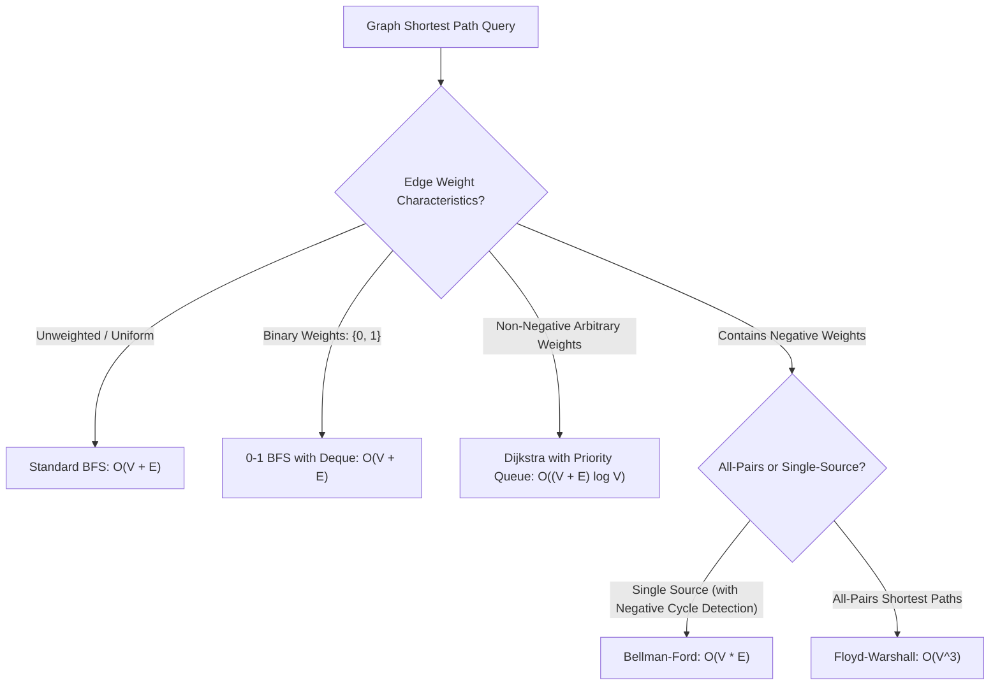

# Data Structures & Algorithms Cheatsheet

A high-density reference covering asymptotic formulas, Master Theorem cases, data structure operation costs, Word-RAM bitwise formulas, and the complete TypeScript $\leftrightarrow$ Python interview translation matrix.

---

## 1. Asymptotic Recurrences & Master Theorem

For divide-and-conquer recurrences: $T(n) = a T(n/b) + f(n)$ where $a \ge 1, b > 1$:
Let $c_{\text{crit}} = \log_b a$. Compare $f(n)$ to $n^{c_{\text{crit}}}$:

| Case | Condition | Form of $f(n)$ | Solution $T(n)$ | Canonical Example |
|---|---|---|---|---|
| **Case 1: Leaves Dominate** | $f(n) = O(n^{c_{\text{crit}} - \epsilon})$ for $\epsilon > 0$ | Subproblems dominate | $\Theta(n^{\log_b a})$ | Strassen Matrix Multiplication: $T(n) = 7T(n/2) + O(n^2) \implies \Theta(n^{\log_2 7}) \approx \Theta(n^{2.807})$ |
| **Case 2: Balanced Tree** | $f(n) = \Theta(n^{c_{\text{crit}}} \log^k n)$ for $k \ge 0$ | Equal work per level | $\Theta(n^{\log_b a} \log^{k+1} n)$ | Merge Sort: $T(n) = 2T(n/2) + \Theta(n) \implies \Theta(n \log n)$ |
| **Case 3: Root Dominates** | $f(n) = \Omega(n^{c_{\text{crit}} + \epsilon})$ & $a f(n/b) \le c f(n)$ | Top level dominates | $\Theta(f(n))$ | Quickselect average: $T(n) = T(n/2) + \Theta(n) \implies \Theta(n)$ |

---

## 2. Word-RAM Bitwise Primitives Cheat Table

All operations assume unsigned 32-bit integer arithmetic coerced via `>>> 0`:

| Desired Bitwise Operation | Bitwise Formula | Explanation & Mechanics |
|---|---|---|
| **Isolate Lowest Set Bit** | `x & (-x)` | In two's complement, zeroes all bits except the lowest 1-bit. |
| **Clear Lowest Set Bit** | `x & (x - 1)` | Flips the lowest 1-bit to 0 (Kernighan's iteration step). |
| **Check if Power of Two** | `x > 0 && (x & (x - 1)) === 0` | A positive power of two contains exactly one set bit. |
| **Circular Advance ($C = 2^k$)** | `(idx + 1) & (C - 1)` | Replaces slow `% C` modulo division with 1-cycle bitmask. |
| **Unsigned 32-bit Midpoint** | `lo + ((hi - lo) >>> 1)` | Prevents signed 32-bit integer overflow when $lo + hi > 2^{31} - 1$. |
| **Bitwise 32-bit Multiplication** | `Math.imul(a, b) >>> 0` | C-like 32-bit hardware multiplication without float precision loss. |
| **Pack 2D Coordinate** | `(r * numCols + c) >>> 0` | Encodes $(r, c)$ in a single integer, eliminating string allocations. |

---

## 3. Core Data Structure Complexities

| Data Structure | Access | Search | Insertion | Deletion | Space |
|---|---|---|---|---|---|
| **Dynamic Array (Vector)** | $O(1)$ | $O(n)$ | $O(1)$ amortized | $O(n)$ | $O(n)$ |
| **Ring-Buffer Deque** | $O(1)$ | $O(n)$ | $O(1)$ front/back | $O(1)$ front/back | $O(n)$ |
| **Doubly Linked List** | $O(n)$ | $O(n)$ | $O(1)$ at node | $O(1)$ at node | $O(n)$ |
| **Hash Table (Open / Chaining)**| N/A | $O(1)$ avg / $O(n)$ worst | $O(1)$ avg / $O(n)$ worst | $O(1)$ avg / $O(n)$ worst | $O(n)$ |
| **Binary Min/Max Heap** | $O(1)$ (peek) | $O(n)$ | $O(\log n)$ | $O(\log n)$ (extract) | $O(n)$ |
| **AVL / Red-Black Tree** | $O(\log n)$ | $O(\log n)$ | $O(\log n)$ | $O(\log n)$ | $O(n)$ |
| **Fenwick Tree (BIT)** | N/A | $O(\log n)$ prefix | $O(\log n)$ point add | N/A | $O(n)$ |
| **Segment Tree** | N/A | $O(\log n)$ range query | $O(\log n)$ point/range | N/A | $O(n)$ |
| **Trie (Prefix Tree)** | N/A | $O(L)$ key length | $O(L)$ key length | $O(L)$ | $O(\Sigma \cdot L)$ |
| **Disjoint Set Union (DSU)** | N/A | $O(\alpha(n))$ `find` | $O(\alpha(n))$ `union` | N/A | $O(n)$ |
| **Bloom Filter** | N/A | $O(k)$ membership | $O(k)$ insert | N/A | $O(m)$ bits |

---

## 4. Graph Algorithm Selection Matrix

---

## 5. TypeScript $\leftrightarrow$ Python Interview Translation Matrix

| Idiom / Operation | TypeScript (Node 26 / V8) | Python (3.14+) |
|---|---|---|
| **Double-Ended Queue** | Custom `CircularDeque` or head index | `from collections import deque` `q = deque(); q.popleft()` |
| **Min Priority Queue** | Custom binary `MinHeap` class | `import heapq` `heapq.heappush(h, val); heapq.heappop(h)` |
| **Max Priority Queue** | Invert values into `MinHeap` | `heapq.heappush(h, -val)` |
| **Binary Search (Lower Bound)** | Custom `while (lo < hi)` loop | `import bisect` `idx = bisect.bisect_left(arr, x)` |
| **Binary Search (Upper Bound)** | Custom `while (lo < hi)` on `> x` | `idx = bisect.bisect_right(arr, x)` |
| **Frequency Counter** | `const counts = new Map<T, number>()` | `from collections import Counter` `c = Counter(nums)` |
| **Default Map** | `map.get(k) ?? defaultVal` | `from collections import defaultdict` `d = defaultdict(list)` |
| **Top-Down Memoization** | Multidimensional array or `Map` | `from functools import cache` `@cache` |
| **Integer Floor Division** | `Math.floor(a / b)` | `a // b` |
| **Positive Modulo** | `((a % m) + m) % m` | `a % m` (Python `%` is always positive) |
| **Integer Hashable Tuple** | `` `${r},${c}` `` or `r * W + c` | `(r, c)` (tuples are natively hashable) |
| **2D Array Initialization** | `Array.from({length: R}, () => new Array(C).fill(0))` | `[[0] * C for _ in range(R)]` *(Avoid `[[0]*C]*R` row aliasing trap!)* |

---

## 6. Critical Production Gotchas Fast Reference

1. **JavaScript Lexicographical Default Sort**:
   `[10, 9, 1].sort()` produces `[1, 10, 9]`. Always provide numeric comparator: `.sort((a, b) => a - b)`.
2. **`queue.shift()` BFS Performance Trap**:
   In V8, shifting a large array is $O(n)$ memory copy. BFS with `queue.shift()` turns $O(V + E)$ into quadratic $O(V^2 + E)$. Use an index pointer `let head = 0` or ring buffer.
3. **Recursive DFS Call-Stack Explosion**:
   V8 default stack limit is ~10,000 frames. Deep graphs ($10^5$ nodes) crash with `RangeError: Maximum call stack size exceeded`. Use iterative DFS with an array stack.
4. **Modulo Sign Anomaly**:
   In JavaScript, `-1 % 5 === -1`. Array bucket lookups using negative remainder produce `undefined` index out-of-bounds. Always normalize: `((val % m) + m) % m`.
5. **Key Collisions with Object Map Keys**:
   In JavaScript, `Map.get([1, 2])` compares by reference identity, not structural value, always returning `undefined`. Pack coordinates into 32-bit numbers (`r * cols + c`).
