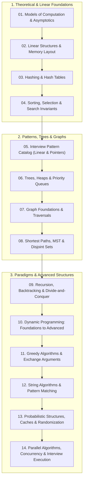

# Data Structures & Algorithms: Computational Mechanics to Staff Engineering

A mathematically grounded, production-verified curriculum in algorithm design, computational complexity, and runtime data structures. Every theoretical concept is accompanied by formal proofs, invariant definitions, and deterministic, executable TypeScript test suites running directly under Node.js 26 without transpilation build steps.

> Verified against Node 26.12.1, TypeScript 7.0.2 on 2026-10-30

---

## 1. Syllabus & Curriculum Structure

The curriculum is structured as a continuous progressive narrative spanning 14 in-depth modules:



### Module Directory
1. [Module 01: Models of Computation & Asymptotic Analysis](modules/01-models-of-computation-and-asymptotics.md): Word-RAM model, Master Theorem, Akra-Bazzi, Amortized Potential Method ($\Phi(D) = 2S - C$), binary search invariants.
2. [Module 02: Linear Data Structures & Memory Layout](modules/02-linear-structures-and-memory-layout.md): Contiguous memory vs pointers, V8 elements kinds, circular ring-buffer Deque, sentinel doubly linked list, bitwise Word-RAM primitives.
3. [Module 03: Hashing, Hash Tables & Rolling Hash](modules/03-hashing-and-hash-tables.md): Separate chaining vs open addressing, Robin Hood hashing with DIB, HashDoS, Carter-Wegman universal hashing, Rabin-Karp.
4. [Module 04: Sorting, Selection & Search Invariants](modules/04-sorting-selection-and-search-invariants.md): $\Omega(n \log n)$ decision tree proof, Quicksort (Lomuto, Hoare, 3-way Dijkstra DNF), TimSort, Quickselect $O(n)$, Binary search on answer.
5. [Module 05: Interview Pattern Catalog (Linear & Pointers)](modules/05-interview-patterns-linear-and-pointers.md): Two pointers opposite/fast-slow, sliding window monotonicity vs negative numbers trap, monotonic stack/queue, prefix sums, Kadane, cyclic sort.
6. [Module 06: Trees, Balanced BSTs & Priority Queues](modules/06-trees-heaps-and-priority-queues.md): Morris in-order traversal $O(1)$ space, AVL vs Red-Black 5 invariants, Binary Heap $O(n)$ `buildHeap` proof, Two-heaps median, Fenwick tree, Tries.
7. [Module 07: Graph Foundations & Traversals](modules/07-graph-foundations-and-traversals.md): Adjacency representations, stack-safe iterative BFS/DFS, edge classification, Kahn's algorithm, Tarjan's SCC, 0-1 BFS, Bipartite coloring.
8. [Module 08: Shortest Paths, MST & Disjoint-Set Union](modules/08-shortest-paths-mst-and-disjoint-sets.md): Dijkstra greedy invariant, Bellman-Ford negative cycle detection, Floyd-Warshall, Kruskal's MST, Prim's MST, DSU with path compression + rank ($O(\alpha(n))$ bound).
9. [Module 09: Recursion, Backtracking & Divide-and-Conquer](modules/09-recursion-backtracking-and-divide-and-conquer.md): State-space tree template choose-explore-unchoose, N-Queens $O(1)$ bitmask pruning, Karatsuba multiplication $O(n^{1.585})$, Meet-in-the-Middle $O(2^{n/2} \cdot n)$.
10. [Module 10: Dynamic Programming: Foundations to Advanced Dimensions](modules/10-dynamic-programming-foundations-to-advanced.md): Optimal substructure, overlapping subproblems DAG, 0/1 vs unbounded knapsack, LIS via Patience Sorting $O(n \log n)$, LCS & Edit Distance, TSP Bitmask DP $O(n^2 2^n)$.
11. [Module 11: Greedy Algorithms & Exchange Arguments](modules/11-greedy-algorithms-and-exchange-arguments.md): Greedy-choice property, formal exchange argument proof schema, Interval scheduling, Huffman coding proof, Jump Game, Gas Station, Matroid theory & Rado-Edmonds, Coin change counterexample.
12. [Module 12: String Algorithms & Pattern Matching](modules/12-string-algorithms-and-pattern-matching.md): KMP prefix function $\pi$, Z-algorithm, Aho-Corasick multi-pattern automaton, Suffix Array & Kasai's $O(n)$ LCP, Manacher's linear $O(n)$ palindrome algorithm.
13. [Module 13: Probabilistic Data Structures, Caches & Randomization](modules/13-probabilistic-data-structures-and-randomized-algorithms.md): Bloom filter error derivation ($p \approx (1 - e^{-kn/m})^k$), Count-Min Sketch Markov bounds, HyperLogLog harmonic mean, $O(1)$ LRU & LFU caches, Consistent Hash Ring & Jump Consistent Hash, Reservoir sampling.
14. [Module 14: Parallel Algorithms, Concurrency & Interview Execution](modules/14-parallel-algorithms-concurrency-and-interview-execution.md): PRAM model, Work-Span analysis ($T_1 / T_\infty$), Brent's Theorem, Lock-free Treiber stack & MS-Queue, CAS mechanics & ABA avoidance, UMPIRE interview framework, TS $\leftrightarrow$ Python matrix.

### Prerequisites

- Working knowledge of basic programming constructs (variables, control flow, functions, recursion).
- Comfort with elementary mathematical notation (summations, logarithms, induction proofs).
- Terminal environment with Node.js 26 and `npm` installed.

### Out of Scope

- **Theoretical Complexity Reductions & NP-Completeness Proofs**: Turing machine reductions, Cook-Levin theorem, and formal language automata belong to academic theoretical computer science.
- **Hardware-Specific Microarchitecture Tuning**: SIMD vectorization intrinsics, cache hierarchy hardware design, and CPU branch predictor implementations belong to systems architecture.
- **Database Engine Internals**: B+ Trees as page-storage layouts on disk, WAL logging, and MVCC are owned by `architecture/data-systems` and `technologies/postgres`.
- **Distributed Consensus Protocols**: Paxos, Raft, and distributed transaction 2PC are owned by `architecture/distributed-systems`.

---

## 2. Certifications & Exams

This track provides preparation for premier academic examinations and senior technical interview loops:

| Examination / Program | Vendor / Institution | Target Level / Format | Syllabus Reference |
|---|---|---|---|
| **MIT 6.1210 (formerly 6.006)** | MIT EECS / CSAIL | Academic Midterm & Final (Written proofs & algorithm design) | [MIT 6.1210 Introduction to Algorithms](https://toc.csail.mit.edu/node/1802) |
| **MIT 6.1220J (formerly 6.046)** | MIT EECS / Mathematics | Advanced Undergraduate / Graduate (Advanced amortized analysis, parallel algorithms, NP-completeness) | [MIT 6.1220J Design and Analysis of Algorithms](https://toc.csail.mit.edu/node/1803) |
| **FAANG Senior/Staff DSA Loop** | Google, Meta, Apple, Amazon | 45–60 min Live Technical Rounds (UMPIRE problem-solving, edge cases, invariants, Big-$O$ proofs) | [DSA Interview Question Bank & Mock Exam](exams/interview.md) |

- **Coverage Matrix**: Complete domain breakdown in [`exams/README.md`](exams/README.md).
- **Question Bank**: 75 original scenario questions with exhaustive distractor explanations and difficulty ratings in [`exams/interview.md`](exams/interview.md).
- **Timed Mock Exam**: 90-minute timed 4-problem examination with detailed scoring keys in [`exams/interview.md#part-2-timed-mock-examination-90-minutes`](exams/interview.md#part-2-timed-mock-examination-90-minutes).

---

## 3. Fast Reference & Glossaries

- **[CHEATSHEET.md](CHEATSHEET.md)**: High-density lookup table for Master Theorem cases, data structure operation costs, bitwise formulas, and the TypeScript $\leftrightarrow$ Python live coding translation table.
- **[GLOSSARY.md](GLOSSARY.md)**: Bilingual English ↔ Czech algorithmic terminology index anchored in canonical literature.

---

## 4. Runnable Instructions & Verification

All code examples and test suites run natively under Node.js 26 using Node's built-in test runner (`node:test`) and type stripping (`--experimental-strip-types` enabled by default in Node 26):

```bash
# Enter track directory
cd algorithms/dsa

# Install pinned development dependencies (fast-check property testing)
mise exec -- npm install

# Run the complete test suite (68 tests across 9 test suites)
mise exec -- npm test

# Run strict TypeScript type verification (zero emit)
mise exec -- npm run typecheck

# Verify all Mermaid diagrams parse across Mermaid 11 & 12
node ../../tools/mermaid-check/check.mjs .
```
