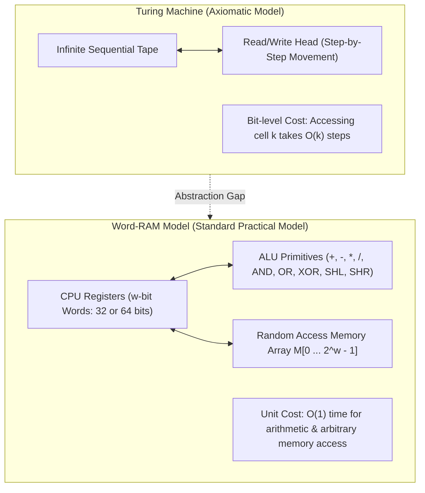
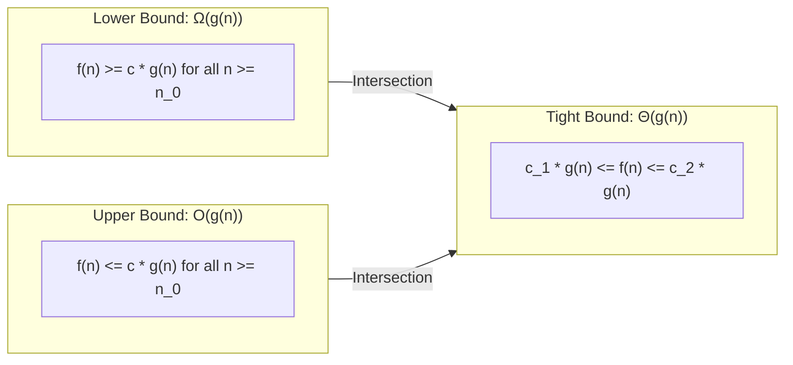
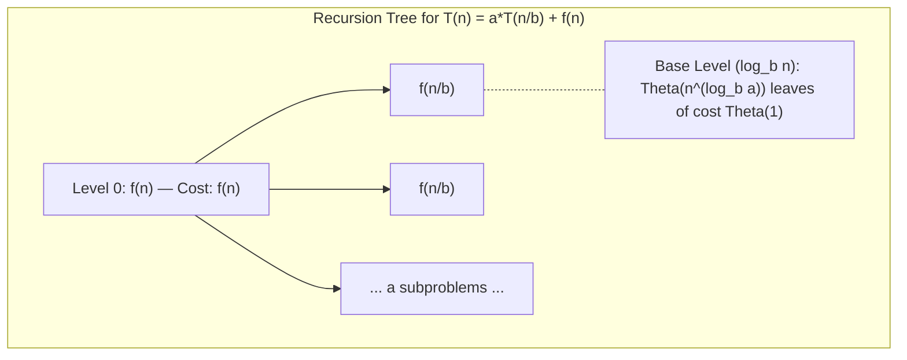
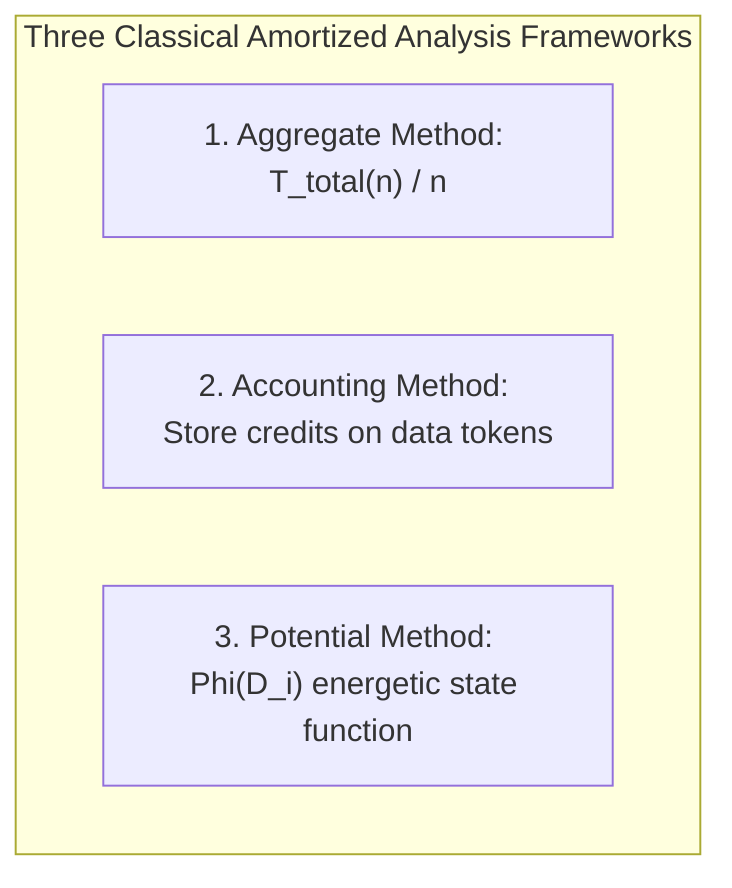
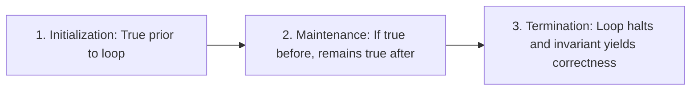

# Module 01 — Models of Computation, Asymptotics & Recurrences

The mathematical analysis of algorithms requires a rigorous foundation that abstracts hardware specifics while accurately predicting empirical running time and memory consumption. This module establishes the formal computational models, asymptotic notations, recurrence-solving methods, and amortized potential functions that govern all algorithmic design.

---

## 1. Models of Computation: Turing Machine vs Word-RAM

Theoretical computer science analyzes algorithms under formal models that define the primitive operations and their costs.



### The Word-RAM Model
In modern software engineering and algorithm design (including CLRS and MIT 6.1210), algorithms are evaluated on the **Word-RAM (Random Access Machine)** model:
1. **Word Size ($w$)**: The computer operates on words of $w$ bits, where $w \ge \log_2 n$ for an input of size $n$. On 64-bit architectures, $w = 64$. This ensures a single word can store an array index or pointer addressing any memory location.
2. **Unit-Cost Operations ($O(1)$)**:
   - Arithmetic: Addition, subtraction, multiplication, integer division, modulo (`+`, `-`, `*`, `/`, `%`).
   - Bitwise Operations: Bitwise AND, OR, XOR, NOT, left/right shifts (`&`, `|`, `^`, `~`, `<<`, `>>`, `>>>`).
   - Memory Access: Reading or writing `Memory[address]` for any $w$-bit pointer takes exactly $O(1)$ time.
   - Comparison: Testing $a < b$, $a = b$, or $a > b$.

> [!WARNING] The Multiplication and Word Size Trap
> While addition and subtraction are strictly linear in bit length, integer multiplication $a \times b$ on numbers exceeding $w$ bits requires multi-precision arithmetic ($O(k \log k)$ via Harvey-Hoeven or Karatsuba $O(k^{1.585})$). In the Word-RAM model, $w$-bit multiplication is defined as $O(1)$, but treating numbers of arbitrary size (such as JavaScript `BigInt` or Python integers) as $O(1)$ creates incorrect complexity proofs.

---

## 2. Asymptotic Notations: Formal Set-Theoretic Definitions

Asymptotic analysis describes the limiting behavior of execution time or space as input size $n \to \infty$. Formally, asymptotic notations represent **sets of functions**.



### Mathematical Definitions
Let $f(n)$ and $g(n)$ be functions mapping $\mathbb{N} \to \mathbb{R}^+$.

1. **Big-$O$ (Asymptotic Upper Bound)**:
   $$O(g(n)) = \left\{ f(n) : \exists c > 0, n_0 > 0 \text{ such that } 0 \le f(n) \le c \cdot g(n) \quad \forall n \ge n_0 \right\}$$
   We say $f(n) \in O(g(n))$ (commonly written $f(n) = O(g(n))$) if $g(n)$ provides an asymptotic ceiling on $f(n)$.

2. **Big-$\Omega$ (Asymptotic Lower Bound)**:
   $$\Omega(g(n)) = \left\{ f(n) : \exists c > 0, n_0 > 0 \text{ such that } 0 \le c \cdot g(n) \le f(n) \quad \forall n \ge n_0 \right\}$$
   $g(n)$ provides an asymptotic floor on the algorithm's running time.

3. **Big-$\Theta$ (Asymptotic Tight Bound)**:
   $$\Theta(g(n)) = \left\{ f(n) : \exists c_1 > 0, c_2 > 0, n_0 > 0 \text{ such that } 0 \le c_1 \cdot g(n) \le f(n) \le c_2 \cdot g(n) \quad \forall n \ge n_0 \right\}$$
   **Theorem**: $f(n) = \Theta(g(n)) \iff f(n) = O(g(n)) \land f(n) = \Omega(g(n))$.

4. **Little-$o$ (Strict Asymptotic Upper Bound)**:
   $$o(g(n)) = \left\{ f(n) : \forall c > 0, \exists n_0 > 0 \text{ such that } 0 \le f(n) < c \cdot g(n) \quad \forall n \ge n_0 \right\}$$
   Equivalently, $\lim_{n \to \infty} \frac{f(n)}{g(n)} = 0$.

5. **Little-$\omega$ (Strict Asymptotic Lower Bound)**:
   $$\omega(g(n)) = \left\{ f(n) : \forall c > 0, \exists n_0 > 0 \text{ such that } 0 \le c \cdot g(n) < f(n) \quad \forall n \ge n_0 \right\}$$
   Equivalently, $\lim_{n \to \infty} \frac{f(n)}{g(n)} = \infty$.

### Complexity Hierarchy
$$O(1) < O(\log \log n) < O(\log n) < O(\sqrt{n}) < O(n) < O(n \log n) < O(n^2) < O(n^3) < O(2^n) < O(n!) < O(n^n)$$

---

## 3. Solving Recurrences

Divide-and-conquer algorithms generate recursive relations of the form $T(n) = a T(n/b) + f(n)$.



### The Master Theorem (CLRS 4th Edition)
For recurrences of the form:
$$T(n) = a T\left(\frac{n}{b}\right) + f(n), \quad a \ge 1, b > 1$$
We compare $f(n)$ asymptotically with the watershed function $n^{\log_b a}$:

| Case | Condition | Intuition | Solution |
| :---: | :--- | :--- | :---: |
| **Case 1** | $f(n) = O(n^{\log_b a - \epsilon})$ for some constant $\epsilon > 0$ | Work is dominated by the leaves of the tree | $T(n) = \Theta(n^{\log_b a})$ |
| **Case 2** | $f(n) = \Theta(n^{\log_b a} \log^k n)$ for some $k \ge 0$ | Work is evenly distributed across all tree levels | $T(n) = \Theta(n^{\log_b a} \log^{k+1} n)$ |
| **Case 3** | $f(n) = \Omega(n^{\log_b a + \epsilon})$ for $\epsilon > 0$ AND regularity holds ($a f(n/b) \le c f(n)$ for $c < 1$) | Work is dominated by the root node | $T(n) = \Theta(f(n))$ |

### Classical Master Theorem Examples
1. **Merge Sort**: $T(n) = 2 T(n/2) + \Theta(n)$.
   $a = 2, b = 2 \implies n^{\log_2 2} = n^1 = n$. Since $f(n) = \Theta(n)$, Case 2 applies with $k = 0$:
   $$T(n) = \Theta(n \log n)$$

2. **Binary Search**: $T(n) = T(n/2) + \Theta(1)$.
   $a = 1, b = 2 \implies n^{\log_2 1} = n^0 = 1$. Since $f(n) = \Theta(1)$, Case 2 applies:
   $$T(n) = \Theta(\log n)$$

3. **Karatsuba Integer Multiplication**: $T(n) = 3 T(n/2) + \Theta(n)$.
   $a = 3, b = 2 \implies n^{\log_2 3} \approx n^{1.585}$. Since $f(n) = O(n) = O(n^{1.585 - 0.585})$, Case 1 applies:
   $$T(n) = \Theta(n^{\log_2 3}) \approx \Theta(n^{1.585})$$

4. **Strassen's Matrix Multiplication**: $T(n) = 7 T(n/2) + \Theta(n^2)$.
   $a = 7, b = 2 \implies n^{\log_2 7} \approx n^{2.807}$. Case 1 applies:
   $$T(n) = \Theta(n^{\log_2 7}) \approx \Theta(n^{2.807})$$

### When Master Theorem Fails: Akra-Bazzi Formula
When subproblems have unequal divisions (e.g., $T(n) = T(n/3) + T(2n/3) + \Theta(n)$), the Master Theorem does not apply. The **Akra-Bazzi method** solves general recurrences:
$$T(x) = \sum_{i=1}^k a_i T(b_i x) + g(x)$$
Find the unique real value $p$ such that $\sum_{i=1}^k a_i b_i^p = 1$. Then:
$$T(x) = \Theta\left(x^p \left(1 + \int_1^x \frac{g(u)}{u^{p+1}} \, du\right)\right)$$
For $T(n) = T(n/3) + T(2n/3) + n$: $(1/3)^p + (2/3)^p = 1 \implies p = 1$. Evaluating the integral yields $T(n) = \Theta(n \log n)$.

---

## 4. Amortized Analysis: Aggregate, Accounting, and Potential Methods

Amortized analysis guarantees the average performance of each operation over a worst-case sequence of operations. Unlike average-case analysis, **no probability distribution is assumed**.



### Case Study: Dynamic Array Resizing (Vector / ArrayList)
A dynamic array doubles its capacity whenever an element is inserted into a full buffer.
- When array size $i - 1$ is a power of 2, insertion costs $O(i)$ (allocating $2i$ memory and copying $i$ elements).
- Otherwise, insertion costs $O(1)$.

#### 1. Aggregate Method
For a sequence of $n$ insertions starting from capacity 1:
- Normal insertions cost 1 unit each $\implies n$ units.
- Resizing copies occur at sizes $1, 2, 4, 8, \dots, 2^{\lfloor \log_2 n \rfloor}$.
Total cost:
$$T(n) \le n + \sum_{j=0}^{\lfloor \log_2 n \rfloor} 2^j = n + (2^{\lfloor \log_2 n \rfloor + 1} - 1) < n + 2n = 3n$$
Amortized cost per operation:
$$\hat{c} = \frac{T(n)}{n} < \frac{3n}{n} = 3 = O(1)$$

#### 2. Accounting Method
We assign an amortized charge $\hat{c}_i = 3$ credits to each insertion:
- 1 credit pays for the immediate insertion into the array slot.
- 1 credit is stored with the newly inserted element.
- 1 credit is stored with an older element that already had its credit spent.
When the array fills up at capacity $k$ and must resize to $2k$, exactly $k/2$ elements were inserted since the last resize. Each contributed 2 stored credits, totaling $2 \times (k/2) = k$ credits. This exactly pays for copying all $k$ elements to the new buffer. The credit bank never drops below zero.

#### 3. Potential Method (Physicist's Method)
Define a potential function $\Phi(D)$ mapping the data structure state $D$ to a real number such that $\Phi(D_0) = 0$ and $\Phi(D_i) \ge 0$ for all $i$.
The amortized cost $\hat{c}_i$ of the $i$-th operation is:
$$\hat{c}_i = c_i + \Phi(D_i) - \Phi(D_{i-1})$$
Summing across $n$ operations:
$$\sum_{i=1}^n \hat{c}_i = \sum_{i=1}^n \left(c_i + \Phi(D_i) - \Phi(D_{i-1})\right) = \sum_{i=1}^n c_i + \Phi(D_n) - \Phi(D_0)$$
Since $\Phi(D_n) \ge \Phi(D_0)$, the total amortized cost serves as an upper bound on actual cost:
$$\sum_{i=1}^n c_i \le \sum_{i=1}^n \hat{c}_i$$

For a dynamic array with size $S$ and capacity $C$:
$$\Phi(D) = 2S - C$$
- Initially: $S = 0, C = 0 \implies \Phi(D_0) = 0$.
- Right after doubling: $C = 2S \implies \Phi(D) = 2S - 2S = 0 \ge 0$.
- Right before doubling: $S = C \implies \Phi(D) = 2C - C = C \ge 0$. Thus $\Phi(D_i) \ge 0$ always.

Now compute amortized cost $\hat{c}_i$:
- **Case A: Insertion without resize** ($c_i = 1$, $S_i = S_{i-1} + 1$, $C_i = C_{i-1}$):
  $$\hat{c}_i = 1 + (2(S_{i-1} + 1) - C_{i-1}) - (2S_{i-1} - C_{i-1}) = 1 + 2 = 3$$
- **Case B: Insertion triggering resize** ($S_{i-1} = C_{i-1}$, $c_i = S_{i-1} + 1$, $C_i = 2 C_{i-1}$):
  $$\hat{c}_i = (S_{i-1} + 1) + (2(S_{i-1} + 1) - 2S_{i-1}) - (2S_{i-1} - S_{i-1})$$
  $$\hat{c}_i = S_{i-1} + 1 + 2 - S_{i-1} = 3$$
In both cases, $\hat{c}_i = 3 = O(1)$.

---

## 5. Loop Invariants & Correctness Proofs

A **Loop Invariant** is a formal predicate about program variables that is true before and after each iteration of a loop. Proving an algorithm correct via a loop invariant mirrors mathematical induction:



### Canonical Proof: Binary Search Lower Bound
Given a sorted array $A[0 \dots n-1]$ and target $x$:

```typescript
function lowerBound(A: number[], x: number): number {
  let left = 0;
  let right = A.length; // Range is [left, right)

  // Invariant: A[i] < x for all i < left
  //            A[j] >= x for all j >= right
  while (left < right) {
    const mid = left + Math.floor((right - left) / 2);
    if (A[mid]! < x) {
      left = mid + 1;
    } else {
      right = mid;
    }
  }
  return left;
}
```

1. **Initialization**: Before the first iteration, `left = 0`, `right = n`.
   - $i < 0$ is vacuously true.
   - $j \ge n$ is vacuously true.
2. **Maintenance**: Assume the invariant holds at the start of an iteration. Let `mid = left + Math.floor((right - left) / 2)`.
   - If `A[mid] < x`: Since $A$ is sorted, $A[k] \le A[mid] < x$ for all $k \le mid$. Setting `left = mid + 1` preserves $A[i] < x$ for all $i < left$.
   - If `A[mid] >= x`: Since $A$ is sorted, $A[k] \ge A[mid] \ge x$ for all $k \ge mid$. Setting `right = mid` preserves $A[j] \ge x$ for all $j \ge right$.
3. **Termination**: The loop terminates when `left >= right`. Because `right - left` strictly decreases on every iteration, `left === right`.
   By the invariant, all elements strictly before `left` are $< x$, and all elements starting at `left` are $\ge x$. Thus, `left` is the exact first index where $A[\text{left}] \ge x$, proving algorithmic correctness.

---

## 6. Interview Drill: Models of Computation & Asymptotics

<details>
<summary>1. Is it true that f(n) = O(g(n)) implies g(n) = Ω(f(n))? Provide a formal proof.</summary>

**Yes.** By definition, $f(n) = O(g(n))$ means there exist constants $c > 0$ and $n_0 > 0$ such that $0 \le f(n) \le c \cdot g(n)$ for all $n \ge n_0$.
Dividing by $c$ (since $c > 0$):
$$\frac{1}{c} \cdot f(n) \le g(n) \implies g(n) \ge c' \cdot f(n) \quad \text{where } c' = \frac{1}{c} > 0$$
This satisfies the definition of $g(n) \in \Omega(f(n))$ with constant $c' = 1/c$ and threshold $n_0$.
</details>

<details>
<summary>2. Why does computing mid = (left + right) / 2 represent a dangerous bug in production systems, and how is it corrected?</summary>

In fixed-width integer arithmetic (such as 32-bit signed integers in Java, C++, or Rust, and 32-bit bitwise math in JavaScript), if `left` and `right` are both large (e.g. `left = 1.5e9`, `right = 1.8e9`), their sum $left + right = 3.3 \times 10^9$ exceeds $2^{31} - 1 = 2,147,483,647$. This causes integer overflow into negative values, resulting in an out-of-bounds array access.
The correct calculation is:
$$\text{mid} = \text{left} + \left\lfloor \frac{\text{right} - \text{left}}{2} \right\rfloor$$
In JavaScript/TypeScript with 64-bit IEEE 754 floats, safe integers extend to $2^{53} - 1$, but using `left + Math.floor((right - left) / 2)` or `(left + right) >>> 1` is standard practice to preserve portability and prevent overflow.
</details>

<details>
<summary>3. Can the Master Theorem solve T(n) = 2T(n/2) + n log n? Explain why or why not.</summary>

**No, standard Case 3 of the classical Master Theorem does not apply directly.**
Here $a = 2, b = 2 \implies n^{\log_2 2} = n^1 = n$.
The non-recursive work is $f(n) = n \log n$.
Although $f(n)$ is asymptotically larger than $n$, it is not **polynomially** larger: $\frac{f(n)}{n^{\log_b a}} = \frac{n \log n}{n} = \log n$, which is strictly slower than $n^\epsilon$ for any $\epsilon > 0$.
However, the **Extended Master Theorem (Case 2 generalized)** handles $f(n) = \Theta(n^{\log_b a} \log^k n)$.
Here $k = 1$, so:
$$T(n) = \Theta(n^{\log_b a} \log^{k+1} n) = \Theta(n \log^2 n)$$
</details>

<details>
<summary>4. What is the amortized cost per pop operation in a dynamic array that halves its capacity when size reaches capacity / 4?</summary>

The amortized cost is $O(1)$.
If we halved capacity when size reached $C/2$, an adversary could alternate between inserting and deleting around the boundary, forcing repeated $O(n)$ reallocations and degrading amortized cost to $O(n)$.
By waiting until $S = C/4$ before shrinking to $C/2$, the array is guaranteed to have at least $C/4$ elements of headroom before it can double or halve again.
Using the potential function:
$$\Phi(D) = \begin{cases} 2S - C & \text{if } S \ge C/2 \\ C/2 - S & \text{if } S < C/2 \end{cases}$$
The potential is 0 immediately after halving and grows to $C/4$ before the next resize, providing sufficient stored credits to absorb the $O(S)$ copying cost.
</details>

<details>
<summary>5. Explain the difference between worst-case analysis and amortized analysis.</summary>

- **Worst-case analysis** bounds the execution cost of a **single** invocation of an operation under the most adversarial possible input. For example, a single insertion into a dynamic array has a worst-case cost of $O(n)$ due to buffer copying.
- **Amortized analysis** bounds the **average cost per operation over any arbitrary sequence of operations** in the worst case. Even if a single insertion takes $O(n)$, any sequence of $k$ operations is guaranteed to run in $O(k)$ total time, yielding an amortized cost of $O(1)$ per operation.
- Unlike average-case analysis, amortized analysis makes no probabilistic assumptions about the input distribution.
</details>
