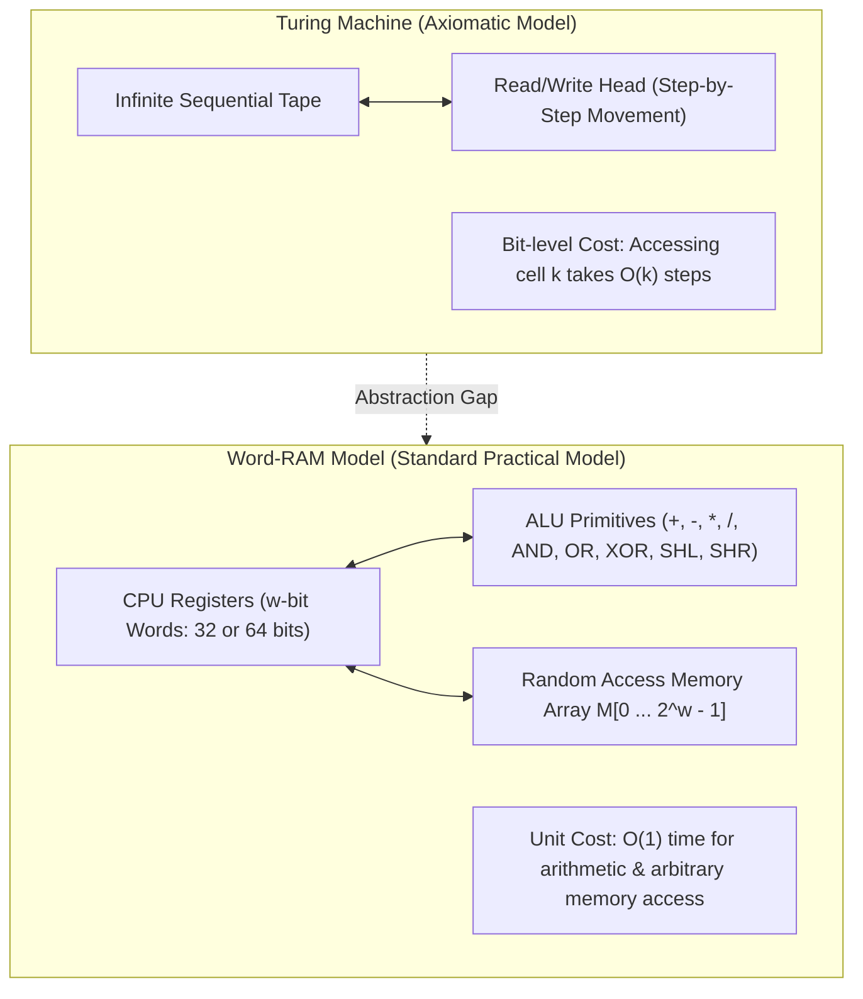
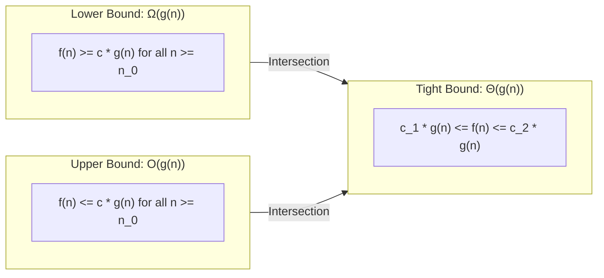
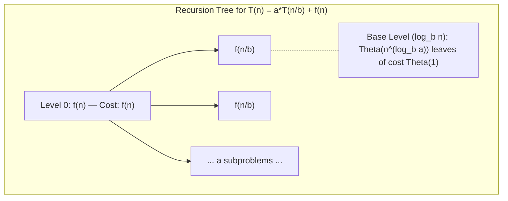
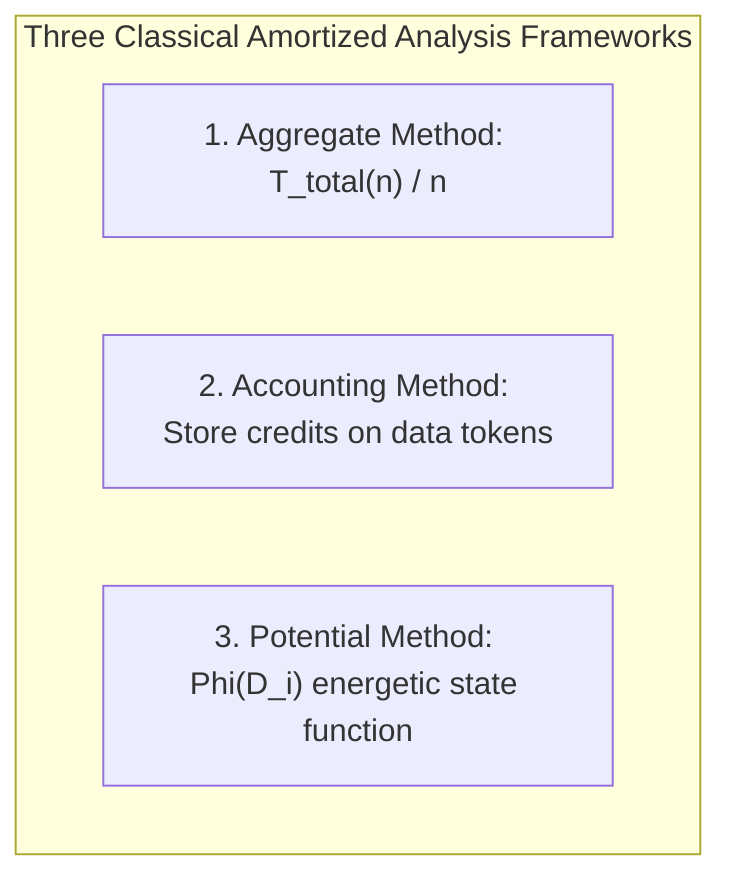
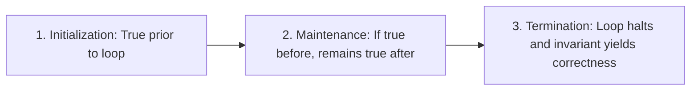
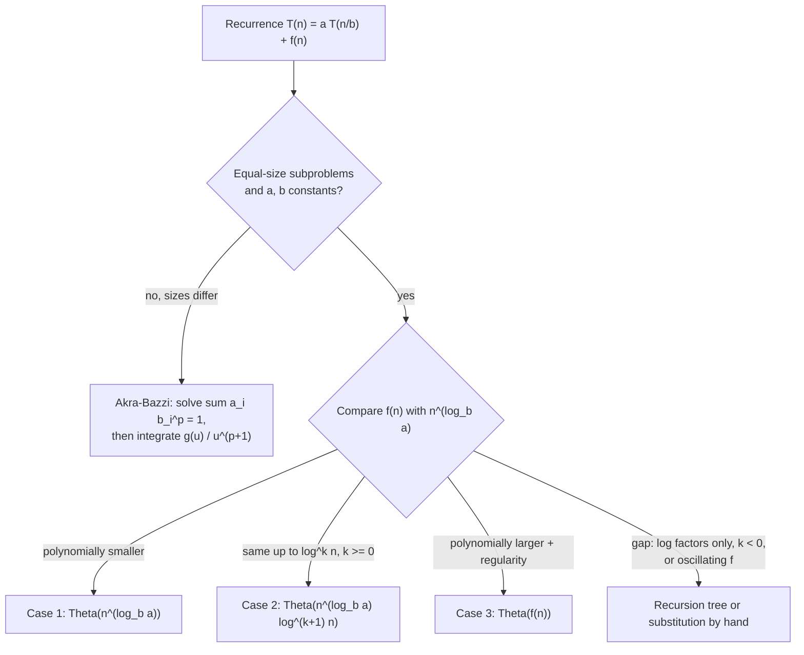

# Module 01 — Models of Computation, Asymptotics & Recurrences

The mathematical analysis of algorithms requires a rigorous foundation that abstracts hardware specifics while accurately predicting empirical running time and memory consumption. This module establishes the formal computational models, asymptotic notations, recurrence-solving methods, and amortized potential functions that govern all algorithmic design.

---

## 1. Models of Computation: Turing Machine vs Word-RAM

Theoretical computer science analyzes algorithms under formal models that define the primitive operations and their costs.



### The Word-RAM Model

In modern software engineering and algorithm design (including CLRS and MIT 6.1210), algorithms are evaluated on the **Word-RAM (Random Access Machine)** model:

1. **Word Size ($w$)**: The computer operates on words of $w$ bits, where $w \ge \log_2 n$ for an input of size $n$. On 64-bit architectures, $w = 64$. This ensures a single word can store an array index or pointer addressing any memory location.
2. **Unit-Cost Operations ($O(1)$)**:
   - Arithmetic: Addition, subtraction, multiplication, integer division, modulo (`+`, `-`, `*`, `/`, `%`).
   - Bitwise Operations: Bitwise AND, OR, XOR, NOT, left/right shifts (`&`, `|`, `^`, `~`, `<<`, `>>`, `>>>`).
   - Memory Access: Reading or writing `Memory[address]` for any $w$-bit pointer takes exactly $O(1)$ time.
   - Comparison: Testing $a < b$, $a = b$, or $a > b$.

> [!WARNING]
> **The Multiplication and Word Size Trap** While addition and subtraction are strictly linear in bit length, integer multiplication $a \times b$ on numbers exceeding $w$ bits requires multi-precision arithmetic ($O(k \log k)$ via Harvey-Hoeven or Karatsuba $O(k^{1.585})$). In the Word-RAM model, $w$-bit multiplication is defined as $O(1)$, but treating numbers of arbitrary size (such as JavaScript `BigInt` or Python integers) as $O(1)$ creates incorrect complexity proofs.

---

## 2. Asymptotic Notations: Formal Set-Theoretic Definitions

Asymptotic analysis describes the limiting behavior of execution time or space as input size $n \to \infty$. Formally, asymptotic notations represent **sets of functions**.



### Mathematical Definitions

Let $f(n)$ and $g(n)$ be functions mapping $\mathbb{N} \to \mathbb{R}^+$.

1. **Big-$O$ (Asymptotic Upper Bound)**: $$O(g(n)) = \left\{ f(n) : \exists c > 0, n_0 > 0 \text{ such that } 0 \le f(n) \le c \cdot g(n) \quad \forall n \ge n_0 \right\}$$ We say $f(n) \in O(g(n))$ (commonly written $f(n) = O(g(n))$) if $g(n)$ provides an asymptotic ceiling on $f(n)$.

2. **Big-$\Omega$ (Asymptotic Lower Bound)**: $$\Omega(g(n)) = \left\{ f(n) : \exists c > 0, n_0 > 0 \text{ such that } 0 \le c \cdot g(n) \le f(n) \quad \forall n \ge n_0 \right\}$$ $g(n)$ provides an asymptotic floor on the algorithm's running time.

3. **Big-$\Theta$ (Asymptotic Tight Bound)**: $$\Theta(g(n)) = \left\{ f(n) : \exists c_1 > 0, c_2 > 0, n_0 > 0 \text{ such that } 0 \le c_1 \cdot g(n) \le f(n) \le c_2 \cdot g(n) \quad \forall n \ge n_0 \right\}$$ **Theorem**: $f(n) = \Theta(g(n)) \iff f(n) = O(g(n)) \land f(n) = \Omega(g(n))$.

4. **Little-$o$ (Strict Asymptotic Upper Bound)**: $$o(g(n)) = \left\{ f(n) : \forall c > 0, \exists n_0 > 0 \text{ such that } 0 \le f(n) < c \cdot g(n) \quad \forall n \ge n_0 \right\}$$ Equivalently, $\lim_{n \to \infty} \frac{f(n)}{g(n)} = 0$.

5. **Little-$\omega$ (Strict Asymptotic Lower Bound)**: $$\omega(g(n)) = \left\{ f(n) : \forall c > 0, \exists n_0 > 0 \text{ such that } 0 \le c \cdot g(n) < f(n) \quad \forall n \ge n_0 \right\}$$ Equivalently, $\lim_{n \to \infty} \frac{f(n)}{g(n)} = \infty$.

### Complexity Hierarchy

$$O(1) < O(\log \log n) < O(\log n) < O(\sqrt{n}) < O(n) < O(n \log n) < O(n^2) < O(n^3) < O(2^n) < O(n!) < O(n^n)$$

---

## 3. Solving Recurrences

Divide-and-conquer algorithms generate recursive relations of the form $T(n) = a T(n/b) + f(n)$.



### The Master Theorem (CLRS 4th Edition)

For recurrences of the form: $$T(n) = a T\left(\frac{n}{b}\right) + f(n), \quad a \ge 1, b > 1$$ We compare $f(n)$ asymptotically with the watershed function $n^{\log_b a}$:

| Case | Condition | Intuition | Solution |
| :-: | :-- | :-- | :-: |
| **Case 1** | $f(n) = O(n^{\log_b a - \epsilon})$ for some constant $\epsilon > 0$ | Work is dominated by the leaves of the tree | $T(n) = \Theta(n^{\log_b a})$ |
| **Case 2** | $f(n) = \Theta(n^{\log_b a} \log^k n)$ for some $k \ge 0$ | Work is evenly distributed across all tree levels | $T(n) = \Theta(n^{\log_b a} \log^{k+1} n)$ |
| **Case 3** | $f(n) = \Omega(n^{\log_b a + \epsilon})$ for $\epsilon > 0$ AND regularity holds ($a f(n/b) \le c f(n)$ for $c < 1$) | Work is dominated by the root node | $T(n) = \Theta(f(n))$ |

### Classical Master Theorem Examples

1. **Merge Sort**: $T(n) = 2 T(n/2) + \Theta(n)$. $a = 2, b = 2 \implies n^{\log_2 2} = n^1 = n$. Since $f(n) = \Theta(n)$, Case 2 applies with $k = 0$: $$T(n) = \Theta(n \log n)$$

2. **Binary Search**: $T(n) = T(n/2) + \Theta(1)$. $a = 1, b = 2 \implies n^{\log_2 1} = n^0 = 1$. Since $f(n) = \Theta(1)$, Case 2 applies: $$T(n) = \Theta(\log n)$$

3. **Karatsuba Integer Multiplication**: $T(n) = 3 T(n/2) + \Theta(n)$. $a = 3, b = 2 \implies n^{\log_2 3} \approx n^{1.585}$. Since $f(n) = O(n) = O(n^{1.585 - 0.585})$, Case 1 applies: $$T(n) = \Theta(n^{\log_2 3}) \approx \Theta(n^{1.585})$$

4. **Strassen's Matrix Multiplication**: $T(n) = 7 T(n/2) + \Theta(n^2)$. $a = 7, b = 2 \implies n^{\log_2 7} \approx n^{2.807}$. Case 1 applies: $$T(n) = \Theta(n^{\log_2 7}) \approx \Theta(n^{2.807})$$

### When Master Theorem Fails: Akra-Bazzi Formula

When subproblems have unequal divisions (e.g., $T(n) = T(n/3) + T(2n/3) + \Theta(n)$), the Master Theorem does not apply. The **Akra-Bazzi method** solves general recurrences: $$T(x) = \sum_{i=1}^k a_i T(b_i x) + g(x)$$ Find the unique real value $p$ such that $\sum_{i=1}^k a_i b_i^p = 1$. Then: $$T(x) = \Theta\left(x^p \left(1 + \int_1^x \frac{g(u)}{u^{p+1}} \, du\right)\right)$$ For $T(n) = T(n/3) + T(2n/3) + n$: $(1/3)^p + (2/3)^p = 1 \implies p = 1$. Evaluating the integral yields $T(n) = \Theta(n \log n)$.

---

## 4. Amortized Analysis: Aggregate, Accounting, and Potential Methods

Amortized analysis guarantees the average performance of each operation over a worst-case sequence of operations. Unlike average-case analysis, **no probability distribution is assumed**.



### Case Study: Dynamic Array Resizing (Vector / ArrayList)

A dynamic array doubles its capacity whenever an element is inserted into a full buffer.

- When array size $i - 1$ is a power of 2, insertion costs $O(i)$ (allocating $2i$ memory and copying $i$ elements).
- Otherwise, insertion costs $O(1)$.

#### 1. Aggregate Method

For a sequence of $n$ insertions starting from capacity 1:

- Normal insertions cost 1 unit each $\implies n$ units.
- Resizing copies occur at sizes $1, 2, 4, 8, \dots, 2^{\lfloor \log_2 n \rfloor}$. Total cost: $$T(n) \le n + \sum_{j=0}^{\lfloor \log_2 n \rfloor} 2^j = n + (2^{\lfloor \log_2 n \rfloor + 1} - 1) < n + 2n = 3n$$ Amortized cost per operation: $$\hat{c} = \frac{T(n)}{n} < \frac{3n}{n} = 3 = O(1)$$

#### 2. Accounting Method

We assign an amortized charge $\hat{c}_i = 3$ credits to each insertion:

- 1 credit pays for the immediate insertion into the array slot.
- 1 credit is stored with the newly inserted element.
- 1 credit is stored with an older element that already had its credit spent. When the array fills up at capacity $k$ and must resize to $2k$, exactly $k/2$ elements were inserted since the last resize. Each contributed 2 stored credits, totaling $2 \times (k/2) = k$ credits. This exactly pays for copying all $k$ elements to the new buffer. The credit bank never drops below zero.

#### 3. Potential Method (Physicist's Method)

Define a potential function $\Phi(D)$ mapping the data structure state $D$ to a real number such that $\Phi(D_0) = 0$ and $\Phi(D_i) \ge 0$ for all $i$. The amortized cost $\hat{c}_i$ of the $i$-th operation is: $$\hat{c}_i = c_i + \Phi(D_i) - \Phi(D_{i-1})$$ Summing across $n$ operations: $$\sum_{i=1}^n \hat{c}_i = \sum_{i=1}^n \left(c_i + \Phi(D_i) - \Phi(D_{i-1})\right) = \sum_{i=1}^n c_i + \Phi(D_n) - \Phi(D_0)$$ Since $\Phi(D_n) \ge \Phi(D_0)$, the total amortized cost serves as an upper bound on actual cost: $$\sum_{i=1}^n c_i \le \sum_{i=1}^n \hat{c}_i$$

For a dynamic array with size $S$ and capacity $C$: $$\Phi(D) = 2S - C$$

- Initially: $S = 0, C = 0 \implies \Phi(D_0) = 0$.
- Right after doubling: $C = 2S \implies \Phi(D) = 2S - 2S = 0 \ge 0$.
- Right before doubling: $S = C \implies \Phi(D) = 2C - C = C \ge 0$. Thus $\Phi(D_i) \ge 0$ always.

Now compute amortized cost $\hat{c}_i$:

- **Case A: Insertion without resize** ($c_i = 1$, $S_i = S_{i-1} + 1$, $C_i = C_{i-1}$): $$\hat{c}_i = 1 + (2(S_{i-1} + 1) - C_{i-1}) - (2S_{i-1} - C_{i-1}) = 1 + 2 = 3$$
- **Case B: Insertion triggering resize** ($S_{i-1} = C_{i-1}$, $c_i = S_{i-1} + 1$, $C_i = 2 C_{i-1}$): $$\hat{c}_i = (S_{i-1} + 1) + (2(S_{i-1} + 1) - 2S_{i-1}) - (2S_{i-1} - S_{i-1})$$ $$\hat{c}_i = S_{i-1} + 1 + 2 - S_{i-1} = 3$$ In both cases, $\hat{c}_i = 3 = O(1)$.

---

## 5. Loop Invariants & Correctness Proofs

A **Loop Invariant** is a formal predicate about program variables that is true before and after each iteration of a loop. Proving an algorithm correct via a loop invariant mirrors mathematical induction:



### Canonical Proof: Binary Search Lower Bound

Given a sorted array $A[0 \dots n-1]$ and target $x$:

```typescript
function lowerBound(A: number[], x: number): number {
  let left = 0;
  let right = A.length; // Range is [left, right)

  // Invariant: A[i] < x for all i < left
  //            A[j] >= x for all j >= right
  while (left < right) {
    const mid = left + Math.floor((right - left) / 2);
    if (A[mid]! < x) {
      left = mid + 1;
    } else {
      right = mid;
    }
  }
  return left;
}
```

1. **Initialization**: Before the first iteration, `left = 0`, `right = n`.
   - $i < 0$ is vacuously true.
   - $j \ge n$ is vacuously true.
2. **Maintenance**: Assume the invariant holds at the start of an iteration. Let `mid = left + Math.floor((right - left) / 2)`.
   - If `A[mid] < x`: Since $A$ is sorted, $A[k] \le A[mid] < x$ for all $k \le mid$. Setting `left = mid + 1` preserves $A[i] < x$ for all $i < left$.
   - If `A[mid] >= x`: Since $A$ is sorted, $A[k] \ge A[mid] \ge x$ for all $k \ge mid$. Setting `right = mid` preserves $A[j] \ge x$ for all $j \ge right$.
3. **Termination**: The loop terminates when `left >= right`. Because `right - left` strictly decreases on every iteration, `left === right`. By the invariant, all elements strictly before `left` are $< x$, and all elements starting at `left` are $\ge x$. Thus, `left` is the exact first index where $A[\text{left}] \ge x$, proving algorithmic correctness.

---

## 6. Why the Master Theorem Is True: A Proof Sketch

Section 3 stated the three cases; this section derives them so the case conditions are not magic. Work on exact powers of $b$ (CLRS 4e §4.6 gives the full proof for the continuous recurrence; the floor and ceiling bookkeeping is a routine but tedious extension (section numbers `unverified`)). Unrolling $T(n) = a\,T(n/b) + f(n)$ for $\log_b n$ levels gives

$$T(n) = \underbrace{\Theta\!\left(n^{\log_b a}\right)}_{\text{leaves: } a^{\log_b n} = n^{\log_b a}} + \underbrace{\sum_{j=0}^{\log_b n - 1} a^j f\!\left(n/b^j\right)}_{g(n):\ \text{internal work, level by level}}$$

Level $j$ has $a^j$ nodes, each doing $f(n/b^j)$ work. The three cases are exactly the three ways the geometric-like series $g(n)$ can behave.

| Regime | Behaviour of level cost $a^j f(n/b^j)$ as $j$ grows | Sum $g(n)$ | Winner |
| :-- | :-- | :-- | :-- |
| $f(n) = O(n^{\log_b a - \epsilon})$ | Grows geometrically with ratio $b^{\epsilon}$ | $O(n^{\log_b a})$ (geometric series dominated by its last term) | Leaves |
| $f(n) = \Theta(n^{\log_b a} \log^k n)$ | Each of the $\log_b n$ levels costs $\Theta(n^{\log_b a} \log^k n)$ up to a constant | $\Theta(n^{\log_b a} \log^{k+1} n)$ (about $\log_b n$ equal terms) | Every level ties |
| $f(n) = \Omega(n^{\log_b a + \epsilon})$ plus regularity | Shrinks geometrically: $a f(n/b) \le c f(n)$ with $c < 1$ implies level $j$ costs at most $c^j f(n)$ | $\Theta(f(n))$ (the $j = 0$ term bounds the sum; the lower bound is the root itself) | Root |

Case 1 in one line: substitute $f(n/b^j) = O\big((n/b^j)^{\log_b a - \epsilon}\big)$, so level $j$ costs $O\big(n^{\log_b a - \epsilon} \, (b^{\epsilon})^{j}\big)$ because $a^j b^{-j(\log_b a - \epsilon)} = b^{\epsilon j}$. The sum of $(b^\epsilon)^j$ for $j < \log_b n$ is $O\big((b^{\epsilon})^{\log_b n}\big) = O(n^{\epsilon})$, giving $O(n^{\log_b a})$ in total.

Why Case 3 needs the **regularity condition** and why Case 2 needs $k \ge 0$: a Case 3 candidate such as $f(n) = n^{1+\epsilon}(2 + \sin n)$ oscillates, so $a f(n/b) \le c f(n)$ can fail for infinitely many $n$ even though $f$ is polynomially larger than the watershed; the per-level geometric decay argument breaks. For $k < 0$ (for example $f(n) = n / \log n$ with $a = b = 2$) the level costs $n / (\log n - j)$ form a harmonic-like series, the total is $\Theta(n \log\log n)$ and no case applies. The test suite refuses that input rather than guessing.



Executable check: `examples/01b-recurrences-and-amortization.test.ts` implements the classifier `classifyMaster(a, b, c, k)` for $f(n) = \Theta(n^c \log^k n)$, asserts the textbook outputs, verifies exact closed forms on powers of two ($T(2^j) = 2^j (j+1)$ for merge sort; $T(2^j) = 3^{j+1} - 2^{j+1}$ for Karatsuba), and checks that the $k = -1$ gap case is rejected.

---

## 7. The Substitution Method and How Proofs Go Wrong

The substitution method guesses a bound and proves it by induction. It is the only method that works for every recurrence, and the one most often botched in interviews because the induction hypothesis must be used with the **same constant**.

**Failed attempt.** Claim $T(n) \le c\,n$ for $T(n) = 2T(n/2) + n$. Inductive step: $T(n) \le 2 \cdot c \, (n/2) + n = c\,n + n$. That is not $\le c\,n$ for any $c$; the extra $n$ never disappears. The claim is false, not just unprovable: on powers of two $T(2^j) = 2^j (j + 1)$, so $T(n)/n = \log_2 n + 1$ is unbounded. A sloppy proof that writes "$\le cn + n = O(n)$" hides the error by absorbing the additive term into the big-$O$ **inside** the induction, which is invalid because each recursion level would add another absorbed term.

**Repairing a too-weak hypothesis.** For $T(n) = 2T(n/2) + 1$ the guess $T(n) \le c\,n$ also fails to close ($c\,n + 1 > c\,n$), yet the true answer is $\Theta(n)$. Strengthen by **subtracting a lower-order term**: assume $T(m) \le c\,m - d$ for $m < n$. Then $T(n) \le 2(c\,n/2 - d) + 1 = c\,n - 2d + 1 \le c\,n - d$ whenever $d \ge 1$. The stronger hypothesis is easier to maintain because it carries slack. With $T(1) = 1$ the exact solution is $T(n) = 2n - 1$, which the tests confirm for $n = 2^0 \ldots 2^{30}$.

**Change of variables.** $T(n) = 2T(\lfloor\sqrt n\rfloor) + \log_2 n$: set $m = \log_2 n$ and $S(m) = T(2^m)$ so that $S(m) = 2S(m/2) + m$, which is merge sort's recurrence and gives $S(m) = \Theta(m \log m)$, hence $T(n) = \Theta(\log n \log\log n)$.

**Akra-Bazzi, finished.** Section 3 left the integral implicit. For $T(n) = T(n/3) + T(2n/3) + n$ the exponent is $p = 1$, and $\int_1^n u / u^{2}\,du = \ln n$, so $T(n) = \Theta\big(n(1 + \ln n)\big) = \Theta(n \log n)$. For $T(n) = T(n/2) + T(n/4) + n$ the exponent solves $x + x^2 = 1$ with $x = 2^{-p}$, so $x = (\sqrt5 - 1)/2$ and $p = \log_2\big(2/(\sqrt5-1)\big) \approx 0.694 < 1$. Because $g(u) = u$ polynomially exceeds $u^p$, the integral is $\Theta(n^{1-p})$ and the root dominates: $T(n) = \Theta(n)$. The tests solve $p$ by bisection and check the floor/ceiling variant numerically stays inside a constant band of $n \log_2 n$ for $100 \le n \le 20000$.

> [!WARNING] A band over finitely many $n$ is evidence, not proof The numeric checks in `examples/` cannot prove an asymptotic claim. They exist to catch _wrong_ claims (the bogus $O(n)$ for merge sort fails immediately) and to pin exact closed forms where those exist. The proofs are in the text.

---

## 8. Amortized Analysis Beyond the Dynamic Array

Section 4 analysed one structure with all three methods. Two more cases show where each method is the natural fit and where amortization silently stops holding.

### 8.1 The binary counter: potential = number of 1 bits

`increment` flips the trailing run of 1s to 0 and the next 0 to 1. A single call can flip all $k$ bits, so the worst case per call is $\Theta(k)$.

Define $\Phi(D) = $ number of 1 bits. Suppose an increment turns $t$ trailing 1s into 0s and one 0 into 1. Actual cost $c_i = t + 1$, $\Phi_i - \Phi_{i-1} = 1 - t$, hence $\hat c_i = (t + 1) + (1 - t) = 2$. Since $\Phi \ge 0 = \Phi_0$, the total cost of $n$ increments from zero is at most $2n$. The exact total is the identity

$$\text{flips}(n) = 2n - \operatorname{popcount}(n),$$

(each bit position $i$ flips $\lfloor n / 2^i \rfloor$ times, so the total is $\sum_i \lfloor n/2^i \rfloor = 2n - \operatorname{popcount}(n)$, a standard identity from Legendre's formula). The suite asserts it at $n = 5000$.

### 8.2 Amortization is a property of an operation _set_

Add `decrement` and the bound collapses. Start at $0111\ldots1$ ($k$ ones). `increment` yields $1000\ldots0$ at cost $k + 1$; `decrement` immediately flips them all back at cost $k + 1$. Alternating the two costs $\Theta(k)$ per operation forever, so there is no $O(1)$ amortized bound for the mixed workload. The same potential function fails because decrement can raise $\Phi$ by $k$ in one step. The test `alternating increment/decrement` asserts exactly $200 \cdot (k+1)$ flips for 200 operations at $k = 16$.

The dynamic array has the identical trap. If it **halves capacity as soon as $S \le C/2$** and doubles at $S = C$, a workload that alternates `pop`, `push` around the boundary copies about $C/2$ elements every operation. Shrinking only at $S \le C/4$ leaves $\Omega(C/4)$ cheap operations between any two resizes, restoring $O(1)$ amortized cost. The tests build both policies and count element copies: the naive policy performs more than $500$ copies per operation at $C = 2048$; the quarter policy performs zero extra copies on the same adversary and at most $3n$ copies on every random push/pop sequence tested.

### 8.3 Production failure modes of amortized structures

- **Latency SLOs are about the worst call, not the mean.** A doubling vector inside a request path produces periodic $O(n)$ stalls. Pre-size (`new Array(n)`), or use a structure with worst-case bounds (a deque of fixed-size chunks) when the p99 matters. Amortized $O(1)$ says nothing about tail latency.
- **Persistence breaks amortization.** If an old version of a structure can be reused, an adversary replays the expensive operation repeatedly from the same version, so the credit is spent many times. Persistent structures need worst-case bounds or lazy evaluation with memoized debts (Okasaki's _Purely Functional Data Structures_).
- **Multi-threaded sharing.** One thread pays for a resize that credit from other threads' pushes funded; the per-thread bound no longer holds. See [Module 14](14-parallel-algorithms-concurrency-and-interview-execution.md).

---

## 9. Loop Invariants on a Second Algorithm: Insertion Sort

Section 5 proved binary search. A loop invariant proof is only convincing once it has handled an _update_ inside the loop, so here is CLRS's own first example (4e §2.1) in the book's pseudocode style:

```text
INSERTION-SORT(A, n)
1  for i = 2 to n
2      key = A[i]
3      // insert A[i] into the sorted subarray A[1 : i-1]
4      j = i - 1
5      while j > 0 and A[j] > key
6          A[j+1] = A[j]
7          j = j - 1
8      A[j+1] = key
```

- **Invariant (outer loop):** at the start of each iteration with index $i$, the subarray $A[1 : i-1]$ consists of the elements originally in $A[1 : i-1]$, but in sorted order.
- **Initialization:** $i = 2$, the subarray $A[1:1]$ is a single element, trivially sorted.
- **Maintenance:** the inner loop shifts each element greater than `key` one position right; that is the inner invariant "$A[j+2 : i]$ holds the elements of the old $A[j+1 : i-1]$ that exceed `key`, still in order". When it stops, $A[j] \le \text{key}$ (or $j = 0$), so writing `key` at $A[j+1]$ leaves $A[1 : i]$ sorted and a permutation of the original prefix.
- **Termination:** after the loop `i = n + 1`, so the invariant says $A[1:n]$ is the sorted original array.

The TypeScript version in `examples/01b-recurrences-and-amortization.test.ts` runs the invariant as an assertion _inside_ every outer iteration (prefix sorted, and prefix is a multiset-equal permutation of the original prefix). That turns a paper proof into a regression test: change one comparison from `>` to `>=` and stability, not correctness, changes; delete the shift and the assertion fires on the first out-of-order input.

Comparison counts are exact, which makes them testable without timing: the best case (already sorted) performs $n - 1$ comparisons, the worst case (strictly decreasing) performs $\sum_{i=2}^{n}(i - 1) = n(n-1)/2$. The suite asserts both for $n \in \{2, 5, 17, 64\}$.

### Where Word-RAM assumptions fail in JavaScript

The Word-RAM model of Section 1 promises $w$-bit integers with unit-cost arithmetic. JavaScript gives you three different machines, and mixing them is the origin of most "my correct algorithm fails on big input" bugs:

| Operation | Machine you actually get | Exact range | Failure |
| :-- | :-- | :-- | :-- |
| `a + b`, `a * b` on `number` | IEEE 754 binary64 | integers exact up to $2^{53}$ | `2**53 + 1 === 2**53`; products beyond $2^{53}$ silently round |
| `a \| 0`, `a >> k`, `a & b` | Convert to int32 first (`ToInt32`) | $[-2^{31}, 2^{31})$ | `(1.5e9 + 1.8e9) >> 1` is negative |
| `a >>> k` | Convert to uint32 first (`ToUint32`) | $[0, 2^{32})$ | wraps for sums at or beyond $2^{32}$ |
| `BigInt` ops | Arbitrary precision | unbounded | cost grows with length: multiplication is not $O(1)$ |

The safe midpoint is `lo + Math.floor((hi - lo) / 2)` for any index below $2^{53}$. The tests assert the three failure thresholds above, so the claim in the module does not depend on the reader's memory of `ToInt32`.

---

## 10. Then vs Now: Textbook and Practice

| Topic | Then (CLRS 3e, 2009) | Now (CLRS 4e, 2022) | Why it matters |
| :-- | :-- | :-- | :-- |
| Chapter map | Amortized analysis was chapter 17; Fibonacci heaps and van Emde Boas trees were full chapters | Amortized analysis is chapter 16 and augmenting data structures is chapter 17; Fibonacci heaps and van Emde Boas trees were removed from the printed book (MIT Press transition guide) | Old course notes and interview-prep cheat sheets quote 3e numbers; cite by title when in doubt |
| Master theorem | Case 2 stated only for $f(n) = \Theta(n^{\log_b a})$; the $\log^k$ extension lived in an exercise | Case 2 includes $\log^k n$ for $k \ge 0$, so $2T(n/2) + n\log n$ is solved directly; Akra-Bazzi appears as a section | Drill question 3 below depends on this |
| Asymptotic chapter | "Growth of Functions" | "Characterizing Running Times" (chapter 3) | Same notation, newer framing around $O$/$\Omega$/$\Theta$ as set membership |
| Machine model in interviews | "Assume $O(1)$ arithmetic" | State the word size when numbers can exceed 32 bits (mod $10^9 + 7$ products reach $2^{60}$) | `number` multiplication above $2^{53}$ is wrong without `BigInt` or split multiplication |

Migration pitfall: do not mix chapter numbers from two editions in the same notes file. Pin the edition in the first line of any study note that cites chapters.

---

## 11. Interview Drill: Models of Computation & Asymptotics

<details>
<summary>1. Is it true that f(n) = O(g(n)) implies g(n) = Ω(f(n))? Provide a formal proof.</summary>

**Yes.** By definition, $f(n) = O(g(n))$ means there exist constants $c > 0$ and $n_0 > 0$ such that $0 \le f(n) \le c \cdot g(n)$ for all $n \ge n_0$. Dividing by $c$ (since $c > 0$): $$\frac{1}{c} \cdot f(n) \le g(n) \implies g(n) \ge c' \cdot f(n) \quad \text{where } c' = \frac{1}{c} > 0$$ This satisfies the definition of $g(n) \in \Omega(f(n))$ with constant $c' = 1/c$ and threshold $n_0$.
</details>

<details>
<summary>2. Why does computing mid = (left + right) / 2 represent a dangerous bug in production systems, and how is it corrected?</summary>

In fixed-width integer arithmetic (such as 32-bit signed integers in Java, C++, or Rust, and 32-bit bitwise math in JavaScript), if `left` and `right` are both large (e.g. `left = 1.5e9`, `right = 1.8e9`), their sum $left + right = 3.3 \times 10^9$ exceeds $2^{31} - 1 = 2,147,483,647$. This causes integer overflow into negative values, resulting in an out-of-bounds array access. The correct calculation is: $$\text{mid} = \text{left} + \left\lfloor \frac{\text{right} - \text{left}}{2} \right\rfloor$$ In JavaScript/TypeScript with 64-bit IEEE 754 floats, safe integers extend to $2^{53} - 1$, but using `left + Math.floor((right - left) / 2)` or `(left + right) >>> 1` is standard practice to preserve portability and prevent overflow.
</details>

<details>
<summary>3. Can the Master Theorem solve T(n) = 2T(n/2) + n log n? Explain why or why not.</summary>

**No, standard Case 3 of the classical Master Theorem does not apply directly.** Here $a = 2, b = 2 \implies n^{\log_2 2} = n^1 = n$. The non-recursive work is $f(n) = n \log n$. Although $f(n)$ is asymptotically larger than $n$, it is not **polynomially** larger: $\frac{f(n)}{n^{\log_b a}} = \frac{n \log n}{n} = \log n$, which is strictly slower than $n^\epsilon$ for any $\epsilon > 0$. However, the **Extended Master Theorem (Case 2 generalized)** handles $f(n) = \Theta(n^{\log_b a} \log^k n)$. Here $k = 1$, so: $$T(n) = \Theta(n^{\log_b a} \log^{k+1} n) = \Theta(n \log^2 n)$$
</details>

<details>
<summary>4. What is the amortized cost per pop operation in a dynamic array that halves its capacity when size reaches capacity / 4?</summary>

The amortized cost is $O(1)$. If we halved capacity when size reached $C/2$, an adversary could alternate between inserting and deleting around the boundary, forcing repeated $O(n)$ reallocations and degrading amortized cost to $O(n)$. By waiting until $S = C/4$ before shrinking to $C/2$, the array is guaranteed to have at least $C/4$ elements of headroom before it can double or halve again. Using the potential function: $$\Phi(D) = \begin{cases} 2S - C & \text{if } S \ge C/2 \\ C/2 - S & \text{if } S < C/2 \end{cases}$$ The potential is 0 immediately after halving and grows to $C/4$ before the next resize, providing sufficient stored credits to absorb the $O(S)$ copying cost.
</details>

<details>
<summary>5. Explain the difference between worst-case analysis and amortized analysis.</summary>

- **Worst-case analysis** bounds the execution cost of a **single** invocation of an operation under the most adversarial possible input. For example, a single insertion into a dynamic array has a worst-case cost of $O(n)$ due to buffer copying.
- **Amortized analysis** bounds the **average cost per operation over any arbitrary sequence of operations** in the worst case. Even if a single insertion takes $O(n)$, any sequence of $k$ operations is guaranteed to run in $O(k)$ total time, yielding an amortized cost of $O(1)$ per operation.
- Unlike average-case analysis, amortized analysis makes no probabilistic assumptions about the input distribution.

</details>

<details>
<summary>6. A binary counter supports both increment and decrement. What is the worst-case cost of n alternating operations, and why does the potential-function proof for increment-only not carry over?</summary>

Start at $0111\ldots1$ with $k$ ones. Increment flips $k + 1$ bits to reach $1000\ldots0$; decrement flips the same $k + 1$ bits back. $n$ alternating operations therefore cost $n(k + 1) = \Theta(nk)$, not $O(n)$. The increment-only proof uses $\Phi = $ number of 1 bits, which gives $\hat c = 2$ because an increment lowers $\Phi$ by $t - 1$ where $t$ is the number of bits it clears. Decrement is the mirror image: it sets $t$ bits to 1 and clears one, so $\Phi$ rises by $t - 1$ and $\hat c = (t + 1) + (t - 1) = 2t$. The potential no longer pays for the operation because amortization is a property of the whole operation set, and adding `decrement` changed the set.
</details>

<details>
<summary>7. Show that the guess T(n) ≤ cn cannot be proved for T(n) = 2T(n/2) + 1 by direct substitution, and give a hypothesis that works.</summary>

The inductive step yields $T(n) \le 2c(n/2) + 1 = cn + 1$, which exceeds $cn$ for every $c$. The statement $T(n) = O(n)$ is nevertheless true ($T(n) = 2n - 1$ with $T(1) = 1$), so the hypothesis is too weak to carry the induction. Strengthen it to $T(m) \le cm - d$ for all $m < n$ with $d \ge 1$. Then $T(n) \le 2(cn/2 - d) + 1 = cn - 2d + 1 \le cn - d$. The base case needs $c \cdot 1 - d \ge T(1)$, which holds for $c \ge 2$, $d = 1$. Subtracting a lower-order term is the standard repair when an additive constant accumulates one per level.
</details>
