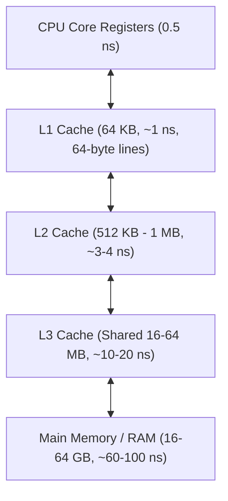
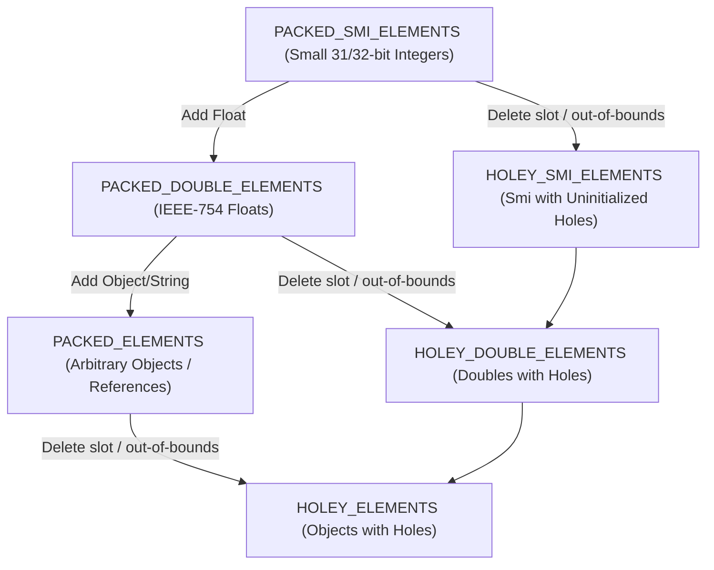
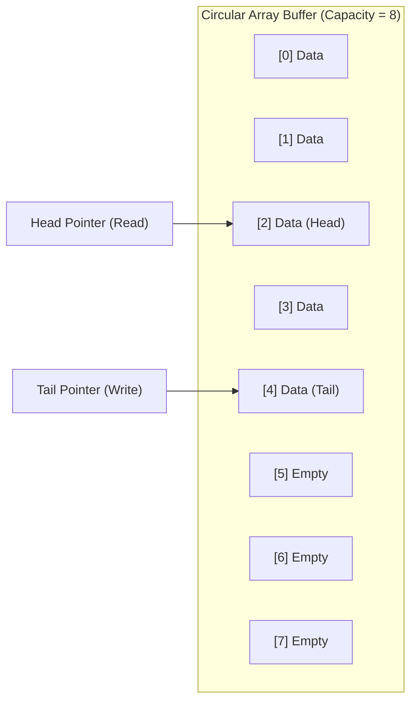
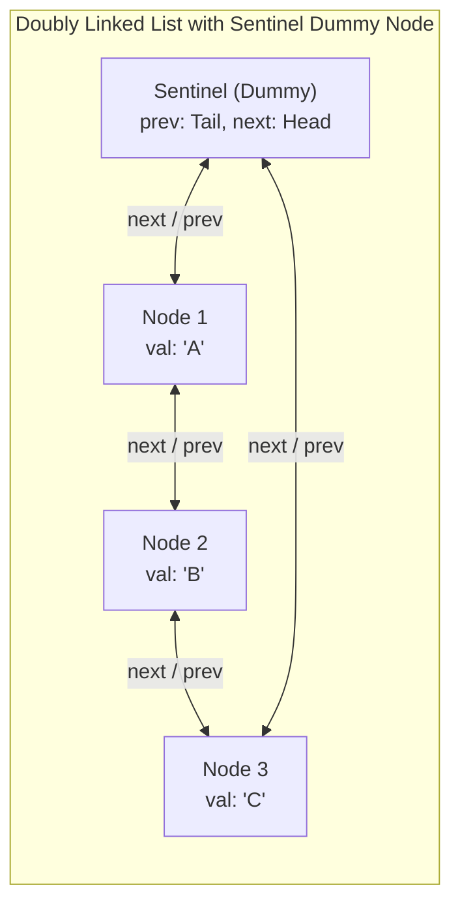

# Module 02 — Linear Data Structures & Memory Layout

Linear data structures organize elements in a sequential order. While abstract interfaces (arrays, lists, stacks, queues, and deques) are conceptually simple, their physical memory representations, CPU cache-line locality, and language runtime implementations (such as V8's element kinds) dictate their real-world performance.

---

## 1. Physical Memory Layout & The Cache Hierarchy

Modern CPUs access data through a hierarchical memory subsystem. Understanding memory layout explains why an $O(n)$ array traversal often outperforms an $O(n)$ linked-list traversal by orders of magnitude.



### Contiguous Arrays vs Pointer-Chasing Linked Lists
1. **Contiguous Array**: Elements are stored in adjacent memory addresses ($A[i] = \text{base} + i \times \text{sizeof}(\text{element})$).
   - **Spatial Locality**: When the CPU requests $A[0]$, the hardware prefetcher loads an entire 64-byte cache line into L1 cache, pulling the next several elements into fast SRAM simultaneously.
   - **Stride Predictability**: Linear array scans allow branch predictors and hardware prefetchers to stream data ahead of execution, avoiding CPU memory stalls.
2. **Linked List**: Every node is an individually heap-allocated object containing a payload and pointer (`next`, `prev`).
   - **Cache Thrashing**: Nodes are scattered across disparate memory addresses. Following a `node.next` pointer triggers a cache miss, stalling the CPU pipeline for ~60–100 ns per node.
   - **Memory Overhead**: On 64-bit architectures, each linked list node requires 8 bytes for a pointer (or 16 bytes for a doubly linked list) plus object header overhead (16–24 bytes in V8 / JVM), dwarfing small payloads.

---

## 2. Dynamic Array Mechanics & The V8 Elements Kinds Hierarchy

In JavaScript and TypeScript, the standard `Array` is not a raw C-style array. In modern runtimes like V8 (Node.js and Chromium), an array starts as a contiguous backing store and dynamically transitions through an internal lattice of **Elements Kinds**.



### The Transition Rules
Transitions in V8's elements kinds lattice are **one-way**: an array can only transition to a more generic or holey state; it never transitions back to a more specific packed state.

1. **`PACKED_SMI_ELEMENTS`**:
   - Contains only Small Integers (Smi: signed 31-bit integers on 32-bit systems, 32-bit on 64-bit).
   - Stored directly unboxed in memory; fast arithmetic and zero GC overhead.
2. **`PACKED_DOUBLE_ELEMENTS`**:
   - Transitions here as soon as a non-integer float (e.g. `arr.push(4.2)`) is inserted.
   - Stored as raw 64-bit floating point numbers.
3. **`PACKED_ELEMENTS`**:
   - Transitions here when objects, strings, functions, or mixed types are stored.
   - Stored as pointers to heap objects.
4. **Holey Arrays (`HOLEY_*`)**:
   - Occurs when an element is deleted (`delete arr[2]`) or elements are written past the current length (`arr[100] = 1` on an array of length 2).
   - **Severe Performance Penalty**: When accessing `arr[i]`, if the slot is empty, V8 must traverse the prototype chain (`arr.__proto__`) to check for inherited properties before returning `undefined`.

> [!CAUTION] The Pre-Allocation Trap
> Writing `const arr = new Array(1000)` creates an array with 1000 uninitialized holes (`HOLEY_SMI_ELEMENTS`). Filling it with a loop leaves it permanently holey. Always initialize with `Array.from({ length: 1000 }, () => 0)` or fill immediately via `new Array(1000).fill(0)` to preserve `PACKED` status.

---

## 3. The `Array.prototype.shift()` Trap & The Circular Ring Buffer Deque

A classic performance trap in algorithmic programming is using a native JavaScript array as a FIFO queue:

```typescript
// ANTI-PATTERN: O(n) per dequeue operation
const queue: number[] = [];
queue.push(1);       // O(1) amortized
const item = queue.shift(); // O(n) — must memmove all remaining elements 1 slot to the left!
```

Processing $n$ elements through `queue.push()` and `queue.shift()` takes $O(n^2)$ total time, causing timeouts on inputs with $n = 100,000$.

### The Circular Ring Buffer Deque
A **Double-Ended Queue (Deque)** implemented over a fixed or dynamic circular array achieves true $O(1)$ amortized `pushFront`, `pushBack`, `popFront`, and `popBack`.



### Invariants & Wrap-Around Math
For an array of capacity $C$:
$$\text{next\_index} = (\text{index} + 1) \pmod C$$
$$\text{prev\_index} = (\text{index} - 1 + C) \pmod C$$

When $C$ is a power of 2 ($C = 2^k$), the expensive modulo operation `% C` can be replaced with the ultra-fast bitwise AND mask:
$$\text{index} \pmod C \equiv \text{index} \ \& \ (C - 1)$$

---

## 4. Linked Lists: Singly, Doubly & Sentinel Architectures



### The Sentinel (Dummy Head/Tail) Pattern
In naive linked list implementations, inserting or deleting at the head or tail requires verbose conditional logic (`if (this.head === null) ... if (node === this.tail) ...`).
Using a circular **Sentinel Node** (or a dummy head and dummy tail pair) completely eliminates null checks:
- The list is never empty: `sentinel.next === sentinel` represents an empty list.
- Every valid element node $X$ is guaranteed to have both $X.prev$ and $X.next$.
- Insertion before any node $P$:
  ```typescript
  const newNode = new ListNode(value, P.prev, P);
  P.prev.next = newNode;
  P.prev = newNode;
  ```
- Deletion of node $X$:
  ```typescript
  X.prev.next = X.next;
  X.next.prev = X.prev;
  ```

---

## 5. Bitwise Arithmetic on the Word-RAM Model

On modern 64-bit hardware, bit manipulation evaluates in 1 CPU cycle, providing $O(1)$ operations over compact bitsets.

### Essential Bitwise Formulas
| Operation | Expression | Mathematical Purpose |
| :--- | :--- | :--- |
| **Check $k$-th bit** | `(x & (1 << k)) !== 0` | Tests if bit $k$ is set |
| **Set $k$-th bit** | `x \| (1 << k)` | Unconditionally sets bit $k$ to 1 |
| **Clear $k$-th bit** | `x & ~(1 << k)` | Clears bit $k$ to 0 |
| **Toggle $k$-th bit** | `x ^ (1 << k)` | Inverts bit $k$ |
| **Extract lowest set bit** | `x & (-x)` | Isolates least significant 1-bit via two's complement |
| **Clear lowest set bit** | `x & (x - 1)` | Clears least significant 1-bit (Kernighan's bit-count loop) |
| **Check if power of 2** | `x > 0 && (x & (x - 1)) === 0` | True iff $x$ has exactly one set bit |
| **Unsigned 32-bit Shift** | `x >>> k` | Zero-fill right shift (coerces result to unsigned 32-bit uint) |
| **32-bit Integer Multiplication** | `Math.imul(a, b)` | C-like 32-bit signed multiplication without float degradation |

---

## 6. Interview Drill: Linear Structures & Memory Layout

<details>
<summary>1. Why is Array.prototype.shift() an O(n) operation in JavaScript, and what data structure should be used instead for FIFO queues?</summary>

`Array.prototype.shift()` removes the element at index 0. Because a standard array stores elements in contiguous memory, removing index 0 requires the runtime to shift all remaining $n - 1$ elements one memory slot to the left to maintain contiguous indexing.
For a FIFO queue, an engineer should use a **Circular Ring-Buffer Deque** or a linked list with head/tail pointers, both of which execute dequeue operations in $O(1)$ amortized time.
</details>

<details>
<summary>2. What is the difference between JavaScript's >> (Sign-propagating right shift) and >>> (Zero-fill right shift)?</summary>

- `>>` is an arithmetic right shift: it preserves the sign bit of a 32-bit signed integer. If the input is negative, 1s are shifted in from the left.
- `>>>` is a logical right shift: it always shifts in 0s from the left regardless of the sign bit, and crucially, coerces the output to an **unsigned 32-bit integer** in the range $[0, 2^{32} - 1]$.
For example, `(-1) >> 1 === -1`, while `(-1) >>> 1 === 2147483647`.
</details>

<details>
<summary>3. Why does Brian Kernighan's algorithm count set bits in O(k) time rather than O(w) time where w is word size?</summary>

Kernighan's algorithm uses the identity `x & (x - 1)`:
Subtracting 1 from a binary number flips the lowest set bit to 0 and all trailing 0s to 1. Performing a bitwise AND between $x$ and $x - 1$ clears the lowest set bit and leaves all higher bits unchanged.
Because each iteration of the loop `x = x & (x - 1)` eliminates exactly one set bit, the loop runs in $O(k)$ iterations where $k$ is the number of set bits (popcount), rather than checking all 32 or 64 bits sequentially.
</details>

<details>
<summary>4. How does V8 handle holey arrays, and why does reading a hole cause significant performance deoptimization?</summary>

When an array has an uninitialized or deleted index (a "hole"), its element kind transitions to a `HOLEY_*` kind. When code accesses `arr[i]` on a holey array and the slot contains the internal `the_hole` sentinel, V8 cannot simply return `undefined`. By ECMAScript specification, it must search up the prototype chain (`Array.prototype`, `Object.prototype`) to ensure no getter or property exists with key `i`. This breaks inline caches (ICs) and causes V8 to deoptimize compiled JIT code back to interpreted bytecode.
</details>

<details>
<summary>5. Explain the purpose of using sentinel dummy nodes in a doubly linked list.</summary>

Sentinel nodes (or dummy head/tail nodes) serve as permanent anchor boundaries that never hold application data. They eliminate special-case edge handling when inserting or deleting elements at the boundaries (empty list, insertion at head, deletion at tail). All insertions and deletions become uniform operations between two guaranteed non-null nodes (`node.prev` and `node.next`), eliminating null-pointer dereferences and reducing branching in inner loops.
</details>
