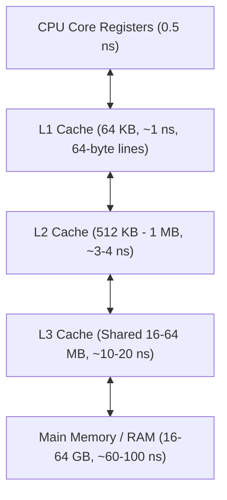
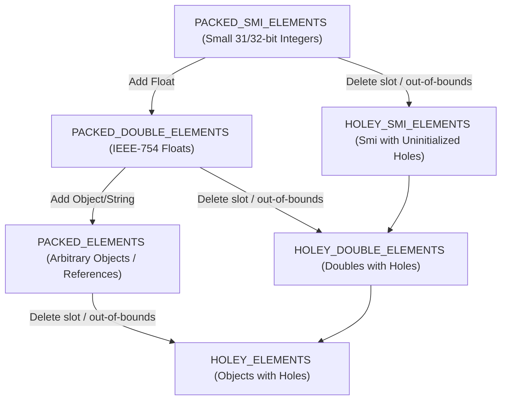
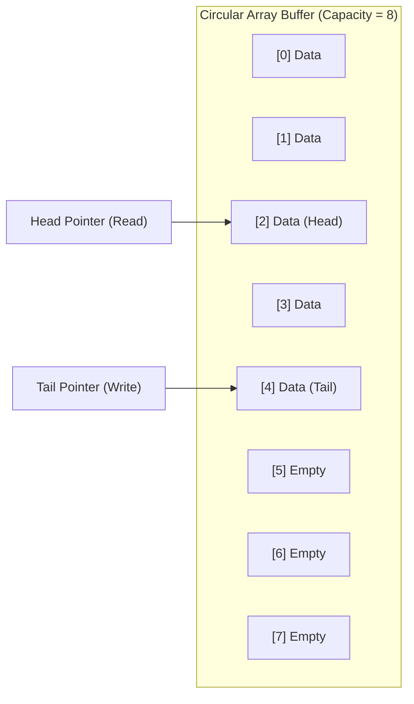
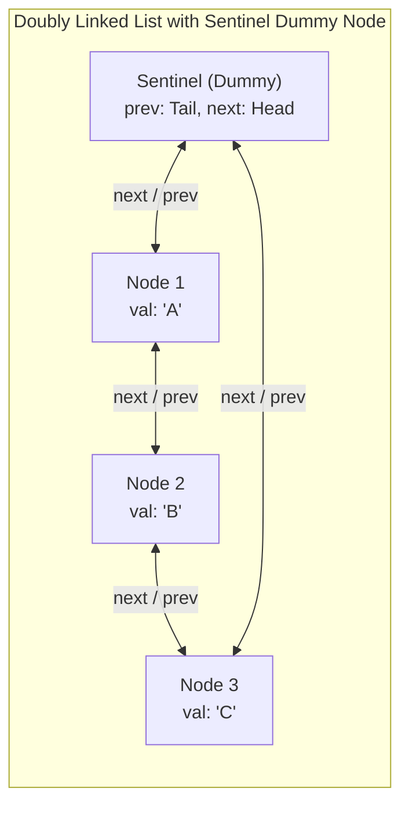
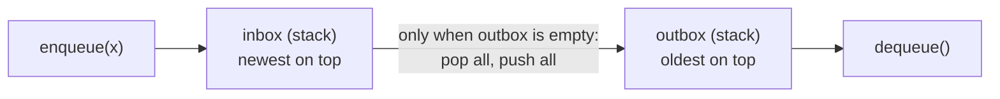
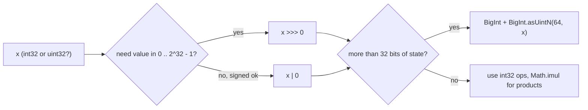

# Module 02 — Linear Data Structures & Memory Layout

Linear data structures organize elements in a sequential order. While abstract interfaces (arrays, lists, stacks, queues, and deques) are conceptually simple, their physical memory representations, CPU cache-line locality, and language runtime implementations (such as V8's element kinds) dictate their real-world performance.

---

## 1. Physical Memory Layout & The Cache Hierarchy

Modern CPUs access data through a hierarchical memory subsystem. Understanding memory layout explains why an $O(n)$ array traversal often outperforms an $O(n)$ linked-list traversal by orders of magnitude.



### Contiguous Arrays vs Pointer-Chasing Linked Lists

1. **Contiguous Array**: Elements are stored in adjacent memory addresses ($A[i] = \text{base} + i \times \text{sizeof}(\text{element})$).
   - **Spatial Locality**: When the CPU requests $A[0]$, the hardware prefetcher loads an entire 64-byte cache line into L1 cache, pulling the next several elements into fast SRAM simultaneously.
   - **Stride Predictability**: Linear array scans allow branch predictors and hardware prefetchers to stream data ahead of execution, avoiding CPU memory stalls.
2. **Linked List**: Every node is an individually heap-allocated object containing a payload and pointer (`next`, `prev`).
   - **Cache Thrashing**: Nodes are scattered across disparate memory addresses. Following a `node.next` pointer triggers a cache miss, stalling the CPU pipeline for ~60–100 ns per node.
   - **Memory Overhead**: On 64-bit architectures, each linked list node requires 8 bytes for a pointer (or 16 bytes for a doubly linked list) plus object header overhead (16–24 bytes in V8 / JVM), dwarfing small payloads.

---

## 2. Dynamic Array Mechanics & The V8 Elements Kinds Hierarchy

In JavaScript and TypeScript, the standard `Array` is not a raw C-style array. In modern runtimes like V8 (Node.js and Chromium), an array starts as a contiguous backing store and dynamically transitions through an internal lattice of **Elements Kinds**.



### The Transition Rules

Transitions in V8's elements kinds lattice are **one-way**: an array can only transition to a more generic or holey state; it never transitions back to a more specific packed state.

1. **`PACKED_SMI_ELEMENTS`**:
   - Contains only Small Integers (Smi: signed 31-bit integers on 32-bit systems, 32-bit on 64-bit).
   - Stored directly unboxed in memory; fast arithmetic and zero GC overhead.
2. **`PACKED_DOUBLE_ELEMENTS`**:
   - Transitions here as soon as a non-integer float (e.g. `arr.push(4.2)`) is inserted.
   - Stored as raw 64-bit floating point numbers.
3. **`PACKED_ELEMENTS`**:
   - Transitions here when objects, strings, functions, or mixed types are stored.
   - Stored as pointers to heap objects.
4. **Holey Arrays (`HOLEY_*`)**:
   - Occurs when an element is deleted (`delete arr[2]`) or elements are written past the current length (`arr[100] = 1` on an array of length 2).
   - **Severe Performance Penalty**: When accessing `arr[i]`, if the slot is empty, V8 must traverse the prototype chain (`arr.__proto__`) to check for inherited properties before returning `undefined`.

> [!CAUTION]
> **The Pre-Allocation Trap** Writing `const arr = new Array(1000)` creates an array with 1000 uninitialized holes (`HOLEY_SMI_ELEMENTS`). Filling it with a loop leaves it permanently holey. Always initialize with `Array.from({ length: 1000 }, () => 0)` or fill immediately via `new Array(1000).fill(0)` to preserve `PACKED` status.

---

## 3. The `Array.prototype.shift()` Trap & The Circular Ring Buffer Deque

A classic performance trap in algorithmic programming is using a native JavaScript array as a FIFO queue:

```typescript
// ANTI-PATTERN: O(n) per dequeue operation
const queue: number[] = [];
queue.push(1); // O(1) amortized
const item = queue.shift(); // O(n) — must memmove all remaining elements 1 slot to the left!
```

Processing $n$ elements through `queue.push()` and `queue.shift()` takes $O(n^2)$ total time, causing timeouts on inputs with $n = 100,000$.

### The Circular Ring Buffer Deque

A **Double-Ended Queue (Deque)** implemented over a fixed or dynamic circular array achieves true $O(1)$ amortized `pushFront`, `pushBack`, `popFront`, and `popBack`.



### Invariants & Wrap-Around Math

For an array of capacity $C$: $$\text{next-index} = (\text{index} + 1) \pmod C$$ $$\text{prev-index} = (\text{index} - 1 + C) \pmod C$$

When $C$ is a power of 2 ($C = 2^k$), the expensive modulo operation `% C` can be replaced with the ultra-fast bitwise AND mask: $$\text{index} \pmod C \equiv \text{index} \ \& \ (C - 1)$$

---

## 4. Linked Lists: Singly, Doubly & Sentinel Architectures



### The Sentinel (Dummy Head/Tail) Pattern

In naive linked list implementations, inserting or deleting at the head or tail requires verbose conditional logic (`if (this.head === null) ... if (node === this.tail) ...`). Using a circular **Sentinel Node** (or a dummy head and dummy tail pair) completely eliminates null checks:

- The list is never empty: `sentinel.next === sentinel` represents an empty list.
- Every valid element node $X$ is guaranteed to have both $X.prev$ and $X.next$.
- Insertion before any node $P$:
  ```typescript
  const newNode = new ListNode(value, P.prev, P);
  P.prev.next = newNode;
  P.prev = newNode;
  ```
- Deletion of node $X$:
  ```typescript
  X.prev.next = X.next;
  X.next.prev = X.prev;
  ```

---

## 5. Bitwise Arithmetic on the Word-RAM Model

On modern 64-bit hardware, bit manipulation evaluates in 1 CPU cycle, providing $O(1)$ operations over compact bitsets.

### Essential Bitwise Formulas

| Operation | Expression | Mathematical Purpose |
| :-- | :-- | :-- |
| **Check $k$-th bit** | `(x & (1 << k)) !== 0` | Tests if bit $k$ is set |
| **Set $k$-th bit** | `x \| (1 << k)` | Unconditionally sets bit $k$ to 1 |
| **Clear $k$-th bit** | `x & ~(1 << k)` | Clears bit $k$ to 0 |
| **Toggle $k$-th bit** | `x ^ (1 << k)` | Inverts bit $k$ |
| **Extract lowest set bit** | `x & (-x)` | Isolates least significant 1-bit via two's complement |
| **Clear lowest set bit** | `x & (x - 1)` | Clears least significant 1-bit (Kernighan's bit-count loop) |
| **Check if power of 2** | `x > 0 && (x & (x - 1)) === 0` | True iff $x$ has exactly one set bit |
| **Unsigned 32-bit Shift** | `x >>> k` | Zero-fill right shift (coerces result to unsigned 32-bit uint) |
| **32-bit Integer Multiplication** | `Math.imul(a, b)` | C-like 32-bit signed multiplication without float degradation |

---

## 6. Dynamic Array Growth: Choosing the Factor

Module 01 proved doubling is amortized $O(1)$. The factor itself is a design parameter, and the general result is short.

**Lemma (growth factor).** Let capacities grow as $c_{i+1} \ge g\,c_i$ with $g > 1$, and copy the full $c_i$ elements at each growth. For $n$ appends the total number of element copies is less than $n\,g/(g-1)$.

_Proof._ A growth from $c_i$ happens only when the size is $c_i < n$, so every capacity that is ever copied is smaller than $n$. The copied capacities form a sequence whose terms satisfy $c_{i} \le c_{\text{last}}\,g^{-(\text{last} - i)}$, and $c_{\text{last}} < n$. Summing the geometric series gives $\sum_i c_i < n\,(1 + g^{-1} + g^{-2} + \cdots) = n\,g/(g-1)$. $\square$

| Factor $g$ | Copies per append (bound) | Worst-case slack memory | Where it is used |
| :-: | :-: | :-: | :-- |
| 1.5 | $< 3$ | up to $33\%$ of the buffer | V8 (`old + old/2 + 16`, see below) |
| 2 | $< 2$ | up to $50\%$ | common textbook default |
| 4 | $< 1.34$ | up to $75\%$ | rarely; wastes memory |
| additive ($+k$) | $\Theta(n/k)$ | $k$ | quadratic, never acceptable |

The V8 source (`JSObject::NewElementsCapacity` in `src/objects/js-objects.h`) computes `old_capacity + (old_capacity >> 1) + kMinAddedElementsCapacity`, a 1.5x factor plus a small constant so that tiny arrays do not reallocate on every push. The constant is currently 16 (`unverified` against the header at the time of writing; the formula shape was read from the upstream file).

A folk argument says factors below the golden ratio $\varphi \approx 1.618$ let a malloc-style allocator reuse the memory freed by earlier growths, because the sum of all earlier blocks eventually exceeds the next request. It is a heuristic about _one_ allocator policy, not a theorem, and V8 does not rely on it (the GC moves objects). Treat it as trivia, not as a design rule.

Executable check in `examples/02b-linear-structures-deep.test.ts`: simulated copy counts stay below $n g/(g-1)$ for $g \in \{1.5, 2, 4\}$; the V8 formula stays below $3n$; the additive $+16$ policy multiplies its copy count by more than 3.5 when $n$ doubles, which is the signature of quadratic growth.

---

## 7. `shift()` Revisited: Specification, V8 Reality and a Safe Queue

Section 3 said `shift()` is $O(n)$. That is the cost _the specification prescribes_, and the honest statement is more nuanced.

**What ECMAScript says.** `Array.prototype.shift` reads index 0, then for each $k = 1, \ldots, \text{len} - 1$ performs `HasProperty`, `Get(k)` and `Set(k-1)` (or `DeletePropertyOrThrow` for holes), then deletes the last index and writes `length`. That is $\Theta(n)$ property operations. Because it is the _generic_ algorithm, you can observe it on an array-like `Proxy`: the test counts exactly $n$ `[[Get]]` and $n - 1$ `[[Set]]` traps for $n = 10, 100, 1000$.

**What V8 does.** Engines are free to implement the observable behaviour any way they like. A V8 engineer on the v8-users list describes **left-trimming**: instead of moving elements, V8 moves the array's object header forward over the removed slot, so `shift()` on a regular-sized backing store does no copying. He also states that left-trimming is impossible in large object space (backing stores above the regular page size, 512 KB in his explanation, reached near 56,000 elements in his example), where each `shift()` becomes an $O(n)$ `memmove`, and that the thresholds are implementation details that may change (post date `unverified`). The practical reading:

- A BFS over 1,000 nodes will look fine with `shift()`; a BFS over $10^6$ nodes can fall off a cliff when the queue array crosses into large object space.
- No guarantee exists in the language, so complexity analysis for interviews and for portable code must use $O(n)$.
- Other engines (JavaScriptCore, SpiderMonkey) have their own behaviour, so code that runs in both a browser and Node.js cannot assume V8's.

**The safe pattern: head index with compaction.** Keep `items` and an integer `head`; dequeue reads `items[head++]`. Reclaim the dead prefix when it has grown to at least half the array:

```text
DEQUEUE(Q)
1  if Q.head == Q.items.length  return NIL
2  x = Q.items[Q.head];  Q.items[Q.head] = NIL      // drop the reference so the GC can collect x
3  Q.head = Q.head + 1
4  if Q.head >= 32 and 2 * Q.head >= Q.items.length
5      Q.items = Q.items[Q.head :]                  // copy the live suffix
6      Q.head = 0
7  return x
```

_Invariant:_ $0 \le \text{head} \le |\text{items}|$ and the live queue is `items[head:]`. _Amortized cost:_ when compaction runs, the live suffix has length $\le \text{head}$ (because $2\,\text{head} \ge |\text{items}|$), so it copies at most as many elements as were dequeued since the previous compaction. Charge one unit to each dequeue and total copying is at most the number of dequeues; every dequeue is $O(1)$ amortized. The property test asserts `moved <= dequeues` over random operation sequences and compares every result with a naive model.

Compaction is still a stall of $O(\text{live size})$ for one call. Where tail latency matters, use the ring-buffer deque from Section 3 (which has worst-case $O(1)$ except at resize) or a deque of fixed-size chunks.

---

## 8. Queues from Stacks and Stacks with Extra Powers

### 8.1 A FIFO queue from two LIFO stacks (CLRS exercise 10.1-6)

```text
ENQUEUE(Q, x)  push(Q.inbox, x)
DEQUEUE(Q)
1  if Q.outbox is empty
2      while Q.inbox is not empty
3          push(Q.outbox, pop(Q.inbox))
4  return pop(Q.outbox)                // error if both are empty
```



**Invariant.** Reading `outbox` from top to bottom and then `inbox` from bottom to top lists the queue from front to back.

**Amortized cost.** Each element is pushed to `inbox` once, moved to `outbox` at most once, and popped once, so $n$ operations cost at most $3n$ stack operations: $O(1)$ amortized. The potential $\Phi = |\text{inbox}|$ proves it: a transfer of $m$ elements has actual cost $m$ and lowers $\Phi$ by $m$.

**The caveat the proof hides:** a single `dequeue` can cost $\Theta(n)$. The test enqueues 1000 items and shows the first dequeue moves all 1000. If the two stacks are replicas on different threads, or the transfer holds a lock, that spike is a latency incident; amortization does not help the unlucky caller.

### 8.2 A stack that reports its minimum in $O(1)$

Store with each element the minimum of everything beneath it (`mins[i] = min(data[0..i])`). _Invariant:_ `mins.length === data.length` and `mins.at(-1)` is the minimum of the live stack. `push` appends `min(x, mins.at(-1))`, `pop` removes from both arrays. Space doubles; the alternative of pushing to the `mins` stack only when a new minimum (or an equal one) appears saves space but breaks with duplicates if equal values are not pushed. The property test replays random push/pop sequences against `Math.min` of the live contents after every step, including duplicates.

---

## 9. Linked-List Algorithms with Proofs

### 9.1 In-place reversal

```text
REVERSE(head)
1  prev = NIL;  curr = head
2  while curr != NIL
3      next = curr.next
4      curr.next = prev
5      prev = curr;  curr = next
6  return prev
```

_Invariant:_ at the top of the iteration that processes the $j$-th node (0-based), `prev` is the head of the already reversed list $v_{j-1} \to \cdots \to v_0 \to \text{NIL}$ and `curr` is the untouched suffix $v_j \to \cdots$. Initially $j = 0$ and `prev` is NIL. Each iteration moves one node; on exit `curr` is NIL, so the reversed prefix is the whole list. The test checks this invariant structurally at **every** iteration for lists up to 60 nodes.

### 9.2 Floyd's cycle detection: why it works and what it finds

Model the list as a "rho": a tail of $\mu$ nodes followed by a cycle of $\lambda$ nodes. After $k$ steps the tortoise is at path position $k$ and the hare at $2k$.

**Theorem.** If the list has a cycle, the pointers meet at the smallest $k \ge \max(\mu, 1)$ with $\lambda \mid k$.

_Proof._ A meeting requires both pointers in the cycle, so $k \ge \mu$ for the tortoise. Positions inside the cycle are taken modulo $\lambda$, and the pointers coincide iff $2k \equiv k \pmod \lambda$, i.e. $\lambda \mid k$. The smallest such $k \ge \max(\mu, 1)$ lies in $[\mu,\ \mu + \lambda - 1]$, so detection takes at most $\mu + \lambda$ iterations. $\square$

**Finding the cycle start.** At the meeting step $k$ the tortoise is $k - \mu$ steps into the cycle and $k$ is a multiple of $\lambda$, so advancing $\mu$ more steps lands exactly on the entry node (because $k - \mu + \mu = k \equiv 0 \pmod \lambda$). A second pointer starting at the head and advancing in lock-step with the tortoise therefore meets it exactly at the entry after $\mu$ steps. Then $\lambda$ is recovered by walking the cycle once.

The test builds all rho shapes with $0 \le \mu \le 25$ and $1 \le \lambda \le 25$, asserts the exact meeting step formula above, and asserts phase 2 returns exactly $\mu$ and $\lambda$. Negative tests: acyclic lists never meet, and returning the _meeting node_ as the "cycle start" is wrong (for $\mu = 3, \lambda = 5$ the meeting node is not the entry).

Cost: $O(\mu + \lambda)$ time and $O(1)$ space, versus $O(\mu + \lambda)$ space for the hash-set visited approach. Mutating the list (marking nodes) is **not** a safe substitute when other readers share the structure.

---

## 10. Bit Manipulation with Proofs

Section 5 listed formulas; this section proves the ones that interviews and bitmask DP depend on.

**Two's complement identity.** For a $w$-bit integer $x$, $-x \equiv \sim x + 1 \pmod{2^w}$. Hence $x \,\&\, (-x)$ isolates the lowest set bit. _Proof:_ let the lowest 1 of $x$ be at position $p$, so bits $0..p-1$ of $x$ are 0. Then $\sim x$ has 1s at positions $0..p-1$, a 0 at $p$, and every higher bit complemented. Adding 1 carries through the low run of 1s (turning them to 0), sets position $p$ to 1, and leaves the higher bits complemented. So $-x$ agrees with $x$ at position $p$ and is the bitwise complement of $x$ above it; ANDing with $x$ keeps position $p$ and cancels everything above. The property test checks the identity over the full int32 range except the one input ($-2^{31}$) where negation overflows.

**Kernighan's clear-lowest-bit.** $x\,\&\,(x-1)$ clears bit $p$ and leaves higher bits alone, because $x - 1$ flips bits $0..p$. The loop therefore runs popcount$(x)$ times. The Challenger fix for unsigned behaviour in the original suite stays in force: coerce with `>>> 0` when $x \ge 2^{31}$.

**SWAR popcount** (population count in $O(\log w)$ word operations, no loop): sum bits in pairs, then nibbles, then bytes, then gather the byte sums with one multiply.

```text
POPCOUNT32(x)
1  x = x - ((x >> 1) & 0x55555555)               // each 2-bit field holds its own count (0..2)
2  x = (x & 0x33333333) + ((x >> 2) & 0x33333333) // each 4-bit field holds a count (0..4)
3  x = (x + (x >> 4)) & 0x0F0F0F0F               // each byte holds a count (0..8)
4  return (x * 0x01010101) >> 24                  // top byte = sum of the four byte counts
```

_Invariant after step $s$:_ every field of width $2^s$ holds the popcount of the corresponding input bits. Step 1 works because for a 2-bit field $ab$ the value $2a + b - a = a + b$. In JavaScript write the multiply as `Math.imul` to get C's 32-bit wrap (a plain `*` happens to stay exact here, since $0x0F0F0F0F \cdot 0x01010101 < 2^{53}$, but the habit breaks as soon as a constant is larger), and shift with `>>> 24` so the result is read as unsigned. The property test compares it with the naive loop on 500 random uint32 values.

**Enumerating submasks.** `for (s = mask; s > 0; s = (s - 1) & mask)` visits every non-empty submask exactly once in strictly decreasing order. _Why:_ $s - 1$ flips the lowest set bit of $s$ and sets all lower bits; ANDing with `mask` keeps only bits that are in `mask`, which yields the largest submask smaller than $s$. There are $2^{\mathrm{popcount}(\text{mask})} - 1$ of them, so iterating over all masks and all their submasks costs $\sum_{\text{mask}} 2^{|\text{mask}|} = 3^n$ (each of the $n$ elements is outside the mask, in the mask but outside the submask, or in both). That $3^n$ bound is what makes subset-convolution style DP feasible for $n \approx 15$.

**Gosper's hack** enumerates all $n$-bit masks with exactly $k$ bits set in increasing order:

```text
NEXT-COMBINATION(x)
1  c = x & -x                // lowest set bit
2  r = x + c                 // ripple the lowest run of 1s into one higher 1
3  return (((r ^ x) >> 2) / c) | r   // put the leftover ones back at the bottom
```

The tests check, for every $1 \le k \le n \le 12$, that the generator returns exactly $\binom{n}{k}$ masks, each with popcount $k$, strictly increasing.

**JavaScript-specific failure modes** (all asserted): `1 << 32 === 1` because shift counts are taken modulo 32; `1 << 31` is $-2^{31}$; `2 ** 32 | 0 === 0`; `Math.clz32` operates on the uint32 view (`Math.clz32(-1) === 0`). For 64-bit masks use `BigInt` with `BigInt.asUintN(64, x)`, accepting that BigInt operations are not unit cost.



---

## 11. Typed Arrays: Opting Out of Elements-Kind Guesswork

Section 2 described how an ordinary array can drift through V8's elements-kind lattice. A typed array removes the guessing by fixing the element type at construction: `Int32Array` stores 4-byte two's complement integers contiguously in an `ArrayBuffer`, `Float64Array` stores 8-byte doubles, and out-of-range stores follow the conversion rules (wrap for the integer kinds, clamp for `Uint8ClampedArray`). The test asserts `BYTES_PER_ELEMENT` and the wrap/clamp behaviour so the table below is executable rather than remembered.

| Need | Use | Reason |
| :-- | :-- | :-- |
| Dense numeric DP table, visited flags, counters | `Int32Array`, `Uint8Array`, `Float64Array` | no holes, no boxing, predictable footprint; `fill(0)` is a single call |
| Heterogeneous items | plain `Array` | typed arrays cannot hold objects |
| Resizable collection | plain `Array`, or a typed array plus your own size counter and the growth rule from Section 6 | a typed array's length is fixed at construction |
| Needs `push`/`pop` semantics on numbers | `Array` with SMI-only content, or typed array plus a size counter | typed arrays have no `push` |

**Then vs now.** Early JavaScript algorithm code used plain arrays for everything and `new Array(n)`; the modern advice is `new Int32Array(n)` for numeric tables and `Array.from({ length: n }, ...)` for object tables. The `shift()` guidance changed from "always O(n)" (specification) to "usually fast for small arrays through an engine hack, but never portable". Pin the reasoning to the specification in interviews and to the profile in production.

---

## Interview Drill

<details><summary>1. Why is Array.prototype.shift() an O(n) operation in JavaScript, and what data structure should be used instead for FIFO queues?</summary>

`Array.prototype.shift()` removes the element at index 0. Because a standard array stores elements in contiguous memory, removing index 0 requires the runtime to shift all remaining $n - 1$ elements one memory slot to the left to maintain contiguous indexing. For a FIFO queue, an engineer should use a **Circular Ring-Buffer Deque** or a linked list with head/tail pointers, both of which execute dequeue operations in $O(1)$ amortized time.
</details>

<details><summary>2. What is the difference between JavaScript's >> (Sign-propagating right shift) and >>> (Zero-fill right shift)?</summary>

- `>>` is an arithmetic right shift: it preserves the sign bit of a 32-bit signed integer. If the input is negative, 1s are shifted in from the left.
- `>>>` is a logical right shift: it always shifts in 0s from the left regardless of the sign bit, and crucially, coerces the output to an **unsigned 32-bit integer** in the range $[0, 2^{32} - 1]$. For example, `(-1) >> 1 === -1`, while `(-1) >>> 1 === 2147483647`.

</details>

<details><summary>3. Why does Brian Kernighan's algorithm count set bits in O(k) time rather than O(w) time where w is word size?</summary>

Kernighan's algorithm uses the identity `x & (x - 1)`: Subtracting 1 from a binary number flips the lowest set bit to 0 and all trailing 0s to 1. Performing a bitwise AND between $x$ and $x - 1$ clears the lowest set bit and leaves all higher bits unchanged. Because each iteration of the loop `x = x & (x - 1)` eliminates exactly one set bit, the loop runs in $O(k)$ iterations where $k$ is the number of set bits (popcount), rather than checking all 32 or 64 bits sequentially.
</details>

<details><summary>4. How does V8 handle holey arrays, and why does reading a hole cause significant performance deoptimization?</summary>

When an array has an uninitialized or deleted index (a "hole"), its element kind transitions to a `HOLEY_*` kind. When code accesses `arr[i]` on a holey array and the slot contains the internal `the_hole` sentinel, V8 cannot simply return `undefined`. By ECMAScript specification, it must search up the prototype chain (`Array.prototype`, `Object.prototype`) to ensure no getter or property exists with key `i`. This breaks inline caches (ICs) and causes V8 to deoptimize compiled JIT code back to interpreted bytecode.
</details>

<details><summary>5. Explain the purpose of using sentinel dummy nodes in a doubly linked list.</summary>

Sentinel nodes (or dummy head/tail nodes) serve as permanent anchor boundaries that never hold application data. They eliminate special-case edge handling when inserting or deleting elements at the boundaries (empty list, insertion at head, deletion at tail). All insertions and deletions become uniform operations between two guaranteed non-null nodes (`node.prev` and `node.next`), eliminating null-pointer dereferences and reducing branching in inner loops.
</details>

<details><summary>6. A teammate claims `queue.shift()` is fine because V8 left-trims arrays. How do you respond, and what do you ship instead?</summary>

V8 does have a left-trimming optimization that moves the array's start instead of copying, but a V8 engineer has stated it cannot be applied once the backing store lives in large object space, and that the thresholds are implementation details. Past that point each `shift()` is an $O(n)$ `memmove`, so a BFS or event queue that works at $10^3$ elements can degrade quadratically at $10^6$. The ECMAScript algorithm itself is $\Theta(n)$ (it performs about $n$ `Get` and `Set` operations; observable on a `Proxy`). Ship a head-index queue with compaction when the live suffix is at most the dead prefix (amortized $O(1)$, one copy per dequeue at most) or a ring buffer. Use `shift()` only for small bounded arrays, and state the assumption in a comment.
</details>

<details><summary>7. Prove that Floyd's tortoise and hare meet inside the cycle, and explain how the cycle entry is found afterwards.</summary>

Let the tail have $\mu$ nodes and the cycle $\lambda$. After $k$ steps the tortoise is at position $k$ and the hare at $2k$. They can only coincide when both are in the cycle ($k \ge \mu$), and then they coincide iff $2k \equiv k \pmod \lambda$, i.e. $\lambda \mid k$. The first such $k \ge \max(\mu, 1)$ is at most $\mu + \lambda - 1$ (or $\lambda$ when $\mu = 0$). At that moment the tortoise is $k - \mu$ steps into the cycle; $k$ is a multiple of $\lambda$, so $\mu$ more steps bring it back to the entry node. Place a second pointer at the head and advance both one step at a time: after $\mu$ steps they stand on the entry together. Returning the meeting node instead is a classic wrong answer.
</details>
