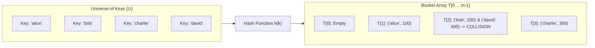
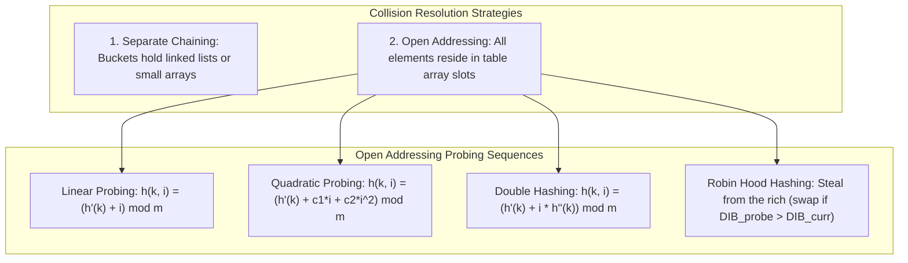
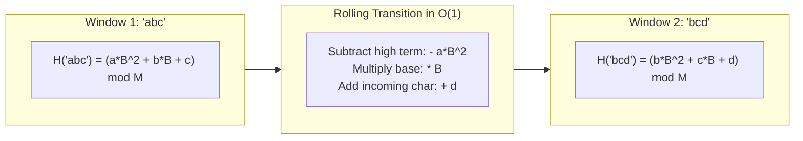

# Module 03 — Hashing, Hash Tables & Collision Resolution

The dictionary problem addresses maintaining a dynamic set of key-value pairs supporting $O(1)$ average-time `insert`, `search`, and `delete`. While balanced binary search trees achieve $O(\log n)$ worst-case bounds by comparing keys, hash tables bypass the comparison lower bound by calculating memory addresses directly from keys via hash functions.

---

## 1. Mathematical Principles of Hash Functions

A hash function $h: \mathcal{U} \to \{0, 1, \dots, m - 1\}$ maps an enormous universe of possible keys $\mathcal{U}$ into a finite table of $m$ slots.

### The Pigeonhole Principle & Collisions
Because $|\mathcal{U}| \gg m$, the **Pigeonhole Principle** guarantees that collisions ($\exists k_1 \neq k_2$ such that $h(k_1) = h(k_2)$) are mathematically inevitable. A secure and efficient hash table requires:
1. **Uniformity (Simple Uniform Hashing Assumption)**: Any given key is equally likely to hash into any of the $m$ slots, independently of where any other key has hashed.
2. **Avalanche Effect**: Flipping a single bit in the key should flip each output bit with 50% probability, preventing correlated clustering.
3. **Deterministic Evaluation**: $h(k)$ must evaluate in $O(\text{key\_length})$ time and return identical outputs for identical keys.

---

## 2. Collision Resolution: Chaining vs Open Addressing

When two keys hash to the identical bucket index $h(k)$, the table must resolve the collision.

### 1. Separate Chaining
Each slot $T[j]$ contains a pointer to a linked list (or dynamic array) of all entries hashing to $j$.
- **Load Factor**: $\alpha = \frac{n}{m}$ where $n$ is the number of stored keys and $m$ is the number of buckets. In separate chaining, $\alpha$ can exceed $1.0$.
- **Expected Search Time**: Under simple uniform hashing, an unsuccessful search takes $\Theta(1 + \alpha)$ time. A successful search takes $\Theta(1 + \alpha / 2)$ time.
- **Worst-Case**: If all $n$ keys hash to the same bucket, lookup degrades to $O(n)$. (Modern Java `HashMap` mitigates this by converting chains longer than 8 elements into balanced Red-Black trees, bounding worst-case lookup to $O(\log n)$).

### 2. Open Addressing
All key-value pairs are stored directly in the table array itself ($m \ge n \implies \alpha \le 1$). If slot $h(k)$ is occupied, the table systematically probes alternate slots until an empty cell is found.

#### A. Linear Probing: $h(k, i) = (h'(k) + i) \pmod m$
- Advantage: Exceptional CPU cache locality because consecutive array slots are probed sequentially.
- **Primary Clustering Pitfall**: As the table fills, contiguous occupied blocks grow longer. Any key hashing into a cluster increases the cluster size, leading to severe performance degradation as $\alpha \to 1$.

#### B. Quadratic Probing: $h(k, i) = (h'(k) + c_1 i + c_2 i^2) \pmod m$
- Eliminates primary clustering by jumping quadratically, but creates **Secondary Clustering** (keys with the same initial hash follow the identical probe path).

#### C. Double Hashing: $h(k, i) = (h_1(k) + i \cdot h_2(k)) \pmod m$
- The step size depends on a second hash function $h_2(k)$ (which must be relatively prime to $m$, guaranteed if $m$ is prime and $1 \le h_2(k) < m$).
- Produces $\Theta(m^2)$ distinct probe sequences, closely approximating ideal uniform hashing.

#### D. Robin Hood Hashing
Robin Hood hashing is an open addressing variant that minimizes the variance of probe sequence lengths:
- Each slot stores its **Distance to Initial Bucket (DIB)**: $\text{DIB} = (\text{curr\_slot} - h(k) + m) \pmod m$.
- During insertion, if the incoming element has a larger DIB than the element currently occupying the slot ($\text{DIB}_{\text{new}} > \text{DIB}_{\text{existing}}$), the incoming element **steals the slot** ("robs the rich to give to the poor"), and the displaced element continues probing.
- **Result**: Guarantees very low maximum probe lengths, making search failures exit early as soon as $\text{DIB}_{\text{probe}} < \text{DIB}_{\text{slot}}$.

---

## 3. Universal Hashing & Hash Flooding (DoS) Defenses

If an adversary knows an application's hash function $h(k)$, they can generate $n$ distinct keys that all produce the identical hash ($h(k_1) = h(k_2) = \dots = h(k_n)$). Inserting these keys into an HTTP request body degrades a web server's hash table from $O(1)$ to $O(n^2)$, consuming 100% CPU and causing a Denial of Service (**Hash Flooding DoS**).

### Universal Hashing
A collection of hash functions $\mathcal{H}$ from $\mathcal{U} \to \{0, \dots, m-1\}$ is **universal** if for any distinct pair of keys $x \neq y$:
$$\Pr_{h \in \mathcal{H}}[h(x) = h(y)] \le \frac{1}{m}$$

#### Carter-Wegman Universal Construction
Choose a prime $p > |\mathcal{U}|$. Define:
$$h_{a,b}(k) = ((a \cdot k + b) \bmod p) \bmod m, \quad a \in \{1, 2, \dots, p-1\}, \ b \in \{0, 1, \dots, p-1\}$$
Selecting $a$ and $b$ uniformly at random at application startup guarantees that no static malicious input can force worst-case behavior across server restarts. In production web engines, algorithms like **SipHash-1-3 / SipHash-2-4** provide cryptographically keyed universal hashing.

---

## 4. JavaScript `Map` & `Set` Internals

JavaScript's native `Map` and `Set` specifications (ECMA-262) have explicit semantics that distinguish them from standard C++ `std::unordered_map`:

1. **`SameValueZero` Equality**:
   - `NaN === NaN` is treated as **true** (unlike IEEE 754 float comparison where `NaN !== NaN`).
   - `+0` and `-0` are considered identical keys.
2. **Deterministic Insertion-Order Iteration**:
   - Iterating over `map.keys()` or `map.entries()` is strictly guaranteed to yield keys in their exact insertion order.
   - V8 achieves this using a **Deterministic Hash Table**: an array of bucket headers pointing into an index in a secondary contiguous entry store. Deletions mark entries with a tombstone; rehash operations compact the entry store while preserving original insertion order.
3. **Object Key Identity**:
   - Objects used as Map keys are compared by **heap pointer reference**, never by deep structural equality (`{ id: 1 } !== { id: 1 }`).

---

## 5. The Rabin-Karp Rolling Hash Algorithm

The **Rabin-Karp** string matching algorithm treats a string $S$ as a base-$B$ polynomial evaluated modulo a large prime $M$:
$$H(S[0 \dots k-1]) = \left( \sum_{i=0}^{k-1} S[i] \cdot B^{k - 1 - i} \right) \pmod M$$

### The $O(1)$ Rolling Update Formula
When sliding a window of length $k$ from $S[i \dots i+k-1]$ to $S[i+1 \dots i+k]$:
$$H_{\text{new}} = \left( \left( H_{\text{old}} - S[i] \cdot B^{k-1} \right) \cdot B + S[i+k] \right) \pmod M$$
By precomputing $B^{k-1} \pmod M$, rolling the hash window takes $O(1)$ arithmetic operations, enabling average-case $O(n + m)$ substring search.

---

## 6. Interview Drill: Hashing & Hash Tables

1. In open addressing, why cannot an element simply be deleted by clearing the slot to null?

In open addressing, if slot $i$ is cleared to `null`, any subsequent search for a key that collided with the deleted element and probed past slot $i$ will terminate prematurely upon seeing `null`, falsely concluding that the key is not in the table.
To fix this, deletion must write a special sentinel marker called a **Tombstone** (or `DELETED` flag).
- Search operations treat tombstones as occupied cells and continue probing.
- Insert operations treat tombstones as reusable empty cells.
- Rehashing compacts the table and removes all tombstones.

2. Why is the prime number 2^31 - 1 (Mersenne prime M31) widely favored in rolling hash implementations?

$2^{31} - 1$ ($2,147,483,647$) is a prime number that allows fast modular reduction without slow hardware integer division:
Because $2^{31} \equiv 1 \pmod{2^{31} - 1}$, any 62-bit integer $X$ can be reduced modulo $2^{31} - 1$ using bit shifts and addition:
$$X = (X \gg 31) + (X \ \& \ (2^{31} - 1))$$
If the result $\ge 2^{31} - 1$, subtract $2^{31} - 1$ once. This replaces expensive 64-bit division instructions with fast bitwise operations.

3. What is Robin Hood hashing, and how does it improve lookup performance over standard linear probing?

Robin Hood hashing is an open addressing collision resolution technique where elements track their Distance to Initial Bucket (DIB). During insertion, if the incoming element has a larger DIB than the current occupant of a slot, the incoming element takes the slot and displaces the occupant to probe further.
This equalizes probe lengths across all elements and dramatically reduces the variance of probe sequences.
Crucially, it enables unsuccessful searches to terminate early: as soon as the search probe's current distance exceeds the stored element's DIB, the search halts and returns "not found" without scanning the rest of the cluster.

4. Why does JavaScript's Map use SameValueZero equality instead of strict ===?

Under strict equality `===`, `NaN === NaN` evaluates to `false`. If a hash map used `===`, a key stored as `NaN` could never be retrieved (`map.get(NaN)` would return `undefined`).
`SameValueZero` specifies that `NaN` is identical to `NaN`, allowing `map.set(NaN, "value")` and `map.get(NaN)` to work intuitively, while treating `+0` and `-0` as identical keys (unlike `SameValue` / `Object.is()`, which distinguishes `+0` from `-0`).

5. What is the difference between primary clustering and secondary clustering?

- **Primary Clustering** occurs in Linear Probing: long contiguous blocks of occupied slots form. Any key whose initial hash lands anywhere within the block or immediately adjacent to it will extend the block by 1, accelerating cluster growth and degrading performance to $O(n)$.
- **Secondary Clustering** occurs in Quadratic Probing: while keys do not form contiguous physical blocks, any two keys that share the same initial hash ($h(k_1) = h(k_2)$) will trace the exact same probe sequence through the table. Double hashing eliminates secondary clustering by using a second hash function to determine step size.

