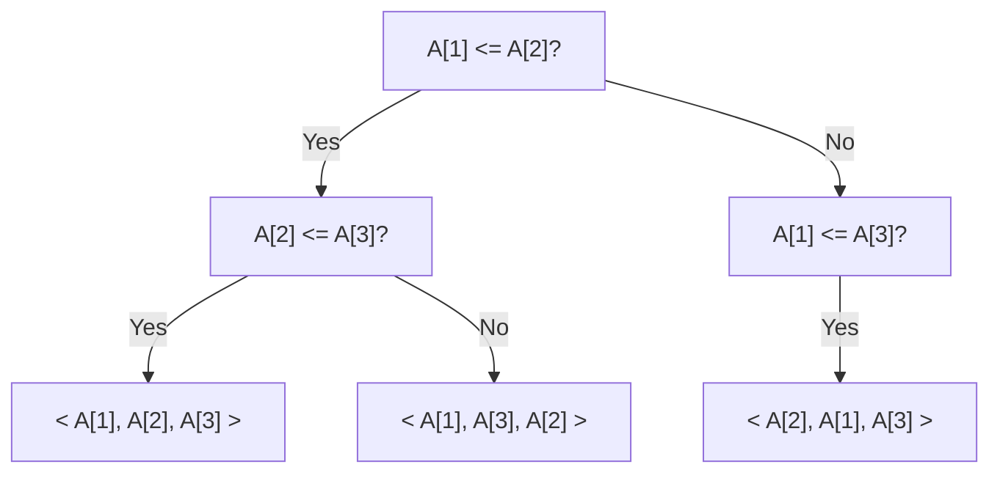
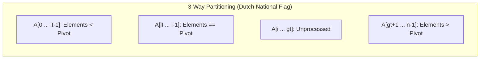
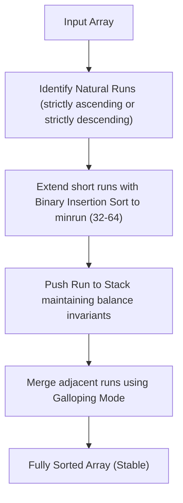
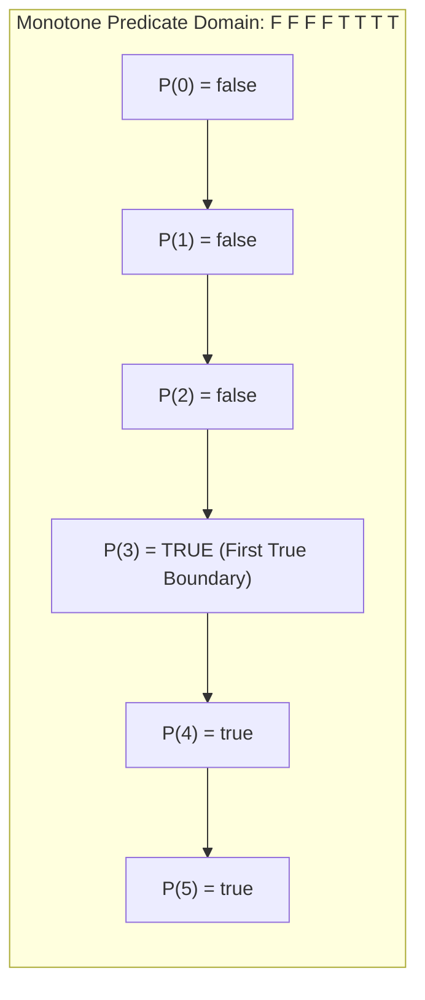

# Module 04 — Sorting, Selection & Search Invariants

Sorting and searching constitute the bedrock of computational algorithms. This module investigates the information-theoretic lower bounds of comparison sorting, the mechanics of hybrid industrial algorithms (TimSort, Introsort), linear-time selection (Quickselect), and the formulation of Binary Search as an invariant on a monotone predicate.

---

## 1. Information-Theoretic Lower Bound for Comparison Sorting

Any comparison-based sorting algorithm can be modeled as a binary **Decision Tree**, where each internal node represents a comparison $A[i] \le A[j]$ and each leaf represents a distinct permutation of the $n$ input elements.



### The Formal Proof: $\Omega(n \log n)$
1. **Number of Leaves ($L$)**: An array of $n$ distinct elements has $n!$ possible permutations. The decision tree must contain at least one leaf for every possible permutation, so:
   $$L \ge n!$$
2. **Tree Height ($h$)**: A binary tree of height $h$ has at most $2^h$ leaves:
   $$2^h \ge L \ge n! \implies h \ge \log_2(n!)$$
3. **Stirling's Approximation**: $\ln(n!) = n \ln n - n + O(\log n)$:
   $$h \ge \log_2(n!) = \sum_{k=1}^n \log_2 k \ge \sum_{k=n/2}^n \log_2 \frac{n}{2} = \frac{n}{2} \log_2 \frac{n}{2} = \frac{n}{2} (\log_2 n - 1) = \Omega(n \log n)$$
Thus, **no comparison-based sorting algorithm can achieve a worst-case time faster than $\Omega(n \log n)$**.

---

## 2. Quicksort Partitioning: Lomuto vs Hoare vs 3-Way

Quicksort's practical efficiency hinges entirely on its partitioning subroutine.



### Partitioning Comparisons
| Scheme | Invariant & Mechanics | Behavior on Duplicates | Swaps |
| :--- | :--- | :--- | :--- |
| **Lomuto** | Single index $i$; elements $< \text{pivot}$ kept at $A[\dots i]$. | **Degrades to $O(n^2)$** on arrays with all identical keys! | $\approx 3\times$ more swaps than Hoare |
| **Hoare** | Two pointers moving inward from both ends. | Yields balanced partitions on identical keys. | Minimal swaps; standard in libc |
| **3-Way (Dijkstra DNF)** | Three pointers: `lt`, `i`, `gt`. Partitions into `< pivot`, `== pivot`, `> pivot`. | **Runs in $O(n)$ linear time** when array has few unique keys! | Optimal for high-duplicate datasets |

### Introsort (Introspective Sort)
Standard in modern C++ `std::sort`:
1. Begins with Quicksort (median-of-3 pivot).
2. Monitors recursion depth: if depth exceeds $2 \lfloor \log_2 n \rfloor$, it switches to **Heapsort**, guaranteeing $O(n \log n)$ worst-case time.
3. For small partitions ($n \le 16$), it switches to **Insertion Sort** to maximize CPU cache locality.

---

## 3. Industrial Hybrid Sorting: TimSort Mechanics

Invented by Tim Peters for Python (2002) and adopted by V8 (Node.js and Chrome) in 2018 (V8 v7.0) to replace Quicksort, **TimSort** is an adaptive, stable, natural merge sort with $O(n)$ best-case and $O(n \log n)$ worst-case performance.



### TimSort Core Invariants
1. **`minrun` Selection**: Chosen in range $[32, 64]$ such that $n / \text{minrun}$ is close to a power of 2, ensuring perfectly balanced merges.
2. **Stack Collapse Invariants**: Maintains a stack of pending runs $(A, B, C)$ where $|A| > |B| + |C|$ and $|B| > |C|$. If either invariant is violated, adjacent runs are merged.
3. **Galloping Mode**: During merge of runs $A$ and $B$, if one run wins 7 consecutive times, TimSort switches from linear scan to exponential (galloping) binary search, copying entire chunks in $O(\log k)$ time.

---

## 4. Linear-Time Selection: Quickselect & Median-of-Medians

Finding the $k$-th smallest element in an unsorted array of size $n$:

### Quickselect (Hoare's Selection)
Instead of recursing into both sub-arrays like Quicksort, Quickselect recurses only into the partition containing index $k$:
$$T(n) = T(n/2) + O(n) = O(n) \quad \text{(Expected)}$$
Worst case: $O(n^2)$ if poor pivots are repeatedly chosen.

### Deterministic $O(n)$ Worst-Case: Median-of-Medians (BFPRT)
1. Partition $n$ elements into $\lfloor n/5 \rfloor$ groups of 5.
2. Find the median of each 5-element group via insertion sort ($O(1)$ per group $\implies O(n)$ total).
3. Recursively call BFPRT to find the median of the $\lfloor n/5 \rfloor$ medians: $x$.
4. Partition the entire array around pivot $x$.
5. **Guarantee**: At least $30\%$ of elements are strictly less than $x$, and at least $30\%$ are strictly greater than $x$.
6. Recurrence:
   $$T(n) \le T(n/5) + T(7n/10) + O(n)$$
   Since $1/5 + 7/10 = 9/10 < 1$, the sum converges geometrically: $T(n) = O(n)$ **strictly in the worst case**.

---

## 5. Binary Search as a Monotone Predicate

Binary search is fundamentally not about finding an element in a sorted list; it is about finding the boundary of a **monotonic boolean predicate** $P(x): \mathcal{D} \to \{0, 1\}$.



### The Universal Binary Search Invariant
To find the smallest $x \in [\text{low}, \text{high}]$ where $P(x) = \text{true}$:
```typescript
function binarySearchFirstTrue(low: number, high: number, predicate: (x: number) => boolean): number {
  let left = low;
  let right = high; // Invariant: answer is within [left, right]

  while (left < right) {
    const mid = left + Math.floor((right - left) / 2);
    if (predicate(mid)) {
      right = mid; // mid could be the first true, so keep it in range
    } else {
      left = mid + 1; // mid is false, so answer must be strictly > mid
    }
  }
  return left;
}
```

### "Binary Search on Answer"
Whenever a problem asks to minimize a maximum or maximize a minimum (e.g., *Capacity to Ship Packages Within D Days*, *Koko Eating Bananas*, *Split Array Largest Sum*), if $P(x)$ ("Is it possible with capacity $x$?") is monotonic ($P(x) \implies P(x+1)$), the problem reduces to Binary Search over the answer range $[1, \text{max\_possible}]$.

---

## 6. Interview Drill: Sorting, Selection & Search Invariants

<details>
<summary>1. Why does V8's Array.prototype.sort() use TimSort rather than Quicksort?</summary>

Prior to V8 v7.0, V8 used a hybrid of Quicksort and Insertion Sort. However, Quicksort has two major flaws in production:
1. **Unstable**: Quicksort does not preserve the relative order of elements with equal keys.
2. **Worst-Case Degradation**: Adversarial or partially sorted inputs could trigger $O(n^2)$ time.
TimSort is **strictly stable**, runs in $O(n)$ time on already-sorted or reverse-sorted data (common in UI tables), guarantees $O(n \log n)$ worst-case time, and leverages CPU cache locality via natural run identification.
</details>

<details>
<summary>2. Why does 3-way partitioning (Dutch National Flag) run in O(n) time on an array where all elements are identical?</summary>

In standard Lomuto partitioning, an array with identical elements forces all elements into one side of the partition, degrading Quicksort to $O(n^2)$.
In 3-way partitioning, elements are partitioned into three contiguous regions: $< \text{pivot}$, $== \text{pivot}$, and $> \text{pivot}$.
When all elements are identical, every element lands in the $== \text{pivot}$ middle region in a single linear pass ($O(n)$). The recursive subproblems for $< \text{pivot}$ and $> \text{pivot}$ are empty, terminating the algorithm immediately.
</details>

<details>
<summary>3. In the Median-of-Medians algorithm, why must the group size be at least 5? Why not groups of 3?</summary>

If groups of 3 are used, the recurrence becomes:
$$T(n) = T(n/3) + T(2n/3) + O(n)$$
The sum of the subproblem fractions is $1/3 + 2/3 = 1$. By the Akra-Bazzi theorem, this recurrence evaluates to $O(n \log n)$, losing linear worst-case performance!
With groups of 5, the recurrence is $T(n) \le T(n/5) + T(7n/10) + O(n)$. Because $1/5 + 7/10 = 9/10 < 1$, the recursion tree shrinks geometrically, guaranteeing $O(n)$ total time.
</details>

<details>
<summary>4. What is the difference between lower_bound and upper_bound in C++ std / algorithmic search?</summary>

- `lower_bound(target)`: Returns an iterator pointing to the **first** element that is **$\ge$ target** (equivalent to `A[i] < target` predicate boundary).
- `upper_bound(target)`: Returns an iterator pointing to the **first** element that is **strictly $>$ target** (equivalent to `A[i] <= target` predicate boundary).
For array `[10, 20, 20, 20, 30]`:
- `lower_bound(20)` returns index 1.
- `upper_bound(20)` returns index 4 (pointing to 30).
The range of all occurrences of 20 is `[lower_bound, upper_bound)`.
</details>

<details>
<summary>5. How does Counting Sort achieve O(n + k) time, and why cannot it be used for arbitrary floating-point numbers?</summary>

Counting Sort avoids comparisons by counting the occurrences of each discrete integer key in an auxiliary array of size $k$ (where $k = \text{max} - \text{min} + 1$). It computes prefix sums of the counts to determine each element's exact final index in the output array in $O(n + k)$ time.
It cannot be used for arbitrary floating-point numbers because floats cannot be mapped directly to discrete, dense array indices; the range of possible floating-point values is continuous and astronomical, requiring an array of infinite or prohibitive size.
</details>
