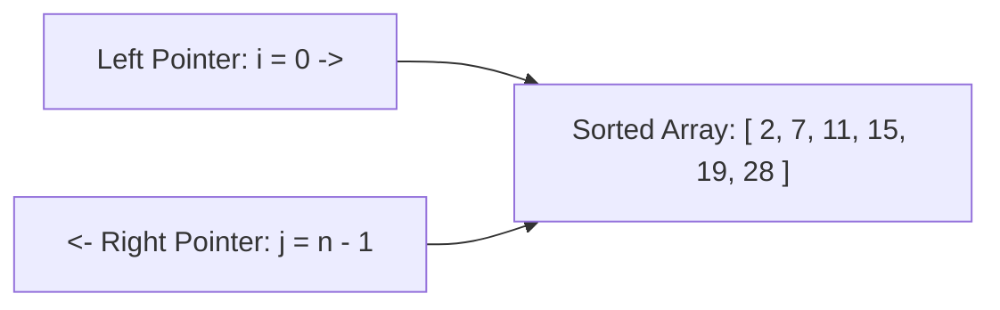
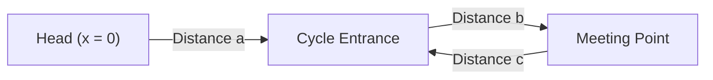
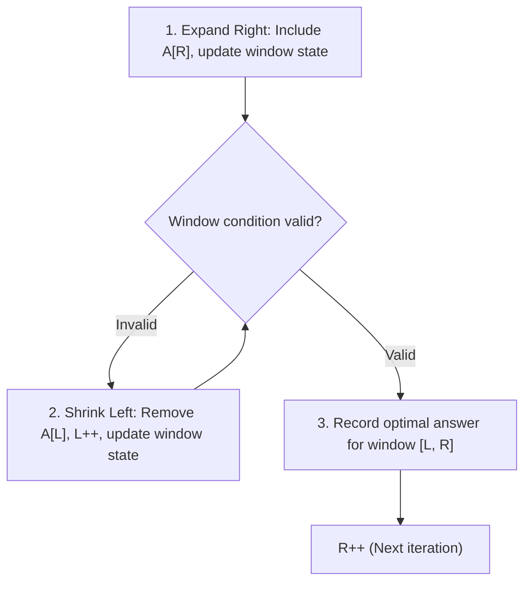
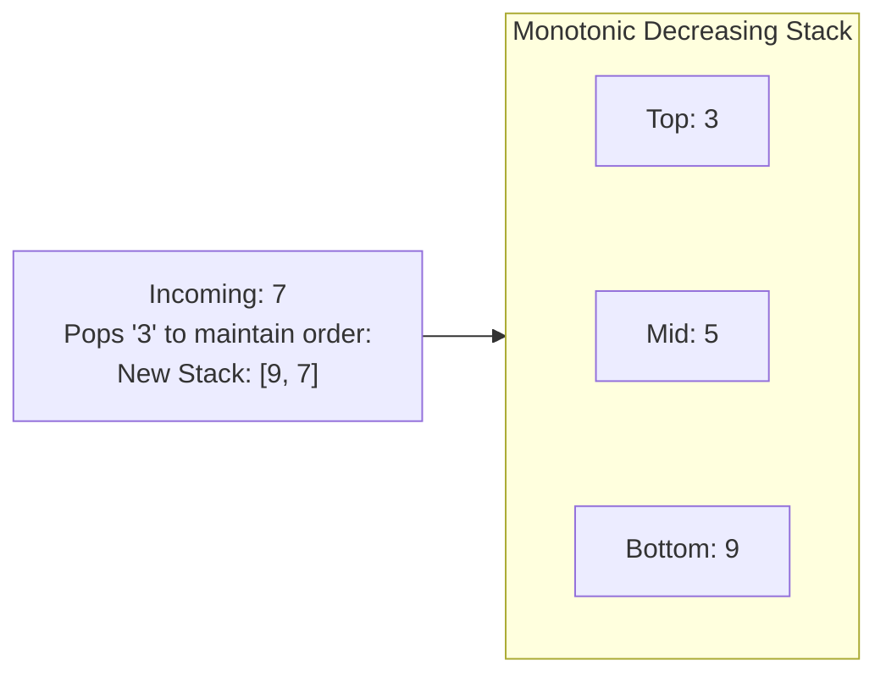

# Module 05 — Interview Pattern Catalog: Linear & Two Pointers

A substantial proportion of coding interviews test a set of canonical linear patterns: Two Pointers, Sliding Windows, Prefix Sums, Difference Arrays, Monotonic Stacks, and Cyclic Sorts. This module provides formal invariants, time/space proofs, and edge-case boundaries for each pattern.

---

## 1. Two Pointers: Invariant Elimination & Floyd's Cycle Detection

Two pointers reduce search spaces from $O(n^2)$ pairs to $O(n)$ linear time by exploiting sorted order or geometric monotonicity to eliminate entire rows/columns of candidate combinations.



### Opposite-Direction Pointers: Formal Elimination Invariant
In *Two Sum II* (sorted array):
- If $A[\text{left}] + A[\text{right}] > \text{target}$: Because $A$ is sorted, $A[k] + A[\text{right}] > \text{target}$ for **all** $k \ge \text{left}$. Therefore, index `right` can **never** pair with any candidate in the current window. We eliminate `right` decrementing `right--`.
- If $A[\text{left}] + A[\text{right}] < \text{target}$: Similarly, index `left` can never pair with any candidate $\le \text{right}$. We eliminate `left` incrementing `left++`.
Each step eliminates one candidate element in $O(1)$ time, guaranteeing convergence in at most $n - 1$ steps ($O(n)$ time, $O(1)$ space).

### Fast & Slow Pointers (Floyd's Tortoise & Hare)
Used for cycle detection in linked lists and finite state machines:

1. `slow` advances 1 step; `fast` advances 2 steps.
2. If a cycle exists, they must meet within the cycle.
3. **Meeting Math**: Let $a$ be distance from head to cycle entrance, $L = b + c$ be cycle length. When they meet:
   $$\text{Dist}_{\text{slow}} = a + b$$
   $$\text{Dist}_{\text{fast}} = a + b + k \cdot L$$
   Since `fast` traveled twice as fast: $2(a + b) = a + b + k L \implies a + b = k L \implies a = k L - b = (k - 1) L + c$.
4. **Cycle Entrance Proof**: Resetting `slow` to `head` while keeping `fast` at `Meet` and advancing both at speed 1 guarantees they will meet at the cycle entrance after exactly $a$ steps!

---

## 2. Sliding Window: Monotonicity & The Negative Numbers Trap

The sliding window pattern maintains a contiguous range $[L, R)$ over an array or string.



### The Negative Numbers Trap
> [!CAUTION] When Sliding Window Fails
> The Sliding Window pattern **strictly requires monotonicity**: expanding the window ($R++$) must monotonically increase the sum/property, and shrinking the window ($L++$) must monotonically decrease it.
> If an array contains **negative numbers**, adding an element might decrease the sum, and removing an element might increase it!
> For "Subarray Sum Equals K" with negative numbers, **Sliding Window fails completely**. You must use **Prefix Sums + Hash Map**.

---

## 3. Prefix Sums & Difference Arrays

### 1D and 2D Prefix Sums
- 1D Prefix Sum: $P[i] = \sum_{k=0}^{i-1} A[k]$.
  Query sum in range $[L, R]$:
  $$\text{Sum}(A[L \dots R]) = P[R + 1] - P[L] \quad \implies O(1) \text{ time}$$
- 2D Prefix Sum (Matrix Region Sum):
  $$P[r][c] = M[r-1][c-1] + P[r-1][c] + P[r][c-1] - P[r-1][c-1]$$
  Query sum inside rectangle $(r_1, c_1)$ to $(r_2, c_2)$:
  $$\text{Sum} = P[r_2+1][c_2+1] - P[r_1][c_2+1] - P[r_2+1][c_1] + P[r_1][c_1]$$

### Difference Array: $O(1)$ Range Additions
Given an array $A$, its difference array is $D[i] = A[i] - A[i-1]$ (with $D[0] = A[0]$).
- Adding value $v$ to all elements in range $[L, R]$:
  $$D[L] \mathrel{+}= v$$
  $$D[R + 1] \mathrel{-}= v \quad (\text{if } R + 1 < n)$$
Applying $k$ range updates takes $O(k)$ time. Computing the prefix sum of $D$ reconstructs the final modified array in a single $O(n)$ pass, reducing an $O(n \times k)$ brute force to $O(n + k)$.

---

## 4. Monotonic Stack & Monotonic Queue

A Monotonic Stack (or Queue) preserves a strictly increasing or decreasing order of elements.



### Amortized $O(n)$ Proof
Although an individual insertion may trigger a loop popping multiple elements, **every element is pushed onto the stack at most once and popped at most once**.
Across all $n$ iterations, the total number of pops cannot exceed $n$.
Total amortized time is strictly $O(n)$.

### Applications
1. **Next Greater Element**: Maintain monotonic decreasing stack; when $A[i] > \text{stack.top}$, $A[i]$ is the next greater element for `stack.pop()`.
2. **Largest Rectangle in Histogram**: Compute left and right bounding indices where bars are strictly shorter in $O(n)$ time.
3. **Sliding Window Maximum (Monotonic Deque)**: Store indices in a deque whose values are monotonically decreasing. The front of the deque is always the maximum element in the current window of size $k$.

---

## 5. Kadane's Algorithm & Cyclic Sort

### Kadane's Algorithm: Maximum Subarray Sum
Find the contiguous subarray with the largest sum in $O(n)$ time and $O(1)$ space:

```typescript
function maxSubArray(nums: number[]): number {
  let currentSum = nums[0]!;
  let maxSum = nums[0]!;

  for (let i = 1; i < nums.length; i++) {
    // Decision: extend previous subarray or start fresh from nums[i]?
    currentSum = Math.max(nums[i]!, currentSum + nums[i]!);
    maxSum = Math.max(maxSum, currentSum);
  }
  return maxSum;
}
```

### Cyclic Sort: In-Place Permutation
When an array of length $n$ contains integers strictly in the range $[1, n]$ (or $[0, n-1]$), each number $x$ has an exact designated target index $\text{target} = x - 1$.
Instead of sorting in $O(n \log n)$ or allocating an auxiliary array in $O(n)$ space:
```typescript
function cyclicSort(nums: number[]): void {
  let i = 0;
  while (i < nums.length) {
    const correctIdx = nums[i]! - 1;
    if (nums[i]! > 0 && nums[i]! <= nums.length && nums[i]! !== nums[correctIdx]) {
      // Swap element to its correct home
      [nums[i], nums[correctIdx]] = [nums[correctIdx]!, nums[i]!];
    } else {
      i++;
    }
  }
}
```
**Complexity**: Each swap places at least one element into its final permanent position. The `while` loop executes at most $2n$ steps, achieving $O(n)$ time in $O(1)$ auxiliary space.

---

## 6. Interview Drill: Linear & Two Pointers

<details>
<summary>1. In the "Subarray Sum Equals K" problem, why must a hash map be initialized with { 0: 1 }?</summary>

The hash map stores `prefixSum -> frequency`.
The condition for a valid subarray ending at index $i$ is:
$$\text{currentPrefixSum} - \text{target} = \text{previousPrefixSum}$$
If a subarray starting from index 0 itself sums to `target` (e.g. `currentPrefixSum === target`), then `currentPrefixSum - target = 0`.
Initializing `{ 0: 1 }` represents an empty prefix before index 0 with sum 0, ensuring subarrays starting from the beginning of the array are counted.
</details>

<details>
<summary>2. Explain how to detect the start of a cycle in an array where each index points to nums[i], without modifying the array or using extra memory.</summary>

Treat the array as a functional linked list where `next(i) = nums[i]`.
By the Pigeonhole Principle, if an array of size $n + 1$ contains values in range $[1, n]$, a duplicate value exists, creating a cycle.
1. Run Floyd's Tortoise and Hare: `slow = nums[slow]`, `fast = nums[nums[fast]]` until `slow === fast`.
2. Reset `slow = 0`.
3. Advance both `slow` and `fast` one step at a time: `slow = nums[slow]`, `fast = nums[fast]`.
4. The value where they collide is the cycle entrance, representing the duplicate number.
</details>

<details>
<summary>3. In the Sliding Window Maximum problem, why does the deque store indices rather than values?</summary>

Storing indices provides two critical capabilities:
1. **Value Lookup**: $A[\text{index}]$ retrieves the value in $O(1)$ time for monotonic comparisons.
2. **Window Expiration Check**: The algorithm must remove elements that have fallen outside the left edge of the sliding window ($L > \text{index}$). Comparing `deque.peekFront() <= i - k` allows $O(1)$ expiration of out-of-window elements. Storing values alone cannot distinguish between duplicate values or determine position relative to window boundaries.
</details>

<details>
<summary>4. Why does Cyclic Sort achieve O(n) running time even though it contains a while loop with swaps?</summary>

Every time a swap occurs (`swap(nums[i], nums[correctIdx])`), the element `nums[i]` is moved to its correct home index `correctIdx`. Once an element is placed in its correct position, it is never moved again.
Because there are $n$ elements, there can be at most $n - 1$ swaps.
The loop increments `i` when an element is already in place.
The total number of loop iterations is bounded by $n \text{ (advancing i)} + (n - 1) \text{ (swaps)} \le 2n = O(n)$.
</details>

<details>
<summary>5. How does a Difference Array handle overlapping interval updates in O(1) per update?</summary>

A difference array records the derivative (rate of change) of the array rather than the absolute values:
- Adding $+v$ at index $L$ means all subsequent elements in the accumulated prefix sum will increase by $+v$.
- Subtracting $-v$ at index $R + 1$ cancels the $+v$ for all elements past index $R$.
Because each interval update only modifies two boundary indices ($L$ and $R+1$), each update takes $O(1)$ time regardless of interval span.
</details>
