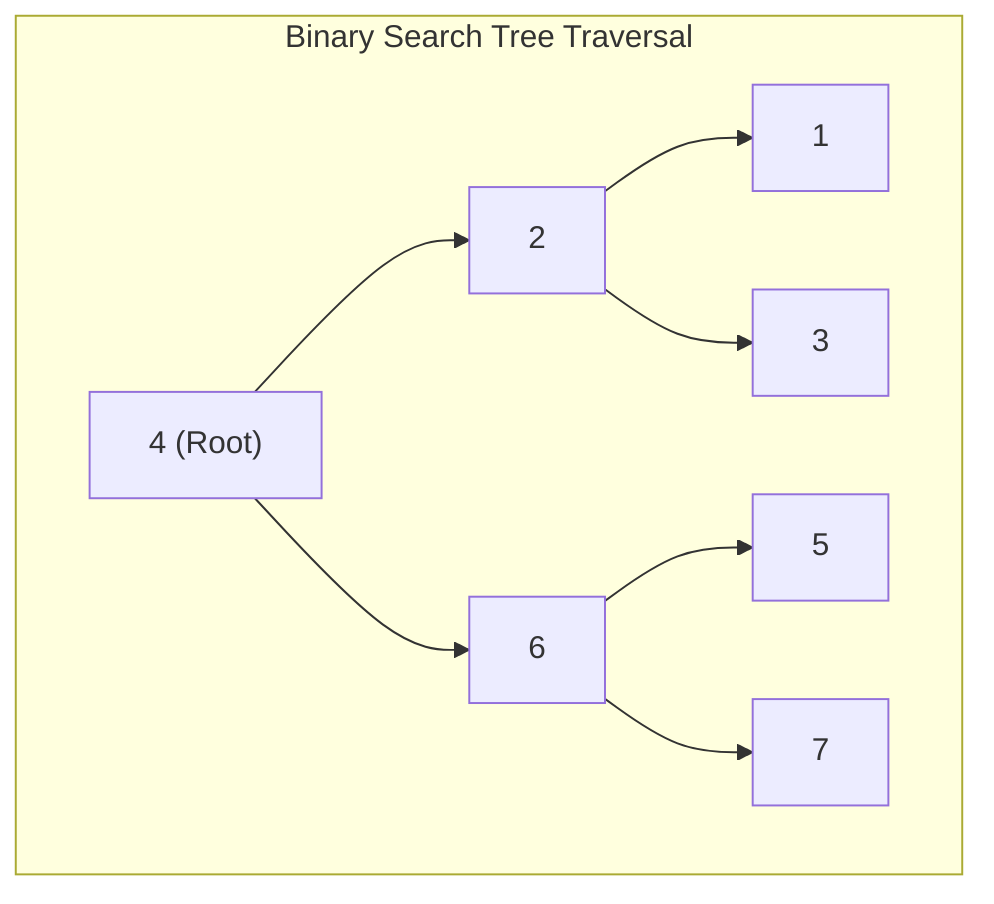
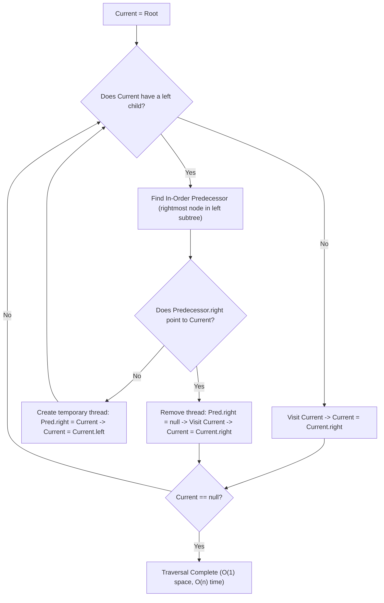
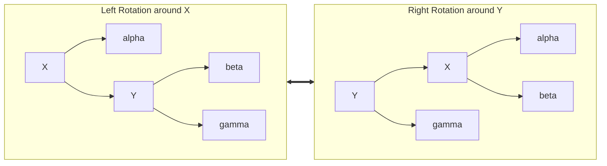
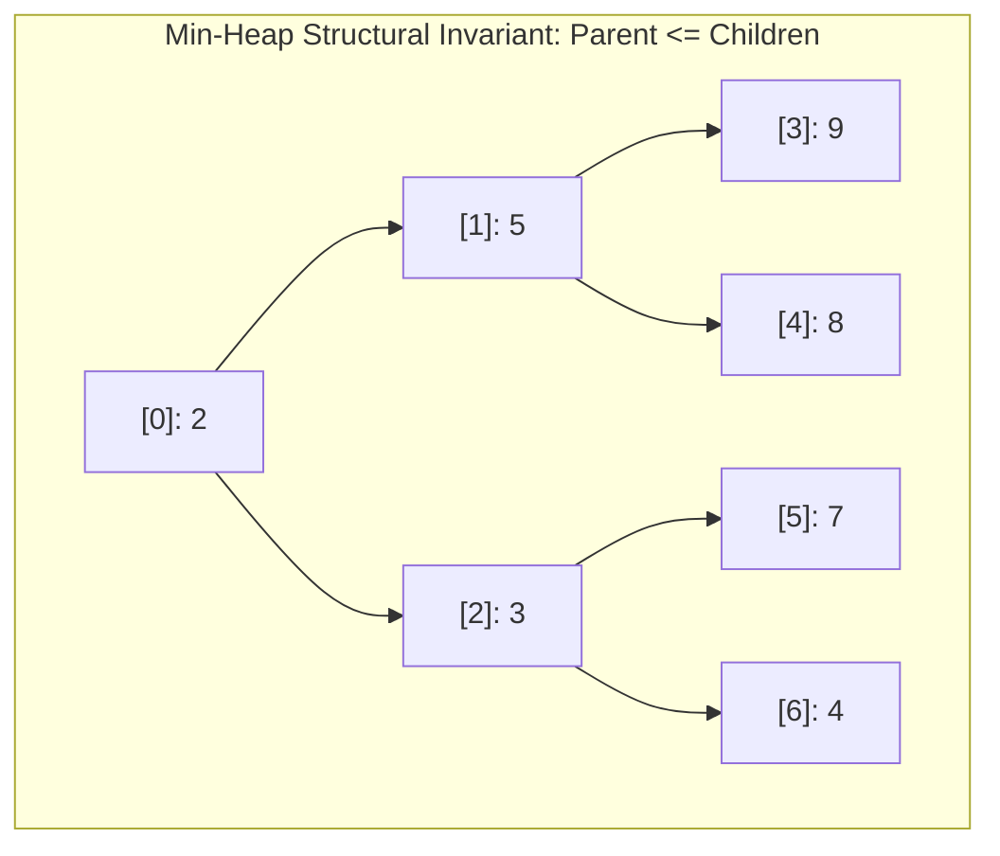
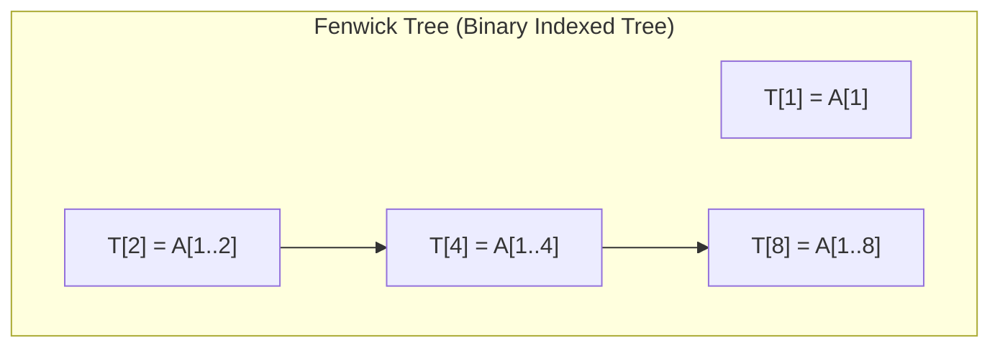
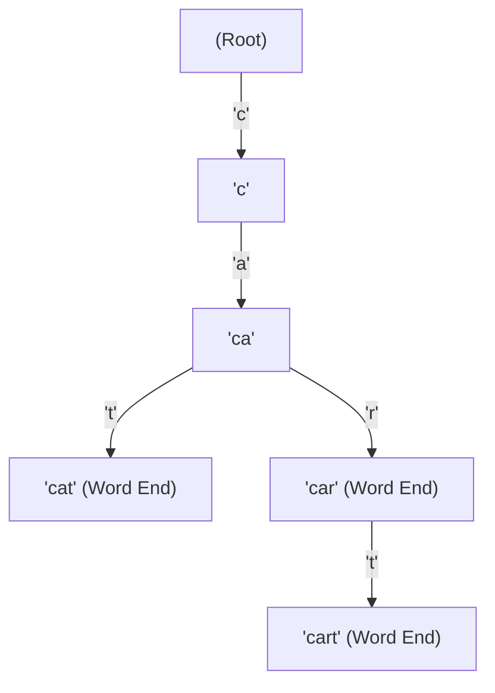

# Module 06 — Trees, Heaps & Priority Queues

Hierarchical tree structures organize data non-linearly to support logarithmic search, insertion, and range queries. This module establishes the structural invariants of balanced search trees, $O(1)$-space Morris traversals, linear-time heap construction, and specialized range-query structures (Segment and Fenwick trees).

---

## 1. Binary Tree Traversals & The Morris $O(1)$-Space Traversal

Standard tree traversals (Pre-order, In-order, Post-order) require $O(h)$ auxiliary stack memory, which degrades to $O(n)$ space on skewed trees.

### Morris In-Order Traversal (Threaded Binary Tree)
Joseph Morris (1979) introduced an algorithm to traverse a binary tree in $O(n)$ time and **strictly $O(1)$ auxiliary space** without modifying tree nodes or using recursion.

Every edge is traversed at most three times: once to find the predecessor and create the thread, once to traverse into the left subtree, and once to find the predecessor and delete the thread. Overall time is $\Theta(n)$ with $O(1)$ memory.

---

## 2. Self-Balancing Binary Search Trees: AVL vs Red-Black

Unbalanced BSTs degrade to $O(n)$ linked lists under sequential insertions. Self-balancing trees guarantee $O(\log n)$ height by performing **tree rotations**.

### AVL Trees (Strict Balance)
- **Invariant**: For every node $x$, the **Balance Factor** $\text{BF}(x) = \text{height}(\text{left}) - \text{height}(\text{right}) \in \{-1, 0, +1\}$.
- **Height Bound**: Maximum height $h < 1.44 \log_2(n + 2)$.
- **Rebalancing**: 4 rotation cases:
  1. **Left-Left (LL)**: Single Right Rotation.
  2. **Right-Right (RR)**: Single Left Rotation.
  3. **Left-Right (LR)**: Left Rotation on left child, then Right Rotation on root.
  4. **Right-Left (RL)**: Right Rotation on right child, then Left Rotation on root.
- **Use Case**: Read-heavy workloads where fast $O(\log n)$ lookup dominates over updates.

### Red-Black Trees (Relaxed Balance)
Standard in Linux kernel `rbtree`, C++ `std::map`, and Java `TreeMap`:
- **5 Axiomatic Invariants**:
  1. Every node is either **Red** or **Black**.
  2. The root is always **Black**.
  3. All leaf nodes (NIL sentinels) are **Black**.
  4. If a node is **Red**, both of its children must be **Black** (no two consecutive reds).
  5. Every simple path from any node to any of its descendant leaves contains the identical number of black nodes (**Black-Height**, $bh(x)$).
- **Height Theorem**: A red-black tree with $n$ internal nodes has height:
  $$h \le 2 \log_2(n + 1)$$
- **Trade-off**: Slightly taller than AVL trees, but insertions/deletions require at most **2 rotations** for insertion and **3 rotations** for deletion, making it superior for write-heavy workloads.

---

## 3. Binary Heaps & Priority Queues

A **Binary Heap** is a complete binary tree stored compactly in a single flat array without pointers.

### Array Indexing Formulas (0-based)
For node at index $i$:
$$\text{parent}(i) = \left\lfloor \frac{i - 1}{2} \right\rfloor, \quad \text{left}(i) = 2i + 1, \quad \text{right}(i) = 2i + 2$$

### Linear-Time Heapify Proof: $O(n)$ `buildHeap`
Instead of calling `push` $n$ times ($O(n \log n)$), `buildHeap` runs `siftDown` bottom-up starting from the lowest non-leaf node $\lfloor n/2 \rfloor - 1$ down to index 0:
- At height $h$, there are at most $\lceil n / 2^{h+1} \rceil$ nodes.
- A node at height $h$ can sift down at most $h$ levels.
Total cost:
$$\sum_{h=0}^{\lfloor \log_2 n \rfloor} \left\lceil \frac{n}{2^{h+1}} \right\rceil O(h) = O\left( n \sum_{h=0}^{\infty} \frac{h}{2^h} \right)$$
Using the geometric series $\sum_{h=0}^\infty \frac{h}{2^h} = 2$:
$$\text{Total Cost} = O(2n) = O(n) \quad \text{strictly linear time!}$$

---

## 4. Range Query Data Structures: Fenwick vs Segment Trees

When an algorithm must execute frequent point updates and range queries (e.g. range sum or range minimum):

### Fenwick Tree (Binary Indexed Tree / BIT)
- Stored as a 1-indexed array $T$ of size $n + 1$.
- Each index $i$ is responsible for the sum of elements in range $[i - \text{lowbit}(i) + 1, i]$, where:
  $$\text{lowbit}(i) = i \ \& \ (-i)$$
- **Point Update**: $i \leftarrow i + \text{lowbit}(i)$ (takes $O(\log n)$).
- **Prefix Sum**: $i \leftarrow i - \text{lowbit}(i)$ (takes $O(\log n)$).
- Memory: Exactly $n$ words ($O(n)$ space, zero pointer overhead).

### Segment Tree
- A full binary tree where each node represents an interval $[L, R]$.
- Can support non-invertible operations (such as **Range Minimum Query / RMQ**, which Fenwick trees cannot handle natively).
- **Lazy Propagation**: Defers range updates to child subtrees, achieving $O(\log n)$ range updates and range queries simultaneously.
- Memory: Requires $4n$ array slots.

---

## 5. Tries (Prefix Trees)

A **Trie** is an $m$-ary tree where edges are labeled with characters, enabling $O(L)$ key insertion, lookup, and prefix search (where $L$ is string length), independent of the number of keys stored.

---

## 6. Interview Drill: Trees, Heaps & Priority Queues

1. Why does buildHeap take O(n) time while inserting n elements one-by-one takes O(n log n)?

When building a heap by inserting elements one-by-one, each insertion adds an element at the bottom (leaf level) and sifts up. Half the elements ($n/2$) reside at the leaf level and must sift up $\log n$ levels, leading to $\sum \log n = O(n \log n)$.
In `buildHeap`, the algorithm processes bottom-up: half the elements ($n/2$) are leaves and sift down 0 levels; one-quarter ($n/4$) sift down 1 level; one-eighth ($n/8$) sift down 2 levels.
Because the vast majority of nodes reside near the bottom and have tiny sift distances, the sum $\sum h / 2^h$ converges to a constant, yielding strictly $O(n)$ time.

2. How can you find the running median of a data stream in O(1) read time and O(log n) insertion time?

Use **Two Heaps**:
1. A **Max-Heap** storing the smaller half of the numbers.
2. A **Min-Heap** storing the larger half of the numbers.
- **Invariants**:
  - Max-Heap root $\le$ Min-Heap root.
  - Sizes differ by at most 1 ($\text{size}_{\text{max}} = \text{size}_{\text{min}}$ or $\text{size}_{\text{max}} = \text{size}_{\text{min}} + 1$).
- **Insertion ($O(\log n)$)**: Insert into max-heap; balance to min-heap if order invariant violated; balance sizes if size invariant violated.
- **Median ($O(1)$)**: If max-heap has more elements, median is `maxHeap.peek()`. Otherwise, median is $(\text{maxHeap.peek()} + \text{minHeap.peek()}) / 2$.

3. In an Indexed Priority Queue, what auxiliary structures are maintained and why?

Standard binary heaps do not support finding an arbitrary element in $O(\log n)$ time; finding an element to update its key requires an $O(n)$ linear scan.
An **Indexed Priority Queue** maintains three synchronized arrays:
1. `keys`: The actual priority values.
2. `heap`: Array of indices mapping heap slots to key IDs.
3. `inv`: Inverse lookup mapping key ID to its current slot in `heap`.
When nodes are swapped in the heap, `inv` is updated in $O(1)$ time. This allows `decreaseKey(id, newPriority)` to find the node's heap index in $O(1)$ time and sift up in $O(\log n)$, which is crucial for Dijkstra's shortest path algorithm.

4. What is the fundamental advantage of a Fenwick Tree over a Segment Tree?

A Fenwick Tree (BIT) uses **substantially less memory and exhibits faster cache performance**.
- A Fenwick tree uses an array of size $n + 1$, has zero pointers, and requires only 2–3 bitwise operations per update or query.
- A Segment tree requires $4n$ array slots (or pointer nodes) and has recursive traversal overhead.
However, Fenwick trees only handle invertible associative operations (like sum, XOR). For non-invertible range operations (like Range Minimum Query) or general range updates with range queries, Segment Trees with Lazy Propagation are required.

5. Explain the Morris In-Order Traversal invariant and how it restores the original tree structure.

In Morris Traversal, when visiting node $X$:
1. If $X$ has a left child, find $X$'s in-order predecessor $P$ (the rightmost node in $X$'s left subtree).
2. If $P.right === null$, create a temporary back-pointer (thread) $P.right = X$, and move to $X.left$.
3. If $P.right === X$, the left subtree has already been fully visited! The algorithm clears $P.right = null$ (restoring the tree to its original state), visits $X$, and moves to $X.right$.
This thread mechanism acts as a temporary return stack encoded directly within unused leaf pointers.

