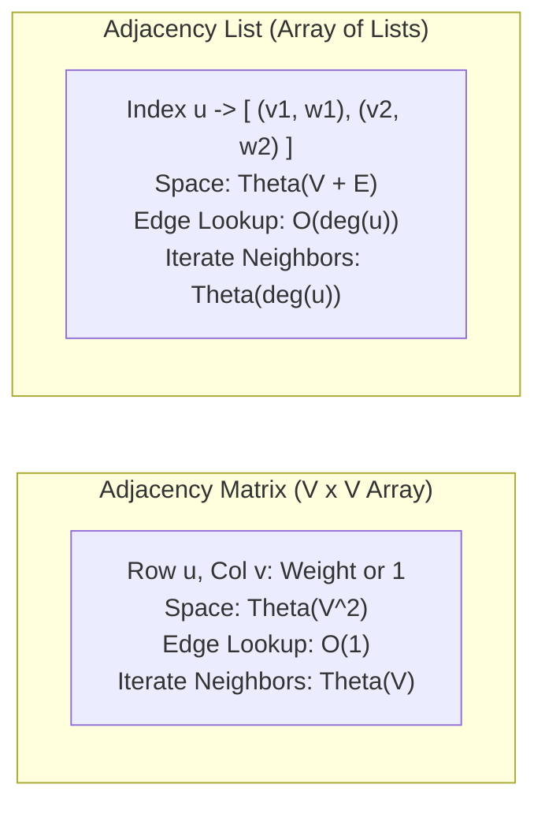
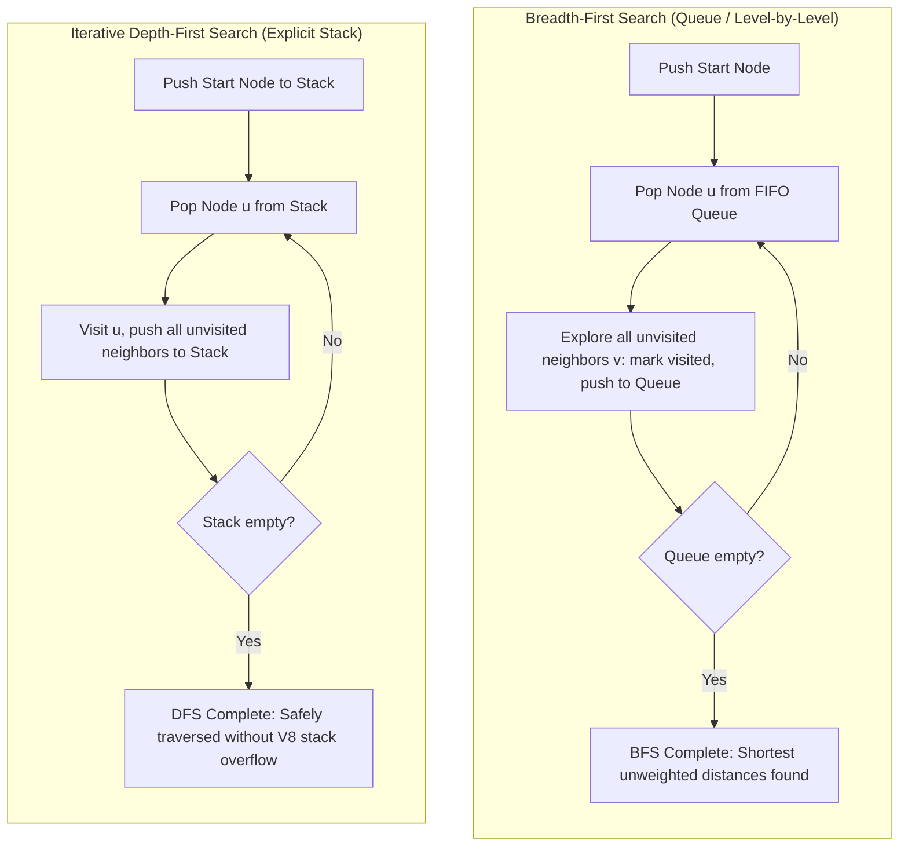
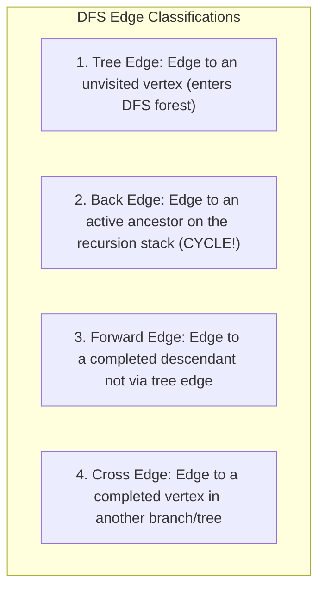
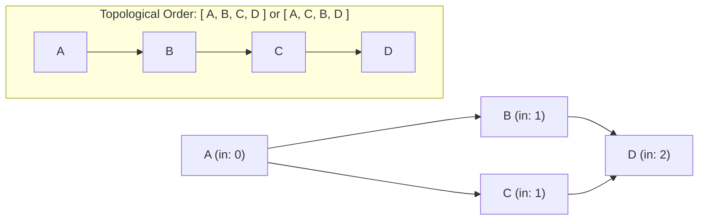
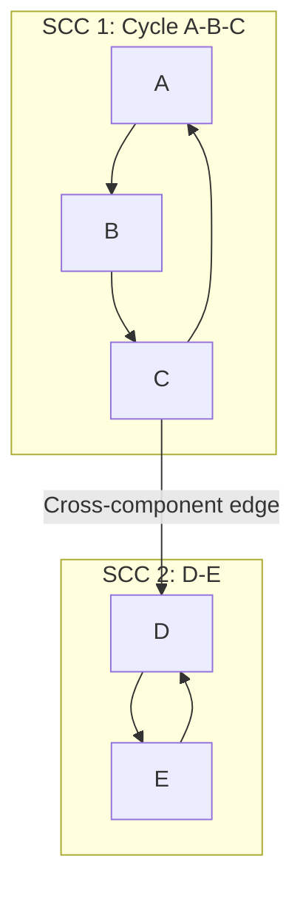
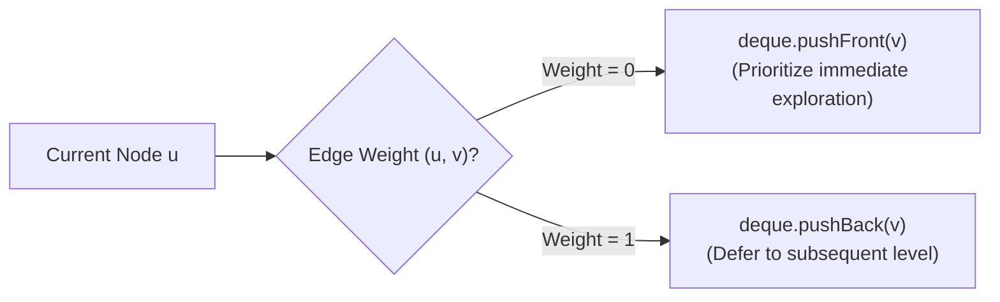

# Module 07 — Graph Foundations, Traversals & Topological Sorting

Graphs represent arbitrary pairwise relationships between entities. This module explores sparse vs dense graph representations, iterative BFS/DFS stack safety, DFS edge classifications, cycle detection invariants, topological sorting, Strongly Connected Components (Tarjan's algorithm), and 0-1 BFS.

---

## 1. Graph Representations: Adjacency Matrix vs Adjacency List

A graph $G = (V, E)$ consists of vertices $V$ and edges $E$.

### The Density Threshold
- **Sparse Graphs** ($|E| \ll |V|^2$, common in real-world networks where average degree is low): **Adjacency Lists** are strictly superior, saving orders of magnitude of memory ($O(V + E)$ vs $O(V^2)$).
- **Dense Graphs** ($|E| \approx |V|^2$): Adjacency Matrices offer cache locality and $O(1)$ edge existence checks.

---

## 2. Iterative Graph Traversals & Call-Stack Protection

In environments with limited call stacks (such as V8 with a default stack limit of ~10,000 frames), recursive DFS on a path graph of $100,000$ vertices throws `RangeError: Maximum call stack size exceeded`.

### Invariants & Complexity
Both BFS and DFS visit every vertex once and examine every incident edge once:
$$\text{Time Complexity} = O(V + E), \quad \text{Space Complexity} = O(V)$$

---

## 3. DFS Edge Classification & Directed Cycle Detection

When performing Depth-First Search on a directed graph, every edge $(u, v)$ falls into one of four mutually exclusive topological categories based on the entry and exit timestamps:

### Three-Color Cycle Detection
To detect cycles in directed graphs without recursion:
- **White (0)**: Unvisited.
- **Gray (1)**: Currently active on the DFS recursion stack (ancestor).
- **Black (2)**: Completely processed (all descendants visited).

**Theorem**: A directed graph $G$ contains a cycle if and only if DFS encounters a **Back Edge** pointing to an active **Gray** vertex.

---

## 4. Topological Sorting: Kahn's Algorithm vs DFS Post-Order Reversal

A **Topological Sort** of a Directed Acyclic Graph (DAG) is a linear ordering of vertices such that for every directed edge $(u, v)$, vertex $u$ appears before vertex $v$.

### 1. Kahn's Algorithm (BFS In-Degree Reduction)
1. Compute the in-degree $\text{in}[u]$ for all vertices $u \in V$.
2. Initialize a queue with all vertices having $\text{in}[u] = 0$.
3. While queue is not empty:
   - Pop $u$, append $u$ to result list.
   - For each neighbor $v$ of $u$: decrement $\text{in}[v]$. If $\text{in}[v] == 0$, push $v$ to queue.
4. **Cycle Detection**: If result length $< |V|$, the graph contains a cycle (unresolved dependencies).

### 2. DFS Post-Order Reversal
Run DFS. When a vertex finishes (all children explored), append it to a list. Reverse the list at the end. (If a back edge is encountered, reject: not a DAG).

---

## 5. Strongly Connected Components: Tarjan's Algorithm

In a directed graph, a **Strongly Connected Component (SCC)** is a maximal subgraph where every vertex is reachable from every other vertex.

### Tarjan's Algorithm (Single-Pass DFS)
Tarjan's algorithm finds all SCCs in a single DFS pass using two integers per node:
1. `discovery[u]`: Timestamp when node $u$ was first visited.
2. `low[u]`: Smallest discovery timestamp reachable from $u$ via tree edges and at most one back edge.
A stack maintains all nodes in the current candidate SCC:
- When exploring neighbor $v$:
  - If $v$ is unvisited: recurse; `low[u] = Math.min(low[u], low[v])`.
  - Else if $v$ is currently on the stack: `low[u] = Math.min(low[u], discovery[v])`.
- **Root of SCC Invariant**: If `low[u] === discovery[u]`, node $u$ is the root of an SCC! Pop all nodes from the stack down to $u$; they form a complete, isolated SCC.
**Complexity**: $\Theta(V + E)$ time and $\Theta(V)$ auxiliary space.

---

## 6. 0-1 Breadth-First Search (Dijkstra Optimization)

When edge weights in a graph are restricted strictly to values $w \in \{0, 1\}$ (e.g. state transitions that cost 0 or 1), running Dijkstra's algorithm with a binary heap costs $O((V + E) \log V)$.
Using a **Double-Ended Queue (Deque)**, 0-1 BFS solves the single-source shortest path problem in **strictly linear $O(V + E)$ time**:

Because 0-weight edges do not advance the current path cost, pushing them to the front preserves the monotonic distance invariant of the queue without sorting.

---

## 7. Interview Drill: Graph Foundations & Traversals

1. In Kahn's algorithm, what does it mean if the queue becomes empty before all vertices are added to the topological sort?

It proves that the directed graph contains at least one **directed cycle**.
Every vertex in a cycle has an in-degree of at least 1 (incoming edge from the previous node in the cycle). None of the cycle nodes can ever have their in-degree reduced to 0, preventing them from entering the queue.
Kahn's algorithm thus doubles as a definitive cycle detection mechanism: `result.length === V ? topologicalOrder : hasCycle`.

2. How does 0-1 BFS maintain the shortest path invariant without using a priority queue?

In standard BFS, all edges have weight 1, so the queue is monotonically ordered by distance: nodes at distance $d$ are followed by nodes at distance $d+1$.
In 0-1 BFS, traversing a 0-weight edge leads to distance $d + 0 = d$. Pushing this to the **front** of the deque ensures it is processed before any node at distance $d + 1$.
Traversing a 1-weight edge leads to distance $d + 1$. Pushing this to the **back** of the deque places it behind all distance $d$ nodes.
Thus, the deque contains elements at only two distances at any moment ($d$ and $d+1$), strictly preserving non-decreasing order in $O(1)$ operations per edge.

3. Why can an undirected graph be bipartite if and only if it contains no odd-length cycles?

A bipartite graph can be partitioned into two independent sets $U$ and $V$ such that all edges connect a node in $U$ to a node in $V$ (2-colorable).
Traversing an edge alternates color: $U \to V \to U \to V$.
Any path of length $k$ returning to the starting node must make an even number of color flips to return to the original color. An odd-length cycle forces an edge to connect two nodes of the identical color, violating bipartiteness.

4. What is the difference between a Cross Edge and a Back Edge in directed DFS?

- A **Back Edge** points from a descendant to an **ancestor** currently active on the DFS stack. A back edge proves the existence of a directed cycle.
- A **Cross Edge** points from a node to an already-finished node that is neither an ancestor nor a descendant (it connects two separate branches or disjoint trees in the DFS forest). Cross edges do not indicate a cycle.

5. How does Multi-Source BFS work, and what problem does it solve?

In Multi-Source BFS, all initial starting source nodes are pushed into the queue simultaneously at time $t = 0$.
The BFS expands outwards from all sources in lockstep, computing the shortest distance from **any** source to every other node in the graph in a single $O(V + E)$ pass.
This eliminates running BFS repeatedly from each individual source, which would cost $O(S \times (V + E))$. Classic applications include computing proximity fields on grid maps (e.g. distance to nearest hospital or zombie outbreak simulation).

