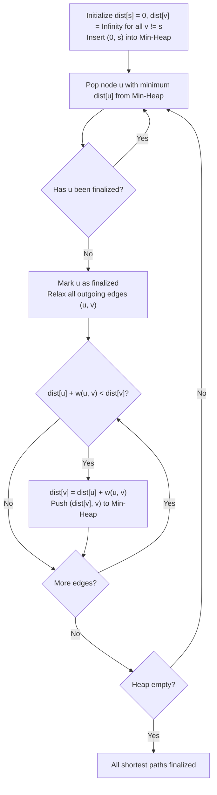
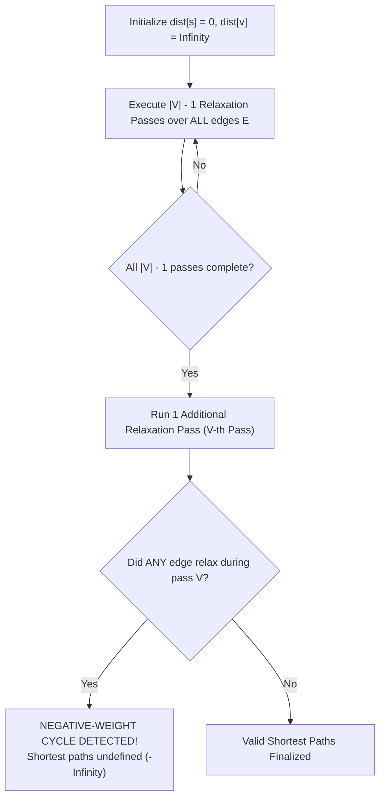
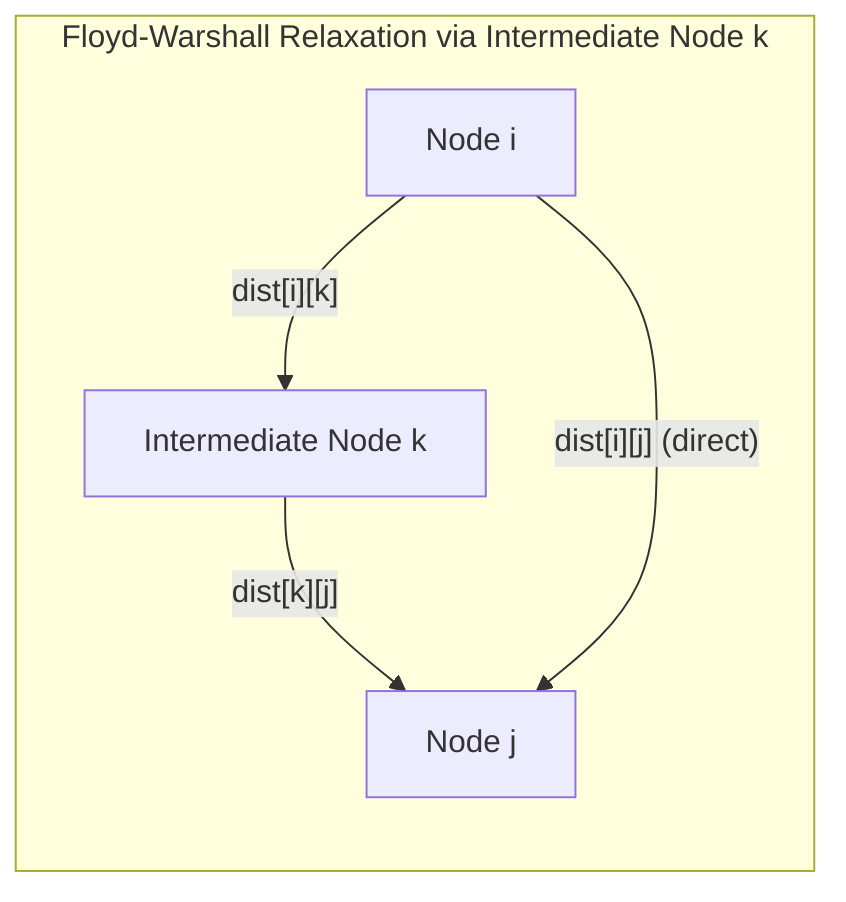
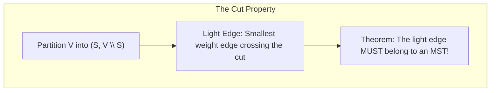
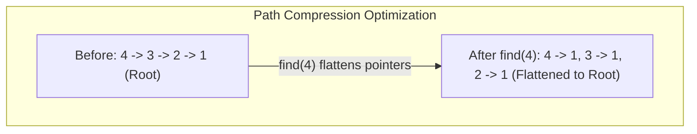

# Module 08 — Shortest Paths, Minimum Spanning Trees & Disjoint Sets

Finding optimal paths and minimal spanning subgraphs in weighted networks represents a cornerstone of combinatorial optimization. This module examines Dijkstra's algorithm, negative cycle detection via Bellman-Ford, all-pairs shortest paths via Floyd-Warshall, minimum spanning tree invariants (Kruskal and Prim), and the near-constant-time Disjoint-Set Union (DSU) data structure.

---

## 1. Single-Source Shortest Paths: Dijkstra's Algorithm

Given a directed weighted graph $G = (V, E)$ with non-negative edge weights ($w(u, v) \ge 0$), **Dijkstra's Algorithm** finds the shortest path from a source $s$ to all vertices.



### Why Negative Edge Weights Break Dijkstra
Dijkstra relies on a **Greedy Monotonicity Invariant**: once a vertex $u$ is popped from the min-heap, its shortest path distance $\text{dist}[u]$ is permanently finalized and will never be improved.
If an edge has a negative weight ($w(x, y) < 0$), a path traversing through $x$ and $y$ later could reduce $\text{dist}[u]$ after $u$ was already finalized, violating the greedy choice property and producing incorrect distances.

---

## 2. Negative Cycles & Bellman-Ford Algorithm

When edges can have negative weights, the **Bellman-Ford Algorithm** computes shortest paths and detects negative-weight cycles in $O(V \cdot E)$ time.



### The Longest Simple Path Invariant
In a graph with $V$ vertices without negative cycles, any shortest path contains at most $V - 1$ edges.
Therefore, relaxing all edges $V - 1$ times guarantees that all shortest paths are computed. If an edge can still relax on the $V$-th pass, a **negative-weight cycle** must exist, allowing an infinite loop of decreasing distances.

---

## 3. All-Pairs Shortest Paths: The Floyd-Warshall Algorithm

To find the shortest distance between **every pair of vertices** $(i, j)$ in a graph with no negative cycles, the **Floyd-Warshall** dynamic programming algorithm runs in $\Theta(V^3)$ time and $\Theta(V^2)$ space:



### Dynamic Programming Recurrence
Let $D^{(k)}[i][j]$ be the shortest path from $i$ to $j$ using only intermediate vertices from the subset $\{0, 1, \dots, k\}$:
$$D^{(k)}[i][j] = \min\left( D^{(k-1)}[i][j], \ D^{(k-1)}[i][k] + D^{(k-1)}[k][j] \right)$$

---

## 4. Minimum Spanning Trees: Cut & Cycle Properties

A **Minimum Spanning Tree (MST)** of a connected, undirected weighted graph $G = (V, E)$ is an acyclic subgraph spanning all $V$ vertices with the minimal total edge weight.



### 1. Kruskal's Algorithm (Edge Greedy + DSU)
1. Sort all edges $E$ in non-decreasing order of weight: $O(E \log E)$.
2. Initialize a Disjoint-Set Union (DSU) structure with $V$ singletons.
3. For each edge $(u, v, w)$:
   - If $\text{find}(u) \neq \text{find}(v)$: add $(u, v)$ to MST and call $\text{union}(u, v)$.
   - Else: discard (would create a cycle).
**Complexity**: $O(E \log E) = O(E \log V)$.

### 2. Prim's Algorithm (Vertex Cut Expansion)
Grows an MST from an arbitrary starting vertex using a Priority Queue, repeatedly adding the minimum-weight edge connecting the tree to an unvisited vertex (identical structure to Dijkstra).
**Complexity**: $O((V + E) \log V)$.

---

## 5. Disjoint-Set Union (DSU / Union-Find) & The Inverse Ackermann Bound

The **Disjoint-Set Union (DSU)** data structure maintains a collection of disjoint dynamic sets supporting two operations:
- `find(u)`: Returns the representative (root) of the set containing $u$.
- `union(u, v)`: Merges the set containing $u$ with the set containing $v$.



### Two Essential Optimizations
1. **Union by Rank (or Size)**: Always attach the tree with smaller depth/size under the root of the larger tree, bounding uncompressed tree height to $O(\log n)$.
2. **Path Compression**: During `find(x)`, point every visited node directly to the root:
   ```typescript
   find(x: number): number {
     if (this.parent[x] !== x) {
       this.parent[x] = this.find(this.parent[x]!); // Flattens tree
     }
     return this.parent[x]!;
   }
   ```

### The Inverse Ackermann Bound: $O(\alpha(n))$
**Tarjan's Theorem (1975)**: Any sequence of $m$ operations on a DSU with $n$ elements using both path compression and union by rank runs in:
$$O(m \cdot \alpha(n)) \text{ total time}$$
where $\alpha(n)$ is the **Inverse Ackermann Function**.
Because Ackermann's function $A(k)$ grows at an astronomical rate ($A(4) = 2^{2^{2^{65536}}}$), its inverse $\alpha(n) \le 4$ for any input $n$ smaller than the number of atoms in the observable universe ($10^{80}$).
Thus, DSU operations run in **strictly $O(1)$ amortized time** for all physical engineering purposes.

---

## 6. Interview Drill: Shortest Paths, MST & DSU

<details>
<summary>1. Can Dijkstra's algorithm work if all edge weights are decreased by a constant C to eliminate negative numbers?</summary>

**No, adding or subtracting a constant across all edges changes the shortest path!**
If path $P_1$ uses 1 edge of weight 10, and path $P_2$ uses 10 edges of weight 1 each, both paths initially have length 10.
If we add a constant $+5$ to all edges:
- $P_1$ cost becomes $10 + 5 = 15$.
- $P_2$ cost becomes $10 + (10 \times 5) = 60$.
Adding a constant penalizes paths with more edges, altering the shortest path topology. Reweighting edges safely requires **Johnson's Algorithm** (using node potentials $h(u)$ derived from Bellman-Ford).
</details>

<details>
<summary>2. Why does Kruskal's algorithm sort edges while Prim's algorithm does not require pre-sorting?</summary>

Kruskal's algorithm operates on the global edge set: it processes edges in globally increasing order of weight and uses DSU to prevent cycles, which requires sorting all $E$ edges upfront ($O(E \log E)$).
Prim's algorithm operates locally by expanding a single connected tree: it uses a Priority Queue to dynamically extract the smallest-weight edge crossing the cut between the tree and the remaining unvisited vertices.
</details>

<details>
<summary>3. In Floyd-Warshall, why must the k-loop (intermediate node) be the outermost loop?</summary>

The dynamic programming definition is $D^{(k)}[i][j]$: shortest path using intermediate nodes strictly from $\{0 \dots k\}$.
For $D^{(k)}[i][j]$ to be computed correctly, all subproblems $D^{(k-1)}[i][k]$ and $D^{(k-1)}[k][j]$ must have already been finalized for all pairs $(i, j)$ across the entire graph.
Placing the $k$-loop inside would attempt to calculate paths through node $k$ before paths through previous intermediate nodes were known, producing incorrect lengths.
</details>

<details>
<summary>4. What is the difference between an admissible heuristic and a consistent heuristic in A* search?</summary>

- **Admissible**: The heuristic never overestimates the true cost to reach the goal: $h(n) \le d(n, \text{goal})$ for all $n$. Admissibility guarantees that A* tree search finds an optimal shortest path.
- **Consistent (Monotonic)**: For every node $n$ and neighbor $p$, $h(n) \le c(n, p) + h(p)$, and $h(\text{goal}) = 0$ (satisfies the triangle inequality). Consistency guarantees that when A* graph search visits a node, its shortest path is already finalized, meaning nodes never need to be re-opened in the closed set.
</details>

<details>
<summary>5. How can Disjoint-Set Union be used to detect cycles in an undirected graph online?</summary>

Initialize DSU with each vertex in its own set.
Process each undirected edge $(u, v)$ as it arrives:
1. Check if $\text{find}(u) === \text{find}(v)$.
2. If true, both vertices already belong to the same connected component. Adding edge $(u, v)$ provides an alternate path between them, immediately creating a cycle!
3. If false, call $\text{union}(u, v)$.
This detects cycles in $O(\alpha(V))$ amortized time per edge.
</details>
