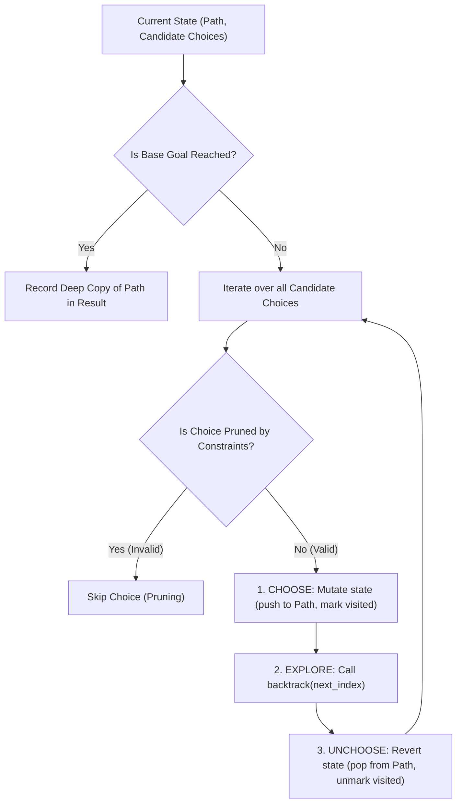
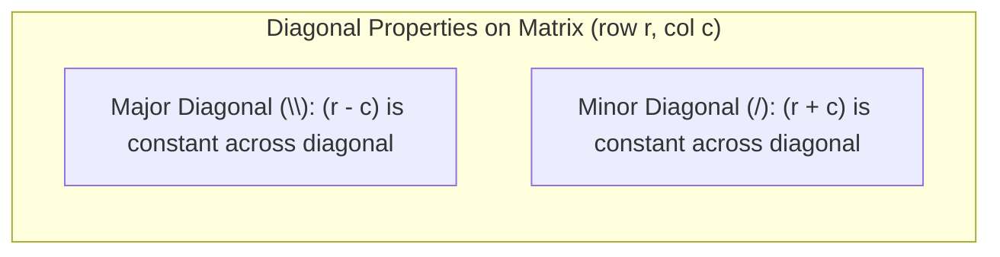
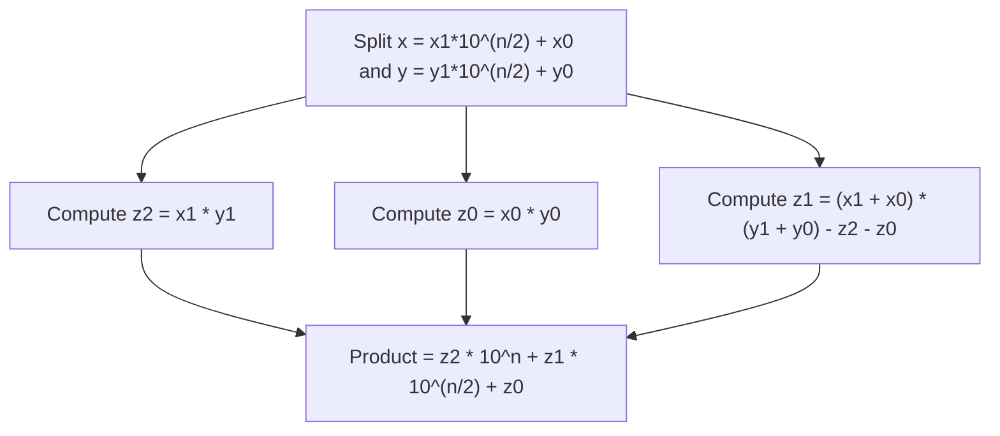
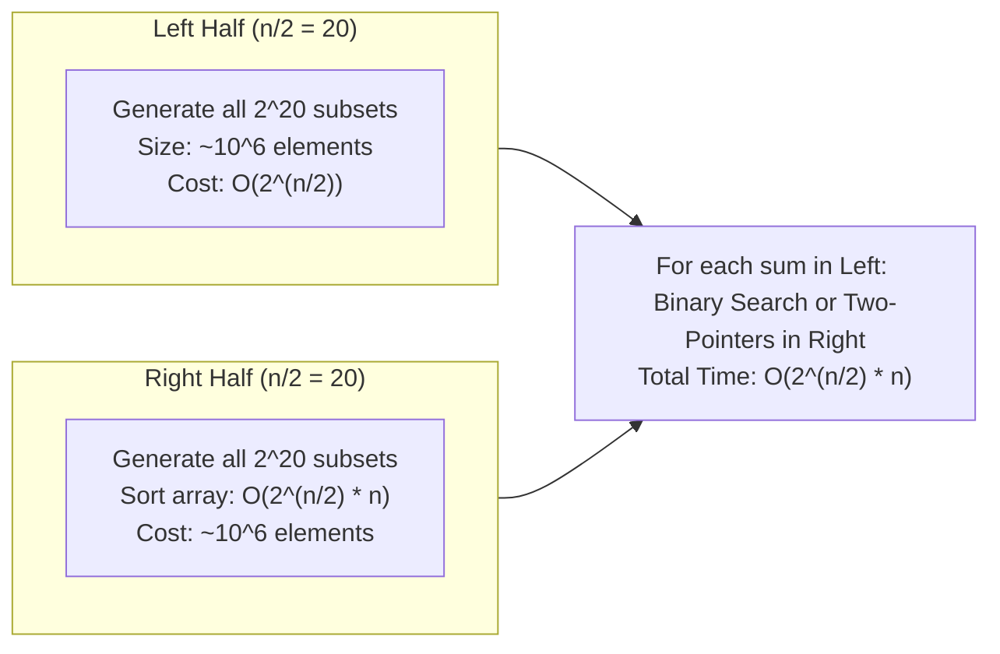

# Module 09 — Recursion, Backtracking & Divide-and-Conquer

Recursion expresses algorithmic solutions through self-similar subproblems. When combined with state-space search (Backtracking) or problem decomposition (Divide-and-Conquer), it provides optimal solutions to combinatorial explosions and divide-and-conquer reductions.

---

## 1. The Backtracking Framework: Universal State-Space Search

Backtracking is an exhaustive depth-first search through a conceptual **State-Space Tree**. The core architectural requirement is the symmetrical **Choose $\to$ Explore $\to$ Unchoose** invariant:

### Backtracking Canonical Complexity
| Combinatorial Problem | Search Tree Size | Pruning Impact |
| :--- | :--- | :--- |
| **Subsets** (Power Set) | $\Theta(2^n)$ | Fixed size $2^n$ |
| **Combinations** ($C(n, k)$) | $\Theta\left(\frac{n!}{k!(n-k)!}\right)$ | Pruning when remaining candidates $< k - \text{path.length}$ |
| **Permutations** ($n!$) | $\Theta(n!)$ | Visited array tracking |
| **N-Queens** ($N!$) | $O(N!)$ worst-case | Diagonal bitmasks prune $>99\%$ of branches |

---

## 2. Constraint Satisfaction & Pruning: N-Queens with Bitmasks

In the $N$-Queens problem, placing $N$ queens on an $N \times N$ chessboard such that no two queens attack each other requires checking columns, major diagonals, and minor diagonals.

### The $O(1)$ Bitmask Optimization
Instead of passing sets or 2D boards through recursion, bitwise integers track occupied constraints in 1 CPU cycle:
- `cols`: Bit $c$ is set if column $c$ is occupied.
- `diag1`: Bit $(r - c + N)$ is set for major diagonals.
- `diag2`: Bit $(r + c)$ is set for minor diagonals.
- Available slots at row $r$:
  $$\text{available} = \sim(\text{cols} \ | \ \text{diag1} \ | \ \text{diag2}) \ \& \ ((1 \ll N) - 1)$$
This eliminates all inner validation loops, running at near-C speeds.

---

## 3. Divide-and-Conquer: Karatsuba Integer Multiplication

Classical grade-school multiplication of two $n$-digit numbers performs $n^2$ single-digit multiplications ($O(n^2)$).
Anatoly Karatsuba (1960) discovered that 4 multiplications can be reduced to 3:

### The Recurrence & Speedup
Standard multiplication: $T(n) = 4 T(n/2) + O(n) \implies O(n^{\log_2 4}) = O(n^2)$.
Karatsuba multiplication:
$$T(n) = 3 T\left(\frac{n}{2}\right) + O(n)$$
By the Master Theorem (Case 1):
$$T(n) = \Theta\left(n^{\log_2 3}\right) \approx \Theta(n^{1.585})$$
For 1,024-bit numbers, $n^{1.585} \approx 56,000$ operations versus $n^2 \approx 1,048,000$ operations—a $18\times$ performance improvement.

---

## 4. Meet-in-the-Middle: Taming Exponential Explosions

When a combinatorial decision problem has size $n = 40$, brute force explores $2^{40} \approx 1.1 \times 10^{12}$ states, which exceeds typical 1-second CPU execution limits ($10^8$ ops).
The **Meet-in-the-Middle** technique splits the input into two halves of size $n/2 = 20$:

### Complexity Reduction
- Brute Force: $O(2^n) = O(2^{40}) \approx 1,099,511,627,776$ operations (Time Limit Exceeded).
- Meet-in-the-Middle: $O(2^{n/2} \cdot n) = O(2^{20} \cdot 40) \approx 1,048,576 \times 40 \approx 4.2 \times 10^7$ operations (Runs in **< 50 milliseconds**).

---

## 5. Interview Drill: Recursion, Backtracking & Divide-and-Conquer

1. In Backtracking, why is it critical to create a deep copy of the path before adding it to the final result list?

In JavaScript, arrays are reference types passed by pointer. The `path` array is mutated in-place across recursive calls (`path.push()`, `path.pop()`).
If code executes `result.push(path)` without copying, every entry in `result` will hold a reference to the **exact same array object**. When the algorithm completes and unwinds to the root, `path` becomes empty (`[]`), causing `result` to contain hundreds of empty arrays `[[], [], []]`.
Writing `result.push([...path])` or `result.push(path.slice())` creates an immutable snapshot of the current state.

2. Explain how pruning converts exponential backtracking into polynomial time on solvable Sudoku boards.

A naive $9 \times 9$ board has up to $81$ empty cells, representing $9^{81} \approx 1.9 \times 10^{77}$ combinations.
Pruning checks row, column, and $3 \times 3$ box constraints before recursing. If only 1 number is valid for a cell, the branching factor drops from 9 to 1.
Combined with the "Minimum Remaining Values" (MRV) heuristic (always picking the cell with the fewest legal candidates first), the search tree shrinks dramatically, allowing standard Sudoku puzzles to solve in a few hundred iterations (< 2 milliseconds).

3. Can Meet-in-the-Middle solve the 4-Sum problem in O(n^2) time?

**Yes.**
Instead of checking all $\binom{n}{4} = O(n^4)$ quadruplets:
1. Divide the 4 numbers into two pairs: $(a + b) + (c + d) = \text{target}$.
2. Compute the sums of all $n(n - 1) / 2 = O(n^2)$ pairs of the first two numbers and store them in a hash map: `sum -> list of (i, j)`.
3. Iterate through all $O(n^2)$ pairs of the remaining two numbers $(c, d)$: query the hash map for $\text{target} - (c + d)$.
4. Total time is $O(n^2)$ time and $O(n^2)$ auxiliary space, down from $O(n^4)$.

4. What is the Master Theorem recurrence for the Closest Pair of Points in 2D space, and why does the strip check only compare 7 points?

Recurrence:
$$T(n) = 2 T(n/2) + O(n) \implies \Theta(n \log n)$$
After finding the minimum distance $\delta = \min(\delta_L, \delta_R)$ in left and right halves, points within $\delta$ of the vertical dividing line are gathered into a strip sorted by y-coordinate.
**Geometric Packing Invariant**: In a $\delta \times 2\delta$ rectangle across the dividing line, all points in the left half are at least $\delta$ apart from each other, and similarly for the right half.
At most **7 points** can physically fit into this area without two points being closer than $\delta$. Thus, each point in the strip needs to be compared against at most 7 subsequent points, keeping the combine step strictly $O(n)$.

5. What is the difference between Divide-and-Conquer and Dynamic Programming?

- **Divide-and-Conquer** splits a problem into **independent, non-overlapping** subproblems (e.g. Merge Sort splits into disjoint left and right halves). Each subproblem is solved independently; no caching or memoization is needed.
- **Dynamic Programming** is used when subproblems **overlap heavily** (e.g. Fibonacci, shortest paths, knapsack). Solving subproblems independently would duplicate exponential work; DP caches subproblem solutions in a table to ensure each subproblem is computed exactly once.

