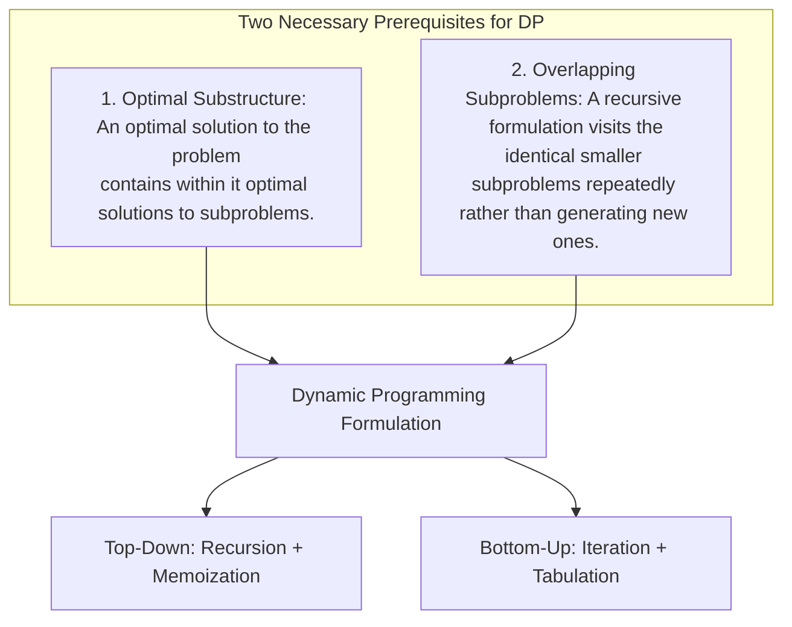
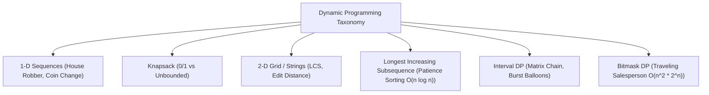
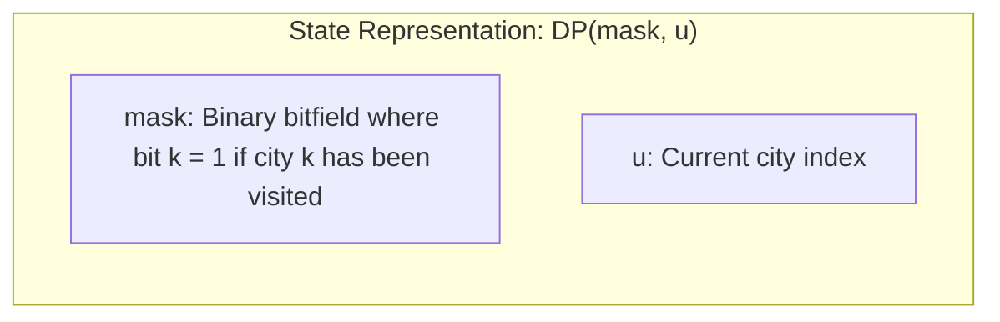

# Module 10 — Dynamic Programming: Foundations to Advanced Dimensions

Dynamic Programming (DP) solves complex optimization problems by decomposing them into overlapping subproblems, computing each subproblem once, and caching results in a memoization table or multidimensional array. This module covers formal recurrence formulations, space optimizations, the core canonical DP archetypes, and patience sorting for $O(n \log n)$ Longest Increasing Subsequence.

---

## 1. Axiomatic Principles: Optimal Substructure & Overlapping Subproblems

For a problem to be solvable via Dynamic Programming, it must satisfy two fundamental properties:



### The DAG Formulation of DP
Every dynamic programming problem can be viewed as finding a shortest or longest path in a **Directed Acyclic Graph (DAG)** of states:
- **Vertices**: Distinct parameter states (e.g. `(index, remaining_capacity)`).
- **Directed Edges**: Transitions from smaller subproblems to larger ones.
- **Topological Order**: Bottom-up tabulation simply evaluates states in the topological order of this state-space DAG.

---

## 2. The Core Canonical DP Archetypes



### 1. 0/1 Knapsack vs Unbounded Knapsack
Given items with weights $w[i]$ and values $v[i]$, maximize total value in capacity $W$:
- **0/1 Knapsack (Each item used at most once)**:
  $$DP[i][w] = \max(DP[i-1][w], \ DP[i-1][w - w[i]] + v[i])$$
  **1-D Space Optimization**: Iterate $w$ **in reverse** from $W$ down to $w[i]$:
  ```typescript
  for (let i = 0; i < n; i++) {
    for (let w = W; w >= weights[i]!; w--) {
      dp[w] = Math.max(dp[w]!, dp[w - weights[i]!]! + values[i]!);
    }
  }
  ```
  Iterating backwards ensures $dp[w - weights[i]]$ comes from the **previous** item step $i - 1$, preventing multiple inclusions of the same item.

- **Unbounded Knapsack (Items can be reused infinitely)**:
  Iterate $w$ **forward** from $w[i]$ up to $W$:
  ```typescript
  for (let i = 0; i < n; i++) {
    for (let w = weights[i]!; w <= W; w++) {
      dp[w] = Math.max(dp[w]!, dp[w - weights[i]!]! + values[i]!);
    }
  }
  ```
  Iterating forward allows newly updated states at $w$ to be reused at $w + w[i]$, supporting unbounded repetition.

---

## 3. Longest Increasing Subsequence: $O(n^2)$ to $O(n \log n)$ via Patience Sorting

Given array $A[0 \dots n-1]$, find the length of the longest strictly increasing subsequence.

### Naive $O(n^2)$ Formulation
$$DP[i] = 1 + \max(\{ DP[j] : 0 \le j < i \land A[j] < A[i] \} \cup \{0\})$$

### The $O(n \log n)$ Patience Sorting Algorithm
Aldous and Diaconis proved that LIS corresponds to the game of **Patience Sorting**:
1. Maintain an array `tails`, where `tails[len]` stores the **smallest ending element** of all increasing subsequences of length `len + 1` found so far.
2. Invariant: `tails` is **strictly monotonically increasing**.
3. For each element $x \in A$:
   - Binary search in `tails` to find the first element $\ge x$.
   - If found at index `idx`, update `tails[idx] = x` (a smaller ending value makes extending the subsequence easier!).
   - If not found (all elements in `tails` are $< x$), append $x$: `tails.push(x)`.
4. The final length of `tails` is the exact length of the LIS!
$$\text{Time Complexity} = O(n \log n), \quad \text{Space Complexity} = O(n)$$

---

## 4. String Dynamic Programming: LCS & Levenshtein Edit Distance

### Longest Common Subsequence (LCS)
For strings $S_1$ and $S_2$ of lengths $m$ and $n$:
$$DP[i][j] = \begin{cases} DP[i-1][j-1] + 1 & \text{if } S_1[i-1] == S_2[j-1] \\ \max(DP[i-1][j], DP[i][j-1]) & \text{if } S_1[i-1] \neq S_2[j-1] \end{cases}$$

### Levenshtein Edit Distance
Minimum operations (insert, delete, replace) to transform $S_1$ into $S_2$:
$$DP[i][j] = \begin{cases} DP[i-1][j-1] & \text{if } S_1[i-1] == S_2[j-1] \\ 1 + \min\left( \begin{array}{l} DP[i-1][j] \text{ (Delete)}, \\ DP[i][j-1] \text{ (Insert)}, \\ DP[i-1][j-1] \text{ (Replace)} \end{array} \right) & \text{if } S_1[i-1] \neq S_2[j-1] \end{cases}$$

---

## 5. Bitmask DP: The Traveling Salesperson Problem (TSP)

Given $n$ cities and distance matrix $D$, find the minimum cost to visit all cities and return to start.
- Brute Force: $O(n!)$
- **Held-Karp Bitmask DP**: $O(n^2 2^n)$ time and $O(n 2^n)$ space.



### Recurrence
$$DP(\text{mask}, u) = \min_{v \notin \text{mask}} \left( D[u][v] + DP(\text{mask} \ | \ (1 \ll v), \ v) \right)$$
For $n = 20$: $n! \approx 2.4 \times 10^{18}$ (impossible), while $n^2 2^n \approx 400 \times 10^6$ operations (solvable in ~1 second).

---

## 6. Interview Drill: Dynamic Programming

<details>
<summary>1. In 0/1 Knapsack, why must the 1-D array be traversed in reverse, whereas in Unbounded Knapsack it must be traversed forwards?</summary>

In 0/1 Knapsack, each item can be chosen at most once. Traversing backwards ensures that when computing $dp[w] = \max(dp[w], dp[w - \text{weight}] + \text{val})$, the term $dp[w - \text{weight}]$ has not yet been updated for the current item and represents state from the previous item.
In Unbounded Knapsack, an item can be chosen multiple times. Traversing forwards means $dp[w - \text{weight}]$ has already had the current item included, allowing the algorithm to chain multiple copies of the same item into the optimal solution.
</details>

<details>
<summary>2. Why does the tails array in the O(n log n) LIS algorithm not necessarily represent the actual subsequence elements?</summary>

The `tails` array records the minimal tail element for each subsequence length, not the actual sequence of elements.
For example, for input `[2, 5, 3, 7, 101, 18]`:
- After processing elements up to 7, `tails = [2, 3, 7]`.
- Then element 4 arrives: `tails` updates to `[2, 3, 4]`.
- Although length 3 is correct, elements in `tails` may belong to different overlapping subsequences.
To reconstruct the actual subsequence, an auxiliary array of predecessor pointers must be maintained during updates.
</details>

<details>
<summary>3. How can you reduce the space complexity of Longest Common Subsequence from O(m * n) to O(min(m, n))?</summary>

In the recurrence $DP[i][j] = f(DP[i-1][j-1], DP[i-1][j], DP[i][j-1])$, row $i$ depends strictly on the current row $i$ and the immediately preceding row $i - 1$.
Rows $i - 2, i - 3, \dots$ are never referenced again.
By maintaining only two rows (`prevRow` and `currRow`), or a single row updating from right to left while preserving the top-left diagonal in a temporary variable, space drops to $O(\min(m, n))$.
</details>

<details>
<summary>4. What is the difference between Memoization and Tabulation?</summary>

- **Memoization (Top-Down)**: Solves the original problem by calling recursive subproblems and caching results in a map/table. It only computes subproblems that are strictly necessary to answer the query (lazy evaluation). However, it incurs function call overhead and call-stack limits.
- **Tabulation (Bottom-Up)**: Iteratively fills a table starting from base cases up to the target state in topological order. It eliminates recursive call-stack overhead and enables memory reduction (e.g. rolling variables), but computes all intermediate subproblems even if some are unneeded.
</details>

<details>
<summary>5. How can you determine if a problem can be solved with a Greedy algorithm rather than Dynamic Programming?</summary>

A problem can be solved greedily if it satisfies the **Greedy-Choice Property**: a globally optimal solution can be reached by making locally optimal (greedy) choices at each step without ever needing to backtrack or evaluate multiple possibilities.
If a local choice narrows or invalidates the optimal choices for remaining subproblems (e.g. Coin Change with arbitrary denominations where taking the largest coin leaves an impossible or suboptimal remainder), Greedy fails and Dynamic Programming is required.
</details>
