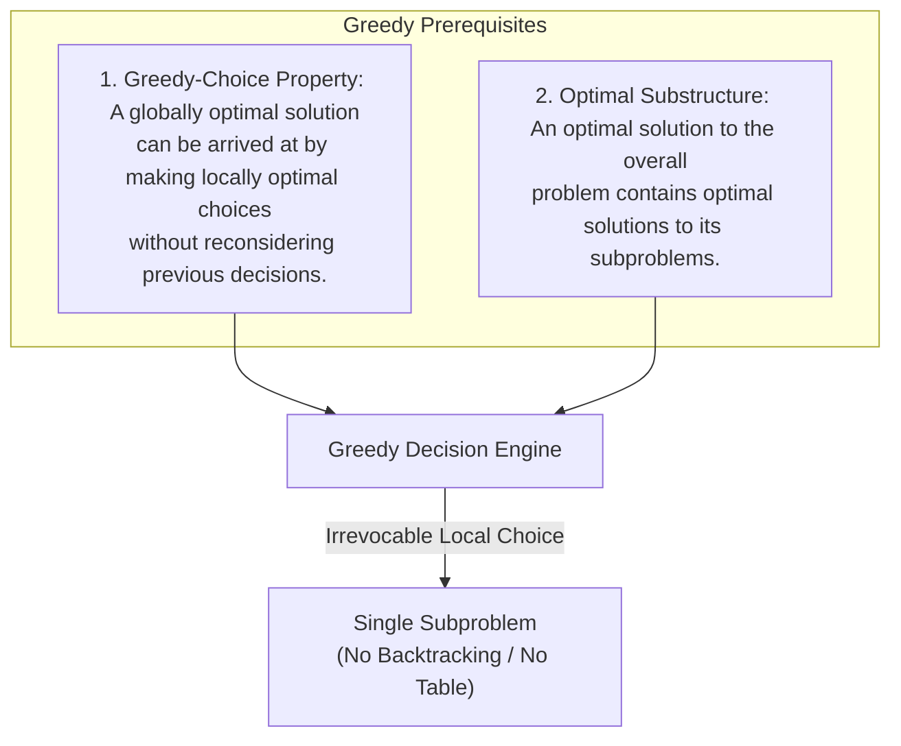
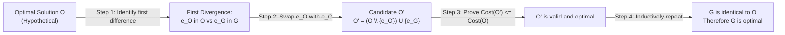
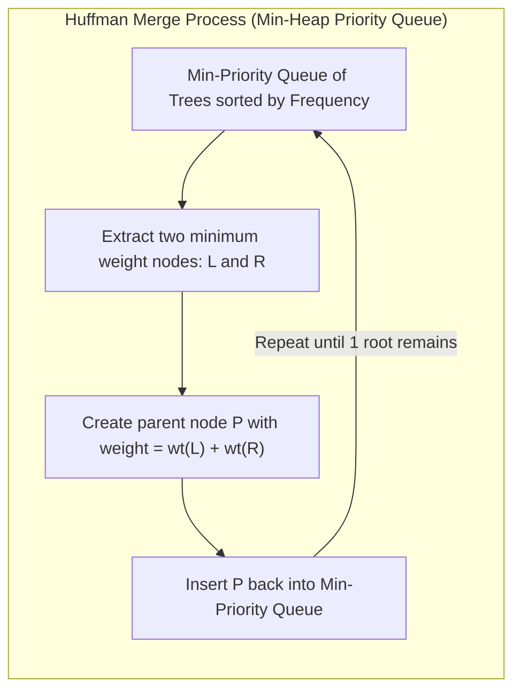
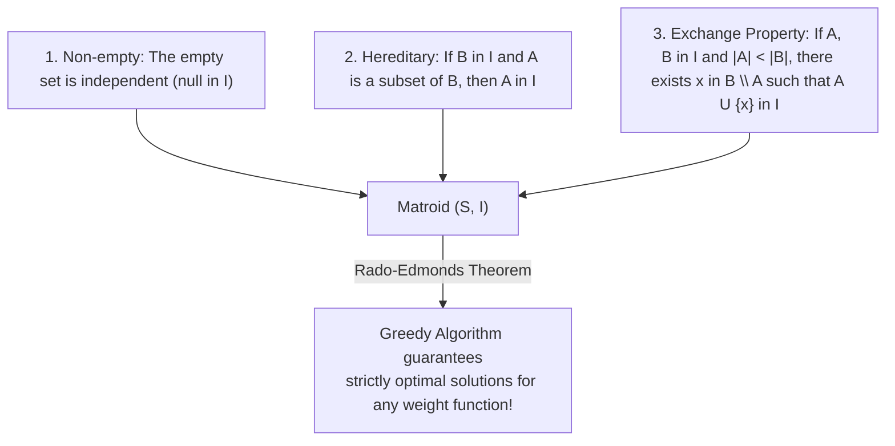

# Module 11 — Greedy Algorithms and Exchange Arguments

A **greedy algorithm** builds a solution piece-by-piece, always choosing the next option that offers the most immediate, local benefit without backtracking. While deceptively straightforward to implement, greedy algorithms are among the most difficult to prove correct. This module establishes the rigorous mathematical foundations of greedy strategies, the canonical **Exchange Argument** proof technique, classic greedy archetypes (Interval Scheduling, Huffman Coding, Jump Game, Gas Station), Matroid theory, and foundational counterexamples where greedy fails.

---

## 1. Axiomatic Principles: Greedy-Choice Property and Optimal Substructure

For a greedy algorithm to yield a mathematically optimal global solution, the problem must exhibit two essential properties:



### Contrast with Dynamic Programming
| Dimension | Dynamic Programming | Greedy Algorithm |
|---|---|---|
| **Choice Order** | Evaluates all valid transitions across overlapping subproblems bottom-up or top-down | Commits immediately to the single locally best choice |
| **Subproblem Dependency** | Subproblems must be solved before making a global choice | Choice is made first, reducing the problem to one smaller subproblem |
| **Backtracking / State Space** | Retains multiple potential candidate branches | Zero backtracking; choices are permanent and irrevocable |
| **Time & Space Complexity** | Typically $O(n^2)$ or pseudo-polynomial; requires memoization | Typically $O(n \log n)$ due to initial sorting, using $O(1)$ auxiliary space |

---

## 2. The Exchange Argument: Formal Proof Technique

The standard mathematical technique used to prove that a greedy algorithm produces an optimal solution is an **Exchange Argument**.



### The 4-Step Exchange Schema
1. **Define Candidates**: Let $G = \{g_1, g_2, \dots, g_k\}$ be the solution selected by the greedy algorithm. Let $O = \{o_1, o_2, \dots, o_m\}$ be an arbitrary, hypothetical optimal solution.
2. **Find First Discrepancy**: Assume $G \neq O$. Identify the smallest index $i$ such that $g_i \neq o_i$.
3. **Construct Exchange**: Substitute $o_i$ with $g_i$ to form a new candidate solution $O' = (O \setminus \{o_i\}) \cup \{g_i\}$.
4. **Prove Invariance / Dominance**:
   - Prove that $O'$ is a feasible solution (satisfies all constraints).
   - Prove that the objective value of $O'$ is at least as good as $O$ (i.e., $\text{value}(O') \ge \text{value}(O)$ or $\text{cost}(O') \le \text{cost}(O)$).
   - By induction over the number of differences, we can transform $O$ into $G$ without degrading quality. Thus, $G$ must also be optimal.

---

## 3. Classic Greedy Archetype I: Activity Selection / Interval Scheduling

Given a set of $n$ activities with start times $s_i$ and finish times $f_i$, select the maximum-size subset of mutually non-overlapping activities.

### The Algorithm
1. Sort all activities by their **finish time** $f_i$ in ascending order: $f_1 \le f_2 \le \dots \le f_n$.
2. Greedily pick the first activity $a_1$ (earliest finish time).
3. For each subsequent activity $a_k$, include it if and only if its start time $s_k \ge f_{\text{last}}$, where $f_{\text{last}}$ is the finish time of the most recently selected activity.

### Proof via Exchange Argument
- Let $G = \{g_1, g_2, \dots, g_k\}$ be the greedy sequence sorted by finish time.
- Let $O = \{o_1, o_2, \dots, o_m\}$ be an optimal sequence sorted by finish time ($m \ge k$).
- Since $g_1$ has the earliest finish time among all available activities, $f(g_1) \le f(o_1)$.
- Replace $o_1$ with $g_1$ to create $O' = \{g_1, o_2, \dots, o_m\}$.
- Since $f(g_1) \le f(o_1) \le s(o_2)$, $g_1$ does not conflict with $o_2$. Thus $O'$ is non-overlapping and has size $m$.
- Continuing inductively for all steps $i = 2, \dots, k$, we replace $o_i$ with $g_i$. Hence $|G| = |O|$, proving greedy optimality in $O(n \log n)$ time.

```typescript
export interface Interval {
  start: number;
  end: number;
}

export function maxNonOverlappingIntervals(intervals: Interval[]): Interval[] {
  if (intervals.length === 0) return [];
  // Sort ascending by finish time
  const sorted = [...intervals].sort((a, b) => a.end - b.end);
  const selected: Interval[] = [sorted[0]!];
  let lastEnd = sorted[0]!.end;

  for (let i = 1; i < sorted.length; i++) {
    if (sorted[i]!.start >= lastEnd) {
      selected.push(sorted[i]!);
      lastEnd = sorted[i]!.end;
    }
  }
  return selected;
}
```

---

## 4. Classic Greedy Archetype II: Huffman Coding

Huffman coding constructs an optimal prefix-free variable-length binary code for characters based on their frequencies $f(c)$.

### Principles
- **Prefix-free**: No codeword is a prefix of any other codeword (enabling unambiguous decoding without delimiter tokens).
- **Full Binary Tree**: Every non-leaf node has exactly two children. Characters with higher frequencies reside closer to the root (shorter bit lengths).



### Optimality Proof (CLRS Lemma 16.2 & 16.3)
1. **Lowest Frequencies at Maximum Depth**: Let $x$ and $y$ be the two characters with the lowest frequencies in alphabet $C$. There exists an optimal prefix code for $C$ in which the codewords for $x$ and $y$ have the same length and differ only in the final bit (they are sibling leaves at maximum depth).
2. **Substructure Reduction**: Replacing $x$ and $y$ with a single composite character $z$ with frequency $f(z) = f(x) + f(y)$ reduces the alphabet size from $n$ to $n - 1$. An optimal code for alphabet $C' = (C \setminus \{x, y\}) \cup \{z\}$ translates directly into an optimal code for $C$ with total bit cost:
   $$B(T) = B(T') + f(x) + f(y)$$
3. By induction on $n$, the greedy tree construction is strictly optimal.

---

## 5. Jump Game and Gas Station: Tracking Farthest Horizons

### Jump Game (Boundary Tracking)
Given an array `nums` where `nums[i]` is the maximum forward jump from index `i`, can you reach the last index?
- Greedy Invariant: Maintain `maxReach`, the farthest reachable index so far.
- At index `i`, if `i > maxReach`, you are trapped (return `false`).
- Update `maxReach = Math.max(maxReach, i + nums[i])`.
- If `maxReach >= n - 1`, return `true`. Time: $O(n)$, Space: $O(1)$.

### Gas Station Circuit
Given circular arrays `gas` and `cost`, find the unique starting station to complete a full circuit:
- If $\sum \text{gas}[i] < \sum \text{cost}[i]$, a complete circuit is physically impossible (return `-1`).
- Maintain running `tank = 0` and candidate `start = 0`.
- As you iterate `i` from 0 to $n-1$:
  - `tank += gas[i] - cost[i]`
  - If `tank < 0`: station `start` through `i` cannot be the start of a valid circuit (any prefix would run dry). Reset `start = i + 1` and `tank = 0`.
- If total gas $\ge$ total cost, `start` is guaranteed to be valid!

---

## 6. Theoretical Boundary: Matroids and When Greedy Provably Works

A **Matroid** is a combinatorial structure $(S, \mathcal{I})$ where $S$ is a finite set and $\mathcal{I}$ is a collection of subsets of $S$ (called *independent sets*) satisfying three axioms:



### Examples of Matroids
- **Graphic Matroid**: $S$ is the set of edges of graph $G$; $\mathcal{I}$ is the set of edge subsets forming forests (acyclic subgraphs). Kruskal's algorithm greedily chooses minimum-weight edges, and matroid theory proves it produces the optimal Minimum Spanning Tree.
- **Vector / Linear Matroid**: $S$ is a set of vectors; $\mathcal{I}$ is linearly independent subsets.

---

## 7. The Counterexample: Where Greedy Fails

Greedy algorithms fail whenever a locally optimal choice locks the system out of a globally optimal path.

### The Arbitrary Coin Change Counterexample
- Standard Canonical Denominations (US currency: `[25, 10, 5, 1]`): Greedy works because each coin is a near-multiple of the next.
- Arbitrary Denominations: `coins = [4, 3, 1]`, Target = `6`.
  - **Greedy approach**: Pick largest coin $\le 6$: picks `4`. Remaining target `2`. Next picks `1`, then `1`. Total = 3 coins (`4 + 1 + 1`).
  - **Optimal approach**: Pick two `3` coins: `3 + 3 = 6`. Total = 2 coins!
  - **Verdict**: Greedy fails. Must use Dynamic Programming: $DP[x] = 1 + \min_{c \in \text{coins}} DP[x - c]$.

---

## 8. Interview Drill: Greedy Algorithms

<details>
<summary>1. What is an Exchange Argument and how does it prove greedy correctness?</summary>

An Exchange Argument assumes the existence of a hypothetical optimal solution $O$ that differs from greedy solution $G$. It locates the first point of divergence, replaces the optimal choice with the greedy choice, and mathematically demonstrates that the resulting solution $O'$ remains valid without worsening the objective value. Repeated applications transform $O$ into $G$, proving $G$ is also optimal.
</details>

<details>
<summary>2. Why does interval scheduling sort by end time rather than start time or duration?</summary>

- Sorting by start time fails on long intervals (an early start can span the entire day, blocking many short intervals).
- Sorting by shortest duration fails when an isolated short interval conflicts with two non-overlapping intervals on either side.
- Sorting by earliest finish time leaves maximum time remaining for all subsequent intervals, greedily maximizing the remaining subproblem capacity.
</details>

<details>
<summary>3. Can Fractional Knapsack be solved with greedy, and why does 0/1 Knapsack fail with the same strategy?</summary>

- **Fractional Knapsack**: Greedy sorting by value-to-weight ratio ($v_i / w_i$) is optimal because we can take fractional amounts of the highest density items until capacity is filled.
- **0/1 Knapsack**: Fails greedily because taking a high-density item may leave unused "slack" capacity that cannot be filled by smaller items, yielding a lower total value than combining lower-density items that pack the knapsack completely.
</details>

<details>
<summary>4. Why does the Gas Station problem have a unique solution whenever total gas >= total cost?</summary>

If total gas $\ge$ total cost, the cumulative net fuel across a full loop is non-negative. If we plot the running net balance along the circle, the optimal starting point is the station immediately following the global minimum of the net balance curve, ensuring the tank never dips below zero at any point in the cycle.
</details>

<details>
<summary>5. What are the three matroid axioms and what do they guarantee?</summary>

A matroid $(S, \mathcal{I})$ requires:
1. Non-empty: $\emptyset \in \mathcal{I}$.
2. Hereditary: Any subset of an independent set is independent.
3. Exchange: If $|A| < |B|$, there is an element $x \in B \setminus A$ such that $A \cup \{x\} \in \mathcal{I}$.
The Rado-Edmonds Theorem guarantees that for any weighted matroid, the greedy algorithm will always find an independent set of maximum total weight.
</details>
