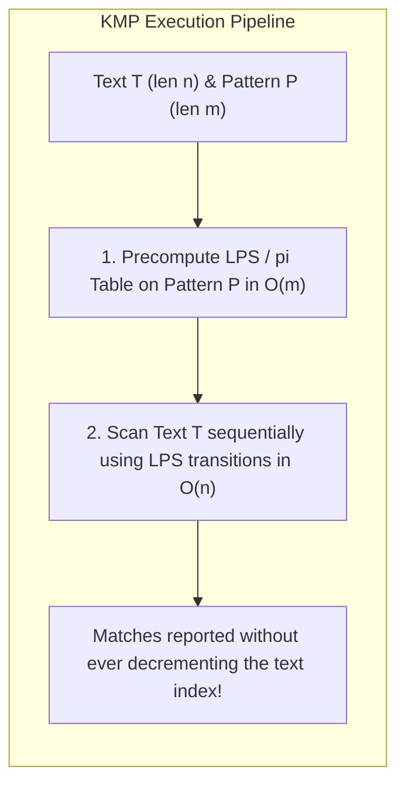
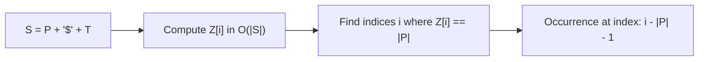
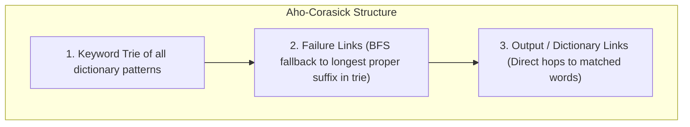
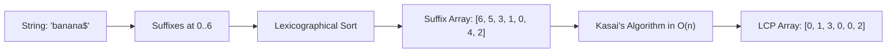
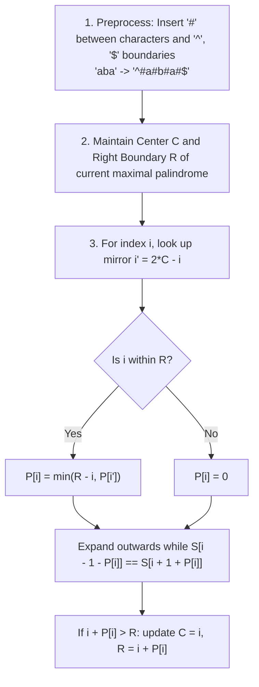

# Module 12 — String Algorithms and Pattern Matching

String processing is central to compilers, search engines, bioinformatics, and distributed systems. Naive string algorithms frequently degrade to quadratic $O(n \cdot m)$ worst-case running times. This module establishes the formal theory and linear-time mechanics of exact single-pattern matching (Knuth-Morris-Pratt and the Z-Algorithm), multi-pattern matching (Aho-Corasick), compressed indexing (Suffix Arrays and LCP), and Manacher's linear palindrome algorithm.

---

## 1. String Fundamentals and Encodings

Formally, a string $S$ of length $n$ is an ordered sequence over a finite alphabet $\Sigma$: $S = s_0 s_1 \dots s_{n-1}$, where $s_i \in \Sigma$.
- **Prefix**: $S[0 \dots k]$ where $0 \le k < n$. A *proper prefix* requires $k < n - 1$.
- **Suffix**: $S[k \dots n-1]$ where $0 \le k < n$. A *proper suffix* requires $k > 0$.
- **Subsegment / Substring**: $S[i \dots j]$ where $0 \le i \le j < n$.

### Runtime Gotcha: Unicode and JavaScript Strings
In JavaScript/V8:
- Standard `.length` and index access (`s[i]`, `s.charCodeAt(i)`) operate on **UTF-16 code units** (16-bit blocks), not Unicode code points.
- Characters outside the Basic Multilingual Plane (BMP, code points $> \text{0xFFFF}$ such as emojis or historical scripts) consume two UTF-16 code units (surrogate pairs).
- Iterating with `for (const char of s)` or `Array.from(s)` correctly segments Unicode code points.

---

## 2. Knuth-Morris-Pratt (KMP) Algorithm

Given text $T$ of length $n$ and pattern $P$ of length $m$, KMP finds all occurrences of $P$ in $T$ in strictly linear $O(n + m)$ time.



### The $\pi$ (LPS) Array
The array $\pi[i]$ (or `lps[i]`) stores the length of the longest proper prefix of $P[0 \dots i]$ that is also a suffix of $P[0 \dots i]$.
$$\pi[i] = \max \{ k : 0 \le k < i \land P[0 \dots k-1] = P[i-k+1 \dots i] \}$$

```typescript
export function computeLPS(pattern: string): number[] {
  const m = pattern.length;
  const lps = new Array<number>(m).fill(0);
  let len = 0; // length of previous longest prefix suffix
  let i = 1;

  while (i < m) {
    if (pattern[i] === pattern[len]) {
      len++;
      lps[i] = len;
      i++;
    } else {
      if (len !== 0) {
        // Fall back to the previous known prefix suffix
        len = lps[len - 1]!;
      } else {
        lps[i] = 0;
        i++;
      }
    }
  }
  return lps;
}
```

### Matching Mechanics & $O(n + m)$ Amortized Proof
During matching, if mismatch occurs after matching $j$ characters, the text pointer $i$ **never decrements**. Instead, the pattern pointer retreats to $j = \pi[j - 1]$.
- In each step of the outer loop, text pointer $i$ increments by 1.
- The pattern pointer $j$ either increments (at most $n$ times) or decrements along $\pi$ transitions.
- Since $j$ cannot decrement more times than it increments and $j \ge 0$, the total number of decrements is bounded by $n$.
- Total time is strictly $O(n + m)$ with $O(m)$ auxiliary space.

---

## 3. The Z-Algorithm

The **Z-Algorithm** finds matches by computing the $Z$-array for the concatenated string $S = P + \text{"\$"} + T$, where `$` is a delimiter character not present in $P$ or $T$.



### Definition of the $Z$-box
For string $S$ of length $N$:
$Z[i]$ is the length of the longest common prefix (LCP) between $S$ and the suffix of $S$ starting at $i$:
$$Z[i] = \max \{ k : S[0 \dots k-1] = S[i \dots i+k-1] \}$$

The algorithm maintains a **$Z$-box** $[L, R]$, which is the interval with maximal $R$ such that $S[L \dots R] = S[0 \dots R - L]$:
1. If $i > R$, compute $Z[i]$ naively by comparing characters starting from $S[0]$ and $S[i]$, then update $[L, R] = [i, i + Z[i] - 1]$.
2. If $i \le R$, let $k = i - L$.
   - If $Z[k] < R - i + 1$, then $Z[i] = Z[k]$ immediately!
   - If $Z[k] \ge R - i + 1$, characters beyond $R$ might still match. Extend naively starting from $R + 1$, then update $[L, R]$.

Both $L$ and $R$ move strictly to the right, guaranteeing $O(N)$ running time.

---

## 4. Multi-Pattern Matching: The Aho-Corasick Automaton

When searching for a set of $k$ dictionary patterns $\{P_1, P_2, \dots, P_k\}$ inside text $T$, running KMP independently takes $O(k \cdot |T|)$. The **Aho-Corasick algorithm** solves this simultaneously in $O(|T| + \sum |P_i| + \text{matches})$.



### Construction
1. Build a Trie over all patterns.
2. Using **Breadth-First Search (BFS)**, construct **failure links** $\text{fail}(u)$ for every node:
   - For root children, $\text{fail}(u) = \text{root}$.
   - For child $v$ of node $u$ with character $c$: traverse $\text{fail}(u)$ until a node with transition $c$ is found; that target is $\text{fail}(v)$.
3. Construct **dictionary links** pointing directly to the nearest ancestor node representing a complete dictionary word.
4. Stream text characters one-by-one through the state machine. Every character processes in amortized $O(1)$ time!

---

## 5. Suffix Arrays and the LCP Array

A **Suffix Array** $SA$ of string $S$ is a sorted array of integers representing the starting indices of all suffixes of $S$ in lexicographical order.



### Kasai's Algorithm for $O(n)$ LCP Array
The Longest Common Prefix (LCP) array stores the length of the common prefix between adjacent suffixes in the sorted Suffix Array:
$$\text{LCP}[i] = \text{lcp}(S[SA[i] \dots], \ S[SA[i+1] \dots])$$

**Kasai's Invariant**: If the suffix starting at index $i$ has LCP $h > 0$ with its predecessor in the Suffix Array, then the suffix starting at $i + 1$ has LCP at least $h - 1$ with its predecessor!
Because $h$ decrements at most $n$ times and cannot exceed $n$, Kasai's algorithm constructs the full LCP array in strictly linear $O(n)$ time.

---

## 6. Manacher's Algorithm: Linear-Time Palindromic Substrings

Finding the longest palindromic substring naively takes $O(n^2)$. **Manacher's Algorithm** achieves strictly linear $O(n)$ time and $O(n)$ space.



### Preprocessing Trick
To eliminate the distinction between odd-length (`"aba"`) and even-length (`"abba"`) palindromes:
- Pad every character boundary with `#`: `"aba"` $\to$ `"#a#b#a#"`.
- Prepend `^` and append `$` as sentinel bounds to avoid boundary condition checks.
- If $P[i]$ is the palindromic radius at index $i$ in the transformed string, $P[i]$ equals the **exact length** of the palindrome in the original string!

### Complexity Analysis
The inner `while` loop only increments characters that extend beyond the current right boundary $R$.
Whenever a character is successfully matched, $R$ increases by at least 1.
Since $R \le 2n + 2$, the total number of character comparisons is at most $2n + 2 = O(n)$.

---

## 7. Interview Drill: String Algorithms

<details>
<summary>1. In KMP, why does the text pointer i never backtrack when a mismatch occurs?</summary>

The precomputed $\pi$ (LPS) table identifies the longest proper prefix of the pattern that is identical to the suffix of the currently matched segment. When a mismatch occurs at pattern index $j$, we already know that the preceding characters match. Sliding the pattern forward to align prefix $\pi[j-1]$ with that matched suffix preserves all potential matching alignments without ever re-reading characters from the text.
</details>

<details>
<summary>2. What is the Z-algorithm and how does it differ conceptually from KMP?</summary>

While KMP computes the longest prefix-suffix table of the pattern and matches it against text sequentially, the Z-algorithm computes the Longest Common Prefix ($Z[i]$) between the entire string and every suffix starting at index $i$. By concatenating $P + \text{"\$"} + T$, any index where $Z[i] = |P|$ represents an exact occurrence of $P$ in $T$. The Z-algorithm maintains an explicit window $[L, R]$ of the farthest reach so far.
</details>

<details>
<summary>3. Why is Kasai's LCP algorithm O(n) rather than O(n^2)?</summary>

Kasai's algorithm processes suffixes in order of their original text positions ($i = 0, 1, \dots, n-1$) rather than their sorted suffix array positions. When moving from suffix $i$ to suffix $i + 1$, stripping the first character can reduce the common prefix length by at most 1 ($h \ge h_{\text{prev}} - 1$). Since $h$ decrements at most $n$ times across the entire loop and $h \le n$, the total number of increments is at most $2n$, proving $O(n)$ complexity.
</details>

<details>
<summary>4. How does Manacher's algorithm avoid separate logic for even-length palindromes?</summary>

It inserts a delimiter (such as `#`) between every adjacent character pair and around the ends of the string. Every even-length palindrome in the original string becomes an odd-length palindrome centered on a `#` delimiter, while every odd-length palindrome remains centered on an original character. This unifies both cases into a single mathematical framework.
</details>

<details>
<summary>5. When should you use Aho-Corasick instead of running KMP multiple times?</summary>

When searching for multiple patterns $\{P_1, \dots, P_k\}$ simultaneously in a long text. Running KMP $k$ times costs $O(k \cdot |T| + \sum |P_i|)$. If $k = 10,000$ and $|T| = 1,000,000$, KMP would scan $10^{10}$ characters. Aho-Corasick constructs a trie with failure transitions and scans the text in a single pass taking $O(|T| + \sum |P_i| + \text{matches})$, processing the same query in fractions of a second.
</details>
