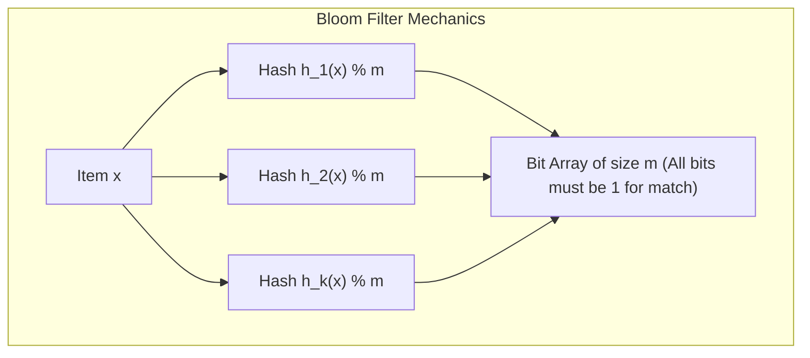
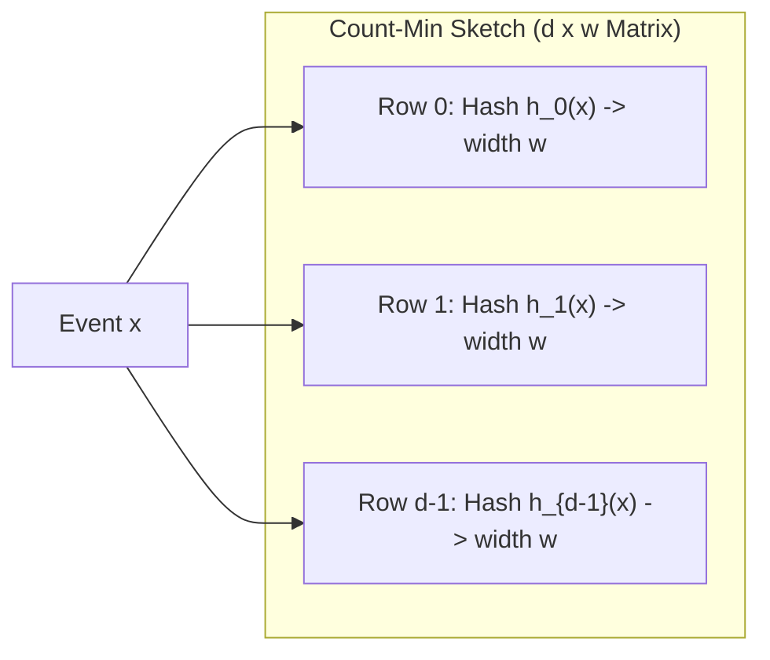
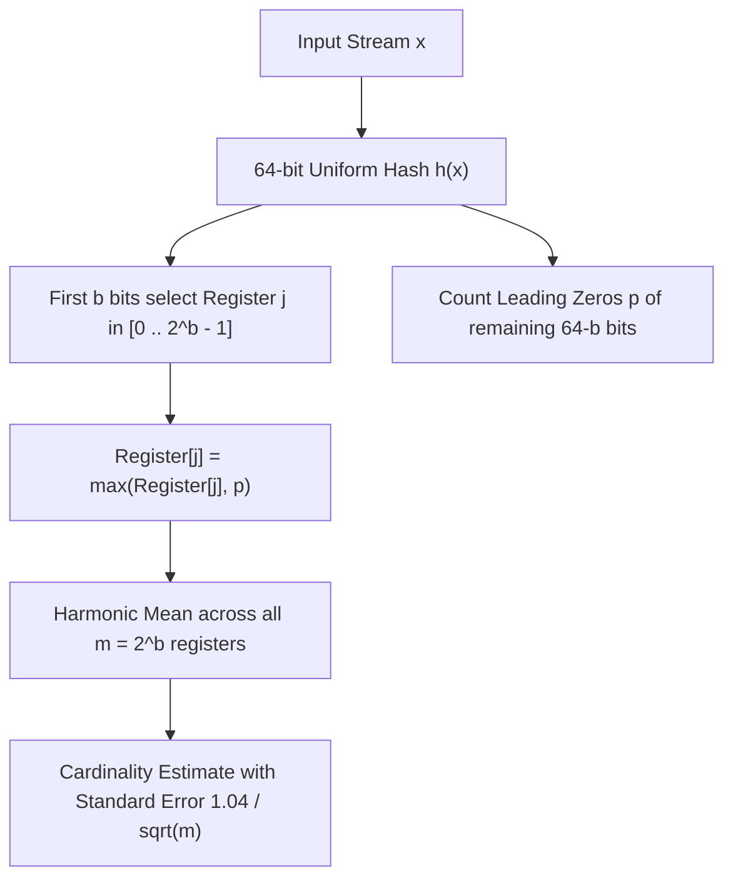
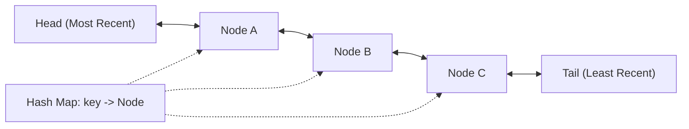
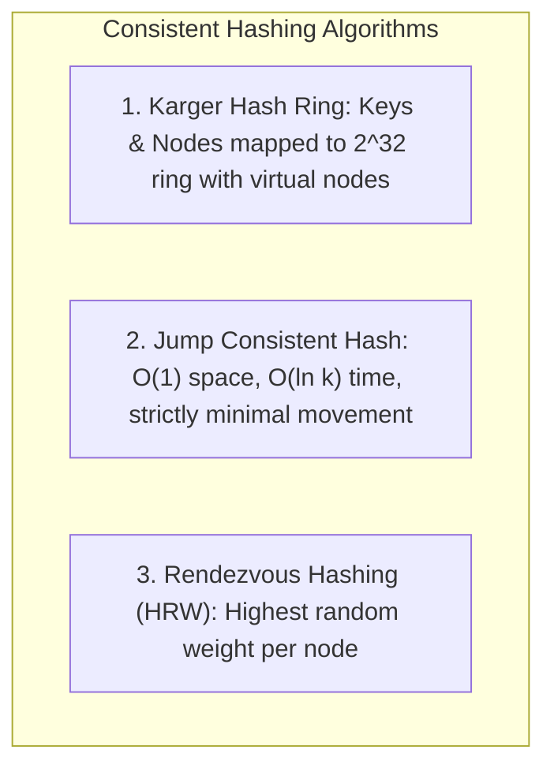
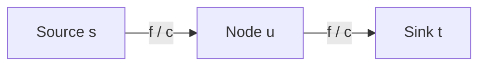

# Module 13 — Probabilistic Data Structures, Caches, and Randomized Algorithms

Modern large-scale systems frequently operate on petabytes of streaming data where deterministic structures require excessive memory. Probabilistic data structures exchange strict determinism for bounded error rates and orders-of-magnitude memory savings. This module explores the mathematical foundations and implementations of Bloom Filters, Count-Min Sketches, HyperLogLog, $O(1)$ LRU/LFU cache topologies, Consistent Hashing algorithms, Reservoir Sampling, Skip Lists, and Network Flow foundations.

---

## 1. Bloom Filters: Zero False Negatives and Error Math

A **Bloom Filter** is a space-efficient probabilistic data structure used to test set membership ($x \in S$).
- **True Negatives**: 100% guarantee. If the filter returns `false`, $x$ is **definitely not** in the set (zero false negatives).
- **False Positives**: Bounded probability $p > 0$. If the filter returns `true`, $x$ is **probably** in the set.



### Mathematical Derivation of False Positive Rate
For a bit array of size $m$, $n$ inserted items, and $k$ independent uniform hash functions:
1. Probability that a specific bit is *not* set by a single hash function:
   $$1 - \frac{1}{m}$$
2. Probability that a bit remains 0 after inserting $n$ elements using $k$ hash functions:
   $$\left(1 - \frac{1}{m}\right)^{kn} \approx e^{-kn/m}$$
3. Probability that a bit is 1:
   $$p_{\text{bit}} \approx 1 - e^{-kn/m}$$
4. Probability of a false positive (all $k$ hash probes hit bits that are 1):
   $$p \approx \left(1 - e^{-kn/m}\right)^k$$

### Optimal Parameters
To minimize false positive probability $p$ for a given $m$ and $n$:
$$k_{\text{opt}} = \frac{m}{n} \ln 2 \approx 0.693 \cdot \frac{m}{n}$$
Required bit array size $m$ for desired error rate $p$:
$$m = - \frac{n \ln p}{(\ln 2)^2} \approx -1.44 \cdot n \log_2 p$$
For $p = 0.01$ (1% false positive rate), only $\approx 9.6$ bits per element and $k = 7$ hash functions are required!

### Kirsch-Mitzenmacher Optimization
Instead of computing $k$ independent cryptographic hashes, Kirsch and Mitzenmacher (2006) proved that two independent hash functions $h_1(x)$ and $h_2(x)$ simulate $k$ hashes without increasing asymptotic error:
$$g_i(x) = \left( h_1(x) + i \cdot h_2(x) \right) \pmod m, \quad \text{for } i = 0, 1, \dots, k-1$$

---

## 2. Count-Min Sketch: Frequency Estimation

The **Count-Min Sketch** estimates the frequencies of events in high-volume data streams using sub-linear space.



### Dimensions and Formal Guarantees
For accuracy parameter $\epsilon$ and error probability $\delta$:
- Width $w = \lceil e / \epsilon \rceil \approx \lceil 2.718 / \epsilon \rceil$
- Depth $d = \lceil \ln(1 / \delta) \rceil$
- **Update**: For incoming item $x$, increment `matrix[i][h_i(x)] += 1` for all rows $i = 0 \dots d-1$.
- **Query**: Frequency estimate $\hat{a}_x$ is the minimum value across all $d$ hashed cells:
  $$\hat{a}_x = \min_{0 \le i < d} \text{matrix}[i][h_i(x)]$$
- **Markov/Chernoff Bound**:
  $$a_x \le \hat{a}_x \le a_x + \epsilon \|a\|_1 \quad \text{with probability } \ge 1 - \delta$$
  The minimum operation guarantees that overestimation from hash collisions is minimized.

---

## 3. HyperLogLog: Cardinality Estimation

**HyperLogLog (HLL)** estimates the number of distinct elements (cardinality) in massive data sets using only $O(\log \log n)$ bits per register.



### Core Principle: Harmonic Mean
If an event has probability $2^{-k}$, we expect to observe it once every $2^k$ trials. The position of the first `1` bit (leading zeros $+ 1$) in a uniform random hash provides an exponential indicator of cardinality.
To prevent outlier distortion from single high-zero hashes, HLL partitions keys across $m = 2^b$ registers and computes the **harmonic mean**:
$$E = \alpha_m m^2 \cdot \left( \sum_{j=0}^{m-1} 2^{-M[j]} \right)^{-1}$$
where $\alpha_m$ is a bias-correction constant.
- With $m = 1024$ registers ($1 \text{ KB}$ of memory), HLL achieves standard error $\approx 1.04 / \sqrt{1024} = 3.25\%$ across billions of items!

---

## 4. Cache Eviction Topologies: $O(1)$ LRU and LFU Caches

### 1. LRU (Least Recently Used) Cache
Maintains items ordered by access recency.
- **Data Structure**: Hash Map + Doubly Linked List with dummy `head` and `tail` sentinels.
- **Operations**: `get(key)` moves accessed node to head; `put(key, value)` adds node at head, evicting from tail when capacity is exceeded. Both run in strictly $O(1)$ time.



### 2. LFU (Least Frequently Used) Cache
Maintains items ordered by access frequency; ties broken by LRU.
- **Data Structure**:
  1. `keyMap`: maps `key` $\to$ Node.
  2. `freqMap`: maps `frequency` $\to$ Doubly Linked List of Nodes with that frequency.
  3. `minFreq`: integer pointer tracking the global minimum active frequency.
- **$O(1)$ Frequency Promotion**:
  - When node $N$ with frequency $f$ is accessed: remove $N$ from `freqMap[f]`.
  - If `freqMap[f]` becomes empty and $f == \text{minFreq}$, increment `minFreq = f + 1`.
  - Increment $N.\text{freq}++$ and insert $N$ into `freqMap[f + 1]`.
- **$O(1)$ Eviction**: Evict the tail node of `freqMap[minFreq]`.

---

## 5. Consistent Hashing Algorithms

In distributed systems, traditional modulo hashing (`hash(key) % N`) reshuffles almost 100% of keys when the node count $N$ changes, triggering catastrophic cache stampedes.



### 1. Karger Ring with Virtual Nodes
- Map node identifiers to points on a circular integer space $[0, 2^{32} - 1]$.
- Map keys to points on the same ring; a key belongs to the first node clockwise from its hash.
- **Virtual Nodes (vnodes)**: To prevent non-uniform distribution and load hotspots, each physical node is replicated as $V \approx 100\dots 250$ virtual nodes around the ring.
- When node count changes from $N$ to $N \pm 1$, only $K / N$ keys are relocated on average!

### 2. Jump Consistent Hash (Lamping & Veach, Google 2014)
Computes the target bucket in $O(\ln k)$ time and $O(1)$ memory without storing a ring:
```typescript
export function jumpConsistentHash(key: bigint, numBuckets: number): number {
  let b = -1n;
  let j = 0n;
  while (j < BigInt(numBuckets)) {
    b = j;
    key = ((key * 2862933555777941757n) + 1n) & 0xffffffffffffffffn;
    j = (b + 1n) * (1n << 31n) / ((key >> 33n) + 1n);
  }
  return Number(b);
}
```

---

## 6. Reservoir Sampling and Skip Lists

### Reservoir Sampling (Algorithm R)
Choose $k$ items uniformly at random from a data stream of unknown, massive length $N$:
1. Store the first $k$ items in the reservoir: $R = [s_0, s_1, \dots, s_{k-1}]$.
2. For each subsequent item $s_i$ ($i \ge k$):
   - Pick a random integer $r \in [0, i]$.
   - If $r < k$, replace $R[r] = s_i$.
- **Proof of Uniformity**: At step $N$, the probability that item $i$ is in the reservoir is exactly $k / N$.

### Skip Lists
A **Skip List** (Pugh, 1990) is a probabilistic alternative to balanced trees (AVL/Red-Black).
- Elements are stored in sorted linked lists across multiple levels $0 \dots L$.
- Level 0 contains all elements.
- Each element is promoted to level $i + 1$ with probability $p = 1/2$.
- Search, insertion, and deletion run in $O(\log n)$ expected time without complex tree rotations!

---

## 7. Network Flow: Ford-Fulkerson, Edmonds-Karp, and Dinic

A **flow network** is a directed graph $G = (V, E)$ where each edge $(u, v)$ has capacity $c(u, v) \ge 0$, a source $s$, and a sink $t$.
- **Capacity Constraint**: $0 \le f(u, v) \le c(u, v)$.
- **Flow Conservation**: $\sum_v f(u, v) = \sum_v f(v, u)$ for all $u \in V \setminus \{s, t\}$.



### The Max-Flow Min-Cut Theorem
The maximum amount of flow passing from source $s$ to sink $t$ equals the minimum capacity among all cuts separating $s$ and $t$.

| Algorithm | Method | Time Complexity |
|---|---|---|
| **Ford-Fulkerson** | Arbitrary augmenting paths via DFS | $O(E \cdot \|f^*\|)$ (can be exponential) |
| **Edmonds-Karp** | Shortest augmenting paths via BFS | $O(V E^2)$ |
| **Dinic's Algorithm** | Layered network BFS + Blocking flow DFS | $O(V^2 E)$ (and $O(E \sqrt{V})$ on unit networks) |

---

## 8. Interview Drill: Probabilistic Data Structures & Caches

<details>
<summary>1. Why can a standard Bloom Filter never produce false negatives?</summary>

When an item is inserted, all $k$ hash function indices are unconditionally set to 1. If an item was truly inserted, every one of its $k$ hash indices must be 1. Therefore, if any of the $k$ queried bit positions contains a 0, the item could never have been inserted into the filter.
</details>

<details>
<summary>2. How does an LFU Cache achieve O(1) time complexity for both get and put operations?</summary>

It maintains a map from keys to nodes, and a secondary map from frequencies to doubly linked lists of nodes. A pointer `minFreq` tracks the smallest active frequency. When a node is accessed, it is removed from its current frequency list and added to frequency $+ 1$ in $O(1)$. When evicting, the tail node of `freqMap[minFreq]` is removed in $O(1)$, updating `minFreq` if necessary.
</details>

<details>
<summary>3. Why are virtual nodes required in Consistent Hash Rings?</summary>

In a standard ring with few physical nodes, random hash placement can leave large gaps on the ring, causing severe load imbalances where one physical node handles a disproportionate volume of keys. Virtual nodes assign dozens or hundreds of distinct ring tokens to each physical server, evenly interleaving their partitions across the ring according to the law of large numbers.
</details>

<details>
<summary>4. What are the space and time advantages of Jump Consistent Hash over a Karger Hash Ring?</summary>

Jump Consistent Hash requires zero memory ($O(1)$ space) because it does not maintain a ring topology or virtual node lookups in a binary search tree. It calculates the target bucket mathematically in $O(\ln k)$ time with optimal key distribution and minimal reassignment ($1/k$ keys moved when bucket count changes from $k - 1$ to $k$). However, it only supports adding/removing the highest-indexed bucket (no arbitrary node removal).
</details>

<details>
<summary>5. In Reservoir Sampling, why does each element have an equal probability of k/N of being in the reservoir?</summary>

By induction: For the $N$-th element, it is chosen with probability $k / N$. For any element already in the reservoir, its probability of remaining is:
$$\mathbb{P}(\text{kept}) = 1 - \left( \frac{k}{N} \cdot \frac{1}{k} \right) = \frac{N - 1}{N}$$
Multiplying by its induction probability $\frac{k}{N-1}$ yields:
$$\frac{k}{N-1} \cdot \frac{N-1}{N} = \frac{k}{N}$$
Thus all elements have identical probability $k / N$.
</details>
