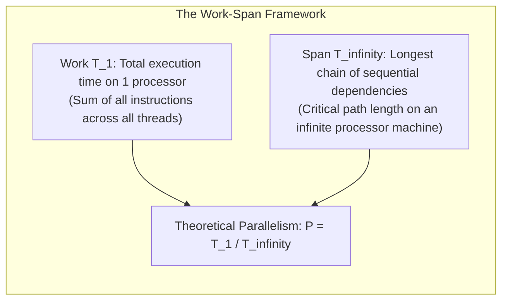
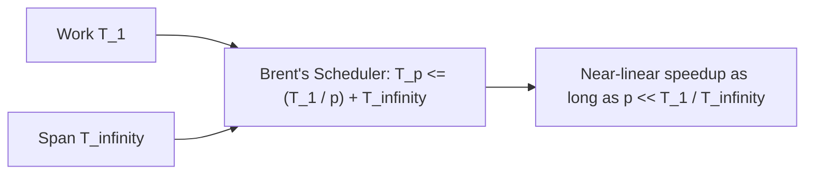
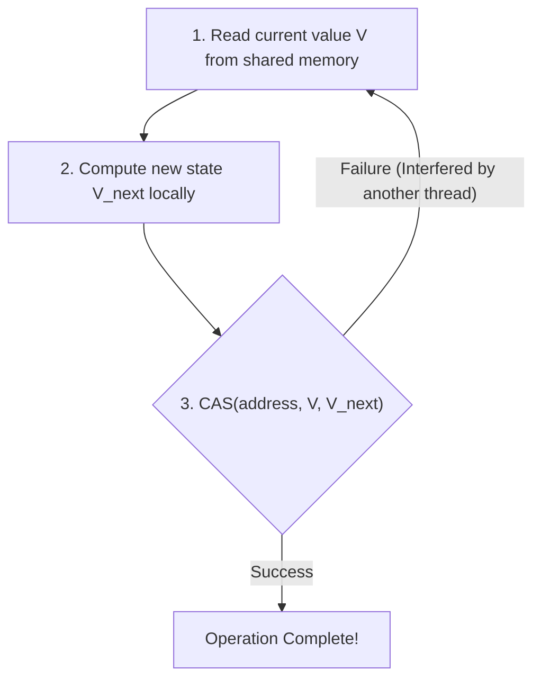
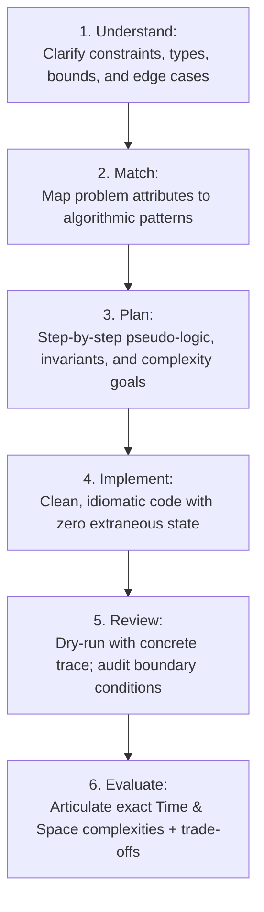

# Module 14 — Parallel Algorithms, Concurrency Foundations, and Interview Execution

This concluding module bridges theoretical algorithm design with multicore execution and high-stakes technical interview execution. We formally analyze parallel computation using the **Work-Span Model** and **Brent's Theorem**, examine lock-free concurrent structures (Treiber Stack, Michael-Scott Queue, CAS mechanics, ABA avoidance), establish the **UMPIRE** problem-solving framework, and provide the complete TypeScript $\leftrightarrow$ Python interview translation matrix.

---

## 1. Parallel Computation: The Work-Span Model and Brent's Theorem

In sequential algorithms, time complexity is measured by total step count $T(n)$. In multicore and parallel systems, two distinct metrics govern execution time:



### 1. Fundamental Lower Bounds
For any parallel execution on $p$ processors:
- **Work Law**: $T_p \ge \frac{T_1}{p}$ (A machine with $p$ cores cannot complete more work per unit time than $p \times 1$ core).
- **Span Law**: $T_p \ge T_\infty$ (Adding infinite processors cannot beat the sequential critical path).

### 2. Brent's Theorem (Greedy Scheduler Bound)
Brent's Theorem proves that a greedy task scheduler (which never leaves a processor idle if a task is ready) guarantees:
$$T_p \le \frac{T_1 - T_\infty}{p} + T_\infty < \frac{T_1}{p} + T_\infty$$



### 3. Parallel Merge Sort Analysis
- **Sequential Merge Sort**: Work $T_1(n) = 2 T_1(n/2) + O(n) = O(n \log n)$.
- **Naive Parallel Merge Sort** (Parallel recursive calls, sequential merge):
  $$T_\infty(n) = T_\infty(n/2) + O(n) = O(n)$$
  Parallelism is only $\frac{O(n \log n)}{O(n)} = O(\log n)$ (poor scalability).
- **Fully Parallel Merge Sort** (Parallel recursive calls + $O(\log^2 n)$ parallel merge via binary search partition):
  $$T_\infty(n) = T_\infty(n/2) + O(\log^2 n) = O(\log^3 n)$$
  Work remains $T_1(n) = O(n \log n)$.
  Parallelism increases to:
  $$\frac{T_1}{T_\infty} = \frac{O(n \log n)}{O(\log^3 n)} = O\left(\frac{n}{\log^2 n}\right) \quad (\text{Massive scaling on } p \text{ cores!})$$

---

## 2. Concurrency Primitives and Lock-Free Data Structures

### 1. Hardware Primitives: Compare-And-Swap (CAS)
Modern CPUs provide atomic read-modify-write instructions:
```c
bool CAS(atomic<int>* address, int expected, int desired) {
    if (*address == expected) {
        *address = desired;
        return true;
    }
    return false;
}
```



### 2. Lock-Free Treiber Stack
A lock-free LIFO stack using atomic CAS on the `top` pointer:
```typescript
interface StackNode<T> {
  value: T;
  next: StackNode<T> | null;
}

export class TreiberStack<T> {
  // In real multi-threaded runtimes (e.g. C++/Rust/Java), top is an AtomicReference
  private top: StackNode<T> | null = null;

  push(value: T): void {
    const newNode: StackNode<T> = { value, next: null };
    while (true) {
      const oldTop = this.top;
      newNode.next = oldTop;
      // In JS single-threaded event loop, simulated CAS:
      if (this.top === oldTop) {
        this.top = newNode;
        return;
      }
    }
  }

  pop(): T | null {
    while (true) {
      const oldTop = this.top;
      if (oldTop === null) return null;
      const nextNode = oldTop.next;
      if (this.top === oldTop) {
        this.top = nextNode;
        return oldTop.value;
      }
    }
  }
}
```

### 3. The ABA Problem and Remediation
The **ABA Problem** occurs when a thread reads value $A$ at memory address $M$, is preempted, another thread changes $M$ from $A \to B \to A$, and the first thread executes CAS, mistakenly assuming nothing changed.
- **Remediation**:
  1. **Tagged / Versioned Pointers**: Pair every pointer with an incrementing 64-bit sequence counter: `(pointer, version)`. A double-width CAS (e.g. `CMPXCHG16B` on x86-64) updates both simultaneously.
  2. **Hazard Pointers**: Threads register active pointers in thread-local storage, preventing memory deallocation while read operations are ongoing.

---

## 3. The UMPIRE Interview Problem-Solving Framework

For Staff-level DSA technical rounds, code correctness is only table stakes. Interviewers evaluate communication, rigorous verification, edge-case anticipation, and trade-off articulation.



### Step-by-Step Execution Protocol
1. **Understand (U)**:
   - Ask clarifying questions: Can the input contain negative numbers? Duplicates? Can the array be empty?
   - Confirm size limits ($n \le 10^5 \implies O(n \log n)$ or $O(n)$; $n \le 20 \implies O(2^n)$ or $O(n^2 2^n)$ bitmask DP).
2. **Match (M)**:
   - Contiguous subarray $\to$ Sliding Window (non-negative) or Prefix Sums (with negatives).
   - Sorted array / monotone condition $\to$ Binary Search on Answer / Two Pointers.
   - Next greater / smaller $\to$ Monotonic Stack.
   - Dependencies / ordering $\to$ Topological Sort (Kahn's or DFS).
   - Shortest path unit weights $\to$ BFS; non-negative weights $\to$ Dijkstra; weights $\in \{0, 1\} \to$ 0-1 BFS.
3. **Plan (P)**:
   - Communicate the chosen invariant aloud *before* writing code.
   - State the target time and space complexities. Get the interviewer's nod.
4. **Implement (I)**:
   - Write clean, modular functions.
   - Avoid manual array shifting (`queue.shift()` is $O(n)$ in V8; use pointers or deques).
   - Guard against integer overflow (`lo + ((hi - lo) >>> 1)`).
5. **Review (R)**:
   - Trace through a small, non-trivial example step-by-step.
   - Manually check 5 critical edge cases: Empty input, single element, all duplicates, strictly sorted/reversed, extreme values (min/max integer).
6. **Evaluate (E)**:
   - State both **Time** and **Auxiliary Space** complexities explicitly.
   - Discuss engineering trade-offs (e.g. iterative BFS stack safety vs recursion simplicity).

---

## 4. TypeScript to Python Interview Translation Matrix

In live coding interviews, many candidates choose Python for concise standard library primitives (`heapq`, `deque`, `Counter`, `@cache`), while writing TypeScript in production.

| Pattern / Operation | TypeScript (Node 26 / V8) | Python (3.14+) |
|---|---|---|
| **Double-Ended Queue** | Custom `CircularDeque` or array indices ($O(1)$) | `from collections import deque` (`q.append()`, `q.popleft()`) |
| **Min-Priority Queue** | Custom binary `MinHeap` class | `import heapq` (`heapq.heappush(h, val)`, `heapq.heappop(h)`) |
| **Max-Priority Queue** | Custom `MaxHeap` or negate keys in `MinHeap` | `heapq.heappush(h, -val)` |
| **Binary Search** | Custom `lowerBound` / `upperBound` loop | `import bisect` (`bisect.bisect_left(a, x)`, `bisect.bisect_right(a, x)`) |
| **Frequency Counter** | `Map<T, number>` | `from collections import Counter` (`c = Counter(nums)`) |
| **Default Map** | `map.get(k) ?? defaultValue` | `from collections import defaultdict` (`d = defaultdict(list)`) |
| **Top-Down Memoization**| `memo = new Map()` or multidimensional array | `from functools import cache` (`@cache` decorator) |
| **Integer Division** | `Math.floor(a / b)` or `(a / b) \| 0` (32-bit) | `a // b` (floor division) |
| **32-bit Modulo Math** | `((a % m) + m) % m` | `a % m` (Python `%` is always positive modulo) |
| **Bitwise Unsigned** | `(x & 0xffffffff) >>> 0` | `x & 0xffffffff` (Python has arbitrary precision ints) |
| **Pair / Tuple Keys** | `` `${i},${j}` `` or `i * W + j` (numeric hash) | `(i, j)` (native hashable tuple) |

---

## 5. Interview Drill: Parallelism & Interview Execution

<details>
<summary>1. In the Work-Span model, what does it mean if an algorithm has Work T_1 = O(n log n) and Span T_infinity = O(log n)?</summary>

It means that running on a single processor, the algorithm performs $O(n \log n)$ total operations. On an idealized machine with infinite processors, the longest chain of dependent operations can be finished in $O(\log n)$ parallel steps.
The parallelism is:
$$P = \frac{T_1}{T_\infty} = \frac{O(n \log n)}{O(\log n)} = O(n)$$
According to Brent's Theorem, on $p$ cores, it achieves near-linear speedup as long as $p \ll n$.
</details>

<details>
<summary>2. How does the ABA problem occur in lock-free concurrent programming, and how is it resolved?</summary>

Thread 1 reads pointer $A$ and is preempted. Thread 2 pops $A$, pushes $B$, and pushes $A$ back onto the stack. When Thread 1 wakes up, it runs CAS comparing current pointer with $A$. The comparison succeeds, but internal data structures referenced by $A$ may have been freed, reused, or modified.
It is resolved using **tagged/versioned pointers** where each pointer is paired with a monotonically incrementing counter `(ptr, counter)`. Double-width CAS fails because the version number changed from $v \to v + 2$.
</details>

<details>
<summary>3. Why is queue.shift() in JavaScript an anti-pattern during a technical coding interview?</summary>

In JavaScript, standard arrays are backed by contiguous memory vectors. `array.shift()` removes the first element and shifts all remaining $n - 1$ elements one index to the left in memory, taking $O(n)$ time.
In a BFS traversal visiting $V$ vertices and $E$ edges, using `queue.shift()` degrades total running time from $O(V + E)$ to quadratic $O(V^2 + E)$, causing large test cases to time out. Candidates must use an index pointer (`let head = 0`) or a circular ring buffer deque.
</details>

<details>
<summary>4. What are the five boundary edge cases every candidate should test during the Review phase of UMPIRE?</summary>

1. **Empty input / Zero bounds**: `nums = []`, `k = 0`, `root = null`.
2. **Single element**: `nums = [1]`, single-node tree or graph.
3. **All identical / high duplicate density**: `nums = [5, 5, 5, 5]`.
4. **Sorted or reverse-sorted input**: Triggers worst-case behavior in naive Quicksort or unpruned recursions.
5. **Integer extremes / negative values**: Max/min 32-bit integers (`-2^31`, `2^31 - 1`) checking for overflow and modulo remainder sign bugs.
</details>

<details>
<summary>5. When should you use a Python tuple vs a JavaScript string when storing coordinates in a Set or Map?</summary>

In Python, tuples `(r, c)` are immutable and natively hashable by value, allowing direct usage in `set()` or `dict()`.
In JavaScript, objects and arrays are compared strictly by reference identity (`[1, 2] !== [1, 2]`), so `set.has([1, 2])` is always `false`. In JavaScript, coordinates must either be encoded as strings (`` `${r},${c}` ``) or packed into a single numeric index (`r * numCols + c`), which avoids string allocation overhead.
</details>
