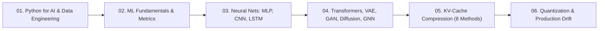

# Machine Learning Foundations: Data Engineering, Neural Architectures, KV-Cache Math, Quantization & Drift

A rigorous, mathematically grounded curriculum covering numerical Python internals, classical ML pipelines and metrics, eight neural network architectures with formal equations and animated schematics, LLM KV-cache compression math, weight/activation quantization, and production statistical drift monitoring.

> Verified against Node 26.13.0, TypeScript 7.0.2, Python 3.14.10, uv 0.13.6, NumPy 2.5.5, SciPy 1.18.1, scikit-learn 1.9.1, Pydantic 2.14.4, and DVC 3.67.1 on 2026-11-28

---

## 1. Syllabus & Curriculum Structure

The track spans six progressive modules backed by nine animated SVG schematics, executable TypeScript and Python test suites, and a 60-question examination bank:



### Module Directory

1. [Module 01: Python for AI & Data Engineering](modules/01-python-for-ai-and-data-engineering.md): NumPy strided `ndarray` memory layout (C/F-order, views vs copies, broadcasting, SIMD vectorization), feature engineering pipelines, chronological/grouped splits, data-leakage prevention, and content-addressed data versioning (`DVC 3.67.1` / LakeFS).
2. [Module 02: ML Fundamentals & Evaluation Metrics](modules/02-ml-fundamentals-and-metrics.md): Formal ERM formulation, bias-variance decomposition, $L_1/L_2$ regularization, leakage-free `scikit-learn 1.9.1` `Pipeline` + `ColumnTransformer`, confusion matrices, Precision/Recall/$F_1$, PR-AUC vs ROC-AUC under extreme skew, Brier/log-loss calibration, RMSE/MAE/$R^2$, and an imbalanced fraud-detection case study.
3. [Module 03: Neural Networks — MLP, CNN, and LSTM](modules/03-neural-networks-mlp-cnn-lstm.md): Universal approximation (Cybenko/Hornik), reverse-mode autodiff VJP chain rule, MLP, 2D CNN cross-correlation and receptive-field recurrence, and LSTM constant-error carousel with three animated SVG schematics.
4. [Module 04: Modern Architectures — Transformers, VAE, GAN, Diffusion, and GNN](modules/04-transformers-autoencoders-gans-diffusion-gnn.md): Scaled dot-product attention, multi-head attention, RoPE relative dot-product invariance, VAE ELBO and reparameterization, GAN minimax JSD equilibrium, DDPM forward/reverse diffusion, and GCN/GAT graph message passing with five animated SVG schematics and an architecture trade-off matrix.
5. [Module 05: KV-Cache Compression & Inference Math](modules/05-kv-cache-compression-and-inference-math.md): Exact KV-cache VRAM equation $M_{\text{KV}} = 2 L n_{kv} d_h b T B$ and all eight compression methods (MQA, GQA, DeepSeek-V2 MLA with matrix absorption, Sliding-Window Attention, Attention Sinks / StreamingLLM, PagedAttention, RadixAttention, and FP8/INT8/KIVI KV quantization) with an animated overview SVG.
6. [Module 06: Quantization & Production ML Monitoring](modules/06-quantization-and-ml-monitoring.md): Affine symmetric/asymmetric uniform quantization, PTQ vs QAT (STE), GPTQ second-order Hessian error compensation, AWQ salient-channel scaling, FP8/INT4 perplexity vs VRAM trade-offs, covariate/label/concept drift taxonomy, PSI, two-sample Kolmogorov-Smirnov test with effect-size caveats, shadow deployment, and retraining gates.

### Prerequisites

- Core Python data model, typing, and packaging covered in [Python](../../languages/python/README.md).
- Asymptotic analysis, memory layout, and core graph/tree structures covered in [Data Structures & Algorithms](../dsa/README.md).
- Undergraduate linear algebra (matrix multiplication, eigenvalues, SVD), multivariable calculus (chain rule, gradients), and probability (expectations, KL divergence, hypothesis testing).

### Out of Scope

- **Distributed LLM Inference Serving & Cluster Routing**: Prefill/decode disaggregation, continuous batching schedulers, and multi-node tensor/pipeline parallelism orchestration live in [System Design Module 14](../../architecture/system-design/modules/14-canonical-designs-transactional-and-staff.md#6-llm-serving--chatgpt-architecture-modern-2026-staff-design).
- **Application-Layer LLM Guardrails & Agent Governance**: Validator sandwiches, semantic caching, and OWASP LLM Top 10 defenses live in [System Design Module 25](../../architecture/system-design/modules/25-reliable-ai-systems.md).
- **Custom CUDA/Triton Kernel Authoring**: Warp-level SIMT scheduling and shared-memory tiling belong to GPU systems engineering.

---

## 2. Running the Track Locally

All toolchains are pinned in [`.mise.toml`](.mise.toml) and [`mise.lock`](mise.lock). Execute from `algorithms/ml-foundations/`:

```bash
mise install
mise exec -- npm install
mise exec -- uv sync
mise exec -- npm test          # runs Node 26 TS proofs + pytest Python suite
mise exec -- npm run typecheck     # runs tsc --noEmit + uv run mypy
mise exec -- npm run lint          # runs oxlint + uv run ruff check
mise exec -- npm run fmt:check     # verifies oxfmt + ruff format
```

---

## 3. Certifications & Exams

No single vendor-neutral certification covers general machine learning foundations, neural architectures, and LLM inference math. Instead, this track aligns with two authoritative assessment benchmarks:

| Assessment / Benchmark | Vendor / Scope | Target Level & Format | Alignment Reference |
| --- | --- | --- | --- |
| **Senior ML Engineer Technical Loop** | Industry standard (FAANG / Frontier AI labs) | 45–60 min theory, coding, and ML system design rounds (leakage debugging, architecture selection, KV-cache & quantization sizing, drift diagnosis) | [exams/ml-foundations.md](exams/ml-foundations.md) |
| **AWS Certified Machine Learning Engineer – Associate (`MLA-C01`)** | Amazon Web Services (official guide active 2026) | 65 questions, 130 minutes, scaled passing score `720 / 1000` (Data Preparation, Model Development, Deployment & Monitoring) | [AWS MLA-C01 Exam Guide](https://d1.awsstatic.com/training-and-certification/docs-ml-engineer-associate/AWS-Certified-Machine-Learning-Engineer-Associate_Exam-Guide.pdf) |

- **Coverage Matrix**: [`exams/README.md`](exams/README.md) maps every ML Foundations competency domain and `MLA-C01` overlap to modules, executable proofs, and question IDs (`100%` ✅ full coverage).
- **Question Bank & Mock Exam**: [`exams/ml-foundations.md`](exams/ml-foundations.md) provides **60 original questions** (`Q-MLF-001` through `Q-MLF-060`) plus a **40-question timed mock exam** with explicit distractor rationales and primary paper citations.
