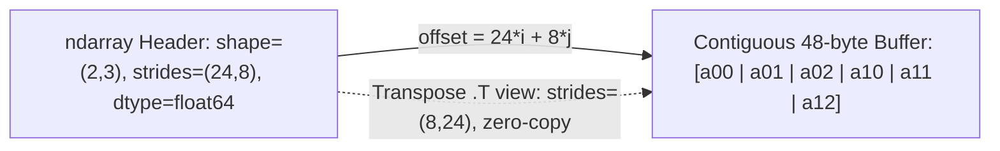

# Module 01: Python for AI & Data Engineering

Production machine learning systems fail far more often in data engineering and numerical memory layout than in gradient-descent math. Treating NumPy arrays like Python lists causes silent `O(n)` copies, cache-line thrashing, and `100x` slowdowns, while ad-hoc feature scripts leak future statistics across train/test boundaries. This module grounds numerical computing in CPython and NumPy `ndarray` stride mechanics, formalizes leakage-free dataset splitting and feature pipelines, and establishes content-addressed data versioning with `DVC 3.67.1` and LakeFS.

Prerequisites: CPython object headers, typing, and packaging internals are covered in [Python](../../../languages/python/README.md); asymptotic memory analysis and contiguous linear layouts are covered in [Data Structures & Algorithms](../../dsa/README.md).

---

## 1. NumPy `ndarray` Strided Memory Layout

A Python `list` stores an array of `PyObject*` pointers scattered across the heap, forcing pointer-chasing and per-element dynamic type checks on every arithmetic operation. By contrast, a `numpy.ndarray` (`2.5.5`, requiring Python `>=3.12`) pairs a **single contiguous raw byte buffer** (`data` pointer) with a fixed-dtype descriptor (`dtype`), a `shape` tuple $(N_0, \dots, N_{d-1})$, and a `strides` tuple $(s_0, \dots, s_{d-1})$ measured in **bytes**.

### 1.1 Stride Addressing & C-Order vs. Fortran-Order

For any $d$-dimensional index $(i_0, i_1, \dots, i_{d-1})$, the exact byte offset from the buffer base pointer is an affine linear combination:

$$\text{offset}(i_0, \dots, i_{d-1}) = \sum_{k=0}^{d-1} i_k \cdot s_k$$

- **Row-major (C-order, NumPy default)**: The last axis has the smallest stride (`itemsize` bytes). For a `float64` (`8` bytes) matrix of shape $(R, C)$, `strides = (8 * C, 8)`. Scanning along rows (`axis=1`) hits sequential 64-byte L1 cache lines.
- **Column-major (Fortran-order, `order='F'`)**: The first axis has stride `itemsize`, so `strides = (8, 8 * R)`. BLAS/LAPACK routines (`DGEMM`) historically prefer column-major buffers; NumPy handles both by passing stride metadata or transposing views.



### 1.2 Views vs. Copies & Broadcasting

Because indexing is purely arithmetic over `(shape, strides)`, operations that can be expressed as a new `(base_ptr, shape, strides)` tuple return an **$O(1)$ zero-copy view** sharing the underlying memory (`arr.base is not None`):

- **Zero-copy views**: Basic slicing (`a[::2, 1:4]`), transpose (`a.T`), `np.reshape` when the existing strides remain compatible (contiguous or cleanly factorizable), and `np.broadcast_to`. Mutating a view mutates the parent array!
- **Materialized copies**: Fancy indexing (`a[[0, 2]]`), boolean masking (`a[a > 0]`), and `reshape` across incompatible non-contiguous layouts (e.g., `a.T.reshape(-1)`).

**Broadcasting** avoids allocating expanded tensors by setting `stride = 0` along broadcast axes. Comparing trailing dimensions right-to-left, two shapes are compatible iff for every axis pair $(d_1, d_2)$, either $d_1 = d_2$, $d_1 = 1$, or $d_2 = 1$. Subtracting per-column means from an `(N, D)` matrix via `X - X.mean(axis=0)` (`(N, D) - (D,)`) broadcasts the `(D,)` mean vector with `stride = (0, 8)` in $O(1)$ extra memory rather than tiling an $N \times D$ matrix.

### 1.3 SIMD Vectorization vs. Python Loops

NumPy's universal functions (`ufunc`) execute tight C loops compiled with AVX2/AVX-512 (x86-64) or NEON (ARM64) SIMD intrinsics directly over contiguous buffers without acquiring the GIL for pure numeric loops.

| Pattern (1M `float64` elements) | Execution Mechanism | Memory / Dispatch Overhead |
| --- | --- | --- |
| Python `for` loop + `math.exp` | Bytecode dispatch + `PyFloatObject` boxing (`24 B` + `8 B` ptr per elem) | `~50–100x` slower; pointer chasing |
| `np.exp(x)` on contiguous C-array | Single Python call into vectorized SIMD C loop | L1/DRAM bandwidth-bound |
| `np.sum(a[:, 0])` on non-contiguous `C` slice | Strided gather across cache lines (`stride = 8*C`) | Degrades vectorization if `C` is large |

> [!TIP]
> Check `arr.flags['C_CONTIGUOUS']` or call `np.ascontiguousarray(arr)` before tight inner loops or C/CUDA FFI boundaries so the CPU prefetcher streams sequential cache lines.

---

## 2. Feature Engineering Pipelines & Data-Leakage Prevention

**Data leakage** occurs whenever information from the validation set, test set, or future timestamps influences training features, transformations, or model selection. Leakage inflates offline metrics while guaranteeing failure in production.

### 2.1 Common Leakage Vectors

| Leakage Vector | Concrete Bug | Fix |
| --- | --- | --- |
| **Pre-split scaling / imputation** | Computing `StandardScaler().fit(X_all)` before `train_test_split` | Fit transformers strictly inside `Pipeline` on training folds only |
| **Target leakage (future proxy)** | Including `days_since_chargeback` or `account_closed_flag` when predicting fraud at checkout | Audit every feature against its exact **feature-availability timestamp** at prediction time |
| **Group / entity leakage** | Random row split puts user `u_42`'s transactions in both train and test | Use `GroupKFold` / `StratifiedGroupKFold` keyed by `user_id` or `session_id` |
| **Temporal lookahead** | Random K-fold on time-series lets Tuesday's price regime predict Monday's return | Use expanding/rolling `TimeSeriesSplit` with embargo gap if labels have horizon delay |

### 2.2 Leakage-Free Split Taxonomy

1. **IID tabular classification**: `StratifiedKFold` preserves class priors across folds when no group or time structure exists.
2. **Grouped entities (medical patients, users, devices)**: `StratifiedGroupKFold` ensures zero entity overlap across train and validation folds.
3. **Time-ordered streams (fraud, demand forecasting, CTR)**: Chronological split (`train < val < test`) or `TimeSeriesSplit`, plus point-in-time joins (`ASOF JOIN`) in the feature store so rolling aggregations (`tx_count_24h`) never peek past the event timestamp.

---

## 3. Data Versioning & Reproducible Lineage

Code in Git alone does not make an ML build reproducible: training runs depend on the triple $(\text{code commit}, \text{dataset snapshot}, \text{hyperparameter/seed config})$. Storing multi-gigabyte Parquet or TFRecord shards directly in Git bloats object packs and breaks clones.

### 3.1 Content-Addressed Versioning (`DVC 3.67.1` vs. LakeFS)

- **DVC (`3.67.1`)**: Tracks large datasets and model binaries via small `.dvc` YAML pointer files committed to Git, containing the file size and cryptographic content hash (`md5` / `sha256`). Raw blobs live in S3/GCS/Azure/SSH remotes organized by content hash, giving automatic deduplication and deterministic `dvc checkout` alongside `git checkout`.
- **LakeFS**: Brings Git-like branching, zero-copy copy-on-write commits, and atomic merge hooks directly to S3/GCS object-store prefixes at petabyte scale, enabling atomic multi-table snapshot isolation for Spark/DuckDB/Ray feature pipelines.
- **Typed dataset contracts (`Pydantic 2.14.4`)**: Enforce schema invariants (column types, non-null rates, valid category sets, timestamp monotonicity) at pipeline ingress before expensive feature computation or training begins.

```python
from pydantic import BaseModel, Field


class FeatureSnapshotManifest(BaseModel):
    dataset_uri: str
    content_sha256: str = Field(pattern=r"^[a-f0-9]{64}$")
    row_count: int = Field(gt=0)
    cutoff_utc: str
    schema_version: int = Field(ge=1)
```

---

## 4. Interview Drill

### 1. Why does transposing a large 2D NumPy array (`X.T`) take $O(1)$ time, and when does a subsequent `.reshape(-1)` trigger an $O(N)$ copy?

<details><summary>Answer</summary>

`X.T` returns a zero-copy view by reversing `shape` and `strides` in the `ndarray` metadata header (`O(1)`). Calling `.reshape(-1)` requires representing the flattened array with a single constant byte stride; because `X.T` has non-contiguous strides `(itemsize, itemsize * R)`, no single stride can step through elements in row-major order, forcing NumPy to allocate a fresh contiguous buffer and copy all `N` elements (`X.ravel()` also copies here, whereas `X.reshape(-1)` on a contiguous array returns a view).

</details>

### 2. How does NumPy broadcasting compute `X - X.mean(axis=0)` without allocating an expanded mean matrix?

<details><summary>Answer</summary>

`X` has shape `(N, D)` and `X.mean(axis=0)` has shape `(D,)`. NumPy right-aligns the shapes `(N, D)` and `(1, D)` and sets the broadcast stride on axis 0 of the mean view to `0` bytes (`strides=(0, 8)`). The ufunc C loop reads the exact same `D` floats on every row iteration with zero extra heap allocation beyond the `(N, D)` output buffer.

</details>

### 3. Why can fitting `StandardScaler` on the full dataset prior to `train_test_split` invalidate cross-validation accuracy even when labels `y` are untouched?

<details><summary>Answer</summary>

Unsupervised preprocessing still leaks test-distribution moments ($\mu_{\text{test}}$, $\sigma_{\text{test}}$) into training representations and subtly shifts decision boundaries—especially severe when outliers, class imbalance, or distribution shifts exist across splits. In time-series or rare-event tasks, future variance spikes bleed backward into training scaling. Putting `StandardScaler` inside a `scikit-learn` `Pipeline` fits statistics strictly on each training fold.

</details>

### 4. You are predicting credit-card fraud at authorization time (`t_0`). Why must you reject a training feature called `merchant_dispute_rate_7d` unless built with an `ASOF` point-in-time join?

<details><summary>Answer</summary>

A naive SQL `GROUP BY merchant_id` aggregates future disputes after `t_0` into historical transactions—and if `t_0` itself resulted in a dispute 3 days later, it encodes the target label directly into the feature (**temporal target leakage**). A point-in-time `ASOF` join restricts the window strictly to `[t_0 - 7d, t_0)` using only records available before `t_0`.

</details>

### 5. When would you choose LakeFS over `DVC 3.67.1` for dataset versioning?

<details><summary>Answer</summary>

`DVC` works well for Git-centric teams versioning moderate file trees (gigabytes to low terabytes) synced to object storage via `.dvc` manifests. At multi-terabyte or petabyte scale across millions of Parquet objects processed by distributed engines (Spark, Trino, Ray), hashing and pulling locally does not scale; **LakeFS** operates natively on the object store via zero-copy metadata branching, atomic commits, and S3-compatible branch URIs (`s3://repo/branch/...`).

</details>
