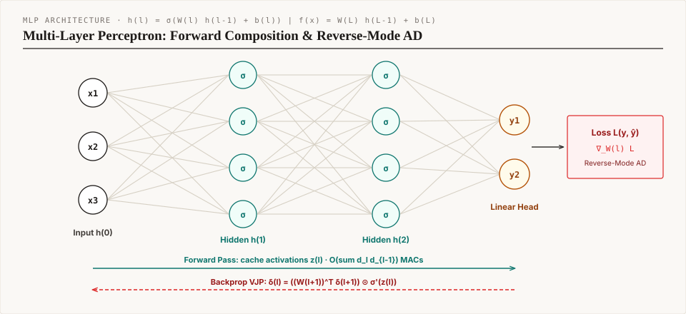
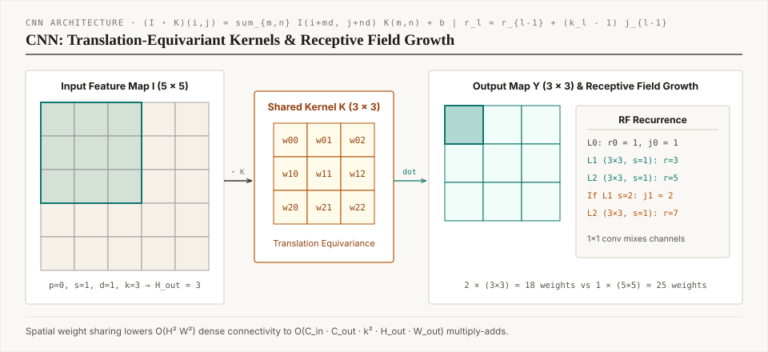
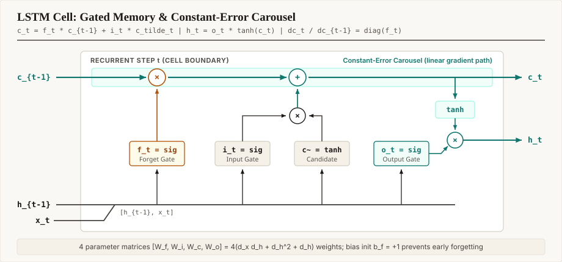

# Module 03: Neural Networks — MLP, CNN, and LSTM

Classical linear models rely on hand-crafted basis expansions $\phi(\mathbf{x})$. Deep neural networks replace fixed basis functions with **hierarchical learned representations** trained end-to-end via reverse-mode automatic differentiation. This module covers universal approximation, backpropagation mechanics, and the three foundational neural architectures—**MLP**, **CNN**, and **LSTM**—alongside their formal equations and visual schematics.

---

## 1. Universal Approximation & Backpropagation

### 1.1 Universal Approximation Theorems

- **Cybenko (1989) & Hornik (1991)**: A feedforward network with a single hidden layer containing finitely many units and any continuous, non-constant, bounded monotone activation (Cybenko) or merely non-polynomial activation (Hornik) can approximate any continuous function $f \in C(K)$ on a compact set $K \subset \mathbb{R}^d$ to arbitrary $\varepsilon > 0$ accuracy in the supremum norm.
- **Why depth matters**: Universal approximation is an existence statement, not a parameter-efficiency guarantee. Representing compositions or parity-like functions with width alone can demand $\mathcal{O}(2^n)$ hidden units in depth-2 networks, whereas deep architectures compose hierarchical features in $\mathcal{O}(\mathrm{poly}(n))$ parameters.

### 1.2 Reverse-Mode Automatic Differentiation (VJP)

Given a scalar loss $\mathcal{L} = \ell(f_\theta(\mathbf{x}), y)$, forward-mode AD computes one directional derivative per pass ($\mathcal{O}(\lvert\theta\rvert)$ passes for $\lvert\theta\rvert$ parameters). **Reverse-mode AD (backpropagation)** computes the entire gradient vector $\nabla_\theta \mathcal{L}$ in **one forward pass** (caching intermediate activations) followed by **one backward pass** propagating vector-Jacobian products (VJPs):

$$\boldsymbol{\delta}^{(L)} = \nabla_{\mathbf{z}^{(L)}} \mathcal{L}, \qquad \boldsymbol{\delta}^{(l)} = \left(\left(W^{(l+1)}\right)^{\top}\boldsymbol{\delta}^{(l+1)}\right) \odot \sigma'\!\left(\mathbf{z}^{(l)}\right)$$

$$\nabla_{W^{(l)}}\mathcal{L} = \boldsymbol{\delta}^{(l)} \left(\mathbf{h}^{(l-1)}\right)^{\top}, \qquad \nabla_{\mathbf{b}^{(l)}}\mathcal{L} = \boldsymbol{\delta}^{(l)}$$

Memory cost scales linearly with depth and batch size because pre-activation tensors $\mathbf{z}^{(l)}$ must remain live until the backward sweep consumes them—motivating **activation checkpointing** (trading recompute FLOPs for VRAM).

---

## 2. Multi-Layer Perceptron (MLP)

An $L$-layer **MLP** composes affine projections with elementwise nonlinearities $\sigma$ (ReLU, GELU, SiLU/SwiGLU) followed by a linear output head:

$$\mathbf{h}^{(0)} = \mathbf{x}, \qquad \mathbf{h}^{(l)} = \sigma\!\left(W^{(l)}\mathbf{h}^{(l-1)} + \mathbf{b}^{(l)}\right), \quad l = 1, \dots, L - 1$$

$$f(\mathbf{x}) = W^{(L)}\mathbf{h}^{(L-1)} + \mathbf{b}^{(L)}$$

- **Initialization & variance preservation**: Naive standard-normal weights collapse or explode activation variance across depth. **Xavier/Glorot** ($\mathrm{Var}(W) = \frac{2}{d_{\text{in}} + d_{\text{out}}}$) preserves variance for linear/$\tanh$ activations; **Kaiming/He** ($\mathrm{Var}(W) = \frac{2}{d_{\text{in}}}$) compensates for ReLU halving expected variance.
- **Architectural limits**: MLPs assume fixed-length unstructured vectors and lack spatial or temporal weight sharing. Applying an MLP directly to a $224 \times 224 \times 3$ image needs $150{,}528$ weights per single first-layer neuron and fails to generalize under translations.

---

## 3. Convolutional Neural Networks (CNN)

### 3.1 2D Cross-Correlation, Stride, Padding, and Dilation

In deep learning libraries (PyTorch `Conv2d`, TensorFlow), the implemented forward operator is **cross-correlation** (sliding the kernel without spatial flipping; flipping only matters in analytical convolution):

$$(I \star K)(i, j) = \sum_{m=0}^{k-1}\sum_{n=0}^{k-1} I\!\left(i \cdot s + m d,\; j \cdot s + n d\right) K(m, n) + b$$

For input height $H$, zero-padding $p$, kernel size $k$, stride $s$, and dilation $d$, the output spatial extent is:

$$H_{\text{out}} = \left\lfloor\frac{H + 2p - d(k - 1) - 1}{s}\right\rfloor + 1$$

### 3.2 Receptive Field Recurrence

With initial receptive field $r_0 = 1$ and jump (effective stride in input pixels) $j_0 = 1$, stacking convolutional layers with kernel size $k_l$ and stride $s_l$ (for $d_l=1$) grows the receptive field monotonically:

$$j_l = j_{l-1} s_l, \qquad r_l = r_{l-1} + (k_l - 1)\,j_{l-1}$$

Solving the recurrence yields the closed form across $L$ layers:

$$r_L = 1 + \sum_{l=1}^{L}(k_l - 1)\prod_{i=1}^{l-1}s_i$$

- **Verification**: Two $3\times 3$ layers at $s = 1$ yield $r_2 = 1 + 2 + 2 = 5$ using only $2 \times 9 = 18$ weights per channel pair instead of $25$ for a single $5\times 5$ kernel, while inserting an extra nonlinearity. A $3\times 3$ ($s=2$) followed by $3\times 3$ ($s=1$) yields $r_2 = 1 + 2 + 2\cdot 2 = 7$. (Tested in [`examples/ts/02-nn-and-quantization.test.ts`](../examples/ts/02-nn-and-quantization.test.ts).)
- **Inductive biases**: **Translation equivariance** (shifting input shifts feature maps identically) and **spatial parameter sharing**; pooled/global-averaged heads yield approximate translation invariance.

---

## 4. Long Short-Term Memory (LSTM)

Vanilla recurrent neural networks ($\mathbf{h}_t = \tanh(W\mathbf{x}_t + U\mathbf{h}_{t-1})$) suffer exponential gradient decay or blow-up across $T$ steps because $\frac{\partial \mathbf{h}_T}{\partial \mathbf{h}_t} = \prod_{k=t+1}^T \mathrm{diag}(\tanh'(\mathbf{z}_k)) U$, whose singular values deviate from $1$.

### 4.1 Gated Equations & Constant-Error Carousel (Hochreiter & Schmidhuber 1997; Graves 2013)

The **LSTM** decouples long-term memory into an additive **cell state** $\mathbf{c}_t$ regulated by three sigmoid gates $(\mathbf{i}_t, \mathbf{f}_t, \mathbf{o}_t)$ and a candidate update $\tilde{\mathbf{c}}_t$:

$$\mathbf{i}_t = \sigma\!\left(W_i\mathbf{x}_t + U_i\mathbf{h}_{t-1} + \mathbf{b}_i\right), \qquad \mathbf{f}_t = \sigma\!\left(W_f\mathbf{x}_t + U_f\mathbf{h}_{t-1} + \mathbf{b}_f\right)$$

$$\mathbf{o}_t = \sigma\!\left(W_o\mathbf{x}_t + U_o\mathbf{h}_{t-1} + \mathbf{b}_o\right), \qquad \tilde{\mathbf{c}}_t = \tanh\!\left(W_c\mathbf{x}_t + U_c\mathbf{h}_{t-1} + \mathbf{b}_c\right)$$

$$\mathbf{c}_t = \mathbf{f}_t \odot \mathbf{c}_{t-1} + \mathbf{i}_t \odot \tilde{\mathbf{c}}_t, \qquad \mathbf{h}_t = \mathbf{o}_t \odot \tanh(\mathbf{c}_t)$$

- **Constant-Error Carousel (CEC)**: Differentiating the cell update gives $\frac{\partial \mathbf{c}_t}{\partial \mathbf{c}_{t-1}} = \mathrm{diag}(\mathbf{f}_t)$ plus indirect gate terms. When the forget gate stays open ($\mathbf{f}_t \approx \mathbf{1}$, typically encouraged by initializing $\mathbf{b}_f = +\mathbf{1}$), gradients flow backward without shrinking through $\tanh'$ saturation or repeated matrix $U^\top$ multiplications.
- **Sequential bottleneck**: Unlike CNNs and Transformers, step $t$ strictly depends on $(\mathbf{h}_{t-1}, \mathbf{c}_{t-1})$, forcing $\mathcal{O}(T)$ sequential latency during training and making large-scale pretraining slower than self-attention.

---

## 5. Interview Drill

### 1. If a single-hidden-layer MLP is a universal approximator, why do modern architectures use dozens of layers?

Answer

Universal approximation proves existence of a width-$N$ approximator on compact domains, not tractable parameter count or sample efficiency. Certain compositional and hierarchical functions require exponential width $\mathcal{O}(2^n)$ in a shallow 2-layer network, whereas depth reduces the requirement to $\mathcal{O}(\mathrm{poly}(n))$ parameters by reusing intermediate feature representations across layers.

### 2. Why does Kaiming (He) initialization scale variance by $2 / d_{\text{in}}$ instead of Xavier's $1 / d_{\text{in}}$?

Answer

ReLU zeroes out negative pre-activations, which cuts expected output variance in half for symmetric zero-mean distributions ($\mathbb{E}[\mathrm{ReLU}(z)^2] = \frac{1}{2}\mathrm{Var}(z)$). Multiplying the weight variance by $2$ restores unit activation variance across stacked ReLU layers instead of collapsing activations exponentially toward zero.

### 3. Compute the output size and receptive field of three stacked $3\times 3$ convolutions with padding $p=1$, dilation $d=1$, and strides $(1, 2, 1)$ on a $32 \times 32$ input.

Answer

Spatial extent: $L_1: \lfloor(32 + 2 - 2 - 1)/1\rfloor + 1 = 32$; $L_2: \lfloor(32 + 2 - 2 - 1)/2\rfloor + 1 = 16$; $L_3: 16 \times 16$. Receptive field recurrence ($r_0=1, j_0=1$): $L_1: r_1 = 1 + 2\cdot 1 = 3, j_1 = 1$; $L_2: r_2 = 3 + 2\cdot 1 = 5, j_2 = 2$; $L_3: r_3 = 5 + 2\cdot 2 = 9$.

### 4. Why does an LSTM still need gradient clipping during training if the constant-error carousel solves vanishing gradients?

Answer

The CEC stabilizes the **additive cell path** against vanishing gradients, not against **exploding gradients** through the recurrent hidden-state matrix multiplications $U_i, U_f, U_o, U_c$ or steep loss landscapes along long BPTT unrolls. Norm clipping ($\lVert \mathbf{g} \rVert_2 \le g_{\max}$) caps rare high-curvature spikes without altering gradient direction.

### 5. Why do two stacked $3 \times 3$ convolutions outperform a single $5 \times 5$ convolution in standard CNN backbones?

Answer

Both achieve an identical $5 \times 5$ receptive field, but two $3 \times 3$ layers use $2 \times 9 C^2 = 18 C^2$ parameters versus $25 C^2$ ($28\%$ fewer weights and MACs) while inserting an extra nonlinear activation between layers, increasing representational expressiveness.

