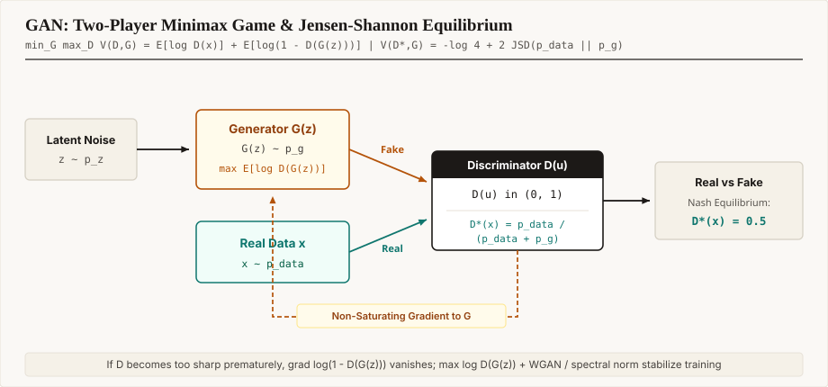
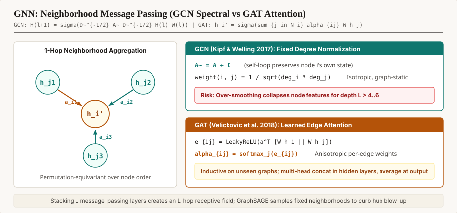

# Module 04: Modern Architectures — Transformers, VAE, GAN, Diffusion, and GNN

Modern deep learning extends beyond feed-forward grids and sequential recurrences into all-to-all attention graphs, variational generative manifolds, adversarial minimax games, iterative denoising Markov chains, and irregular relational topologies. This module formalizes the mathematical foundations and failure modes of **Transformers**, **Autoencoders / VAEs**, **GANs**, **Denoising Diffusion (DDPM)**, and **Graph Neural Networks (GCN & GAT)**, accompanied by five animated schematics and a comparative architecture selection matrix.

---

## 1. Transformer & Rotary Position Embedding (RoPE)

### 1.1 Scaled Dot-Product & Multi-Head Attention (Vaswani et al. 2017, arXiv:1706.03762)

Self-attention replaces $\mathcal{O}(n)$ sequential recurrence with $\mathcal{O}(1)$ path length across all token pairs at $\mathcal{O}(n^2 d)$ prefill cost per layer:

$$\mathrm{Attn}(Q, K, V) = \mathrm{softmax}\!\left(\frac{QK^{\top}}{\sqrt{d_k}}\right)V$$

$$\mathrm{head}_i = \mathrm{Attn}(QW_i^{Q},\, KW_i^{K},\, VW_i^{V}), \qquad \mathrm{MHA}(X) = \big[\,\mathrm{head}_1;\dots;\mathrm{head}_h\,\big]W^{O}$$

Scaling by $\frac{1}{\sqrt{d_k}}$ keeps dot-product variance at `1` when entries of $Q, K$ have zero mean and unit variance, preventing softmax from saturating into vanishing gradients as $d_k$ grows. Original sinusoidal encodings use $PE_{(pos, 2i)} = \sin(pos / 10000^{2i/d_{\text{model}}})$ and $PE_{(pos, 2i+1)} = \cos(\cdot)$.

### 1.2 Rotary Position Embedding (Su et al. 2021, arXiv:2104.09864)

Rather than adding absolute position vectors to token embeddings, **RoPE** rotates adjacent coordinate pairs in $Q$ and $K$ by position-proportional angles $\theta_i = 10000^{-2(i-1)/d}$:

$$R(\theta) = \begin{pmatrix}\cos\theta & -\sin\theta\\ \sin\theta & \cos\theta\end{pmatrix}, \qquad R^{d}_{\Theta,m} = \mathrm{diag}\!\left(R(m\theta_1),\dots,R(m\theta_{d/2})\right)$$

$$\mathbf{q}_m = R^{d}_{\Theta,m} W_q \mathbf{x}_m, \qquad \mathbf{k}_n = R^{d}_{\Theta,n} W_k \mathbf{x}_n$$

Because rotation matrices are orthogonal ($(R_{\Theta,m}^d)^\top = R_{\Theta,-m}^d$) and compose additively ($R_{\Theta,-m}^d R_{\Theta,n}^d = R_{\Theta,n-m}^d$), the inner product depends **strictly on relative token distance $n - m$**:

$$\langle \mathbf{q}_m, \mathbf{k}_n \rangle = \langle W_q \mathbf{x}_m,\; R^{d}_{\Theta,n-m} W_k \mathbf{x}_n \rangle$$

In practice, RoPE evaluates cleanly as complex elementwise multiplication $(W_q\mathbf{x}_m) e^{im\theta}$ without materializing dense $d\times d$ matrices. (Proven numerically in [`examples/ts/02-nn-and-quantization.test.ts`](../examples/ts/02-nn-and-quantization.test.ts).)

---

## 2. Autoencoders & Variational Autoencoders (VAE)

A deterministic **Autoencoder** compresses $\mathbf{x} \in \mathbb{R}^D$ through a bottleneck $\mathbf{z} \in \mathbb{R}^{d_z}$ ($d_z \ll D$) minimizing reconstruction error $\lVert \mathbf{x} - \hat{\mathbf{x}}\rVert_2^2$. Its latent space has holes: arbitrary samples $\mathbf{z}$ rarely decode cleanly.

### 2.1 ELBO & Reparameterization (Kingma & Welling 2013, arXiv:1312.6114)

A **VAE** turns $\mathbf{z}$ into a probabilistic latent variable with prior $p(\mathbf{z}) = \mathcal{N}(\mathbf{0}, I)$ and variational encoder $q_\phi(\mathbf{z}\mid\mathbf{x}) = \mathcal{N}(\boldsymbol{\mu}, \mathrm{diag}(\boldsymbol{\sigma}^2))$. Maximizing the **Evidence Lower Bound (ELBO)** lower-bounds marginal log-likelihood $\log p_\theta(\mathbf{x})$:

$$\log p_\theta(\mathbf{x}) \ge \mathcal{L}(\theta, \phi; \mathbf{x}) = \mathbb{E}_{q_\phi(\mathbf{z}\mid\mathbf{x})}\!\left[\log p_\theta(\mathbf{x}\mid\mathbf{z})\right] - D_{\mathrm{KL}}\!\left(q_\phi(\mathbf{z}\mid\mathbf{x}) \,\Vert\, p(\mathbf{z})\right)$$

For diagonal Gaussians, the KL penalty evaluates in closed form, and the **reparameterization trick** pushes stochasticity into an auxiliary noise draw $\boldsymbol{\varepsilon} \sim \mathcal{N}(\mathbf{0}, I)$ so gradients $\nabla_\phi$ stay low-variance:

$$D_{\mathrm{KL}} = -\tfrac{1}{2}\sum_{j=1}^{d_z}\left(1 + \log\sigma_j^2 - \mu_j^2 - \sigma_j^2\right), \qquad \mathbf{z} = \boldsymbol{\mu} + \boldsymbol{\sigma} \odot \boldsymbol{\varepsilon}$$

- **Degenerate limits**: As $\boldsymbol{\sigma} \to 0$, the KL term diverges unless omitted—recovering a plain autoencoder. Conversely, an overly strong decoder (e.g., autoregressive pixel CNN) causes **posterior collapse** where $q_\phi(\mathbf{z}\mid\mathbf{x}) \to p(\mathbf{z})$ ($D_{\mathrm{KL}} \to 0$) and the decoder ignores $\mathbf{z}$.

---

## 3. Generative Adversarial Networks (GAN)

### 3.1 Minimax Objective & JSD Equilibrium (Goodfellow et al. 2014, arXiv:1406.2661)

A **GAN** avoids explicit likelihood evaluation by pitting generator $G(\mathbf{z})$ ($\mathbf{z} \sim p_z$) against discriminator $D(\mathbf{x}) \in (0, 1)$ in a two-player zero-sum game:

$$\min_G \max_D V(D, G) = \mathbb{E}_{\mathbf{x}\sim p_{\text{data}}}\!\left[\log D(\mathbf{x})\right] + \mathbb{E}_{\mathbf{z}\sim p_z}\!\left[\log\!\left(1 - D(G(\mathbf{z}))\right)\right]$$

For fixed $G$, the optimal discriminator is $D^{\star}(\mathbf{x}) = \frac{p_{\text{data}}(\mathbf{x})}{p_{\text{data}}(\mathbf{x}) + p_g(\mathbf{x})}$. Substituting $D^{\star}$ back yields the Jensen-Shannon divergence (JSD):

$$V(D^{*}, G) = -\log 4 + 2\,\mathrm{JSD}\!\left(p_{\text{data}} \,\Vert\, p_g\right)$$

The global optimum $p_g = p_{\text{data}}$ achieves $V = -\log 4$ and $D^{*}(\mathbf{x}) = \frac{1}{2}$.

- **Training pathologies**: Early in training, when $p_g$ and $p_{\text{data}}$ have disjoint supports, $D(G(\mathbf{z})) \approx 0$ saturates $\log(1 - D(G(\mathbf{z})))$ with near-zero gradients. Replacing $G$'s loss with the **non-saturating objective** $-\mathbb{E}[\log D(G(\mathbf{z}))]$ restores strong early gradients. Still, GANs suffer **mode collapse** (mapping diverse $\mathbf{z}$ onto one high-scoring mode) and oscillatory saddle dynamics, motivating Wasserstein/spectral normalization or diffusion alternatives.

---

## 4. Denoising Diffusion Probabilistic Models (DDPM)

### 4.1 Forward Closed-Form & Reverse Objective (Ho et al. 2020, arXiv:2006.11239)

A **DDPM** defines a fixed forward Markov chain with variance schedule $\beta_t$, $\alpha_t = 1 - \beta_t$, and $\bar\alpha_t = \prod_{s=1}^t \alpha_s$:

$$q(\mathbf{x}_t \mid \mathbf{x}_{t-1}) = \mathcal{N}\!\left(\mathbf{x}_t;\, \sqrt{\alpha_t}\,\mathbf{x}_{t-1},\, \beta_t I\right) \;\Longrightarrow\; q(\mathbf{x}_t \mid \mathbf{x}_0) = \mathcal{N}\!\left(\mathbf{x}_t;\, \sqrt{\bar\alpha_t}\,\mathbf{x}_0,\, (1 - \bar\alpha_t) I\right)$$

Closed-form noising enables $O(1)$ sampling of any step $t$ directly from $\mathbf{x}_0$:

$$\mathbf{x}_t = \sqrt{\bar\alpha_t}\,\mathbf{x}_0 + \sqrt{1 - \bar\alpha_t}\,\boldsymbol{\varepsilon}, \qquad \boldsymbol{\varepsilon} \sim \mathcal{N}(\mathbf{0}, I)$$

The learned reverse chain $p_\theta(\mathbf{x}_{t-1} \mid \mathbf{x}*t) = \mathcal{N}(\mathbf{x}*{t-1};\, \boldsymbol{\mu}_\theta(\mathbf{x}_t, t),\, \sigma_t^2 I)$ predicts the injected noise $\boldsymbol{\varepsilon}_\theta(\mathbf{x}_t, t)$:

$$\boldsymbol{\mu}_\theta(\mathbf{x}_t, t) = \frac{1}{\sqrt{\alpha_t}}\left(\mathbf{x}_t - \frac{\beta_t}{\sqrt{1 - \bar\alpha_t}}\,\boldsymbol{\varepsilon}_\theta(\mathbf{x}_t, t)\right)$$

$$\mathcal{L}_{\text{simple}} = \mathbb{E}_{t, \mathbf{x}_0, \boldsymbol{\varepsilon}}\!\left[\left\lVert \boldsymbol{\varepsilon} - \boldsymbol{\varepsilon}_\theta\!\left(\sqrt{\bar\alpha_t}\,\mathbf{x}_0 + \sqrt{1 - \bar\alpha_t}\,\boldsymbol{\varepsilon},\; t\right) \right\rVert_2^2\right]$$

Here $\mathcal{L}_{\text{simple}}$ is a $\lambda_t$-reweighted simplification of the true variational bound $\mathcal{L}_{\text{vlb}}$ over posteriors $q(\mathbf{x}_{t-1}\mid\mathbf{x}_t,\mathbf{x}_0) = \mathcal{N}(\tilde{\boldsymbol{\mu}}*t, \tilde\beta_t I)$ with $\tilde\beta_t = \frac{1-\bar\alpha*{t-1}}{1-\bar\alpha_t}\beta_t$. At inference, ancestral sampling iterates $\mathbf{x}_{t-1} = \frac{1}{\sqrt{\alpha_t}}(\mathbf{x}_t - \frac{1-\alpha_t}{\sqrt{1-\bar\alpha_t}}\boldsymbol{\varepsilon}_\theta) + \sigma_t\mathbf{z}$ from $t=T$ down to $1$ (or faster via deterministic DDIM/flow-matching ODE solvers).

---

## 5. Graph Neural Networks: GCN & GAT

Graphs lack canonical node ordering or fixed grid neighborhoods. GNNs enforce **permutation equivariance** via iterative neighborhood message passing.

### 5.1 Graph Convolutional Network (Kipf & Welling 2017, arXiv:1609.02907)

Starting from a first-order Chebyshev spectral truncation $g_\theta \star \mathbf{x} \approx \theta(I + D^{-1/2}AD^{-1/2})\mathbf{x}$, Kipf & Welling apply the **renormalization trick** $\tilde A = A + I$ (adding self-loops) and $\tilde D_{ii} = \sum_j \tilde A_{ij}$ to prevent exploding norms across stacked layers:

$$H^{(l+1)} = \sigma\!\left(\tilde D^{-1/2} \tilde A\, \tilde D^{-1/2} H^{(l)} W^{(l)}\right)$$

- **Over-smoothing limit**: Repeated normalized adjacency multiplication acts like a low-pass random-walk diffusion operator. Beyond `4–6` layers, node representations converge toward a degree-proportional stationary subspace, erasing local discrimination unless mitigated with residual/JK connections.

### 5.2 Graph Attention Network (Veličković et al. 2018, arXiv:1710.10903)

**GAT** replaces fixed degree normalization with learned anisotropic edge attention over neighbors $j \in \mathcal{N}_i$:

$$e_{ij} = \mathrm{LeakyReLU}\!\left(\mathbf{a}^{\top}\left[W\mathbf{h}_i \,\Vert\, W\mathbf{h}_j\right]\right), \qquad \alpha_{ij} = \frac{\exp(e_{ij})}{\sum_{k\in\mathcal{N}_i}\exp(e_{ik})}, \qquad \mathbf{h}_i' = \sigma\!\left(\sum_{j\in\mathcal{N}_i}\alpha_{ij} W\mathbf{h}_j\right)$$

Hidden layers concatenate $K$ attention heads while the output head averages them. Because $\alpha_{ij}$ depends solely on node feature pairs rather than a fixed Laplacian eigenbasis, GAT operates **inductively** on unseen graphs at test time.

---

## 6. Comparative Architecture Selection Matrix

| Architecture | Primary Domain | Inductive Bias | Scaling Cost | Dominant Production Bottleneck |
| --- | --- | --- | --- | --- |
| **MLP** | Tabular embeddings, FFN sub-blocks | None (dense all-to-all) | $\mathcal{O}(L d^2)$ | Overfitting raw high-dim grids |
| **CNN** | Vision, audio spectrograms, 1D signals | Translation equivariance + locality | $\mathcal{O}(k^2 C^2 H W)$ | Fixed local kernel without dilation/depth |
| **LSTM** | Low-resource edge streaming time series | Sequential Markov gate state | $\mathcal{O}(T d_h^2)$ sequential | Unparallelizable across $T$; finite state capacity |
| **Transformer** | Language, multimodal, tabular attention | Permutation equivariance + RoPE offset | $\mathcal{O}(n^2 d)$ prefill | KV-cache VRAM $M_{\text{KV}}$ during long decode |
| **VAE** | Latent compression (SD latent space), anomaly scores | Smooth Gaussian latent manifold | 1 forward pass | Blurry high-frequency samples; KL balance |
| **GAN** | Ultra-fast single-step synthesis / super-res | Implicit adversarial divergence | 1 forward pass | Mode collapse & unstable minimax training |
| **Diffusion** | High-fidelity image/video/protein generation | Multi-scale iterative score denoising | $\mathcal{O}(S_{\text{steps}} \cdot \text{UNet/DiT})$ | High sampling latency (needs DDIM/distillation) |
| **GNN (GCN/GAT)** | Fraud rings, molecules, recommender graphs | Graph permutation equivariance | $\mathcal{O}(L \lvert E\rvert d)$ | Over-smoothing & hub neighbor explosion |

---

## 7. Interview Drill

### 1. Why does RoPE produce attention scores that depend only on relative distance $n - m$, unlike adding sinusoidal positional vectors $PE_m$?

Answer

With additive embeddings $(\mathbf{x}_m + PE_m)W_q$ and $(\mathbf{x}*n + PE_n)W_k$, the dot product expands into four cross-terms including content-position noise $PE_m W_q W_k^{\top} \mathbf{x}*n^{\top}$. RoPE applies orthogonal block rotations $R*{\Theta,m}^d$ directly to projected queries and keys; since $(R*{\Theta,m}^d)^{\top} R_{\Theta,n}^d = R_{\Theta,n-m}^d$, only the relative offset $n - m$ survives inside $\langle \mathbf{q}_m, \mathbf{k}_n \rangle$.

### 2. Why is the reparameterization trick $\mathbf{z} = \boldsymbol{\mu} + \boldsymbol{\sigma}\odot\boldsymbol{\varepsilon}$ required to train a VAE with backpropagation?

Answer

Sampling $\mathbf{z} \sim \mathcal{N}(\boldsymbol{\mu}, \boldsymbol{\sigma}^2)$ directly is a non-differentiable random node, blocking pathwise gradients $\nabla_\phi$ from flowing through $\mathbf{z}$ back to encoder weights $\phi$ (leaving only high-variance REINFORCE/score-function estimators). Isolating the random draw into parameter-free $\boldsymbol{\varepsilon} \sim \mathcal{N}(\mathbf{0}, I)$ makes $\mathbf{z}$ a deterministic differentiable function of $\boldsymbol{\mu}$ and $\boldsymbol{\sigma}$.

### 3. Prove why $V(D^*, G) = -\log 4$ at the GAN Nash equilibrium $p_g = p_{\text{data}}$.

Answer

When $p_g = p_{\text{data}}$, the optimal discriminator satisfies $D^{\star}(\mathbf{x}) = \frac{p_{\text{data}}}{p_{\text{data}} + p_g} = \frac{1}{2}$ everywhere on the support. Plugging $D^{\star} = \frac{1}{2}$ into $V(D^{\star}, G) = \mathbb{E}_{p_{\text{data}}}[\log \tfrac{1}{2}] + \mathbb{E}_{p_g}[\log(1 - \tfrac{1}{2})] = \log\tfrac{1}{2} + \log\tfrac{1}{2} = -\log 4$, which matches $-\log 4 + 2\,\mathrm{JSD}(p_{\text{data}} \Vert p_g)$ when $\mathrm{JSD} = 0$.

### 4. How does DDPM sample a noisy image $\mathbf{x}_{500}$ during training without running steps $t = 1 \dots 499$?

Answer

Because every forward transition is Gaussian with linear mean $\sqrt{\alpha_t}\mathbf{x}_{t-1}$, composing $t$ independent Gaussians collapses analytically into $q(\mathbf{x}_t \mid \mathbf{x}_0) = \mathcal{N}(\sqrt{\bar\alpha_t}\mathbf{x}_0, (1 - \bar\alpha_t)I)$ where $\bar\alpha_t = \prod_{s=1}^t \alpha_s$. Training therefore samples $t \sim \mathrm{Unif}\{1, \dots, T\}$ and computes $\mathbf{x}_t$ in $O(1)$ time.

### 5. Why does a 12-layer GCN often perform worse than a 2- or 3-layer GCN on node classification, and what is the structural fix?

Answer

Stacking $\tilde D^{-1/2}\tilde A\tilde D^{-1/2}$ repeatedly averages neighbor representations across increasing hop radii until distinct node embeddings converge to a uniform graph-wide stationary distribution (**over-smoothing**). Fixes include residual/skip connections (GCNII), jumping-knowledge (`JK-Net`) layer concatenation, DropEdge, or shallow GNNs paired with deeper per-node MLPs.

