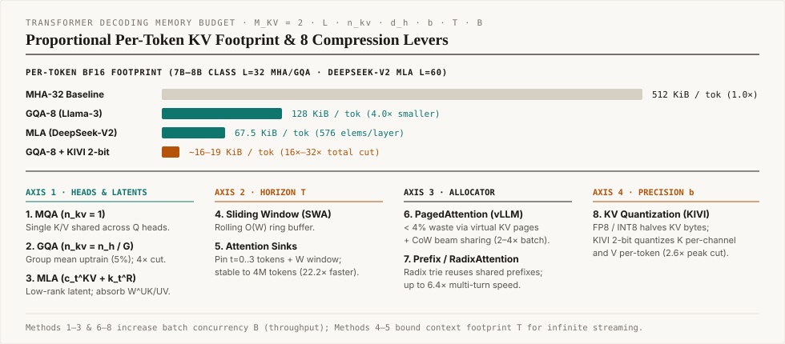

# Module 05: KV-Cache Compression & Inference Math

Autoregressive LLM decoding shifts from compute-bound prefill to **memory-bandwidth-bound** token generation, where every generated token reads the entire persisted Key-Value (KV) cache from GPU HBM. At `128k` context, KV state for a single concurrent session consumes tens of gigabytes—capping max batch size $B$ and throughput far harder than model weights. This module derives exact KV-cache VRAM bounds and dissects **8 ways to shrink the KV cache** from primary papers, with cross-links to serving infrastructure in [System Design Module 14](../../../architecture/system-design/modules/14-canonical-designs-transactional-and-staff.md#6-llm-serving--chatgpt-architecture-modern-2026-staff-design) and application cost/caching boundaries in [System Design Module 25](../../../architecture/system-design/modules/25-reliable-ai-systems.md).

---

## 1. Exact KV-Cache VRAM Equation & Baseline Calibration

For a Transformer with $L$ layers, $n_{kv}$ key/value heads per layer, head dimension $d_h$, precision $b$ bytes per element (`b = 2` for FP16/BF16), sequence context length $T$, and batch size $B$:

$$M_{\text{KV}} = 2\,L\,n_{kv}\,d_h\,b\,T\,B$$

The leading factor `2` accounts for storing both `K` and `V` tensors. Per token in BF16 ($b = 2$), KV cache consumes $4\,L\,n_{kv}\,d_h$ bytes:

| Model Configuration | $L$ | $n_h$ (Q) | $n_{kv}$ (KV) | $d_h$ | BF16 Bytes / Token | 131,072-Token Single-Seq VRAM |
| --- | :-: | :-: | :-: | :-: | :-: | :-: |
| **Llama-2-7B (MHA)** | `32` | `32` | `32` | `128` | `512 KiB/token` | `64.0 GiB` |
| **Llama-2-70B (GQA-8)** | `80` | `64` | `8` | `128` | `320 KiB/token` | `40.0 GiB` |
| **Llama-3-8B (GQA-8)** | `32` | `32` | `8` | `128` | `128 KiB/token` | `16.0 GiB` |

On a single `80 GB` H100 holding Llama-3-8B (`16 GiB` BF16 weights + `~4 GiB` workspace/activations = `~60 GiB` KV budget), maximum concurrency at $T = 131{,}072$ is $B_{\max} \approx \lfloor 60\text{ GiB} / 16\text{ GiB}\rfloor = 3$ sessions without compression! Every method below attacks a specific multiplicative factor in $M_{\text{KV}}$.

---

## 2. The 8 KV-Cache Compression Methods

### 2.1 Method 1: Multi-Query Attention (MQA) — Shazeer 2019 (arXiv:1911.02150)

- **Factor attacked**: $n_{kv} \to 1$. All $n_h$ query heads share a single K head and single V head.
- **Exact formula**: $M_{\text{KV}} = 2\,L\,d_h\,b\,T\,B$ ($\times n_h$ reduction vs. MHA).
- **Trade-off**: Dramatically lowers HBM bandwidth pressure during decode, enabling high batch concurrency, at the cost of measurable (though modest) perplexity degradation vs. MHA.

### 2.2 Method 2: Grouped-Query Attention (GQA) — Ainslie et al. 2023 (arXiv:2305.13245)

- **Factor attacked**: $n_{kv} \to n_h / G$, partitioning $n_h$ query heads into $n_h/G$ groups of $G$ queries sharing each KV head (interpolating MHA at $G=1$ query/head and MQA at $G=n_h$).
- **Exact formula**: $M_{\text{KV}} = 2\,L\,(n_h / G)\,d_h\,b\,T\,B$ (`n_kv = 8` on Llama-3-8B cuts KV `4x` to `128 KiB/token`).
- **Uptraining recipe**: Existing MHA checkpoints convert cleanly to GQA by **mean-pooling** K and V projection heads within each group followed by `5%` of original pre-training compute.

### 2.3 Method 3: Multi-Head Latent Attention (MLA) — DeepSeek-V2 2024 (arXiv:2405.04434)

- **Factor attacked**: Jointly compresses all K and V heads into a single low-rank latent vector $\mathbf{c}_t^{KV} \in \mathbb{R}^{d_c}$ plus a tiny **decoupled RoPE key** $\mathbf{k}_t^R \in \mathbb{R}^{d_h^R}$ shared across heads:

$$\mathbf{c}_t^{KV} = W^{DKV}\mathbf{h}_t, \qquad \mathbf{k}_t^{C} = W^{UK}\mathbf{c}_t^{KV}, \qquad \mathbf{v}_t^{C} = W^{UV}\mathbf{c}_t^{KV}, \qquad \mathbf{k}_t^{R} = \mathrm{RoPE}(W^{KR}\mathbf{h}_t)$$

$$\mathrm{score}_{t,s} = \frac{\left[\mathbf{q}_{t,i}^{C};\, \mathbf{q}_{t,i}^{R}\right]^{\top}\left[\mathbf{k}_{s,i}^{C};\, \mathbf{k}_s^{R}\right]}{\sqrt{d_h + d_h^{R}}}$$

- **Why RoPE decoupling & matrix absorption work**: Standard RoPE inserts a position-dependent rotation $R_{\Theta,s}$ between $W^{UK}$ and $W^{UQ}$, blocking algebraic folding. Decoupling the non-RoPE content path ($\mathbf{q}_{t,i}^C, \mathbf{k}_{s,i}^C$) lets inference absorb $W^{UK}$ directly into $W^{UQ}$ (and $W^{UV}$ into $W^O$), so **only $\mathbf{c}\_t^{KV}$ and $\mathbf{k}\_t^R$ are ever cached**—$K$ and $V$ matrices are never materialized in HBM!
- **Exact formula**: $M_{\text{KV}} = L\,(d_c + d_h^R)\,b\,T\,B$. For DeepSeek-V2 ($L=60$, $d_c=512$, $d_h^R=64$), this caches just `576` elements/layer = **67.5 KiB/token in BF16**.
- **Analytical vs. end-to-end ratio**: Analytically against an MHA-128 baseline ($2 \times 128 \times 128 = 32{,}768$ elems/layer), $576 / 32{,}768 = 1.76\%$ ($\approx 56.9\times$ smaller per layer). Note that the paper's headline `"93.3% KV reduction"` compares DeepSeek-V2 end-to-end against DeepSeek 67B (which uses different $L$ and GQA/MHA geometry); always cite the baseline when quoting percentages.

### 2.4 Method 4: Sliding-Window Attention (SWA) — Beltagy et al. 2020 (arXiv:2004.05150) & Mistral 7B (arXiv:2310.06825)

- **Factor attacked**: $T \to \min(T, W)$. Each token attends only to its preceding $W$ tokens (e.g., Mistral 7B uses $W = 4096$).
- **Exact formula**: $M_{\text{KV}} = 2\,L\,n_{kv}\,d_h\,b\,\min(T, W)\,B$. Implemented via a fixed ring/rolling buffer of size $W$, capping KV memory at $\mathcal{O}(W)$ independent of stream length $T$, while stacked layers expand the theoretical receptive field linearly as $L \times W$.

### 2.5 Method 5: Attention Sinks / StreamingLLM — Xiao et al. 2023 (arXiv:2309.17453)

- **The SWA collapse bug**: Pure sliding-window inference catastrophically spikes perplexity once $T > W$ and token $t = 0$ is evicted. Why? Softmax probabilities must sum to `1` even when current queries share low semantic relevance with recent keys, so models dump surplus attention mass onto the earliest tokens—termed **attention sinks**.
- **Fix & formula**: Keep the first $n_{\text{sink}} = 4$ initial tokens pinned alongside the rolling window $W$ (recomputing or preserving relative positional gaps within the window):

$$M_{\text{KV}} = 2\,L\,n_{kv}\,d_h\,b\,(n_{\text{sink}} + W)\,B$$

- **Reported empirical impact**: Stable streaming generation past **4M tokens** and **22.2× faster** than sliding-window KV recomputation.

### 2.6 Method 6: PagedAttention (vLLM) — Kwon et al. 2023 (arXiv:2309.06180)

- **Factor attacked**: Contiguous static pre-allocation internal/external fragmentation (which wastes `60–80%` of KV VRAM in naive `max_seq_len` buffers).
- **Mechanic & formula**: Partitions each sequence's KV cache into fixed-size logical/physical blocks of $B_{\text{blk}}$ tokens (e.g., `16` tokens) indexed via a per-sequence **block table**, allocating physical GPU frames on demand and sharing read-only prefix/beam blocks via **Copy-on-Write (CoW)**:

$$M_{\text{KV}} = 2\,L\,n_{kv}\,d_h\,b \cdot \left\lceil\frac{T}{B_{\text{blk}}}\right\rceil B_{\text{blk}} \cdot B$$

- **Reported empirical impact**: Bounds internal fragmentation to at most one partial tail block (`< 4%` waste), delivering **2–4× higher throughput** at equal latency.

### 2.7 Method 7: Prefix Caching / RadixAttention (SGLang) — Zheng et al. 2024 (arXiv:2312.07104)

- **Factor attacked**: Redundant recomputation and storage of shared prefixes across concurrent requests (system prompts, few-shot exemplars, multi-turn chat history, Tree-of-Thoughts).
- **Mechanic & formula**: Stores cached KV block pointers in a **radix tree (compressed trie)** keyed by token IDs, with LRU leaf eviction and cache-aware request scheduling to maximize prefix hit rates:

$$M_{\text{KV}} \propto 2\,L\,n_{kv}\,d_h\,b \cdot \left\lvert \bigcup_{i=1}^{B} \text{prefix}_i \right\rvert$$

- **Reported empirical impact**: Eliminates both prefill FLOPs and duplicate KV VRAM on matched prefixes, achieving up to **6.4× throughput** on multi-turn and agentic workloads.

### 2.8 Method 8: KV-Cache Quantization (FP8 / INT8 / KIVI) — Liu et al. 2024 (arXiv:2402.02750)

- **Factor attacked**: Element byte-width $b$ (`2` bytes BF16 $\to$ `1` byte FP8/INT8 $\to$ `0.25` bytes 2-bit + group scale/zero metadata).
- **KIVI asymmetric insight**: Profiling Transformer activations reveals a sharp structural asymmetry: **Key tensors exhibit fixed-channel outliers** across tokens, whereas **Value tensors exhibit per-token outliers** across channels. KIVI therefore quantizes **Keys per-channel** and **Values per-token** using group-wise affine quantization, retaining a small streaming residual window ($R = 128$ recent tokens) in FP16.
- **Reported empirical impact**: **2.6× lower peak memory**, up to **4× larger batch sizes**, and **2.35–3.47× decode throughput** with minimal accuracy degradation.

_(All 8 formulas and Llama-2/Llama-3/DeepSeek-V2/H100 concurrency bounds are verified deterministically in [`examples/ts/01-kv-cache-compression.test.ts`](../examples/ts/01-kv-cache-compression.test.ts).)_

---

## 3. Interview Drill

### 1. Compute the BF16 KV cache size per token and max batch size on an 80 GB H100 (16 GiB weights, 4 GiB overhead) for Llama-3-8B ($L=32, n_{kv}=8, d_h=128$) at $T=32{,}768$ tokens.

Answer

Per-token KV size: $2 \times 32 \times 8 \times 128 \times 2 = 131{,}072\text{ B} = 128\text{ KiB/token}$. One $32{,}768$-token sequence consumes $128\text{ KiB} \times 32{,}768 = 4\text{ GiB}$. With $80 - 16 - 4 = 60\text{ GiB}$ available for KV cache, max concurrency is $60 / 4 = 15$ sequences (before PagedAttention tail rounding).

### 2. Why did DeepSeek-V2 decouple RoPE into a separate $\mathbf{k}_t^R$ vector inside Multi-Head Latent Attention (MLA)?

Answer

In standard attention, RoPE multiplies $K$ by a position-dependent rotation matrix $R_{\Theta,s}$. If RoPE were applied after up-projecting $W^{UK}\mathbf{c}_s^{KV}$, then $W^{UK}$ could not be absorbed into $W^{UQ}$ because $R_{\Theta,s}$ sits in between and depends on token position $s$. Splitting out a dedicated small RoPE key $\mathbf{k}_s^R$ leaves the content branch position-free, allowing full matrix absorption of $W^{UK}$ and $W^{UV}$ at inference.

### 3. Why does a Sliding-Window Attention model fail catastrophically once conversation length exceeds $W$, and how do Attention Sinks fix it?

Answer

Softmax enforces $\sum_j \alpha_{ij} = 1$. Even when no recent token matches the query strongly, the attention head must allocate probability mass somewhere—and early training teaches it to park surplus mass on the very first tokens ($t = 0..3$). Evicting those sink tokens breaks softmax calibration and spikes perplexity; keeping just `4` sink tokens alongside the rolling window $W$ stabilizes infinite streaming.

### 4. Why does KIVI quantize Keys per-channel and Values per-token instead of quantizing both per-token?

Answer

Empirical activation profiling shows that Key matrices contain persistent outlier magnitudes tied to specific feature channels across all sequence positions, so per-token quantization forces every token's dynamic range to stretch around those channel spikes. Value matrices lack channel-persistent spikes and instead vary per token, so quantizing **K per-channel** and **V per-token** tightly bounds quantization error down to 2 bits.

### 5. Which of the 8 KV-cache compression methods are orthogonal and routinely composed in production vLLM / SGLang stacks?

Answer

Architectural head/latent compression (**GQA** or **MLA**) reduces $n_{kv} d_h$ at training time; **PagedAttention** eliminates allocation fragmentation; **RadixAttention** deduplicates shared prefixes across requests; and **FP8 KV quantization** halves $b$. Composing GQA-8 + PagedAttention + RadixAttention + FP8 KV cuts active HBM footprint by `10x–30x` on real multi-turn workloads.

