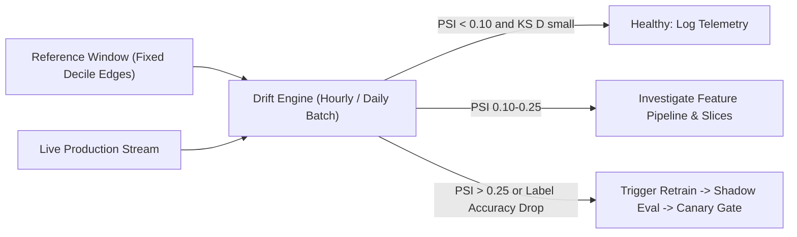

# Module 06: Quantization & Production ML Monitoring

Deploying models at scale requires compressing weights and activations to fit tight GPU VRAM and latency budgets—and then continuously verifying that compressed or full-precision models do not silently decay as live traffic evolves. This module formalizes uniform affine quantization, **PTQ**, **QAT**, **GPTQ**, and **AWQ**, evaluates FP8/INT4 perplexity vs. memory trade-offs, and builds a production statistical drift framework combining **PSI**, **two-sample KS testing**, shadow deployment, and automated retraining gates.

---

## 1. Weight & Activation Quantization

### 1.1 Affine Uniform Quantization

Mapping a floating-point tensor $w \in [w_{\min}, w_{\max}]$ to a $b$-bit integer grid $[q_{\min}, q_{\max}]$ uses scale $s > 0$ and integer zero-point $z$:

$$q = \mathrm{clamp}\!\left(\left\lfloor \frac{w}{s} \right\rceil + z,\; q_{\min},\; q_{\max}\right), \qquad \hat{w} = s\,(q - z)$$

- **Asymmetric** ($q \in [0, 2^b - 1]$): $s = \frac{w_{\max} - w_{\min}}{2^b - 1}$, $z = \lfloor -w_{\min}/s \rceil$. Tightest dynamic range utilization for non-symmetric activations (e.g., post-ReLU), at the cost of extra zero-point cross-terms inside integer GEMM.
- **Symmetric** ($q \in [-(2^{b-1}-1), 2^{b-1}-1]$): $s = \frac{\lVert w\rVert_\infty}{2^{b-1}-1}$, $z = 0$. Zero-point vanishes, simplifying GEMM inner loops for centered weights.
- **Group-wise quantization**: Splitting rows into blocks of `g = 128` elements with independent $(s, z)$ bounds outlier blast radius to 128 weights for `~0.016–0.031` extra bytes per element (FP16 scale alone costs `0.0156 B/elem` at `g = 128` and `0.125 B/elem` at `g = 16`; scale + zero-point costs `~0.031 B/elem` at `g = 128` and `0.25 B/elem` at `g = 16`).

### 1.2 PTQ vs. QAT (Straight-Through Estimator)

- **Post-Training Quantization (PTQ)**: Calibrates scales and minimizes layer-wise reconstruction error $\lVert W X - \hat{W} X \rVert_F^2$ over a small unlabeled calibration sample (`128–512` sequences) without gradient updates. Cheap (minutes to hours), near-lossless at **FP8 / INT8**, but naive round-to-nearest (RTN) degrades steeply at `<= 4` bits on LLMs.
- **Quantization-Aware Training (QAT)**: Inserts fake-quantize nodes ($\text{dequant}(\text{quant}(w))$) in the forward pass during training or fine-tuning. Because $\lfloor \cdot \rceil$ has zero derivative almost everywhere, backward passes use the **Straight-Through Estimator (STE)**:

$$\frac{\partial \mathcal{L}}{\partial w} \approx \frac{\partial \mathcal{L}}{\partial \hat{w}} \cdot \mathbb{I}\!\left(w \in [(q_{\min} - z)s,\; (q_{\max} - z)s]\right)$$

QAT recovers accuracy down to 2–3 bits (and FP4) but demands full training infrastructure, optimizer states, and training corpus access.

### 1.3 Second-Order & Activation-Aware PTQ: GPTQ & AWQ

| Method | Primary Paper | Core Mathematical Mechanism | Trade-Offs |
| --- | --- | --- | --- |
| **GPTQ** | Frantar et al. 2022, [arXiv:2210.17323](https://arxiv.org/abs/2210.17323) | Uses approximate layer Hessian $\mathbf{H} = 2XX^{\top}$ (Cholesky inverse). Quantizes weight column $j$, then compensates remaining unquantized columns $j+1:$ via optimal residual update $\boldsymbol{\delta} = -\frac{w_j - \hat{w}_j}{[\mathbf{H}^{-1}]_{jj}}\mathbf{H}^{-1}_{:,j}$ | Quantizes 175B model to 3–4 bits in ~4 GPU-h; `3.25x` (A100) / `4.5x` (A6000) speedup; can slightly overfit narrow calibration sets |
| **AWQ** | Lin et al. 2023, [arXiv:2306.00978](https://arxiv.org/abs/2306.00978) | Observes `~1%` **activation-salient** weight channels dominate quantization error. Leaves weights uncompensated and instead multiplies salient input weight columns by $s_j = (\mathrm{mean}\lvert X_{:,j}\rvert)^\alpha$ while dividing activations by $s_j$: $y = (W\,\mathrm{diag}(\mathbf{s}))(\mathrm{diag}(\mathbf{s})^{-1}\mathbf{x})$ | Grid-searches $\alpha \in [0, 1]$ without backprop or Hessian inversion; generalizes cleanly out-of-distribution; `> 3x` speedup over FP16 in TinyChat |

_(Numeric proof comparing naive RTN vs. AWQ salient-channel scaling quantization error lives in [`examples/ts/02-nn-and-quantization.test.ts`](../examples/ts/02-nn-and-quantization.test.ts).)_

### 1.4 Precision Case Study: FP16 vs. FP8 vs. INT4-AWQ (70B Model)

| Format | Weight Memory (70B) | Decode Arithmetic / Bottleneck | Typical Quality Impact |
| --- | --- | --- | --- |
| **BF16 / FP16** | `~140 GB` (needs `>= 2x 80GB H100`) | HBM-bandwidth bound at low batch | Reference baseline |
| **FP8 (E4M3)** | `~70 GB` (fits `1x 80GB` tightly; `2x` w/ KV) | Native Hopper/Blackwell FP8 Tensor Cores (`2x` FLOPs + `2x` bandwidth) | Near-zero perplexity delta (`< 0.1` PPL) |
| **INT4 (AWQ/GPTQ `g=128`)** | `~39–42 GB` (fits single `80GB` GPU w/ `~35 GB` KV!) | Weight-only dequantize to FP16 on the fly (`W4A16`); cuts HBM reads `~3.5x` | Slight perplexity rise (`~0.1–0.3` PPL); huge single-GPU latency win at small $B$ |

---

## 2. Monitoring ML in Production & Statistical Drift

Model accuracy degrades silently in production without raising HTTP `5xx` errors. Monitoring separates **data distribution shifts**, **statistical detectors**, and **safe rollout/retraining governance**.

### 2.1 Drift Taxonomy

1. **Covariate drift** ($P_t(X) \neq P_{\text{ref}}(X)$, $P(Y\mid X)$ fixed): Input feature demographics, sensor ranges, or user cohorts shift (e.g., mobile traffic surges over desktop).
2. **Label / prior drift** ($P_t(Y) \neq P_{\text{ref}}(Y)$, $P(X\mid Y)$ fixed): Base prevalence changes (e.g., holiday fraud spike doubles $P(Y=1)$), miscalibrating unadjusted posterior probabilities.
3. **Concept drift** ($P_t(Y\mid X) \neq P_{\text{ref}}(Y\mid X)$): The underlying real-world mapping changes (adversarial fraudsters adapt around rules, macroeconomic regime shifts). Covariate detectors alone **cannot** detect pure concept drift—delayed ground-truth labels or human audits are mandatory.

### 2.2 Population Stability Index (PSI)

Fixed $B$ quantile bins (typically $B = 10$ deciles) are computed **once** on the reference window and reused on every production window (substituting $\varepsilon \approx 10^{-6}$ for zero-count bins):

$$\mathrm{PSI} = \sum_{i=1}^{B} \left(p_i^{\text{act}} - p_i^{\text{ref}}\right) \ln\frac{p_i^{\text{act}}}{p_i^{\text{ref}}} = D_{\mathrm{KL}}\!\left(P_{\text{act}} \Vert P_{\text{ref}}\right) + D_{\mathrm{KL}}\!\left(P_{\text{ref}} \Vert P_{\text{act}}\right)$$

PSI is symmetric KL divergence ($\mathrm{PSI} \ge 0$, zero iff bin proportions match identically):

| PSI Range | Credit-Risk / Industry Convention (Siddiqi 2006) | Operational Action |
| --- | --- | --- |
| `< 0.10` | No meaningful distribution shift | Keep current model |
| `0.10 – 0.25` | Moderate shift | Investigate top contributing bins/features & upstream schema changes |
| `> 0.25` | Major shift | Trigger offline validation, recalibration, or retraining pipeline |

> [!WARNING]
> **PSI Caveat**: The `0.10` / `0.25` thresholds are empirical credit-risk conventions—not statistical theorems. They carry no $p$-value, and PSI increases mechanically with bin count $B$ and small sample noise. Always pair PSI with per-feature distribution plots.

### 2.3 Two-Sample Kolmogorov-Smirnov (KS) Test & Sample-Size Trap

For continuous 1D features with empirical CDFs $F_{1,n}(x)$ and $F_{2,m}(x)$, the two-sample KS statistic measures maximum vertical discrepancy:

$$D_{n,m} = \sup_{x \in \mathbb{R}} \left\lvert F_{1,n}(x) - F_{2,m}(x) \right\rvert$$

Under $H_0$ (identical continuous distributions), reject at level $\alpha$ when $D_{n,m} > c(\alpha)\sqrt{\frac{n+m}{nm}}$ ($c(0.05) = 1.358$). In SciPy (`1.18.1`), use `scipy.stats.ks_2samp(ref, act, method="asymp")` for large production windows (and `"exact"` below `~10^4` samples).

- **The Big-$N$ $p$-value trap**: At `n = m = 1,000,000`, $\sqrt{\frac{n+m}{nm}} \approx 0.0014$, so a trivial `0.4%` shift ($D = 0.004$) triggers $p < 10^{-6}$ (and even $D = 0.002$ gives $p \approx 0.04 < 0.05$)! Never page on-call or auto-retrain on KS $p$-value alone—gate alerts on **effect size** $D_{n,m}$ (e.g., $D > 0.05$) alongside **PSI** and **downstream business loss**. _(Verified in [`examples/py/test_ml_pipeline_and_drift.py`](../examples/py/test_ml_pipeline_and_drift.py).)_

### 2.4 Shadow Deployment & Automated Retraining Gates

1. **Shadow (dark launch) deployment**: Mirror live ingress traffic asynchronously to the candidate model, logging predictions, latency, and schema compliance without returning shadow outputs to users—eliminating live customer blast radius while validating real-world feature parity.
2. **Safe automated retraining**: Require (a) drift/performance breach across sustained windows (not single-hour spikes), (b) automated leakage & schema contract checks (`Pydantic`), (c) non-regression against golden invariant slices + holdout PR-AUC/Brier bounds, and (d) progressive canary rollout (`5% -> 25% -> 100%`).

---

## 3. Practitioner Version History & Then vs. Now

| Component / Practice | Earlier Practice (Then, 2020–2022) | Current Practice (Now, 2026) | Migration Pitfall |
| :-- | :-- | :-- | :-- |
| **Python ML & Data Stack** | `numpy 1.x` (`< 2.0`), `scikit-learn 1.0–1.2` without Polars/Arrow dataframe output, `pydantic v1` | **`numpy 2.5.5`**, **`scipy 1.18.1`**, **`scikit-learn 1.9.1`** (`set_output` / `Pipeline` + `ColumnTransformer`), **`pydantic 2.14.4`**, **`dvc 3.67.1`** (`Python >= 3.12`) | Mixing `numpy 1.x` C-ABI extensions with `2.x`, or fitting scalers before `train_test_split` |
| **Attention & KV-Cache Serving** | Dense MHA (`n_kv = n_h`), static contiguous `max_seq_len` buffers, FP16 KV | **GQA** (`Llama-3`) / **MLA** (`DeepSeek-V2`), **PagedAttention** + **RadixAttention** + **FP8 / KIVI** KV quantization + **StreamingLLM** sinks | Recomputing full prompts on multi-turn prefixes or evicting $t=0..3$ sink tokens |
| **Weight Quantization** | Naive Round-to-Nearest (RTN) INT8 or expensive QAT for every checkpoint | **GPTQ** (`arXiv:2210.17323`) Hessian compensation, **AWQ** (`arXiv:2306.00978`) activation-salient scaling, and native Hopper/Blackwell **FP8** | Quantizing INT4 with RTN or picking salient weights by weight magnitude instead of activations |
| **Drift & Rollout Governance** | Manual offline notebook checks and paging on raw KS $p$-values | Fixed-decile **PSI** + KS **effect size** $D_{n,m}$ + **shadow** evaluation + canary promotion | Recomputing quantile bin edges on live traffic (hiding mean shifts) or trusting $p < 10^{-3}$ at $N = 10^6$ |

---

## 4. Interview Drill

### 1. Why does GPTQ outperform naive Round-to-Nearest (RTN) quantization at 4 bits, and what is the role of the Hessian $\mathbf{H} = 2XX^\top$?

Answer

RTN rounds every weight independently, accumulating correlated output error $\Delta y = (W - \hat{W})X$. GPTQ computes the quadratic layer-reconstruction Hessian $\mathbf{H} = 2XX^\top$ from calibration inputs and, after quantizing weight column $j$, updates all remaining unquantized columns $j+1:$ by $\boldsymbol{\delta} = -\frac{w_j - \hat{w}_j}{[\mathbf{H}^{-1}]_{jj}}\mathbf{H}^{-1}_{:,j}$ to cancel the induced output error along high-curvature input directions.

### 2. How does AWQ protect salient weights from 4-bit quantization loss without storing mixed-precision weights or running backpropagation?

Answer

Mixed-precision `FP16 + INT4` storage breaks regular GPU memory coalescing. AWQ keeps every weight in `INT4` by scaling salient input channels up by $s_j > 1$ (selected from per-channel average activation magnitudes $\mathrm{mean}\lvert X_{:,j}\rvert$) and scaling the corresponding runtime activation channels down by $1/s_j$, leaving $y = (W\,\mathrm{diag}(\mathbf{s}))(\mathrm{diag}(\mathbf{s})^{-1}\mathbf{x})$ mathematically unchanged while reducing relative rounding error on salient weights.

### 3. Why is the KS test $p$-value insufficient for triggering production retraining when monitoring 500k daily events?

Answer

The KS critical threshold scales as $O(1/\sqrt{n})$. At $n = m = 500{,}000$, minor shifts of $D = 0.0045$ produce tiny $p$-values ($< 10^{-4}$), and even $D = 0.003$ trips $p \approx 0.02 < 0.05$, causing continuous false alarms. Production monitors must inspect the KS statistic $D_{n,m}$ directly as a bounded effect size alongside PSI and delayed ground-truth metrics.

### 4. You deploy a fraud classifier in production; PSI on all 40 input features stays below `0.04`, yet fraud chargebacks double. What happened?

Answer

This is **pure concept drift** ($P(Y\mid X)$ changed while $P(X)$ stayed stable)—for example, fraudsters discovered how to mimic normal checkout feature ranges while executing a new abuse pattern. Because covariate monitors (PSI, KS on $X$) only inspect $P(X)$, detecting concept drift requires delayed ground-truth label joins, precision/recall tracking on audit samples, and residual calibration checks.

### 5. What is the difference between shadow deployment and canary deployment, and when do you run shadow first?

Answer

Shadow deployment duplicates live production requests asynchronously to the new model without affecting user responses, measuring latency, feature-pipeline parity, and score distribution drift with zero user impact. Canary deployment routes a small live slice (e.g., `5%`) of real decisions to the new model. Always run shadow first on high-stakes models or major pipeline refactors to catch feature-skew bugs before exposing live users.

