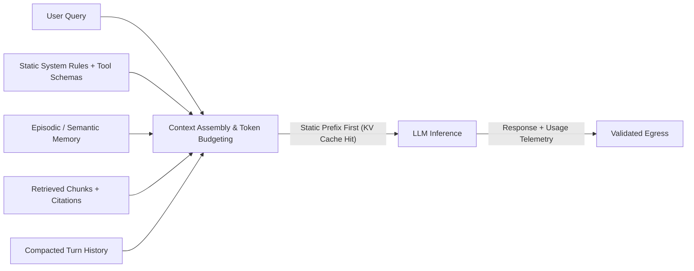

# Module 01: LLM Fundamentals, Prompt & Context Engineering

Production AI applications do not fail primarily because models lack intelligence; they fail because engineers treat stochastic token generators as deterministic RPC functions. Designing reliable LLM systems starts at the mechanics of subword tokenization and autoregressive logit sampling, moves through prompt and context-window engineering, and terminates in grammar-constrained structured outputs paired with runtime domain validation.

> [!NOTE]
> **Cross-Track Ownership.** This module owns LLM tokenization, sampling mechanics, prompt/context engineering, function calling, and framework selection. Deterministic ingress/egress boundary enforcement (**Validator Sandwich**) is owned by [`system-design` Module 25](../../system-design/modules/25-reliable-ai-systems.md#2-the-validator-sandwich-pattern-deterministic-brackets-around-probabilistic-inference), and transformer attention / KV-cache hardware math belongs to [`system-design` Module 14](../../system-design/modules/14-canonical-designs-transactional-and-staff.md#6-llm-serving--chatgpt-architecture-modern-2026-staff-design).

---

## 1. Tokenization (BPE) and Autoregressive Sampling

### 1.1 Byte-Pair Encoding (BPE) Mechanics

Modern foundation models do not process raw Unicode characters or whitespace-split words; they operate over integer token IDs produced by **Byte-Level Byte-Pair Encoding (BBPE)** (Sennrich et al. 2016; Gage 1994). Starting from a base alphabet of 256 raw UTF-8 bytes, offline tokenizer training iteratively merges the most frequent adjacent symbol pair $(u, v)$ into a new vocabulary entry $w$ until the vocabulary reaches target size $|V|$ (typically `100,000–256,000` tokens).

At inference time, encoding is greedy and deterministic given a fixed merge rank table, which produces three subtle engineering consequences:

1. **Non-Uniform Token Density Across Languages and Syntax**: English prose averages `~4` characters per token, whereas minified JSON, UUIDs, non-Latin scripts, or dense whitespace can expand by `2x–4x`, silently exhausting input budgets and inflating quadratic attention/prefill compute.
2. **Leading-Space Sensitivity**: `"hello"` and `" hello"` map to different token IDs (`"hello"` vs `"Ġhello"`), which is why trailing whitespace at the end of a prompt alters next-token probability distributions.
3. **Byte-Boundary Artifacts**: Arithmetic (`"12345"` split into `["123", "45"]`), character counting, and reversal tasks fail disproportionately because the model never observes individual characters directly unless spelled out or computed via tools.

### 1.2 Logits, Softmax, and Sampling Controls

Given prefix tokens $x_{1:t-1}$, a causal transformer emits a raw logit vector $z \in \mathbb{R}^{|V|}$. Before sampling the next token $y_t$, inference engines apply temperature scaling and support truncation:

$$P_T(w \mid x_{1:t-1}) = \frac{\exp(z_w / T)}{\sum_{v \in V} \exp(z_v / T)}$$

| Parameter | Mathematical Rule | Operational Effect & Production Setting |
| :-- | :-- | :-- |
| **Temperature ($T$)** | Scales logits $z_w / T$ prior to `softmax` ($T \to 0^+$ approaches `argmax`) | Use `0.0–0.2` for classification, extraction, and tool arguments; `0.6–0.9` for brainstorming. As proven in [`system-design` M25](../../system-design/modules/25-reliable-ai-systems.md#12-three-production-failure-classes-contract-silent-drift-and-economic-blowup), **`T = 0` is NOT bit-deterministic** under dynamic GPU batching (`BF16`/`FP16` non-associativity) or sparse MoE routing. |
| **Top-$p$ (Nucleus)** | Smallest set $V_p \subseteq V$ where $\sum_{w \in V_p} P_T(w) \ge p$ | Cuts the long tail dynamically by cumulative probability mass. Adjust `temperature` or `top_p`, rarely both simultaneously (`top_p = 0.9–1.0`). |
| **Top-$k$** | Retains only the top $k$ tokens by probability | Static cutoff; too rigid when distribution entropy varies sharply between deterministic syntax (`"{"`) and open prose. |
| **Min-$p$** | Retains tokens satisfying $P_T(w) \ge p_{\min} \cdot \max_v P_T(v)$ | Scales truncation relative to the top token's confidence; preserves creative breadth at high $T$ while suppressing incoherent tail tokens (`p_min = 0.05–0.10`). |

---

## 2. Working with LLM APIs & Prompt Engineering for Developers

### 2.1 Production API Contract Discipline

Treating an LLM provider SDK as a transparent wrapper hides four critical wire realities:

- **Snapshot Pinning**: Always pin immutable dated model snapshots (never floating aliases) in production configs and log `gen_ai.response.model` vs. `gen_ai.request.model` to catch silent backend upgrades.
- **Inspect `finish_reason` First**: Never pass `response.text` directly to `JSON.parse`. Handle `"stop"` (normal completion), `"length"` (truncated at `max_tokens`), `"tool_calls"`, and `"refusal"`/`"content_filter"` explicitly; retrying a safety `"refusal"` wastes budget.
- **Separate Cost Accounting from Model Output**: Input, cached-prefix, output, and hidden reasoning tokens live exclusively on the outer API `usage` envelope.
- **Streaming & Deadlines**: Stream tokens over SSE (`TTFT` vs. `TPOT`) for interactive UX, enforce per-request `AbortSignal` deadlines, and pair retries with jittered exponential backoff only on transient `429`/`5xx` statuses.

### 2.2 Prompt Engineering as Software Specification

For developers, prompts are versioned source artifacts — not ad-hoc prose:

1. **Role & Instruction Hierarchy**: Separate immutable developer/system rules from untrusted user data using structural delimiters (`<untrusted_user_data>...</untrusted_user_data>`) with closing-tag escaping.
2. **Explicit Uncertainty Escape Hatches**: Instruct the model to emit `"INSUFFICIENT_EVIDENCE"` or escalate rather than guessing when retrieved context lacks an answer; this directly reduces hallucination rate (`LLM09`).
3. **Few-Shot Exemplars Over Adjective Soup**: Two to four concrete input/output examples specifying boundary cases (`null` fields, empty arrays, refusals) outperform paragraphs of emphatic capitalization (`"CRITICAL: YOU MUST..."`).
4. **Reasoning Ordering**: When using structured outputs, place intermediate `reasoning` or `evidence_quotes` fields **before** final `decision` or `classification` fields so autoregressive conditioning reflects chain-of-thought evidence rather than post-hoc rationalization.

---

## 3. Context Engineering & Prefix-Cache Economics

**Context Engineering** treats the context window as scarce, ordered, attention-weighted working memory rather than an append-only string buffer.

### 3.1 Static-to-Volatile Ordering Rule

Modern inference engines (vLLM RadixAttention, SGLang, hosted prompt-caching APIs) reuse precomputed KV-cache blocks for exact token prefixes, cutting input costs by `50%–90%` and improving `TTFT` by `2x–5x`. Putting a volatile timestamp (`"Current time: 2026-11-28T10:17:00Z"`), request UUID, or user profile at line 1 of the system prompt invalidates the entire prefix cache on every call. **Always order prompt segments strictly from most static to most volatile**:

1. Immutable system instructions and policy rules.
2. Deterministic, canonically sorted tool schemas (`tools/list` order must stay stable).
3. Shared static domain knowledge / few-shot examples.
4. Session-scoped retrieved RAG evidence and memory.
5. Per-turn user query and volatile runtime metadata (`current_date`, `request_id`).

---

## 4. Function Calling, Tool Use & Grammar-Constrained Structured Outputs

### 4.1 Function Calling Mechanics

Tool calling converts natural language intent into typed JSON arguments matching a tool's `inputSchema`. The model **never executes a tool**; it emits a `tool_call` stop state containing `{ id, name, arguments }`. The host application validates authorization, executes the tool deterministically, and appends a `tool_result` message keyed by `id` for the next model turn.

Key design rules for developer tool surfaces:

- Keep schemas minimal, flat where possible, and explicit about units (`amount_cents`, `iso8601_utc`).
- Return machine-readable, model-recoverable error payloads (`{ errorCode: "INVALID_DATE_RANGE", hint: "start_date must precede end_date" }`) instead of raw stack traces so the model can self-correct on the next step.

### 4.2 Structured Outputs: CFG/FSM vs. Runtime Validation (Zod / Pydantic)

Grammar-constrained decoding engines (**XGrammar**, **Outlines**, **llguidance**) compile a strict JSON Schema (`additionalProperties: false`, all fields `required`) into a Context-Free Grammar (`CFG`) and pushdown automaton / finite-state mask (`FSM`) over the tokenizer vocabulary trie. At each decode step, invalid next tokens have their logits masked to $-\infty$.

| Guarantee Layer | Enforced By | What It Prevents | What Still Slips Through |
| :-- | :-- | :-- | :-- |
| **Syntax & Key Closure** | Inference engine `CFG`/`FSM` token mask (`strict: true`) | Prose preambles, markdown fences, missing keys, invalid enum strings | Truncation (`finish_reason: "length"`), safety `"refusal"`, dynamic per-request schemas busting grammar compile cache (`10–100 ms` first-hit cost) |
| **Type Coercion & Cross-Field Rules** | Host runtime validator (**Zod**, **Pydantic**, TypeScript guards) | Negative amounts, `refund > orderTotal`, invalid regex/email formats, stale cached shapes | Semantic hallucinations (`citationId` pointing to a real-looking but unretrieved doc) |
| **Domain & Grounding Invariants** | **Validator Sandwich** Bottom Bun ([`system-design` M25](../../system-design/modules/25-reliable-ai-systems.md#23-bottom-bun-mandatory-output-guardrails-on-every-egress-path)) | Ungrounded citations, PII/secret leakage, RBAC/ACL violations | Upstream retrieval gaps (addressed via RAG evaluation in Module 05) |

---

## 5. LLM Application Frameworks: Trade-Offs

| Stack Tier | Representative Tools | Best Fit | Hidden Production Pitfalls |
| :-- | :-- | :-- | :-- |
| **Direct Provider SDK + Thin Typed Wrapper** | Native REST/SDK + Zod/Pydantic + OTel | Single-turn extraction, classification, latency-critical endpoints | Teams re-invent retry, streaming, and state checkpointing if workflows grow multi-step |
| **Graph / Stateful Agent Runtimes** | **LangGraph** (`1.2.24` Py / `1.7.5` JS), Temporal + SDK | Long-running stateful agents, durable HITL `interrupt()`, fan-out/map-reduce | Learning curve around reducers/channels; over-abstracting simple 1-call chains |
| **RAG & Indexing Frameworks** | LlamaIndex, Haystack | Document ingestion connectors, prototyping chunkers and retrievers | Default chunking/reranking presets hide retrieval failures until evaluated against golden sets |

**Rule of thumb**: Start with a thin, typed SDK wrapper and explicit state transitions; adopt a stateful graph runtime (Module 04) only when durable checkpointing, parallel fan-out, or human-in-the-loop interrupts justify the control-plane complexity.

---

## 6. Case Study: Eliminating Silent JSON Drift in a Support Triage Service

A SaaS billing triage pipeline migrated from `"Please reply ONLY in JSON"` prompting to grammar-constrained `json_schema` decoding, assuming parsing errors would drop to `0%`. Two weeks into production, downstream refund automation crashed on `1.8%` of traffic and mis-routed `4%` of escalations. Trace inspection uncovered three root causes:

1. **Unchecked `finish_reason`**: Verbose customer threads hit `max_tokens`, emitting `finish_reason: "length"` and truncated JSON; blindly calling `JSON.parse` threw unhandled exceptions.
2. **Schema-Order Bias**: The schema placed `"decision": "approve" | "deny"` _before_ `"reasoning"`; moving `"reasoning"` first raised triage accuracy from `86%` to `93%` on the golden eval set.
3. **Prefix-Cache Busting**: A per-request `current_timestamp` injected at the top of the system prompt caused `0%` prefix cache hits; moving it to the final user message yielded an `84%` prefix-cache hit rate and cut input spend by `68%`.

---

## Interview Drill

### Question 1: Why does setting `temperature = 0` not guarantee deterministic outputs in hosted or batched LLM inference?

Answer

At `temperature = 0`, decoding selects `argmax` logits, but floating-point addition in `FP16`/`BF16` GPU kernels is non-associative. Continuous batching varies batch dimensions dynamically across concurrent requests, altering matrix-multiplication (`GEMM`) reduction order and sparse Mixture-of-Experts (`MoE`) capacity routing, which flips near-tied token logits and cascades into divergent completions.

### Question 2: Why should prompt templates place static system instructions and tool definitions before timestamps and user state?

Answer

GPU KV prefix caching (such as RadixAttention and hosted prompt caches) requires an exact token-for-token prefix match starting from token 0. Placing a volatile timestamp or request ID near the start invalidates the entire prefix cache on every request, forfeiting `50%–90%` input cost discounts and `2x–5x` TTFT improvements.

### Question 3: What is the exact guarantee boundary of grammar-constrained decoding (`CFG`/`FSM` `strict: true`), and what must host code still verify?

Answer

Constrained decoding guarantees syntactic adherence to the compiled JSON grammar **only** for completed, non-refusal outputs. Host code must still inspect `finish_reason` (handling `"length"` and `"refusal"`), validate numeric bounds and cross-field business invariants (e.g., via Zod/Pydantic), and verify grounding/authorization before mutating state.

### Question 4: Why does placing `"decision"` before `"reasoning"` in a structured JSON schema hurt accuracy on analytical tasks?

Answer

In autoregressive decoding, every generated token conditions only on preceding tokens. If the model commits to `"decision": "deny"` first, subsequent `"reasoning"` tokens merely rationalize that premature commitment; putting `"reasoning"` first allows intermediate computation tokens to inform the final classification token.

### Question 5: How does `min-p` sampling improve upon static `top-k` and `top-p` truncation?

Answer

`top-k` fixes an arbitrary token count regardless of entropy, while `top-p` can still admit incoherent long-tail tokens when probability mass is flat at high temperatures. `min-p` scales the inclusion floor dynamically as $p_{\min} \cdot P_{\max}$, keeping diverse candidates when the model is uncertain while sharply pruning tail noise when a strong mode exists.

