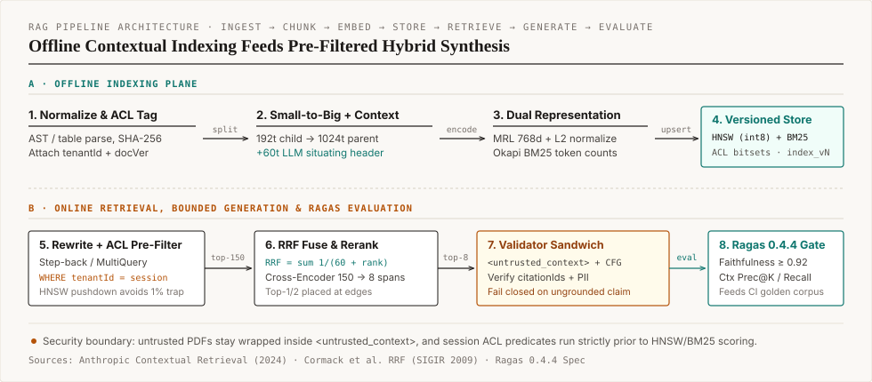
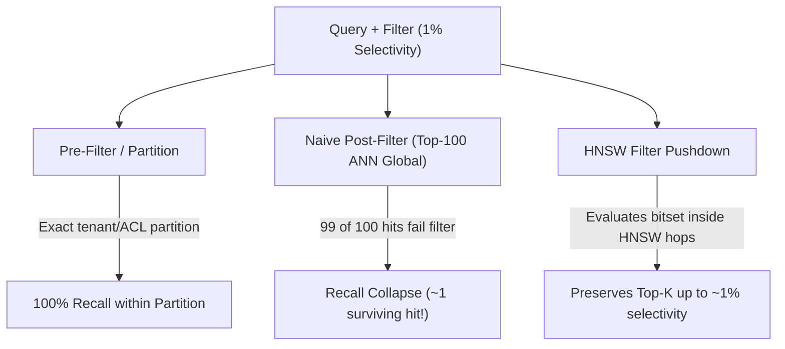

# Module 02: RAG Pipeline & Vector Retrieval

Retrieval-Augmented Generation (RAG) decouples **reasoning** (parametric transformer weights) from **mutable factual knowledge** (external non-parametric indexes). Production RAG failures rarely stem from the generator LLM; they originate upstream in blind chunking, mismatched embedding spaces, post-filter recall collapse, or lexical blind spots on exact identifiers.

> [!NOTE]
> **Cross-Track Ownership.** Core inverted-index codecs, Okapi BM25 storage mechanics, HNSW graph construction, IVF centroids, and vector quantization math belong to [`data-systems` Module 03](../../data-systems/modules/03-indexing-theory-and-vector-search.md). This module owns the end-to-end RAG pipeline, embedding model geometry (including Matryoshka Representation Learning), chunking strategies, Contextual Retrieval, metadata filtering trade-offs, and Hybrid Search with Reciprocal Rank Fusion (RRF).



---

## 1. End-to-End RAG Pipeline Lifecycle

A production RAG architecture splits cleanly into an asynchronous **Offline Indexing Plane** and a latency-bounded **Online Query Plane**:

```
Ingest ─▶ Chunk (+Contextual Prefix) ─▶ Embed (MRL) & Tokenize ─▶ Store (Hybrid + ACLs)
                                                                          │
Evaluate (Ragas) ◀─ Generate (Validator Sandwich) ◀─ Retrieve (Pre-Filter + RRF)
```

1. **Ingest**: Parse raw formats (PDF layouts, HTML, Markdown, code ASTs), strip unsafe control/injection markup, compute content hashes (`SHA-256`) for idempotent incremental updates, and propagate deletions via tombstones so stale records never leak into answers.
2. **Chunk**: Partition documents into retrieval units (`200–800` tokens) while preserving structural boundaries and document-level context.
3. **Embed & Tokenize**: Encode chunks into dense normalized vectors alongside sparse lexical postings (`BM25`).
4. **Store**: Persist vectors, inverted postings, relational metadata/ACL bitsets, and full parent spans in an isolated, versioned index (`index_vN`).
5. **Retrieve**: Enforce tenant/ACL pre-filters, run hybrid lexical + dense search, fuse rankings via RRF, and pass candidates to Stage 2 reranking (Module 03).
6. **Generate**: Assemble retrieved evidence inside `<untrusted_context>` delimiters and enforce citation grounding via the Validator Sandwich ([`system-design` M25](../../system-design/modules/25-reliable-ai-systems.md#23-bottom-bun-mandatory-output-guardrails-on-every-egress-path)).
7. **Evaluate**: Continuously measure `faithfulness`, `context precision@K`, and `context recall` in CI (Module 05).

---

## 2. Embedding Models & Matryoshka Representation Learning (MRL)

### 2.1 Dense Semantic Geometry and Re-Embedding Rules

Dense bi-encoders map queries $q$ and passages $d$ independently into $\mathbb{R}^D$ so relevance approximates cosine similarity:

$$\cos(\mathbf{u}, \mathbf{v}) = \frac{\mathbf{u} \cdot \mathbf{v}}{\|\mathbf{u}\|_2 \, \|\mathbf{v}\|_2}$$

When embeddings are L2-normalized ($\|\mathbf{u}\|_2 = \|\mathbf{v}\|_2 = 1$), cosine similarity reduces to a single dot product $\mathbf{u} \cdot \mathbf{v}$, accelerating SIMD/AVX vector kernels. Crucially, **vector spaces across different model versions or providers are mathematically incompatible**: upgrading from `gemini-embedding-001` to `gemini-embedding-2` (or switching providers) requires building a shadow `index_v2`, dual-writing, and atomically swapping aliases — never mixing vectors in one index.

### 2.2 Matryoshka Representation Learning (MRL)

Traditional embeddings spread semantic variance uniformly across all $D$ dimensions, causing severe recall degradation if truncated. **Matryoshka Representation Learning** (Kusupati et al., `arXiv:2205.13147`) optimizes a weighted multi-scale loss across nested prefixes $m \in \mathcal{M}$ (e.g., $\{128, 256, 768, 1536, 3072\}$):

$$\mathcal{L}_{\text{MRL}} = \sum_{m \in \mathcal{M}} c_m \cdot \mathcal{L}\!\left(f(x)_{1:m};\, y\right)$$

This concentrates coarse semantic discrimination in earlier dimensions and fine nuance in later dimensions, letting teams trade RAM/disk footprint for recall dynamically without retraining or re-embedding — provided prefixes are **L2-renormalized** after truncation (`gemini-embedding-2` auto-normalizes MRL slices; `gemini-embedding-001` requires explicit client normalization).

| Embedding Model (Verified 2026) | Dimensions & MRL | Max Input & Modalities | Operational Notes |
| :-- | :-- | :-- | :-- |
| **`gemini-embedding-2`** (Apr 2026) | `3072` default; MRL `128–3072` (`768`/`1536` recommended) | `8,192` tokens; multimodal (text, image, audio, video, PDF) | Auto-renormalized MRL slices; uses task prompt prefix instead of `task_type` param; incompatible space with `-001` |
| **`gemini-embedding-001`** (Jun 2025) | `3072` | `2,048` tokens; text | Requires manual L2 normalization if truncated |
| **`embed-v5.0-pro` / `embed-v5.0-fast`** (Cohere) | `256–2048` (`2048` default); float / `int8` / binary | `128k` context; `100+` languages | Shared vector space between `pro` (asymmetric high-accuracy) and `fast` (low-latency queries); MRL-enabled |
| **OpenAI `text-embedding-3-large`** | `3072` (shortenable via `dimensions`) | `8,191` tokens; text | Mature GA baseline; supports `dimensions` truncation (`256`–`3072`) with automatic normalization |

---

## 3. Vector Database Selection & Memory Sizing

Detailed HNSW graph mechanics, IVF cluster probing, and product/scalar quantization live in [`data-systems` Module 03](../../data-systems/modules/03-indexing-theory-and-vector-search.md#4-vector-search-and-approximate-nearest-neighbors-ann). From an AI engineering systems perspective, memory sizing drives database selection:

For $N$ vectors of dimension $D$ stored in `float32` (`4 B`), plus HNSW graph links ($M$ bidirectional neighbors at `4–8 B` per edge across layers):

$$\text{RAM}_{\text{HNSW}} \approx N \cdot \left(4D + 8M \cdot 1.3\right) \text{ bytes}$$

At $N = 10\text{M}$ chunks, $D = 1536$, and $M = 16$, raw `float32` HNSW consumes `~63 GB` of RAM; MRL truncation to $D = 768$ plus `int8` scalar quantization (`1 B/dim`) shrinks vector payload by `8x` (`~9 GB`), keeping the working set hot in memory inside PostgreSQL (`pgvector` `halfvec`/HNSW), Qdrant, Weaviate, or OpenSearch/Elasticsearch. Prefer an **integrated transactional + vector store** (`pgvector` or hybrid search engine) until query QPS, index size (`> 50M–100M` vectors), or multi-region isolation justifies a dedicated distributed vector database.

---

## 4. Document Processing, Chunking & Anthropic Contextual Retrieval

Chunk size balances **embedding specificity** (smaller chunks represent one crisp proposition) against **synthesis completeness** (larger chunks keep definitions, tables, and caveats intact).

| Chunking Strategy | Mechanics & Typical Window | Strengths | Failure Mode |
| :-- | :-- | :-- | :-- |
| **Fixed-Size Sliding Window** | `200–800` tokens, `10%–20%` overlap | Predictable latency and index cardinality | Splits sentences, code blocks, and Markdown table rows mid-thought |
| **Recursive Character / Token** | Splits along ordered separators (`\n\n` → `\n` → `. ` → ` `) | Respects paragraphs before falling back to hard cuts | Still breaks multi-paragraph logical arguments or long tables |
| **Structure-Aware Chunking** | Splits on Markdown headings (`H1–H3`), AST functions/classes, PDF/HTML tables | Preserves atomic code units and table headers per row | Requires format-specific parsers (Mistral OCR / Docling / Tree-sitter) |
| **Semantic Chunking** | Groups sentences until cosine similarity between adjacent sliding windows drops below $\tau$ | Adapts boundaries to actual topic transitions | Extra embedding pass at ingest; unstable chunk sizes under noisy prose |

### 4.1 Anthropic Contextual Retrieval

Even well-bounded chunks fail when detached from document headers. A chunk reading `"Revenue grew 14% YoY in Q3"` omits **which company**, **which fiscal year**, and **which filing** it came from. **Contextual Retrieval** (Anthropic, 2024) passes the full document and each chunk to a fast LLM (amortizing document tokens via **prompt caching**) to prepend a `50–100`-token situating summary to the chunk **before** both dense embedding and BM25 indexing.

Reported benchmark impact across diverse corpora:

- Contextual Embeddings alone reduced top-20 retrieval failure rate by **`35%`**.
- Contextual Embeddings + Contextual BM25 reduced failure rate by **`49%`**.
- Adding Stage 2 Cross-Encoder Reranking pushed failure reduction to **`67%`**.

---

## 5. Metadata Filtering: Pre-Filter vs. Post-Filter Selectivity Trap

Multi-tenant AI applications must enforce security ACLs (`tenant_id`, `clearance_level`) and business predicates (`region = 'eu'`, `effective_year >= 2025`). Filtering strategy determines both **security** and **recall**:



1. **Security Pre-Filtering (Non-Negotiable for ACLs)**: Partition physically (shard/collection per large tenant) or filter by tenant bitset before returning candidates; post-filtering ACLs leaks existence/timing side channels and returns empty pages to restricted users.
2. **The Post-Filter Selectivity Trap**: If a query fetches `top_k = 100` global ANN neighbors and then applies a `1%`-selective SQL `WHERE` clause, `~99` candidates are discarded, returning `~1` result instead of `10` and collapsing recall.
3. **Single-Stage Filter Pushdown**: Modern engines (Qdrant payload indexes, pgvector `iterative_scan`, Weaviate bitmap filters) evaluate metadata bitsets _during_ HNSW graph traversal, expanding hop exploration when candidate neighbors fail the predicate, and automatically falling back to an exact brute-force scan when selectivity drops below `~0.5%–1%` (where HNSW graph connectivity fragments).

---

## 6. Hybrid Search: BM25 + Dense + Reciprocal Rank Fusion (RRF)

Dense embeddings excel at synonymy (`"terminate contract"` $\leftrightarrow$ `"cancel agreement"`) but routinely miss exact lexical identifiers: error codes (`ERR_OOM_KILLED`), part numbers (`SKU-9482-X`), legal citations, and proper nouns. **Okapi BM25** (Robertson & Zaragoza 2009) captures exact lexical match with saturating term frequency and length normalization:

$$\text{BM25}(D, Q) = \sum_{q \in Q} \text{IDF}(q) \cdot \frac{f(q, D) \cdot (k_1 + 1)}{f(q, D) + k_1 \cdot \left(1 - b + b \cdot \frac{|D|}{\text{avgdl}}\right)}, \qquad \text{IDF}(q) = \ln\!\left(1 + \frac{N - n(q) + 0.5}{n(q) + 0.5}\right)$$

Typical defaults are $k_1 \in [1.2, 2.0]$ and $b = 0.75$.

### 6.1 Reciprocal Rank Fusion (RRF)

Because BM25 scores (`[0, ∞)`) and cosine similarities (`[-1, 1]`) are on incomparable scales, naive linear score addition fails unless calibrated per query. **Reciprocal Rank Fusion** (Cormack, Clarke & Buettcher, SIGIR 2009) fuses any number of ranked retrieval lists $r \in R$ purely from 1-based ordinal rank $\text{rank}_r(d)$:

$$\text{RRF}(d) = \sum_{r \in R} \frac{1}{k + \text{rank}_r(d)}, \qquad k = 60$$

With $k = 60$, top-ranked outliers cannot monopolize fusion while documents appearing consistently high in **both** BM25 and dense lists rise cleanly to the top. See [`examples/01-rag-hybrid-and-eval.test.ts`](../examples/01-rag-hybrid-and-eval.test.ts) for a deterministic TypeScript proof of BM25 + Cosine + RRF and the post-filter selectivity collapse.

---

## 7. Case Study: Fixing Multi-Tenant Recall Collapse in Enterprise Policy Search

An internal HR/legal assistant indexed `2.4M` policy chunks across `180` subsidiaries using `1536`-d embeddings and a naive post-filtered `top_k = 50` vector query (`WHERE subsidiary_id = $1 AND status = 'active'`). Queries for small subsidiaries (`0.4%` of corpus) returned `0` or `1` relevant chunks `62%` of the time, triggering `"I don't know"` refusals even though the documents existed. Switching to (1) **HNSW filter pushdown with exact-scan fallback below `1%` selectivity**, (2) **Contextual Retrieval** prepending `[Subsidiary | Policy Title | Effective Date]`, and (3) **BM25 + Dense RRF (`k = 60`)** raised `Context Recall@10` from `0.41` to `0.94` while shrinking index RAM by `50%` via `768`-d MRL truncation.

---

## Interview Drill

### Question 1: Explain the post-filter selectivity trap in vector databases and how HNSW filter pushdown resolves it.

<details><summary>Answer</summary>

Post-filtering retrieves the global top-$K$ ANN vectors first and applies metadata predicates afterward; at `1%` selectivity, `99%` of candidates are discarded, collapsing returned results and recall. HNSW filter pushdown evaluates metadata bitsets during graph traversal so exploration continues until $K$ compliant neighbors are collected, falling back to an exact filtered scan when extreme selectivity fragments graph reachability.

</details>

### Question 2: Why is Reciprocal Rank Fusion (RRF) preferred over raw score addition when combining BM25 and dense cosine retrieval?

<details><summary>Answer</summary>

BM25 outputs unbounded lexical scores dependent on corpus IDF and query length, whereas dense cosine similarity sits in `[-1, 1]` with narrow dynamic range (`0.65–0.85`). RRF (`1 / (60 + rank)`) operates strictly on 1-based ordinal positions, eliminating fragile min-max calibration across heterogeneous retrievers while rewarding documents ranked well by both signals.

</details>

### Question 3: How does Matryoshka Representation Learning (MRL) allow dimension reduction without re-embedding a corpus, and what normalization rule applies?

<details><summary>Answer</summary>

MRL trains the embedding network with nested prefix losses $\sum_m c_m \mathcal{L}(f(x)_{1:m}; y)$, packing coarse semantic signal into early coordinates so any prefix slice remains a valid representation. Truncated slices must be L2-renormalized before dot-product indexing (automatic in `gemini-embedding-2`, manual in `gemini-embedding-001`), and vectors from different model versions must never share an index.

</details>

### Question 4: What problem does Anthropic Contextual Retrieval solve that standard overlapping chunking misses?

<details><summary>Answer</summary>

Fixed or recursive chunks frequently lose identifying pronouns, entity names, dates, and section titles located pages earlier, causing both dense embeddings and BM25 to miss relevant queries. Contextual Retrieval uses prompt-cached LLM preprocessing to prepend a `50–100`-token document-situating prefix to every chunk prior to embedding and BM25 indexing.

</details>

### Question 5: Why must a vector index version (`index_vN`) be treated as immutable across embedding model upgrades?

<details><summary>Answer</summary>

Different embedding models (or even major versions like `gemini-embedding-001` vs. `gemini-embedding-2`) learn distinct latent coordinate rotations and metric spaces. Querying `v1` document vectors with `v2` query vectors produces meaningless cosine distances; migrations require dual-writing to a parallel `index_v2` and atomically swapping read aliases once backfilled.

</details>
