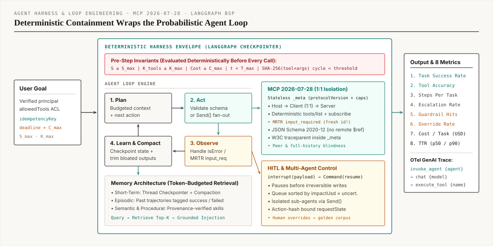
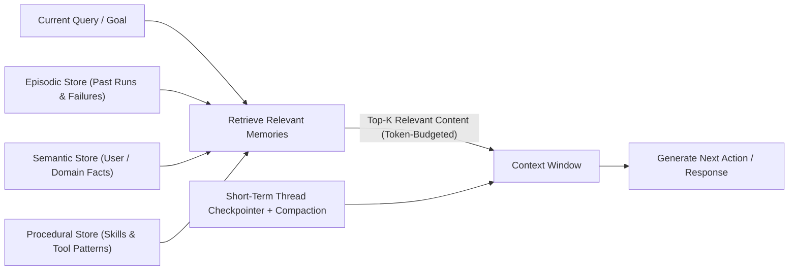

# Module 04: Agent Harness & Orchestration Engineering

An autonomous LLM without deterministic containment is a non-terminating cost and security liability. Production agents achieve reliability not by hoping the model stays on track, but by wrapping the reasoning model inside an **Agent Harness** — a deterministic runtime envelope enforcing budgets, sandboxing, typed tool contracts, memory retrieval, checkpointed execution, and human-in-the-loop interrupts.

> [!NOTE]
> **Cross-Track Ownership.** Bounded loop termination caps ($S_{\max}, K_{\max}, T_{\max}, C_{\max}$), SHA-256 cycle detection, and the Validator Sandwich are introduced in [`system-design` Module 25](../../system-design/modules/25-reliable-ai-systems.md#44-bounded-agent-loops-tool-boundary-authorization-and-owasp-llm-top-102025-mapping). This module owns the full **Agent Harness**, **Loop Engineering**, **Tool Design**, **Memory Architecture**, **Model Context Protocol (MCP 2026-07-28)**, **LangGraph 1.x** orchestration, multi-agent topologies, and HITL control-plane patterns.



---

## 1. Harness Engineering & Loop Engineering

### 1.1 Harness Anatomy

The **Harness** owns everything _except_ token generation:

```
User Goal ─▶ Harness (AuthZ, Budgets, Sandbox, Checkpointer)
               │
               ▼
         Agent Loop (Plan ─▶ Act ─▶ Observe ─▶ Learn & Compact)
               │                                     ▲
               ▼                                     │
      Tools + MCP Resources + Memory ────────────────┘
               │
               ▼
          Task Output + OTel GenAI Trace + 8 Metrics
```

Before every model or tool invocation, the harness verifies five invariants: (1) remaining step budget $S \le S_{\max}$, (2) remaining tool-call budget $K \le K_{\max}$, (3) cumulative spend $C \le C_{\max}$, (4) wall-clock deadline $t < T_{\max}$, and (5) `SHA-256(toolName + canonicalArgs)` has not repeated beyond the cycle threshold.

### 1.2 Loop Engineering (`Goal → Plan → Act → Observe → Learn`)

1. **Plan**: Assemble budgeted context (system policy + tool schemas + retrieved memory + compacted history) and elicit a structured next action or terminal answer.
2. **Act**: Validate arguments against the tool schema, check `principal.allowedTools`, and execute with an explicit timeout and `idempotencyKey`.
3. **Observe**: Parse tool output, handle MCP `isError: true` or `resultType: "input_required"`, and truncate oversized raw payloads before re-injecting them into context (preventing quadratic prefill blowup).
4. **Learn & Compact**: Persist durable step checkpoints, trigger progressive context compaction once token occupancy crosses `~70%–80%`, and write distilled episodic/procedural facts to long-term memory upon completion.

---

## 2. Tool Design & Memory Architecture

### 2.1 Tool Contract Design

Poorly designed tools cause more agent failures than weak models. Enforce four engineering rules:

- **Explicit Units & Flat Schemas**: Name fields `timeout_ms`, `refund_cents`, and `start_iso8601` instead of ambiguous `timeout` or `amount`; keep schemas flat with `additionalProperties: false`.
- **Idempotency & Safe Retries**: Mutating tools must accept an `idempotency_key` so transient network retries never double-charge or duplicate tickets.
- **Model-Recoverable Error Surfaces**: Return structured hints (`{ isError: true, code: "NOT_FOUND", hint: "Verify order_id format ORD-XXXX" }`) rather than opaque HTTP 500 strings or stack traces.
- **Read/Write Separation**: Split read-only lookup tools from mutating tools so authorization and HITL gates wrap writes cleanly.

### 2.2 Memory Architecture



| Memory Tier | Persistence Scope | Contents | Retrieval & Hygiene Rule |
| :-- | :-- | :-- | :-- |
| **Short-Term (Working)** | Single thread / session | Recent turns, tool outputs, plan state | Checkpointed per superstep; compact old tool outputs into concise summaries to bound prefill cost |
| **Episodic** | Cross-session (`BaseStore`) | Past trajectories, root-cause fixes, escalations | Retrieve by task similarity; tag with outcome (`success`/`failed`) so agents avoid repeating failed paths |
| **Semantic** | Cross-session (`BaseStore`) | Verified entity preferences, org facts, invariants | Must carry provenance, timestamp, and tenant isolation to block memory poisoning (`ASI06`) |
| **Procedural** | Cross-session / Repo | Verified workflows, reusable tool-call templates | Version-controlled and tested rather than blindly self-modified in production |

---

## 3. Model Context Protocol (MCP 2026-07-28)

MCP (verified against spec **2026-07-28**, TypeScript SDK `1.32.2`, Python SDK `2.3.0`) standardizes how AI applications connect models to external tools, resources, and prompts over **stateless JSON-RPC 2.0**.

### 3.1 Host–Client–Server Isolation Topology

- **Host**: Single coordinator process owning user consent, security policy, and $N$ client connections.
- **Client**: Maintains a strict **1:1 connection** with one server.
- **Server**: Exposes **Tools** (`tools/list`, `tools/call`), **Resources** (`resources/list`, `resources/templates/list`, `resources/read`), and **Prompts** (`prompts/list`, `prompts/get`). Servers **must not** observe the full conversation history or communicate directly with peer servers.

### 3.2 Wire Envelope, MRTR (`input_required`), and 2026-07-28 Changes

1. **Stateless `_meta` Envelope**: Every JSON-RPC 2.0 request carries `_meta` containing `io.modelcontextprotocol/protocolVersion` (required), `clientInfo`, `clientCapabilities` (required), and optional `logLevel` plus W3C `traceparent`/`tracestate`/`baggage`. Missing required metadata returns `-32602` + HTTP `400`.
2. **Reserved MCP Error Codes**: `-32020` `HeaderMismatch`, `-32021` `MissingRequiredClientCapability`, `-32022` `UnsupportedProtocolVersion` (JSON-RPC core uses `-32700…-32603`; `-32002` resource-not-found is retired, though clients should still accept it).
3. **Multi-Round-Trip Requests (MRTR)**: Results carry `resultType`: `"complete"` (default if omitted) or `"input_required"`. Returning `"input_required"` with `requestState` drives MRTR (pairing with `elicitation/create` in form or URL mode); the client's retry sends `inputResponses` + `requestState` and **must** allocate a fresh JSON-RPC `id`.
4. **2026-07-28 Spec Deltas & Security Rules**:
   - **Deprecated**: `sampling`, `roots`, and `logging` capabilities are deprecated in favor of host-controlled flows.
   - **New**: `server/discover`, unified `subscriptions/listen` (replaces `resources/subscribe`), response caching (`ttlMs`, `cacheScope`), and extensions (`Tasks`, `Skills`, `MCP Apps`).
   - **Deterministic Caching**: `tools/list` must return tools in deterministic order across pagination pages so prompt prefix caches stay intact.
   - **Schema & Handle Security**: JSON Schema defaults to **2020-12**; servers must **never** auto-dereference remote `$ref` URIs (SSRF/DoS) and must bound `anyOf`/`$defs` recursion depth. Because MCP is per-request stateless, stateful operations must issue **explicit opaque handles** whose authorization is re-validated on every call with a bounded TTL. Tool annotations (`readOnlyHint`, `destructiveHint`) are **untrusted** unless the server itself is trusted.

---

## 4. Orchestration Patterns, LangGraph 1.x & Multi-Agent Systems

### 4.1 Choosing the Right Orchestration Topology

```
User ─▶ Orchestrator (Router / Supervisor / Graph)
           ├──▶ Specialized Agent A (Research)
           ├──▶ Specialized Agent B (SQL / Data)
           └──▶ Specialized Agent C (Verifier)
                     │
                     ▼
            Aggregated Result
```

| Pattern | Control Flow | Best Use Case | Primary Risk |
| :-- | :-- | :-- | :-- |
| **Prompt Chaining / Pipeline** | Fixed DAG `A → B → C` | Predictable ETL, translate-then-verify, structured doc extraction | Rigid; cannot skip or loop on surprises |
| **Semantic Router** | Classifier dispatches to 1 of $K$ specialists | Customer support triage (billing vs. tech vs. legal) | Misrouting errors compound if no fallback path exists |
| **Parallel Scatter–Gather** | Fan-out $N$ workers, merge results | Multi-source RAG, multi-perspective code review | Tail latency governed by slowest worker + conflict merge |
| **Orchestrator–Worker** | Dynamic planner spawns sub-tasks at runtime | Open-ended research, multi-file code edits | Runaway fan-out if sub-agent spawning lacks depth/count caps |
| **Multi-Agent Supervisor** | Coordinator delegates to isolated-context specialists | Large tasks whose tool outputs would overflow one context window | Inter-agent telephone-game drift & duplicated token spend |

### 4.2 LangGraph 1.x Runtime Mechanics

**LangGraph** (`1.2.24` Python / `1.7.5` `@langchain/langgraph`) models stateful workflows as directed cyclic graphs executed via **Pregel / Bulk Synchronous Parallel (BSP) supersteps**:

- **`StateGraph(State)`**: Nodes read shared typed state channels and return partial updates merged via **reducers** (e.g., appending messages or reducing counts deterministically across parallel branches).
- **Dynamic Control (`Send` & `Command`)**: `Send(node, payload)` fans out dynamic parallel map-reduce branches (ideal for GraphRAG or per-file sub-tasks), while `Command(goto=..., update=...)` unifies state mutation and conditional routing inside a single node return.
- **Durable Execution**: Compiling with a checkpointer (`langgraph-checkpoint>=4.3.0`, configuring `durability="exit"|"async"|"sync"`) snapshots state at superstep boundaries for crash recovery, time-travel replay, and cross-thread `BaseStore` persistence.

---

## 5. Human-in-the-Loop (HITL) Design

High-stakes actions (database mutations, financial refunds, external emails, production deployments) require deterministic pause-and-verify gates rather than probabilistic confidence checks:

- **Graph Interrupts**: Calling `interrupt(payload)` inside a LangGraph node checkpoints exact graph state and halts execution cleanly with zero idle compute cost; an operator resumes execution asynchronously via `Command(resume=approvalPayload)`.
- **Priority & Capacity Controls**: As detailed in [`system-design` M25](../../system-design/modules/25-reliable-ai-systems.md#33-cost-matrix-uncertainty-routing-and-capacity-bounded-hitl-architecture), score HITL queues by `impactUsd × uncertainty`, render an evidence-rich diff UI, shed overflow gracefully, and log every human override into CI golden evals.

See [`examples/02-agent-harness-and-metrics.test.ts`](../examples/02-agent-harness-and-metrics.test.ts) for an executable bounded agent harness with MCP JSON-RPC dispatch, tool allow-lists, cycle detection, and HITL interrupt/resume.

---

## 6. Case Study: Stopping a $4,200 Weekend Agent Loop & MCP SSRF Incident

An enterprise ops agent connected to three internal MCP servers looped for `14` hours on a Friday evening after an API returned an unparsed pagination cursor. Two defects caused the incident: (1) the agent loop lacked `SHA-256(tool + args)` cycle detection and a per-run `C_max` dollar ceiling, burning `$4,200` in quadratic context re-prefills across `1,900` identical retries; and (2) an untrusted community MCP tool advertised `readOnlyHint: true` while accepting a JSON Schema containing a remote `$ref` that probed an internal metadata endpoint. Wrapping the runtime in a bounded harness (`S_max = 12`, `C_max = $0.50`, `cycleThreshold = 2`), enforcing MCP 2026-07-28 host-side allow-lists, stripping remote `$ref` resolution, and requiring `interrupt()` before write tools eliminated both failure classes.

---

## Interview Drill

### Question 1: Why must MCP 2026-07-28 clients allocate a new JSON-RPC `id` when resuming an `input_required` multi-round-trip request (MRTR)?

<details><summary>Answer</summary>

MCP 2026-07-28 is a stateless request-response protocol over JSON-RPC 2.0. The first request terminated with a valid JSON-RPC response carrying `resultType: "input_required"` and an opaque `requestState`; the subsequent call carrying `inputResponses` and `requestState` is a distinct JSON-RPC transaction that requires a fresh `id` for transport correlation and idempotency.

</details>

### Question 2: Why should an orchestrator isolate sub-agents in separate contexts rather than sharing one giant message thread?

<details><summary>Answer</summary>

Sub-tasks such as reading dozens of files or raw API payloads bloat the context window, inflating quadratic prefill cost and inducing Lost-in-the-Middle attention degradation on the coordinator. Giving each sub-agent a clean context and returning only a concise, schema-validated summary keeps coordinator context lean and prevents cross-task distraction.

</details>

### Question 3: How do `Send` and `Command` differ in LangGraph 1.x?

<details><summary>Answer</summary>

`Send(node, arg)` dynamically spawns $N$ parallel worker branches in a Pregel BSP superstep (for map-reduce fan-out over variable-length inputs). `Command(goto=..., update=...)` lets a node both update state channels and specify the next target node dynamically in one atomic return value without separate conditional-edge wiring.

</details>

### Question 4: Why are MCP tool annotations (such as `readOnlyHint`) unsafe to use as authorization controls?

<details><summary>Answer</summary>

In MCP 2026-07-28, server-supplied tool metadata and annotations are self-asserted claims and must be treated as untrusted unless the server itself is explicitly trusted. Authorization (`allowedTools`, argument validation, HITL approval) must be enforced deterministically by the host policy engine rather than trusting server hints.

</details>

### Question 5: What distinguishes short-term checkpoint state from long-term `BaseStore` memory in agent architectures?

<details><summary>Answer</summary>

Short-term checkpoint state persists per-thread execution snapshots across Pregel supersteps for crash recovery, compaction, and HITL `interrupt()`/`resume`. Long-term `BaseStore` memory persists distilled episodic, semantic, and procedural records across threads and sessions, retrieved selectively via relevance and tenant-scoped filters.

</details>
