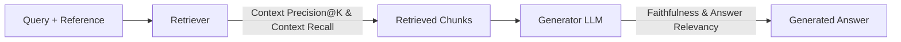

# Module 05: Agent Metrics, Evaluations & Benchmarking

Traditional backend telemetry (`HTTP 200`, CPU, memory) stays green while a RAG pipeline hallucinates citations or an agent calls the wrong tool five times before succeeding. Production AI engineering replaces intuition ("vibes") with three quantitative evaluation layers: **8 operational Agent Metrics**, **component-level RAG evaluation (Ragas 0.4.4)**, and **bias-controlled LLM-as-a-Judge & benchmark governance**.

---

## 1. The 8 Operational AI Agent Metrics & SLOs

Every production agent harness must emit deterministic measurements for all eight operational dimensions, segmented by task tier and model snapshot:

| # | Metric | Exact Mathematical Formula | Target / SLO & Alert Signal |
| :-: | :-- | :-- | :-- |
| **1** | **Task Success Rate** | $\text{TSR} = \dfrac{\text{successful tasks}}{\text{total tasks}}$ | Graded against deterministic end-state assertions or calibrated rubric (`>= 85%` gate) |
| **2** | **Tool Accuracy** | $\text{TA} = \dfrac{\text{correct tool calls}}{\text{total tool calls}}$ | Evaluates exact tool name **plus** schema-valid arguments (`>= 95%`) |
| **3** | **Steps Per Task** | $\mu_S = \dfrac{1}{N}\sum_{i=1}^{N} \text{steps}_i$ (track `p50` / `p95`) | Rising `p95` steps without TSR gain signals prompt drift, broken error hints, or loops |
| **4** | **Escalation Rate** | $\text{ER} = \dfrac{\text{escalated to human}}{\text{total tasks}}$ | Must remain within human staffing capacity (`maxHitlQueueDepth`) |
| **5** | **Guardrail Hit Rate** | $\text{GHR} = \dfrac{\text{blocked or rewritten actions}}{\text{total actions}}$ | Partition by `policy_id`; sudden spikes flag active attacks or miscalibrated prompts |
| **6** | **Override Rate** | $\text{OR} = \dfrac{\text{human overrides}}{\text{agent proposals}}$ | Captures silent agent errors **and** guardrail false-positive friction; feeds golden dataset |
| **7** | **Cost Per Task** | $\text{CPT} = \dfrac{1}{N}\sum_{i=1}^{N}\left(T_{\text{in},i} p_{\text{in}} + T_{\text{out},i} p_{\text{out}} + K_i p_{\text{tool}}\right)$ | Track `p50` / `p99` USD per completed task; alert on trajectory token blowups |
| **8** | **Time to Resolve (TTR)** | Wall-clock `p50` / `p90` from initial user turn to terminal state | Report **autonomous execution TTR** separately from **queued HITL wait time** |

---

## 2. Evals for Agents: Trajectory vs. Outcome

Grading only an agent's final prose answer misses dangerous intermediate behavior (e.g., querying `prod_users` unnecessarily or looping `12` times before stumbling on the right answer). Production agent evals pair **Outcome Evals** with **Trajectory Evals**:

1. **Outcome Evaluation**: Inspects deterministic side effects in sandboxed state (database rows mutated, PR diff tests passing, exact JSON contract) rather than comparing surface wording.
2. **Trajectory Evaluation**: Compares the ordered sequence of `(tool_name, args)` calls against a reference trajectory under three strictness levels:
   - **Exact Match**: Identical ordered sequence (too brittle when parallel reads can validly swap order).
   - **In-Order / Unordered Subset Match**: Required checkpoint tools executed with valid arguments without prohibited tools or policy violations.
   - **Convergence & Efficiency**: Penalizes redundant calls beyond optimal step count $S_{\text{opt}}$ via efficiency ratio $S_{\text{opt}} / S_{\text{actual}}$.

---

## 3. RAG Evaluation (Ragas 0.4.4)

Evaluating RAG end-to-end conflates retrieval failures with generator hallucinations. **Ragas** (`0.4.4` collections API — note the legacy metric API is removed in `1.0`) isolates retrieval vs. generation into five core metrics:

1. **Faithfulness (Generator Groundedness)**: Decomposes the generated answer into atomic factual claims $C_{\text{ans}}$ and checks whether each claim is entailed by the retrieved contexts alone:

$$\text{Faithfulness} = \frac{|\{c \in C_{\text{ans}} : \text{entailed}(c, \text{Context})\}|}{|C_{\text{ans}}|}$$

2. **Context Precision@K (Rank-Aware Retrieval Quality)**: Measures whether truly relevant chunks appear _above_ noisy chunks in the top-$K$ returned list (using binary relevance $v_k \in \{0, 1\}$ at rank $k$):

$$\text{ContextPrecision@K} = \frac{\sum_{k=1}^{K} \left(\text{Precision@}k \cdot v_k\right)}{\text{total relevant items in top } K}, \qquad \text{Precision@}k = \frac{\sum_{j=1}^{k} v_j}{k}$$

3. **Context Recall (Retrieval Completeness)**: Decomposes the ground-truth reference answer into claims $C_{\text{ref}}$ and measures the fraction supported by the retrieved context:

$$\text{ContextRecall} = \frac{|\{c \in C_{\text{ref}} : \text{attributable}(c, \text{Context})\}|}{|C_{\text{ref}}|}$$

4. **Answer / Response Relevancy**: Reverse-generates $N$ synthetic questions $q_1', \dots, q_N'$ from the generated answer alone and computes mean cosine similarity against the original question $q$:

$$\text{AnswerRelevancy} = \frac{1}{N} \sum_{i=1}^{N} \cos\!\left(E(q),\, E(q_i')\right)$$

5. **Noise Sensitivity**: Evaluates the fraction of claims in the generated response that are factually **incorrect** relative to the reference and attributable to retrieved context chunks (`relevant` or `irrelevant` context mode), exposing generators misled by distractor chunks (`0` optimal; lower is better):

$$\text{NoiseSensitivity} = \frac{\lvert\{c \in C_{\text{ans}} : \text{incorrect}(c) \land \text{entailed}(c, \text{Context})\}\rvert}{\lvert C_{\text{ans}}\rvert}$$

See [`examples/01-rag-hybrid-and-eval.test.ts`](../examples/01-rag-hybrid-and-eval.test.ts) for deterministic implementations of `faithfulness`, `contextPrecisionAtK`, and `contextRecall`.

---

## 4. LLM-as-a-Judge: Cognitive Biases & Statistical Calibration

Using an LLM judge scales rubric grading across thousands of test cases, but raw LLM judges exhibit systematic biases — **Position**, **Verbosity**, and **Self-Enhancement** biases documented by Zheng et al. (`arXiv:2306.05685`), alongside **Authority**, **Format**, and **Leniency** biases documented in evaluation literature:

| Judge Bias | Failure Symptom | Mandatory Engineering Control |
| :-- | :-- | :-- |
| **Position Bias** | Prefers Candidate A (or B) purely by prompt slot order | Run pairwise comparisons **twice with swapped order** `(A, B)` and `(B, A)`; average or mark ties |
| **Verbosity Bias** | Rewards longer, padded prose over concise accurate answers | Enforce length-controlled pairwise comparisons or discrete rubric checklists |
| **Self-Enhancement Bias** | Model $M$ scores outputs from family $M$ higher than peer families | **Never judge a generator with its own model family**; use an independent cross-family judge |
| **Authority / Sycophancy Bias** | Swayed by confident tone, fake citations, or `"As a Senior Engineer..."` | Strip credentials/citations from unverified prose and blind model identity |
| **Format Bias** | Penalizes valid answers lacking Markdown headers or bullet lists | Normalize output formatting before passing candidates to the judge |
| **Leniency / Central Tendency** | Clusters `1–5` ratings around `4` with poor discrimination | Use **integer discrete rubrics** (`0/1/2` or binary criteria) with concrete anchor exemplars |

### 4.1 Validating Judge Alignment with Cohen's $\kappa$

Never trust an uncalibrated LLM judge. Score a stratified `100–300` sample with domain experts and measure chance-corrected inter-annotator agreement using **Cohen's kappa** ($\kappa$):

$$\kappa = \frac{p_o - p_e}{1 - p_e}$$

where $p_o$ is observed agreement and $p_e$ is expected agreement by chance. Require $\kappa \ge 0.75$ (Fleiss's "excellent" agreement, 1981; exceeding Landis & Koch's 1977 `0.61` "substantial" threshold) before gating deployments on an automated judge.

---

## 5. Benchmarking Models: Contamination & Pareto Frontiers

Public leaderboards overstate production performance because benchmark test questions leak into web-scale pretraining corpora (**benchmark contamination**). Reliable internal model selection enforces three disciplines:

1. **Private, Time-Sliced Golden Datasets**: Construct evaluation suites from real anonymized production queries and HITL overrides dated **after** candidate model training cutoffs, rotating held-out slices quarterly.
2. **Pareto Cost–Latency–Quality Frontier**: Never compare models on accuracy alone. Plot **Task Success Rate** against **Cost per Task (`USD`)** and **`p95` Time to Resolve (`s`)**; eliminate strictly dominated models and route simple intents to fast, cheap models on the Pareto frontier while reserving frontier models for high-complexity escalations.
3. **Variance-Aware Comparisons**: Run multi-seed evaluations (`N >= 3` trials for stochastic tasks) and report confidence intervals (`pass@k` vs. `pass^k` consistency across all $k$ trials) rather than cherry-picking a single lucky pass.

---

## 6. Case Study: Uncovering a Broken RAG Upgrade Before Production

A legal-research team swapped their retriever embedding model and upgraded their generator, seeing `Answer Relevancy` rise from `0.81` to `0.86` in an informal LLM-judge check. Running the full **Ragas 0.4.4** + **8-metric** gate blocked the release after revealing two hidden regressions: (1) `Context Precision@5` dropped from `0.88` to `0.59` because an un-renormalized embedding slice pushed relevant clauses to ranks 4–5; and (2) `Faithfulness` fell from `0.94` to `0.78` because the new generator extrapolated statutory deadlines not present in the retrieved chunks (`Answer Relevancy` stayed high only because the hallucinated answers sounded directly responsive to the prompt!). Pinning `Faithfulness >= 0.92` and `Context Precision@5 >= 0.85` as hard CI gates caught the silent accuracy drop prior to customer exposure.

---

## Interview Drill

### Question 1: Why can a RAG system score high on Answer Relevancy while failing Faithfulness?

Answer

Answer Relevancy checks whether the generated answer addresses the user's question (measured via similarity to reverse-generated questions), regardless of where the facts came from. A model relying on memorized pretraining weights or confident hallucinations can produce a highly relevant yet completely ungrounded answer that fails Faithfulness against the retrieved context.

### Question 2: Explain why Context Precision@K is rank-aware whereas naive Precision@K is not.

Answer

Naive Precision@K equals `relevant / K` regardless of whether relevant chunks sit at rank 1 or rank $K$. Ragas `Context Precision@K` sums `Precision@k` weighted by binary relevance $v_k$ at each position $1 \dots K$, strictly penalizing retrievers that bury relevant chunks beneath early irrelevant distractors (which worsens Lost-in-the-Middle errors).

### Question 3: What distinguishes `pass@k` from `pass^k` when benchmarking autonomous agents?

Answer

`pass@k` measures the probability that _at least one_ of $k$ independent runs succeeds (useful for code synthesis with an external verifier). `pass^k` measures the probability that _all_ $k$ runs succeed consistently, which reflects production reliability for customer-facing agents where users expect success on their single live attempt.

### Question 4: Why should autonomous execution Time to Resolve (TTR) be reported separately from HITL queue wait time?

Answer

Combining agent compute latency (`2–15 s`) with human approval queue wait times (`minutes–hours`) conflates model/tool performance regressions with human staffing bottlenecks. Tracking both separately isolates infrastructure latency from operational HITL capacity.

### Question 5: How do you prove an LLM-as-a-Judge rubric is reliable enough to gate CI deployments?

Answer

Calibrate the judge against human domain experts on a stratified golden sample (`100–300` examples), control for position (A/B swap), verbosity, and self-enhancement (cross-family judge) biases, and verify chance-corrected agreement via Cohen's $\kappa \ge 0.75$ (Fleiss's "excellent" threshold) before enabling automated CI gates.

