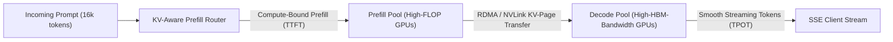
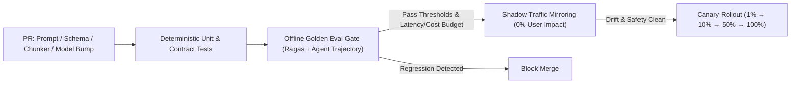

# Module 06: LLMOps — Serving, Observability & CI/CD

Moving an LLM prototype from a notebook to sustained production traffic shifts engineering effort from prompt tweaking to **inference throughput economics**, **privacy-safe distributed tracing**, and **regression-gated continuous delivery**.

> [!NOTE]
> **Cross-Track Ownership.** GPU memory sizing, KV-cache VRAM bounds, PagedAttention, and continuous batching mechanics are owned by [`system-design` Module 14](../../system-design/modules/14-canonical-designs-transactional-and-staff.md#6-llm-serving--chatgpt-architecture-modern-2026-staff-design) (and detailed further in the companion `algorithms/ml-foundations` track, M05–M06). General OpenTelemetry collector pipelines and W3C Trace Context belong to [`technologies/observability`](../../../technologies/observability/README.md), while atomic `RPM + TPM + USD` admission control and multi-provider bulkhead circuit breakers live in [`system-design` Module 25](../../system-design/modules/25-reliable-ai-systems.md#4-gated-ai-architecture-layers-admission-control-semantic-caching-resilience-and-bounded-agents). This module owns **LLMOps serving architectures**, **application deployment patterns**, **OTel GenAI instrumentation**, and **CI/CD eval gates**.

---

## 1. Serving Open-Source Models: vLLM, SGLang & Disaggregated Prefill/Decode

Self-hosting open-weight models (`Llama`, `Qwen`, `Mistral`, `DeepSeek`) becomes cost-effective when sustained GPU utilization exceeds `~40%–60%`, when strict data residency prohibits external APIs, or when fine-tuned LoRA adapters require custom serving.

### 1.1 Serving Engine Trade-Offs

| Serving Engine | Core KV / Scheduling Innovation | Key Strength |
| :-- | :-- | :-- |
| **vLLM** | **PagedAttention** (virtualized non-contiguous KV pages) + continuous iteration-level batching | Broadest model/LoRA ecosystem, mature multi-node tensor/pipeline parallelism, OpenAI-compatible wire API |
| **SGLang** | **RadixAttention** (radix-tree prefix KV cache across multi-turn chats & agents) + zero-overhead compressed FSM decoding | Highest throughput on multi-turn agents, shared RAG prefixes, and tight JSON-schema constrained decoding |
| **TensorRT-LLM** | Ahead-of-time fused CUDA kernels, FP8/INT4 Tensor Core optimization, inflight batching | Maximum single-node hardware efficiency on NVIDIA H100/B200 clusters with higher build complexity |

### 1.2 Disaggregated Prefill / Decode Architecture

Transformer inference splits into two hardware-conflicting phases (see [`system-design` M14](../../system-design/modules/14-canonical-designs-transactional-and-staff.md#6-llm-serving--chatgpt-architecture-modern-2026-staff-design)):

- **Prefill**: Parallel matrix multiplications over all prompt tokens — **compute-bound** (FLOPs-limited), governing **Time-to-First-Token (`TTFT`)**.
- **Decode**: Autoregressive generation of one token per step reading full KV-cache weights — **memory-bandwidth-bound** (HBM GB/s-limited), governing **Time-Per-Output-Token (`TPOT`)**.

In a unified pool, a single `32k`-token RAG prefill stalls decode iterations for every co-scheduled streaming user, spiking `TPOT` tail latency. **Disaggregated serving** separates GPUs into dedicated **Prefill Workers** and **Decode Workers** connected over high-speed RDMA / NVLink fabrics: prefill nodes compute the initial KV cache, transfer KV pages once to a decode worker, and stream tokens smoothly without cross-phase head-of-line blocking.

---

## 2. Deploying LLM Applications: Gateways & Degradation Ladders

Production LLM applications sit behind an **AI Gateway** that decouples application business logic from model providers:

1. **Unified Routing & Provider Fallbacks**: Maintain a **Degradation Ladder** (`Primary Frontier Model → Secondary Region/Provider Snapshot → Mid-Tier Model → Deterministic Safe Fallback`) guarded by outcome-aware circuit breakers ([`system-design` M25](../../system-design/modules/25-reliable-ai-systems.md#43-multi-provider-bulkhead-circuit-breakers-and-degradation-ladders)).
2. **Atomic Quota & Guarded Semantic Cache**: Enforce single-script Redis/Valkey `RPM + TPM + Tenant USD` caps and tenant/slot-guarded semantic caching before paid inference.
3. **Immutable Artifact Pinning**: Deploy every release as a **versioned quadruple**: `(model_snapshot_id, prompt_template_sha, output_schema_hash, retriever_index_version)`. Never update prompts in a mutable admin UI without Git history and CI eval validation.

---

## 3. Observability & Tracing (OpenTelemetry GenAI)

Standard APM spans capture HTTP latency while remaining blind to token economics, finish reasons, silent model alias swaps, and multi-step tool cascades. **OpenTelemetry GenAI Semantic Conventions** (`open-telemetry/semantic-conventions-genai`, currently in **`Development`** status alongside core semconv `v1.45.0`) provide a vendor-neutral schema.

### 3.1 Trace Hierarchy, Spans, and Metrics

- **Span Naming & Tree**: Follow `{gen_ai.operation.name} {target}` (e.g., `invoke_agent {gen_ai.agent.name}` $\to$ `chat {gen_ai.request.model}` $\to$ `retrieval {source}` / `execute_tool {gen_ai.tool.name}`, plus `embeddings {model}`). Across MCP boundaries, propagate W3C `traceparent`, `tracestate`, and `baggage` inside the JSON-RPC `_meta` envelope.
- **Span Attributes**: Required (`gen_ai.operation.name`, `gen_ai.provider.name`), conditionally required (`gen_ai.request.model`, `gen_ai.tool.name`, `error.type`), and recommended (`gen_ai.response.model`, `gen_ai.response.finish_reasons`, `gen_ai.usage.input_tokens`, `gen_ai.usage.output_tokens`).
- **Core Metric Instruments**: `gen_ai.client.operation.duration` (seconds), `gen_ai.server.request.duration`, `gen_ai.server.time_to_first_token`, `gen_ai.server.time_per_output_token` (plus agent metrics `gen_ai.invoke_agent.duration`, `gen_ai.invoke_agent.inference_calls`, and `gen_ai.invoke_agent.tool_calls` where instrumented).

### 3.2 Privacy-Safe Content Capture Governance

Logging full prompts and completions into shared observability backends creates severe PII and secret exposure (`LLM02`). OTel GenAI enforces explicit opt-in via `OTEL_INSTRUMENTATION_GENAI_CAPTURE_MESSAGE_CONTENT`:

| Setting | Behavior | Recommended Environment |
| :-- | :-- | :-- |
| **`NO_CONTENT` (Default)** | Captures structural spans, token counts, latencies, and model IDs only; zero prompt/completion bodies | Default **Production** posture |
| **`SPAN_ONLY` / `EVENT_ONLY` / `SPAN_AND_EVENT`** | Attaches prompt/completion payloads to spans or log events; prefer encrypted blob offloading via `gen_ai.*_ref` URIs | Staging, red-team sandboxes, or KMS-encrypted regulated audit buckets |

---

## 4. CI/CD for LLM Applications

In deterministic services, CI runs unit tests and integration suites against mocks. In AI engineering, **a prompt edit, chunker change, or model bump is a behavioral release** requiring automated statistical gating:

1. **Golden Eval Regression Gates**: Execute deterministic unit proofs (Validator Sandwich, tool allow-lists, JSON schemas) on every commit, followed by an offline golden suite measuring Ragas metrics, 8 agent metrics, and adversarial injection tests.
2. **Shadow Mode**: Mirror live production queries asynchronously to the candidate quadruple `(model, prompt, schema, index_vN)`, comparing latency, cost per task, guardrail hit rate, and LLM-judge equivalence before exposing any user.
3. **Canary & Instant Rollback**: Roll out to `1% → 10% → 50% → 100%` traffic gated on automated error-budget burn alerts (`finish_reason: "length"` spikes, `guardrail_hit_rate` surge, `p95 TPOT` breaches), keeping the prior immutable quadruple warm for instant rollback.
4. **Closed-Loop Dataset Curation**: Feed every production HITL override and user thumbs-down bug back into the versioned golden dataset so resolved failures permanently become regression tests.

---

## 5. Case Study: Solving Decode Tail Latency & Invisible Alias Drift

A coding-assistant platform self-hosted a `70B` model on a unified `8× H100` vLLM cluster alongside a multi-provider cloud fallback. During peak hours, users reported choppy `3-second` streaming pauses mid-sentence (`p99 TPOT > 450 ms`), while accuracy unexpectedly shifted on Monday mornings. OTel GenAI traces (`NO_CONTENT` mode) isolated both issues in one afternoon: (1) `64k`-token repository prefill jobs on the shared GPU pool stalled active decode streams, resolved by separating **Prefill** and **Decode** worker pools with RadixAttention prefix caching; and (2) `gen_ai.response.model` revealed the fallback provider had silently rolled a floating alias to a newer snapshot, fixed by pinning dated snapshots and adding an automated `gen_ai.response.model !== gen_ai.request.model` alert.

---

## Interview Drill

### Question 1: Why does disaggregated prefill/decode serving eliminate streaming `TPOT` jitter on long-context workloads?

Answer

Prefill is compute-bound (large parallel matrix multiplies over thousands of input tokens) whereas decode is memory-bandwidth-bound (streaming model weights and KV cache per single output token). Co-locating both on one GPU batch causes heavy prefill jobs to stall decode steps (`TPOT` spikes); separating dedicated prefill and decode pools connected via RDMA KV transfer isolates streaming smoothness from long-prompt arrivals.

### Question 2: What is the difference between vLLM PagedAttention and SGLang RadixAttention?

Answer

PagedAttention virtualizes the KV cache into fixed-size non-contiguous physical memory blocks to eliminate internal fragmentation and enable high batch concurrency. RadixAttention builds on paged KV memory by indexing shared prompt prefixes across requests in a radix tree, automatically reusing cached KV blocks across multi-turn agent loops and shared system prompts.

### Question 3: How does OpenTelemetry GenAI prevent telemetry pipelines from becoming a PII leakage vector?

Answer

`OTEL_INSTRUMENTATION_GENAI_CAPTURE_MESSAGE_CONTENT` defaults to `NO_CONTENT`, emitting structural attributes (`gen_ai.provider.name`, token counts, finish reasons, latencies) without prompt or completion text. When content inspection is explicitly required, teams scrub PII pre-egress and store payloads in access-controlled encrypted object storage referenced via `gen_ai.*_ref` attributes.

### Question 4: Why must prompts, schemas, model snapshots, and vector index versions be deployed as one atomic versioned bundle?

Answer

Prompt instructions, output JSON schemas, model weights, and embedding spaces interact non-linearly: editing a system prompt outside CI or upgrading an embedding model asynchronously breaks structured parsers, shifts judge calibration, and invalidates cached responses. Bundling `(model_snapshot, prompt_sha, schema_hash, index_version)` makes canary rollbacks and incident reproduction deterministic.

### Question 5: What signals should trigger an automatic canary rollback during an LLM application rollout?

Answer

Roll back automatically on increases in `guardrail_hit_rate` or Bottom-Bun schema rejections, spikes in `finish_reason: "length"` or `"refusal"`, upward drift in `steps_per_task` or `cost_per_task`, `p95 TTFT/TPOT` SLO violations, or unexpected `gen_ai.response.model` mismatches.

