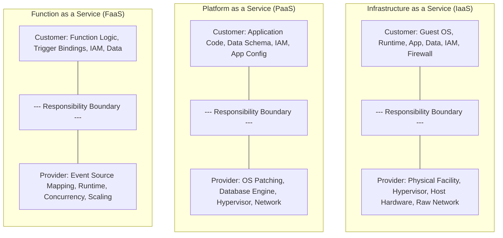
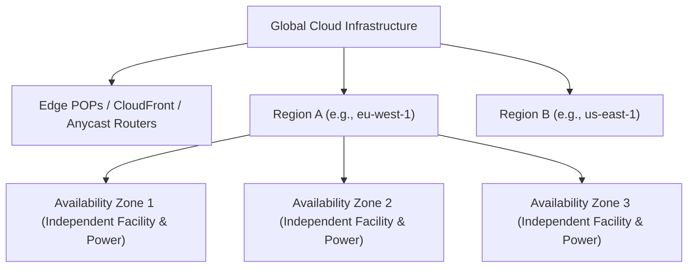
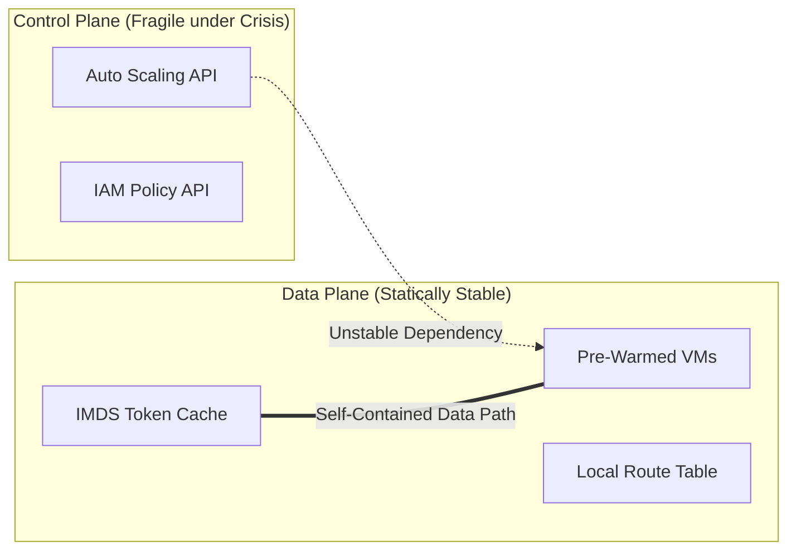
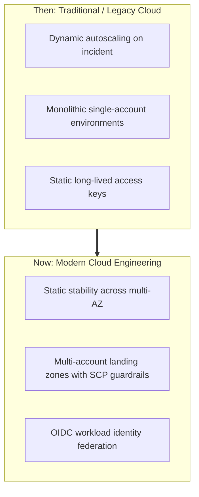

# Module 01: Cloud Model and Shared Responsibility

The cloud computing model is fundamentally an economic and operational abstraction over distributed systems infrastructure. To design reliable, secure, and cost-effective cloud architectures, engineers must move beyond marketing terminology and understand the formal axioms governing shared responsibility, operational boundaries, and failure domain mechanics.

## 1. Formal Foundations: NIST SP 800-145

The National Institute of Standards and Technology (NIST) Special Publication 800-145 establishes the authoritative, vendor-neutral definition of cloud computing. Under NIST SP 800-145, a system constitutes a cloud environment if and only if it exhibits five essential characteristics:

1. **On-Demand Self-Service**: A consumer can unilaterally provision computing capabilities (such as server time and network storage) automatically as needed, without requiring human interaction with each service provider.
2. **Broad Network Access**: Capabilities are available over the network and accessed through standard mechanisms that promote use by heterogeneous thin or thick client platforms (e.g., mobile devices, tablets, laptops, and workstations).
3. **Resource Pooling**: The provider's computing resources are pooled to serve multiple consumers using a multi-tenant model, with different physical and virtual resources dynamically assigned and reassigned according to consumer demand. Location independence is maintained; the customer generally has no control or knowledge over the exact location of the provided resources (with the exception of higher abstraction levels such as country, state, or availability zone).
4. **Rapid Elasticity**: Capabilities can be elastically provisioned and released, in some cases automatically, to scale rapidly outward and inward commensurate with demand. To the consumer, the capabilities available for provisioning often appear to be unlimited and can be appropriated in any quantity at any time.
5. **Measured Service**: Cloud systems automatically control and optimize resource use by leveraging a metering capability at some level of abstraction appropriate to the type of service (e.g., storage, processing, bandwidth, and active user accounts). Resource usage can be monitored, controlled, and reported, providing transparency for both the provider and consumer of the utilized service.

## 2. Service Models and the Shared Responsibility Line

The division of administrative, operational, and security responsibilities varies strictly across the four canonical service models: Infrastructure-as-a-Service (IaaS), Platform-as-a-Service (PaaS), Function-as-a-Service (FaaS), and Software-as-a-Service (SaaS).

### Shared Responsibility Axioms

- **Security OF the Cloud vs. Security IN the Cloud**: The cloud service provider (CSP) maintains total ownership of the physical datacenter facilities, hardware destruction, biometric perimeter security, power distribution, and the hypervisor layer. The cloud consumer retains non-delegable ownership of data classification, identity management, customer data encryption at rest and in transit, network ingress rules, and application-layer security.
- **The Immutable Data Ownership Law**: Regardless of whether a system runs on bare EC2 instances or inside a fully managed SaaS suite (e.g., Microsoft 365, Google Workspace, Salesforce), the consumer _always_ owns data classification, client-side encryption keys, access governance, and backup validity. A cloud provider outage never relieves the customer of regulatory compliance liability (e.g., GDPR, HIPAA, PCI-DSS).

## 3. Failure Domains: Regions, Availability Zones, and Edge

Cloud infrastructure is organized into a strict hierarchical failure-domain model designed to limit the blast radius of hardware malfunctions, natural disasters, and software bugs:

### Availability Zone (AZ) Independence

An Availability Zone is not a single server room; it consists of one or more discrete, physically separated datacenters, each engineered with redundant power, backup generators, independent chilled-water cooling loops, and dedicated network switches. AZs within a region are interconnected over private, low-latency dense wavelength division multiplexing (DWDM) fiber optic rings, providing round-trip latency under 2 milliseconds ($\le 2\text{ ms}$). This low latency permits synchronous database commit protocols (e.g., Multi-AZ relational standby nodes).

### Regional Isolation

Regions are completely independent geographic territories (e.g., Frankfurt `eu-central-1` vs. Dublin `eu-west-1`). By architectural design, a catastrophic outage in one region (including power grid collapse, subsea cable severing, or local control-plane software bugs) cannot propagate across regional boundaries unless an application engineer has explicitly created a cross-region data or control dependency.

## 4. Control Plane vs. Data Plane and Static Stability

One of the most consequential concepts in cloud systems design is the operational distinction between the **Control Plane** and the **Data Plane**.

| Architectural Dimension | Control Plane | Data Plane |
| :-- | :-- | :-- |
| **Primary Purpose** | Administrative configuration, orchestration, API CRUD requests | High-throughput packet routing, request serving, transaction processing |
| **Example Operations** | `ec2:RunInstances`, creating a Route 53 record, modifying an IAM policy | Serving an HTTP GET request through ALB, reading an S3 object, resolving DNS |
| **Availability Target** | Typically $99.9\%$ ($\le 3$ nines) | Designed for $99.99\%$ to $99.999\%$ ($\ge 4 - 5$ nines) |
| **Failure Behavior** | Mutations fail, APIs throw rate-limit or 500 errors | Existing provisioned workloads continue routing packets uninterrupted |

### Static Stability and the Control Plane Boundary

A system is **statically stable** if it continues to operate normally at full production volume without taking state changes, relying on control plane mutations, or initiating external API calls during an upstream control plane degradation.

> [!IMPORTANT]
> If your disaster recovery architecture requires calling the cloud provider's API during an emergency (for example, attempting to launch 200 new virtual machines during a regional crisis), your architecture is dynamically unstable. When an AZ fails, thousands of customers hit the EC2 control plane simultaneously, triggering rate limits and instance capacity shortages. Statically stable architectures pre-provision capacity across surviving AZs so no API calls are needed to survive a failure.

## 5. Quotas vs. Hard Service Limits

Every cloud platform enforces capacity boundaries:

- **Soft Quotas (Adjustable Service Quotas)**: Safeguards designed to protect organizations from accidental billing runaways (e.g., maximum VPCs per region, maximum vCPUs per instance family). These can be raised via API requests or support tickets.
- **Hard Architectural Limits (Non-Adjustable)**: Absolute hardware, physical, or protocol barriers (e.g., maximum 5 IP addresses reserved per cloud subnet, maximum MTU of 1500 bytes over the public internet, maximum SQS message payload size of 256 KB, maximum IAM policy size of 6,144 characters). Architectures must be designed around hard limits rather than hoping for exceptions.

## 6. Executable Proofs

The static stability invariants and NIST characteristic boundaries are verified in our test suite:

| Assertion / Invariant | Implementation Mechanism | Test File Reference |
| :-- | :-- | :-- |
| **Static Stability Invariant** | Proves data plane functions without control-plane runtime dependencies | [`../examples/01-cloud-model-and-static-stability.test.ts`](../examples/01-cloud-model-and-static-stability.test.ts) |
| **NIST Characteristic Verification** | Asserts all five mandatory NIST SP 800-145 boundaries | [`../examples/01-cloud-model-and-static-stability.test.ts`](../examples/01-cloud-model-and-static-stability.test.ts) |

## 7. Then vs. Now: Cloud Architecture Paradigm Shift

- **Then**: Systems relied on active autoscaling triggers (CPU > 80%) to launch new instances during outages. During major cloud disruptions, control plane API rate limiting and capacity constraints prevented new nodes from spawning.
- **Now**: Architectures pre-scale and provision capacity across 3 Availability Zones with static stability, ensuring that if one entire AZ disappears, the surviving 2 AZs carry 100% of peak traffic without issuing a single provisioning API call.

## 8. Provider Mapping Matrix

| Concept | AWS | Google Cloud | Microsoft Azure | Cloudflare |
| :-- | :-- | :-- | :-- | :-- |
| **Regional Boundary** | AWS Region (e.g. `us-east-1`) | GCP Region (e.g. `us-central1`) | Azure Region (e.g. `eastus`) | Global Anycast Network |
| **Fault Domain Isolation** | Availability Zones (1–6 per region) | Zones (typically 3–4 per region) | Availability Zones (3 per region) | 330+ Edge Cities |
| **Control Plane API** | AWS Regional Endpoints | Google Cloud Resource Manager | Azure Resource Manager (ARM) | Cloudflare API v4 |
| **Quota Management** | AWS Service Quotas | Cloud Quotas API | Azure Quotas / Subscriptions | Account Limits |

---

## 9. Interview Drill: Questions & Model Answers

1. How does static stability differ from high availability, and why is it critical during a cloud provider outage?

High availability is the property where a system remains accessible and operational over time (e.g., 99.99% uptime). Static stability is the specific architectural design pattern where a system continues serving existing traffic without requiring state mutations or control-plane API calls when dependencies degrade. During a cloud provider outage, the control plane (e.g., launching new VMs, creating DNS records, or scaling instance groups) is frequently overwhelmed or failing. Statically stable architectures pre-allocate capacity across multiple Availability Zones so that an AZ failure requires zero API calls or scaling operations to survive.

2. Under NIST SP 800-145, why is a private datacenter running VMware vSphere without an API or billing metering not considered cloud computing?

NIST SP 800-145 requires all five essential characteristics: on-demand self-service, broad network access, resource pooling, rapid elasticity, and measured service. A static virtualization cluster that requires human ticket submission for VM provisioning lacks on-demand self-service. If it lacks automated resource metering and dynamic usage-based accounting, it fails the measured service requirement. Virtualization alone is simply server consolidation, not cloud computing.

3. What is the fundamental security difference between IaaS and PaaS under the shared responsibility model?

In IaaS (such as AWS EC2 or Azure VMs), the customer owns and is solely responsible for guest operating system patching, kernel updates, firewall rule configuration on the host, middleware runtimes, and local identity security. In PaaS (such as AWS RDS or Azure App Service), the cloud provider assumes full responsibility for host provisioning, operating system patching, runtime security, and physical database engine maintenance; the customer is responsible only for application code, database schema, data classification, and IAM access controls.

4. Why are Availability Zone identifiers (e.g., `us-east-1a`) physically randomized across different cloud customer accounts?

To prevent resource starvation and power imbalance in specific physical datacenters. If every customer's `us-east-1a` mapped to the exact same physical building, `us-east-1a` would be constantly overloaded while `us-east-1f` remained underutilized. Cloud providers map the logical identifier `us-east-1a` to different physical AZ IDs (e.g., `use1-az1` vs. `use1-az2`) for each independent cloud account.

5. Explain the difference between a soft quota and a hard service limit in cloud operations.

A soft quota is an administrative ceiling imposed by the provider to prevent accidental over-provisioning or runaway billing (such as a maximum of 5 VPCs per region or 32 vCPUs for a new account). Soft quotas can be increased upon request via the Service Quotas console. A hard limit is a physical, architectural, or protocol-level barrier that cannot be increased under any circumstances (such as the 5 reserved IP addresses in an IPv4 subnet, the 256 KB message size limit in SQS, or the 64 KB DNS UDP packet boundary).

