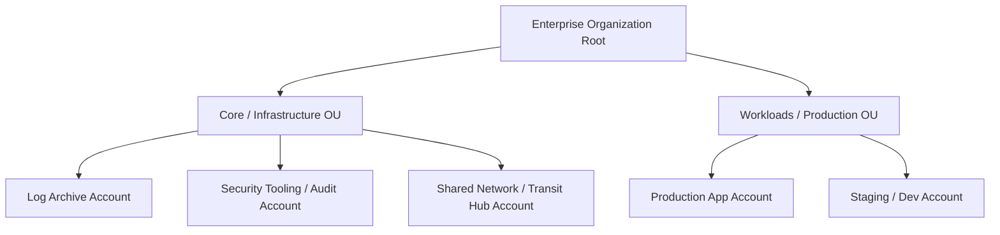
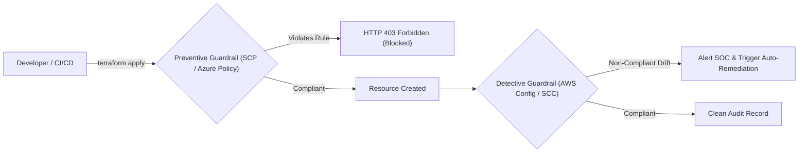

# Module 02: Resource Hierarchy and Governance

Enterprise cloud systems cannot operate safely in a single unpartitioned account. As engineering teams, environments, and compliance scopes scale, organizations must establish a deterministic resource hierarchy that enforces security guardrails, isolates blast radiuses, and partitions financial billing.

## 1. Resource Hierarchies: The Account as a Hard Boundary

In modern cloud architecture, the **Account** (AWS), **Project** (Google Cloud), or **Subscription** (Microsoft Azure) serves as the atomic, non-bypassable security, blast-radius, and billing boundary.



### Why Multi-Account Architecture is Mandatory

1. **Blast Radius Containment**: A compromised credential (or accidental infrastructure deletion script) within a development or staging account has zero cryptographic access to production data or compute instances.
2. **Quota and Rate Limit Isolation**: Cloud providers enforce API rate limits (e.g., CloudFormation stack creations, EC2 DescribeInstances calls) at the account level. A heavy CI/CD load running integration tests in staging will never throttle production workloads when hosted in distinct accounts.
3. **Regulatory and Audit Scope Reduction**: Financial or healthcare workloads subject to PCI-DSS or HIPAA can be quarantined inside dedicated audit accounts, excluding other engineering repositories and microservices from the scope of costly annual compliance audits.
4. **Clean Cost Attribution**: Cross-account billing roll-ups provide clean, undisputed cost allocation at invoice time without relying entirely on volatile resource tagging.

## 2. Landing Zones

A **Landing Zone** is a multi-account, well-architected cloud environment provisioned automatically via Infrastructure-as-Code (IaC). It establishes baseline security, identity federation, centralized network hubs, and audit log aggregation before application workloads are deployed.

### Core Landing Zone Capabilities

- **Single Sign-On (SSO) & Centralized Identity**: Human developers and operations teams authenticate via corporate identity providers (e.g., Okta, Entra ID) using SAML 2.0 / OIDC. Local IAM users with static console passwords and access keys are banned organization-wide.
- **Centralized Log Aggregation**: All administrative audit logs (AWS CloudTrail, Google Cloud Audit Logs, Azure Activity Logs) and network flow logs (VPC Flow Logs) are replicated to an immutable, locked Log Archive Account.
- **Baseline Guardrail Automation**: Baseline policies are attached at the organizational root, mechanically disabling insecure actions across all child accounts.

## 3. Preventive vs. Detective Guardrails

Governance frameworks employ two complementary enforcement mechanisms:

| Dimension | Preventive Guardrails | Detective Guardrails |
| :-- | :-- | :-- |
| **Execution Phase** | Pre-deployment / Real-time authorization check | Post-deployment / Continuous compliance scan |
| **Enforcement Vector** | Cloud control plane authorization engine (e.g., SCPs, Azure Policy Deny effect, OPA admission controller) | Configuration state evaluators (e.g., AWS Config, GCP Security Command Center, Azure Policy Audit) |
| **System Behavior** | API call is immediately rejected with HTTP 403 Forbidden; resource is never created | Resource is successfully created; non-compliant state is flagged, alerts are dispatched, and remediation lambda runs |
| **Blast Radius Window** | Exactly zero seconds of vulnerability exposure | Non-zero time window (seconds to minutes) where insecure resource is live on the network |



## 4. Policy Inheritance and Service Control Policies (SCPs)

Service Control Policies (SCPs) in AWS Organizations and Organization Policies in Google Cloud act as **permission filters** rather than permission grants.

### Formal Evaluation Axioms

1. **Filtering, Not Granting**: An SCP never grants permissions; it merely defines the maximum allowable permissions that identity-based or resource-based policies can grant within child accounts.
2. **Deny Precedence Down the Tree**: If an explicit `Deny` is applied at the Organization Root, that action is irrevocably denied across all child Organizational Units (OUs) and accounts, regardless of local administrator permissions.
3. **Implicit Deny on Disconnection**: If an account does not inherit an `Allow` statement for an action from its parent hierarchy (or if `FullAWSAccess` is detached), all actions are implicitly denied.

```
Effective Permissions = (Organization Guardrail Filter) ∩ (Local IAM Permissions)
```

## 5. Break-Glass Emergency Architecture

During catastrophic operational emergencies—such as when the corporate Single Sign-On (SSO) provider suffers a global outage, or when an accidental SCP misconfiguration cuts off administrative access—organizations must maintain an emergency **Break-Glass** access procedure.

### Break-Glass Invariants

- **IdP Independence**: The break-glass account must not depend on corporate SSO, federated IdPs, or external directory services.
- **Physical Hardware MFA**: Credentials must be secured with physical hardware FIDO2 / U2F security keys (e.g., YubiKeys) stored in dual-custody physical corporate safes.
- **Real-Time SOC P0 Alerting**: The instant break-glass credentials are used to sign in to the cloud console, event rules (e.g., EventBridge rule on `ConsoleLogin` with break-glass ARN) must dispatch immediate high-priority alerts to the Security Operations Center (SOC) on-call paging system.

## 6. Executable Proofs

The multi-account policy inheritance and break-glass invariants are verified in our test suite:

| Assertion / Invariant | Implementation Mechanism | Test File Reference |
| :-- | :-- | :-- |
| **Hierarchical Policy Inheritance** | Evaluates inherited preventive SCP deny constraints down organizational units | [`../examples/02-resource-hierarchy-and-guardrails.test.ts`](../examples/02-resource-hierarchy-and-guardrails.test.ts) |
| **Break-Glass Isolation Boundary** | Proves break-glass credentials maintain IdP independence and hardware MFA | [`../examples/02-resource-hierarchy-and-guardrails.test.ts`](../examples/02-resource-hierarchy-and-guardrails.test.ts) |

## 7. Then vs. Now: Governance Paradigm Shift

- **Then**: Single enterprise account with dozens of IAM user groups. Developers had console credentials, resources shared a single monolithic VPC, and security audits required parsing tens of thousands of mingled resources.
- **Now**: Automated multi-account landing zone deploying hundreds of isolated accounts partitioned by environment, compliance tier, and business domain, governed by immutable preventive SCPs and centralized OIDC identity federation.

## 8. Provider Mapping Matrix

| Concept | AWS | Google Cloud | Microsoft Azure |
| :-- | :-- | :-- | :-- |
| **Top-Level Root** | AWS Organization Root | Organization Resource | Root Management Group |
| **Grouping Folder** | Organizational Unit (OU) | Folder Resource | Management Group |
| **Isolated Boundary** | AWS Account | Google Cloud Project | Azure Subscription |
| **Preventive Guardrail** | Service Control Policy (SCP) | Organization Policy Constraint | Azure Policy (Deny effect) |
| **Detective Scanner** | AWS Config & Security Hub | Security Command Center (SCC) | Microsoft Defender for Cloud |
| **Landing Zone Engine** | AWS Control Tower | Fabric FAST / Terraform Blueprints | Azure Landing Zone Accelerator (ALZ) |

---

## Interview Drill

<details><summary>1. Why can an SCP attached to an OU not be overridden by the root user of a child account within that OU?</summary>

SCPs operate at the AWS Organizations management plane, which sits above individual accounts. The authorization engine evaluates the organization boundary _before_ examining any local account policies. Because explicit denies in SCPs are absolute filters that define the outer perimeter of allowable permissions, not even the local account root user or an administrator with `AdministratorAccess` (`*:*`) can execute an action that is denied by an inherited SCP.
</details>

<details><summary>2. Why are detective guardrails alone insufficient for critical security compliance?</summary>

Detective controls (such as AWS Config or Azure Policy Audit) operate asynchronously post-deployment. When a developer accidentally launches an S3 bucket with public read access or a security group opening port 22 to `0.0.0.0/0`, the detective scanner detects the violation only after the resource is live. This creates a window of vulnerability (often lasting 30 seconds to several minutes) during which automated internet port scanners can discover and exfiltrate data. Preventive guardrails reject the API request synchronously before the resource exists.
</details>

<details><summary>3. Describe the architectural design of a cloud Break-Glass account.</summary>

A Break-Glass account provides emergency access during major identity provider failures. It consists of a dedicated standalone account with direct administrative access, decoupled from the corporate SAML/OIDC identity provider. Authentication relies on complex, randomized passwords split between two custodians, secured with physical hardware MFA stored in a secure safe. Any authentication event immediately triggers an out-of-band P0 alert to the SOC via an automated event bus.
</details>

<details><summary>4. What problems occur when an enterprise deploys all workloads into a single cloud account?</summary>

A single-account architecture suffers from: (1) Uncontained blast radius—a compromised credential exposes the entire company; (2) Shared API rate limits and service quotas—development automated testing can exhaust API limits and cause production outages; (3) Inflated audit scope—the entire environment must be inspected for PCI/HIPAA compliance; (4) Complex IAM policies—thousands of conflicting policies lead to accidental privilege escalation.
</details>

<details><summary>5. How does a Landing Zone handle centralized audit log immutability?</summary>

The Landing Zone configures all member accounts to stream CloudTrail and VPC Flow Logs directly into an S3 bucket located inside a dedicated, isolated Log Archive Account. The destination bucket is configured with S3 Object Lock in Compliance Mode, MFA Delete, and a bucket policy that denies `s3:DeleteObject` and `s3:PutLifecycleConfiguration` to all principals, guaranteeing that audit trails cannot be altered or wiped even by compromised administrators.
</details>
