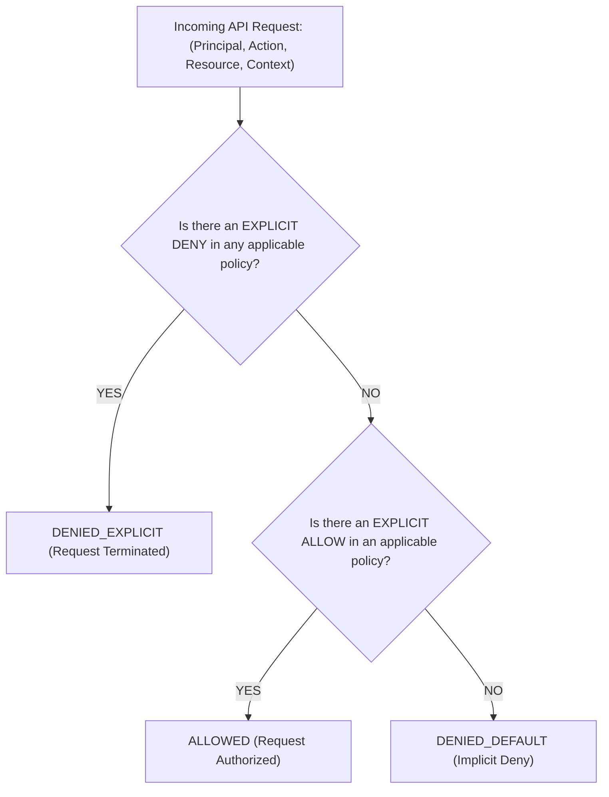
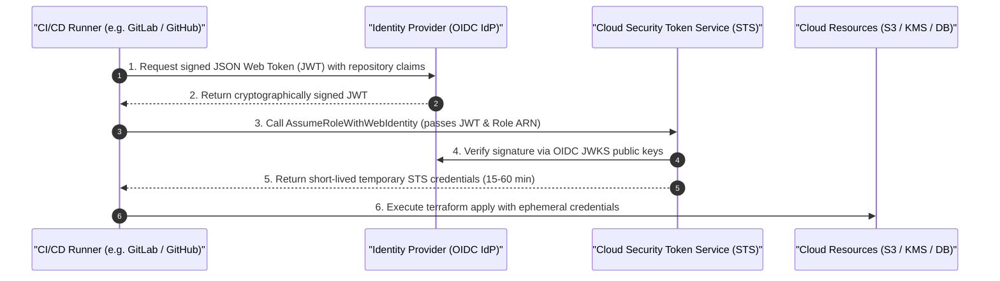
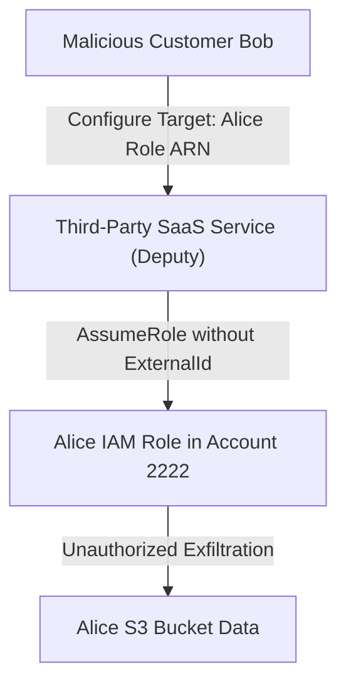

# Module 03: Identity and Authorization Models

Identity and access management (IAM) represents the fundamental control boundary in cloud computing. In traditional on-premises networks, security perimeters were governed primarily by physical firewalls and network segmentation. In the cloud, the identity plane _is_ the network perimeter.

## 1. Core Authorization Models: RBAC vs. ABAC vs. ReBAC

Cloud authorization architectures rely on three primary access control formalisms:

| Model | Formal Mechanism | Strengths | Operational Failure Modes |
| :-- | :-- | :-- | :-- |
| **Role-Based Access Control (RBAC)** | Principals are assigned to static Roles; Roles are granted explicit action sets on resources | Predictable, straightforward auditability, simple directory integration | Role explosion: as teams scale, organizations accumulate thousands of redundant, overlapping roles |
| **Attribute-Based Access Control (ABAC)** | Permissions are evaluated dynamically using policies that compare attributes of the Principal, Resource, Action, and Environment | Scales seamlessly with organizational growth; single policy governs thousands of resources via tags | Governance opacity: difficult to audit who has access to what without evaluating the entire dynamic policy engine |
| **Relationship-Based Access Control (ReBAC)** | Access is derived from graph relations between subjects and objects (e.g., Zanzibar, Cedar, OpenFGA) | Expresses complex nested hierarchies and multi-tenant sharing models | High graph query evaluation overhead; not supported natively as a primary cloud control plane protocol |

## 2. Formal IAM Evaluation Algorithm

Cloud authorization evaluation engines (such as AWS IAM, Google Cloud IAM Conditions, and Azure Role Assignments) process authorization requests using a deterministic evaluation algebra:



### The Three Inviolable Laws of IAM Evaluation

1. **Default Deny by Default**: Every request begins in an implicit deny state. Unless an affirmative `Allow` statement is evaluated, access is refused.
2. **Explicit Deny is an Absorbing Element**: If any policy statement matching the request contains `Effect: Deny` and satisfying all conditions, the evaluation immediately halts and returns an absolute Deny, regardless of how many `Allow` statements exist elsewhere.
3. **Identity vs. Resource Policy Union**: When a principal in Account A accesses a resource in Account A, either an identity-based policy or a resource-based policy can grant access. When accessing a resource across accounts (Account A principal accessing Account B resource), **both** Account A (identity policy) and Account B (resource policy or assumed role) must explicitly grant permission.

## 3. Workload Identity Federation: Eliminating Static Keys

Historically, software running outside a cloud provider (such as GitLab CI/CD runners or Kubernetes pods) authenticated to cloud APIs by embedding long-lived, static access keys (`AKIA...` and secret keys). Static credentials represent the leading vector for cloud security breaches: they are routinely leaked in Git commits, copied across test environments, and rarely rotated.

Modern cloud engineering mandates **Workload Identity Federation** based on the OAuth 2.0 Token Exchange specification (RFC 8693) and OpenID Connect (OIDC).



### OIDC Trust Policy Configuration

An IAM role trust policy verifies claims within the incoming JWT to ensure only authorized repositories and branches can assume the role:

```json
{
  "Version": "2012-10-17",
  "Statement": [
    {
      "Effect": "Allow",
      "Principal": {
        "Federated": "arn:aws:iam::111122223333:oidc-provider/gitlab.com"
      },
      "Action": "sts:AssumeRoleWithWebIdentity",
      "Condition": {
        "StringEquals": {
          "gitlab.com:sub": "project_path:my-org/my-infra:ref_type:branch:ref:main",
          "gitlab.com:aud": "https://aws.amazon.com"
        }
      }
    }
  ]
}
```

## 4. The Confused Deputy Problem and External IDs

The **Confused Deputy Problem** is a privilege escalation vulnerability that arises when a client convinces a trusted service (the "deputy") to act on its behalf to access resources the client has no authority to touch.

### Scenario Breakdown

Imagine a third-party SaaS monitoring platform (`Account 1111`) that reads S3 metrics from customer accounts. Customer Alice (`Account 2222`) grants Account 1111 permission to assume an IAM role in her account. Malicious Customer Bob (`Account 3333`) also subscribes to the SaaS platform. Bob configures his SaaS dashboard to target Alice's role ARN. If the SaaS platform simply calls `sts:AssumeRole` targeting Alice's role ARN without additional verification, Bob has successfully leveraged the SaaS platform as a confused deputy to steal Alice's data.



### The Remedy: Cryptographic External IDs

To prevent this exploit, Alice's role trust policy mandates an `sts:ExternalId` condition:

```json
{
  "Effect": "Allow",
  "Principal": { "AWS": "arn:aws:iam::111111111111:root" },
  "Action": "sts:AssumeRole",
  "Condition": {
    "StringEquals": {
      "sts:ExternalId": "alice-unique-secret-identifier-987123"
    }
  }
}
```

The SaaS provider passes Alice's unique external ID when assuming the role. Because Bob does not know Alice's external ID, the SaaS cannot be tricked into accessing Alice's account on Bob's behalf.

## 5. Executable Proofs

The deterministic IAM policy evaluation engine, ABAC condition matching, and OIDC workload federation logic are verified in our test suite:

| Assertion / Invariant | Implementation Mechanism | Test File Reference |
| :-- | :-- | :-- |
| **Explicit Deny Absorption** | Proves explicit deny overrides all broad allow permissions | [`../examples/03-iam-evaluation-and-workload-identity.test.ts`](../examples/03-iam-evaluation-and-workload-identity.test.ts) |
| **ABAC Tag Matching** | Evaluates dynamic `aws:PrincipalTag` condition keys | [`../examples/03-iam-evaluation-and-workload-identity.test.ts`](../examples/03-iam-evaluation-and-workload-identity.test.ts) |
| **OIDC Token Verification** | Simulates cryptographic claim matching for keyless CI/CD federation | [`../examples/03-iam-evaluation-and-workload-identity.test.ts`](../examples/03-iam-evaluation-and-workload-identity.test.ts) |

## 6. Then vs. Now: Cloud Identity Paradigm Shift

- **Then**: Long-lived IAM user access keys (`AKIA...`) stored in CI/CD variables and developer desktop files; static RBAC policies; shared admin credentials.
- **Now**: 100% keyless architecture using OIDC Workload Identity Federation for machines; central SSO with short-lived STS credentials for humans; ABAC tag-based governance.

## 7. Provider Mapping Matrix

| Concept | AWS | Google Cloud | Microsoft Azure | Cloudflare |
| :-- | :-- | :-- | :-- | :-- |
| **Human Identity** | IAM Identity Center | Cloud Identity / Workspace | Entra ID | Cloudflare Access |
| **Workload Identity** | IAM Roles + Instance Profiles | Service Accounts | Managed Identities | Service Tokens |
| **Federation Engine** | AWS STS (AssumeRoleWithWebIdentity) | Workload Identity Federation | Entra Workload ID | Cloudflare mTLS |
| **Policy Language** | JSON Access Policies | IAM Policy Bindings + CEL | Azure RBAC JSON / Bicep | Cloudflare Access Rules |
| **External ID Token** | `sts:ExternalId` | OIDC Audience / Subject | Tenant & Client ID | Service Token Header |

---

## 8. Interview Drill: Questions & Model Answers

<details>
<summary>1. In what scenario can an action be allowed even if an IAM user's attached policy does not contain an Allow statement for that action?</summary>

In a same-account scenario, an action can be authorized if a **Resource-Based Policy** (such as an S3 Bucket Policy, KMS Key Policy, or SQS Queue Policy) explicitly grants the principal permission to perform that action. For intra-account access, the authorization engine evaluates the union of identity-based policies and resource-based policies; an affirmative Allow in either policy authorizes the request (provided no explicit Deny exists).
</details>

<details>
<summary>2. How does Attribute-Based Access Control (ABAC) prevent "role explosion" in large engineering organizations?</summary>

In traditional RBAC, creating a new development team or project requires authoring distinct roles and policies for each team. In ABAC, a single generic policy is written using condition keys (e.g., allow `s3:GetObject` if `aws:PrincipalTag/Department == aws:ResourceTag/Department`). When a new team or resource is added, administrators simply apply the appropriate tags to the principal and resource. The policy dynamically authorizes matching tags without requiring any modification to the IAM policy definitions.
</details>

<details>
<summary>3. Why is OIDC workload identity federation more secure than rotating static access keys every 90 days?</summary>

Rotating static keys leaves a continuous 90-day window of vulnerability if a key is intercepted, leaked, or cached in log files. OIDC Workload Identity Federation completely eliminates static secrets: the CI/CD runner presents an ephemeral JWT that is validated cryptographically by the cloud STS service, which issues temporary credentials valid for only 15–60 minutes. There are no secrets stored on disk or in environment variables that can be leaked.
</details>

<details>
<summary>4. Explain the mechanics of the Confused Deputy problem and how `sts:ExternalId` mitigates it.</summary>

The confused deputy problem occurs when a trusted third-party service with elevated privileges is tricked by a malicious customer into executing actions on another customer's resources. An `sts:ExternalId` is a shared secret agreed upon between the customer and the third-party SaaS vendor. When the SaaS assumes the customer's role, it must supply that unique external ID in the STS request. Because other tenants cannot guess or provide another customer's unique external ID, the SaaS cannot be coerced into unauthorized cross-tenant role assumption.
</details>

<details>
<summary>5. What is the authorization outcome if a request matches an Allow in an IAM policy, an Allow in a Resource policy, and an explicit Deny in an SCP?</summary>

The request is unconditionally Denied (`DENIED_EXPLICIT`). In cloud authorization algebra, an explicit Deny in any applicable policy (including SCPs, permission boundaries, identity policies, or resource policies) immediately acts as an absorbing element that overrides all concurrent or downstream Allow statements.
</details>
