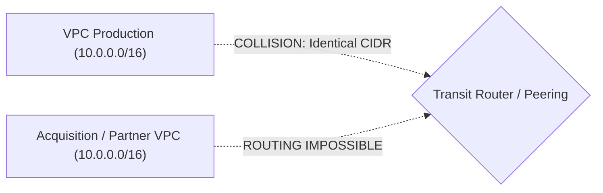
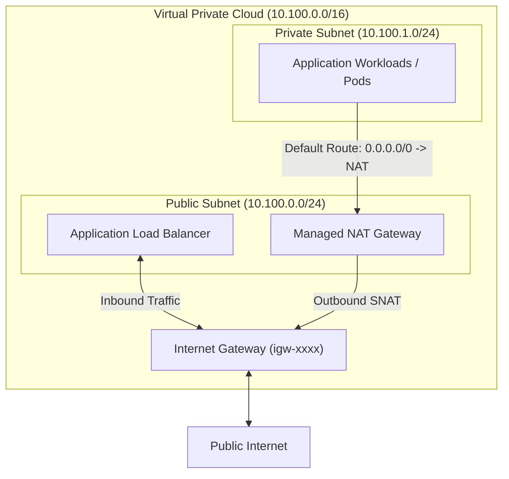
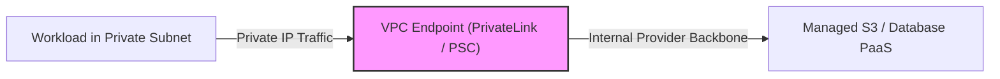
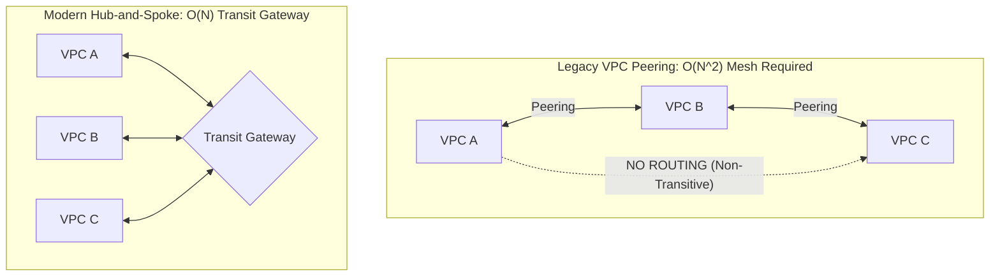

# Module 04: Virtual Networking and CIDR Planning

Cloud networking isolates tenant compute resources within a software-defined network (SDN). While public cloud abstractions hide physical cables, top-of-rack switches, and BGP border routers, engineers must strictly understand IPv4 address math, packet routing rules, and private network segmentation to build production-grade environments.

## 1. RFC 1918 CIDR Planning and the Overlap Disaster

Private cloud networks operate within the private IPv4 address allocations defined by RFC 1918:

- `10.0.0.0/8` (16,777,216 addresses)
- `172.16.0.0/12` (1,048,576 addresses)
- `192.168.0.0/16` (65,536 addresses)

### The Production Overlap Disaster

The most common architectural mistake in early-stage cloud engineering is assigning the default `172.31.0.0/16` or `10.0.0.0/16` CIDR block to multiple VPCs across different environments or corporate subsidiaries.

If two VPCs share identical or overlapping CIDR blocks:

1. **Peering is Physically Impossible**: Direct VPC Peering, Transit Gateway attachments, and AWS Site-to-Site VPNs reject routing tables with overlapping CIDR routes.
2. **Expensive Remediation Required**: Remediating an IP overlap requires either tearing down and rebuilding the entire VPC in a new CIDR range or provisioning complex, fragile Private NAT / Bidirectional NAT overlay gateways.
3. **Mandatory Solution**: Deploy a centralized Cloud IP Address Manager (IPAM) before provisioning the first VPC. Allocate non-overlapping `/16` blocks to distinct business domains and carve `/20` to `/24` subnets for individual environments.

## 2. Cloud Subnetting and Reserved Addresses

Every cloud provider reserves exactly five (5) IP addresses in every IPv4 subnet:

- `.0`: Network address (formal RFC network identifier)
- `.1`: Reserved by the cloud provider for the local VPC software-defined router / default gateway
- `.2`: Reserved by the cloud provider for the base VPC DNS resolver (Amazon Route 53 Resolver, Azure DNS, Google Private DNS)
- `.3`: Reserved by the cloud provider for future internal infrastructure use
- `.255`: Network broadcast address (broadcast is not supported in cloud VPCs, but the address remains reserved)

A `/24` subnet contains $2^{(32-24)} = 256$ total addresses, but yields only $256 - 5 = 251$ usable addresses for host workloads. A `/28` subnet provides only $16 - 5 = 11$ usable host IPs.

## 3. Subnets, Route Tables, and Egress Architecture

A subnet's identity (public vs. private) is determined strictly by its **Route Table association**, not by its IP address range.

- **Public Subnet**: Its associated route table contains an explicit default route directing `0.0.0.0/0` to an **Internet Gateway (IGW)**. Resources require both this route and a public IPv4 address to reach the internet.
- **Private Subnet**: Its associated route table directs `0.0.0.0/0` to a **NAT Gateway** located in a public subnet. Outbound traffic is SNATed (Source Network Address Translated) through the NAT Gateway's Elastic IP, while unsolicited inbound internet connections are physically dropped.

## 4. Stateful vs. Stateless Filtering: Security Groups vs. NACLs

Cloud networks implement layered firewall filtering:

| Dimension | Security Groups (SGs) | Network Access Control Lists (NACLs) |
| :-- | :-- | :-- |
| **Operating Boundary** | Attached directly to Elastic Network Interfaces (ENIs) | Attached to entire Subnet boundaries |
| **State Tracking** | **Stateful**: If inbound request is permitted, return traffic is automatically allowed regardless of outbound rules | **Stateless**: Inbound and outbound traffic must be explicitly permitted in both directions (including ephemeral ports `1024-65535`) |
| **Rule Types** | Supports **Allow** rules only (implicit deny all) | Supports numbered **Allow** and **Deny** rules (evaluated in ascending numeric order) |
| **Evaluation Scope** | All rules are evaluated as a complete set before deciding access | Rules are evaluated strictly in order; first matching rule determines verdict |

## 5. Private Access to PaaS: Endpoints vs. Internet Traversal

Historically, accessing cloud PaaS services (e.g., S3, DynamoDB, Google Cloud Storage, Azure Blob Storage) from private subnets required traversing a NAT Gateway over the public internet, consuming expensive NAT data processing fees and exposing data streams to egress transit.

Modern cloud architecture uses **Private Endpoints**:

- **Gateway Endpoints (AWS S3 & DynamoDB)**: Direct route table entries pointing to cloud storage prefixes. Completely free of charge, routing packets over the internal physical fabric without traversing NAT gateways.
- **Interface Endpoints (AWS PrivateLink / Azure Private Endpoint / GCP PSC)**: Provisions a private Elastic Network Interface (ENI) with a private IP address directly inside the customer's subnet. Private DNS resolves service domain names to this internal IP.

## 6. Peering Non-Transitivity and Transit Routers

VPC Peering is **strictly non-transitive**. If VPC-A is peered with VPC-B, and VPC-B is peered with VPC-C, VPC-A cannot route packets to VPC-C through VPC-B.

To connect dozens or hundreds of spoke VPCs with on-premises datacenters, organizations deploy a centralized **Transit Router** (AWS Transit Gateway, Azure Virtual WAN, or GCP Network Connectivity Center), reducing mesh complexity from $O(N^2)$ point-to-point peerings to an $O(N)$ hub-and-spoke topology with centralized route table domains.

## 7. Executable Proofs

The CIDR subnetting math, overlap detection algorithms, and peering non-transitivity properties are verified in our test suite:

| Assertion / Invariant | Implementation Mechanism | Test File Reference |
| :-- | :-- | :-- |
| **CIDR Subnet Splitting** | Splits /16 VPC into non-overlapping subnets without address collisions | [`../examples/04-cidr-planning-and-vpc-peering.test.ts`](../examples/04-cidr-planning-and-vpc-peering.test.ts) |
| **CIDR Overlap Detection** | Detects overlapping IP blocks that prevent peering or transit attachment | [`../examples/04-cidr-planning-and-vpc-peering.test.ts`](../examples/04-cidr-planning-and-vpc-peering.test.ts) |
| **Peering Non-Transitivity** | Proves spoke-to-spoke transit requires an explicit transit router | [`../examples/04-cidr-planning-and-vpc-peering.test.ts`](../examples/04-cidr-planning-and-vpc-peering.test.ts) |

## 8. Then vs. Now: Cloud Networking Paradigm Shift

- **Then**: Full mesh VPC peering, all egress routed through a single EC2 NAT instance on a Linux VM with iptables, and public internet traversal to reach object storage.
- **Now**: IPAM-governed non-overlapping CIDR blocks, hub-and-spoke Transit Gateways with network firewalls, and private VPC Endpoints (PrivateLink) keeping all PaaS data traffic off the public internet.

## 9. Provider Mapping Matrix

| Concept | AWS | Google Cloud | Microsoft Azure |
| :-- | :-- | :-- | :-- |
| **Virtual Network** | Virtual Private Cloud (VPC) | Virtual Private Cloud (VPC) | Virtual Network (VNet) |
| **Subnet Scope** | Availability Zone scoped | Regional scoped | Regional (spans availability zones) |
| **Transit Hub** | AWS Transit Gateway (TGW) | Network Connectivity Center | Azure Virtual WAN (vWAN) |
| **Stateful L4 Firewall** | Security Groups (SGs) | VPC Firewall Rules | Network Security Groups (NSGs) |
| **Private PaaS Ingress** | Interface Endpoints (PrivateLink) | Private Service Connect (PSC) | Private Endpoints (Private Link) |
| **Managed Egress NAT** | NAT Gateway | Cloud NAT | Azure NAT Gateway |

---

## 10. Interview Drill: Questions & Model Answers

1. Why does a `/24` subnet in an AWS VPC yield only 251 usable IP addresses instead of 256?

In standard IPv4 networking, 2 addresses are reserved per subnet (the network address `.0` and the broadcast address `.255`). Cloud providers reserve 3 additional addresses for internal software-defined infrastructure: `.1` is assigned to the VPC default router, `.2` is reserved for the base VPC DNS resolver (Amazon Route 53 Resolver), and `.3` is reserved for future internal provider usage. Therefore, $256 - 5 = 251$ usable addresses remain.

2. Why does traffic between two peered VPCs fail to route transitively through an intermediate VPC?

VPC Peering is designed at the SDN hypervisor layer to be point-to-point and non-transitive. Packets whose destination IP address does not belong to the direct peering partner are dropped by the VPC routing engine. An intermediate VPC cannot act as an edge router or forward packets on behalf of third-party networks unless a transit hub (like AWS Transit Gateway or a software router with IP forwarding enabled) is introduced.

3. What is the fundamental difference between a Security Group and a Network ACL in terms of state tracking?

Security Groups are stateful firewalls attached at the network interface level. When an incoming packet matches an inbound Allow rule, the connection tracking engine records the flow and automatically permits outgoing response packets on the return path, regardless of outbound rules. Network ACLs are stateless firewalls evaluated at the subnet boundary. Every packet is evaluated independently; to allow an HTTP GET request and its response, an admin must configure both an inbound rule for port 80/443 _and_ an outbound rule for ephemeral ports (`1024-65535`).

4. How do VPC Gateway Endpoints differ from Interface Endpoints (PrivateLink)?

Gateway Endpoints (available for AWS S3 and DynamoDB) modify the VPC route table to direct traffic to service prefix lists across the internal AWS backbone. They are completely free of charge, require no private IP allocation, and do not support on-premises Direct Connect access. Interface Endpoints (AWS PrivateLink) provision a physical Elastic Network Interface (ENI) with a private IP address in the customer subnet, incur hourly and data-processing charges, and allow on-premises systems to query the endpoint via private DNS over VPN or Direct Connect.

5. How does deploying an S3 Gateway Endpoint eliminate NAT Gateway data processing fees?

When private subnet workloads communicate with Amazon S3 without a VPC endpoint, traffic is addressed to S3's public IP range and routed through the NAT Gateway, incurring a $\$0.045$/GB data processing fee. Adding an S3 Gateway Endpoint installs a high-priority route in the subnet route table for S3's prefix list, redirecting traffic directly across the internal provider network fabric, completely bypassing the NAT Gateway and eliminating the per-GB charge.

