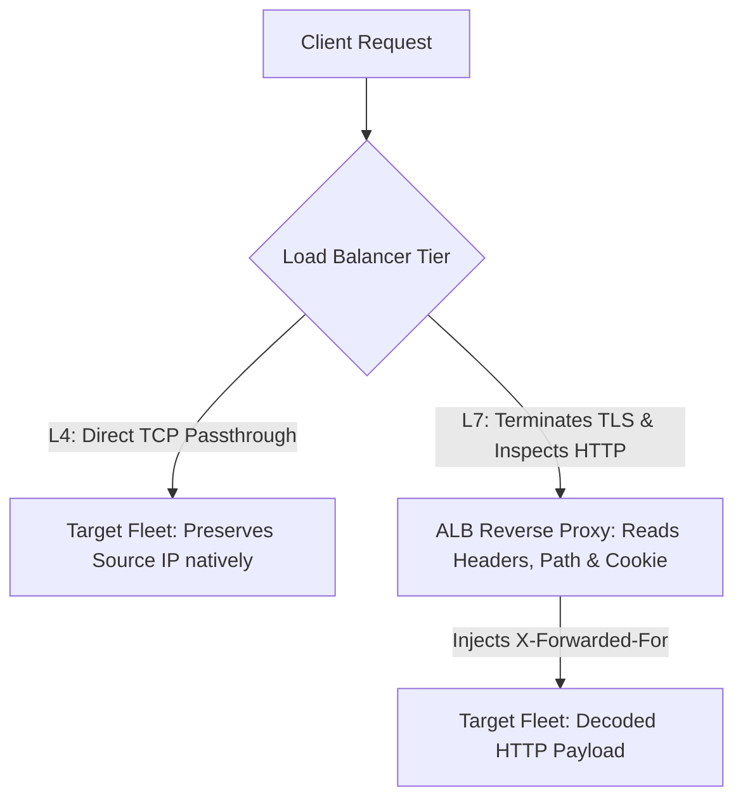
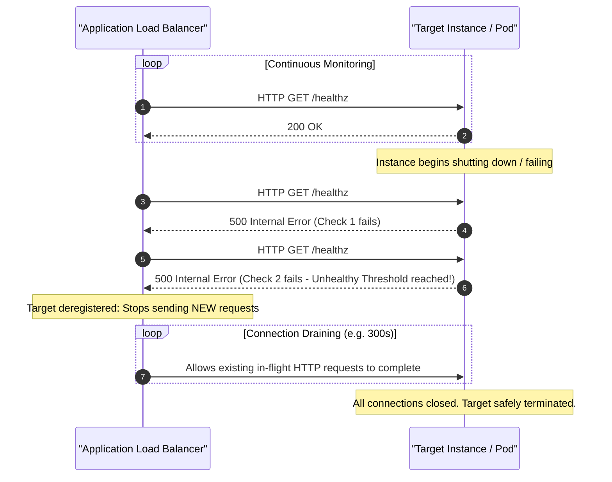
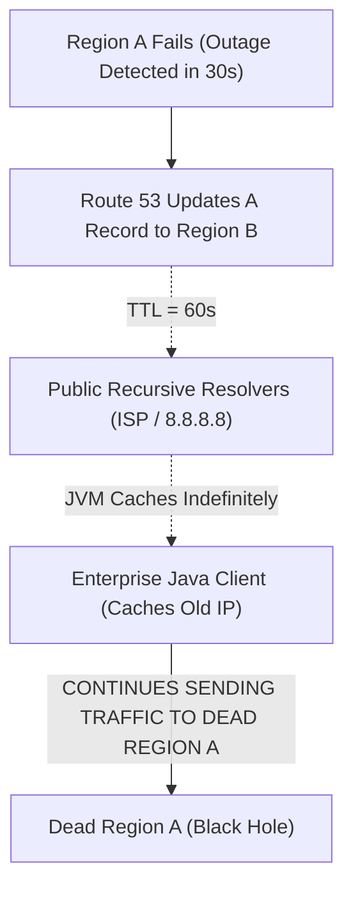

# Module 05: Load Balancing, Edge and DNS

Distributing traffic across redundant compute fleets is essential for cloud reliability and scalability. Engineers must understand the boundaries between transport-layer (Layer 4) and application-layer (Layer 7) routing, the mechanics of health checking and connection draining, CDN edge caching semantics, and the operational limitations of DNS-based failover.

## 1. Layer 4 vs. Layer 7 Load Balancing

Cloud load balancers operate at two distinct layers of the OSI model:

| Dimension | Layer 4 (Transport / NLB) | Layer 7 (Application / ALB) |
| :-- | :-- | :-- |
| **Protocol Inspection** | Evaluates TCP / UDP packets, IP addresses, and ports | Evaluates HTTP / HTTPS headers, paths, query params, cookies |
| **Connection Termination** | Connection passthrough / proxy without decoding TLS application data | Full reverse proxy; terminates client TLS and initiates a new TCP connection to target |
| **Throughput & Latency** | Extreme throughput (millions of requests/sec) with ultra-low latency ($\mu\text{s}$) | High throughput with processing latency (typically $1 - 5\text{ ms}$) |
| **Client IP Preservation** | Preserved natively in IP header (with passthrough) or via PROXY protocol | Client IP rewritten; original client IP forwarded via `X-Forwarded-For` header |
| **Routing Intelligence** | Round-robin / 5-tuple hash based on source/dest IP and port | Path-based routing (`/api` vs. `/static`), host headers, HTTP method, and gRPC routing |

## 2. Anycast vs. Regional Routing

- **Regional Load Balancing (e.g., AWS ALB / NLB)**: The load balancer's VIPs (Virtual IPs) resolve to specific IP addresses assigned to local Availability Zones within a single geographic region. Client packets traverse the public internet until reaching the region's border routers.
- **Global Anycast Load Balancing (e.g., Google Cloud Global External Application LB, Cloudflare)**: The load balancer advertises the exact same public IPv4/IPv6 address from hundreds of Edge Point-of-Presence (POP) locations worldwide using BGP Anycast routing. Client packets enter the provider's private fiber network at the nearest edge datacenter and traverse high-speed private backbone lines to the target compute region, dramatically reducing TCP handshake and TLS negotiation latency.

## 3. Health Checks and Connection Draining

To maintain high availability, load balancers continuously probe backend targets to detect failures before routing production traffic.

- **Health Check Thresholds**: Configured with a consecutive success count (e.g., 2 healthy checks to register) and consecutive failure count (e.g., 2 failed checks to deregister).
- **Connection Draining (Deregistration Delay)**: When a target fails health checks or is scheduled for termination (e.g., during deployment or autoscaling scale-in), the load balancer immediately stops directing _new_ requests to it. It keeps existing active TCP connections open for a configured window (typically 300 seconds) to allow in-flight transactions to drain gracefully without throwing HTTP 502/504 errors to end users.

## 4. Edge Caching and Content Delivery Networks (CDNs)

A Content Delivery Network (e.g., Amazon CloudFront, Cloudflare, Azure Front Door) caches static assets and API responses at edge points of presence close to users.

### The Cache Key

The **Cache Key** is the unique identifier used by the CDN to determine whether an incoming request can be served from cache or must be forwarded to the origin server.

- Default Cache Key: `Protocol + Hostname + URL Path`.
- Cache Key Inflation Trap: Including dynamic HTTP headers (such as `User-Agent` or all cookies) in the cache key fragments the cache. If `User-Agent` is included, identical requests from Chrome 120.1 and Chrome 120.2 generate separate cache misses, reducing the cache hit ratio to near zero.
- **Best Practice for Asset Updates**: Rather than calling expensive and slow CDN cache invalidations, deploy static assets with content-hashed URLs (e.g., `bundle.8a7b9c.js`) and configure an immutable cache header: `Cache-Control: public, max-age=31536000, immutable`.

## 5. DNS-Based Failover and the TTL Caching Reality

Global Server Load Balancing (GSLB) uses DNS routing (e.g., AWS Route 53 latency or failover routing policies) to steer users across multiple cloud regions.

### The DNS TTL Caching Problem

While DNS failover is widely used for disaster recovery, engineers must understand that **DNS is not an instantaneous routing protocol**.

1. **Resolver Caching**: Even if a DNS record has a configured TTL of 60 seconds, thousands of intermediate ISP recursive resolvers enforce a minimum TTL floor (often 300 seconds or higher), ignoring low TTL values.
2. **Client-Side JVM Caching**: Many runtime environments (most notably the Java Virtual Machine) historically cache DNS resolutions forever in memory (`networkaddress.cache.ttl = -1`). Even when public DNS updates, the application process never issues another DNS lookup until the process is restarted.
3. **Architectural Takeaway**: DNS failover is appropriate for multi-minute regional disaster recovery scenarios, but cannot be relied upon for sub-second, zero-downtime microservice failovers. Sub-second failover requires Anycast routing or active global reverse proxies.

## 6. Executable Proofs

The DNS failover timeline calculations, JVM caching latency bounds, and L4 vs. L7 protocol inspection differences are verified in our test suite:

| Assertion / Invariant | Implementation Mechanism | Test File Reference |
| :-- | :-- | :-- |
| **DNS Failover Stale Window** | Calculates maximum client-side traffic black-holing latency under TTL caching | [`../examples/05-load-balancing-and-dns-failover.test.ts`](../examples/05-load-balancing-and-dns-failover.test.ts) |
| **Layer 4 vs Layer 7 Boundaries** | Proves protocol inspection and client IP preservation invariants | [`../examples/05-load-balancing-and-dns-failover.test.ts`](../examples/05-load-balancing-and-dns-failover.test.ts) |

## 7. Then vs. Now: Traffic Management Paradigm Shift

- **Then**: Single regional hardware load balancers, DNS failover with 3600s TTLs, and manual CDN purge scripts run after every deployment.
- **Now**: Global Anycast edge ingress, Layer 7 content-based routing with automated connection draining, and immutable content-hashed cache keys with `max-age=31536000`.

## 8. Provider Mapping Matrix

| Concept | AWS | Google Cloud | Microsoft Azure | Cloudflare |
| :-- | :-- | :-- | :-- | :-- |
| **Layer 7 Load Balancer** | Application Load Balancer (ALB) | Global External Application LB | Application Gateway | Cloudflare Load Balancing |
| **Layer 4 Load Balancer** | Network Load Balancer (NLB) | Regional External Passthrough NLB | Azure Load Balancer (Standard) | Cloudflare Spectrum |
| **Authoritative DNS** | Amazon Route 53 | Cloud DNS | Azure DNS | Cloudflare DNS (1.1.1.1) |
| **Global CDN** | Amazon CloudFront | Cloud CDN | Azure Front Door | Cloudflare CDN |
| **Anycast Edge Accelerator** | AWS Global Accelerator | External Application LB (Native) | Azure Front Door | Cloudflare Global Network |

---

## 9. Interview Drill: Questions & Model Answers

1. When should an architect choose a Network Load Balancer (Layer 4) over an Application Load Balancer (Layer 7)?

An architect should select a Layer 4 Network Load Balancer (NLB) when: (1) The application requires non-HTTP protocols (e.g., raw TCP, UDP, gaming protocols, VoIP, or proprietary binary RPCs); (2) The workload demands extreme, unpredictable traffic spikes (millions of requests per second) where an ALB would require pre-warming; (3) Ultra-low sub-millisecond latency is required; (4) The backend instances require preserving the client's source IP address directly in the TCP packet without parsing `X-Forwarded-For` HTTP headers; (5) Static, fixed public IP addresses are required for client firewall allowlisting.

2. How does connection draining (deregistration delay) prevent HTTP 502/504 errors during rolling deployments?

When an autoscaling group or CI/CD pipeline deploys a new version, old instances must be terminated. If an instance is abruptly stopped while processing an in-flight request, the TCP connection drops and the client receives an HTTP 502 Bad Gateway. Connection draining instructs the load balancer to immediately stop directing _new_ requests to the terminating instance, while allowing active in-flight requests to complete within a bounded grace period (e.g., 300 seconds) before sending the final SIGTERM/SIGKILL signals.

3. Why is cache invalidation considered an anti-pattern compared to content-hashed asset versioning in CDNs?

CDN cache invalidation is slow, eventually consistent, and expensive: invalidation requests can take several minutes to propagate across hundreds of global edge POPs, during which users receive inconsistent mixes of old and new assets. Furthermore, cloud providers charge fees for large invalidation batches. Content-hashed versioning (e.g., `main.4f1b2c.js`) guarantees instant cache coherence: because the new release has a unique URL, edge POPs fetch the new asset immediately on first request, while old cached assets naturally age out.

4. Why can DNS-based global failover not guarantee an immediate, zero-downtime failover during an Availability Zone or regional catastrophe?

DNS is an eventually consistent, distributed caching system. Even if an administrator sets a low TTL (e.g., 60 seconds), many intermediate recursive DNS resolvers and client runtimes (such as Java JVMs or mobile operating systems) cache IP addresses for longer durations or ignore TTL expiry entirely. Consequently, clients continue sending HTTP requests to the failed IP address long after the authoritative DNS server has updated the record.

5. What is the "Cache Key Inflation" problem in CDN configuration, and how does it degrade performance?

Cache key inflation occurs when excessive or highly volatile request components (such as all query parameters, dynamic cookies, or client `User-Agent` headers) are included in the CDN cache key. Because almost every incoming request carries slight variations in these headers, the CDN treats them as distinct resources and cannot serve cached responses. This collapses the cache hit ratio, floods the origin backend server with redundant traffic, and negates the latency benefits of the CDN.

