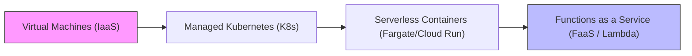
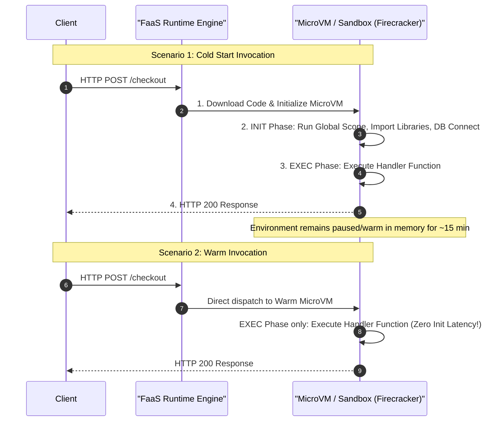
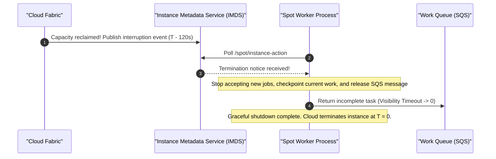

# Module 06: Compute Models and Elasticity

Cloud compute has evolved from virtualized hardware emulation into a spectrum of execution abstractions. Choosing between Virtual Machines (VMs), managed Kubernetes clusters, serverless containers, and Function-as-a-Service (FaaS) requires evaluating concurrency semantics, cold start penalties, autoscaling responsiveness, and unit economics.

## 1. The Compute Abstraction Spectrum

| Compute Model | Primary Abstraction | Scaling Metric | Cold Start Latency | Management Overhead |
| :-- | :-- | :-- | :-- | :-- |
| **Virtual Machines (IaaS)** | EC2 / GCE / Azure VM | Metrics (CPU, Memory, SQS queue depth) | Minutes ($1 - 5\text{ min}$) | High: OS patching, security hardening, agent management |
| **Managed Kubernetes** | EKS / GKE / AKS (Pods) | Pod autoscaling (HPA / KEDA) + Cluster Autoscaler / Karpenter | Seconds ($5 - 60\text{ s}$) | Medium-High: K8s upgrades, Helm charts, CNI networking |
| **Serverless Containers** | Fargate / Cloud Run / Container Apps | Request concurrency, HTTP traffic | Seconds ($1 - 10\text{ s}$) | Low: Container image packaging; zero server management |
| **Function-as-a-Service (FaaS)** | Lambda / Cloud Functions / Workers | Event triggers, instantaneous invocations | Milliseconds to seconds ($100 - 1500\text{ ms}$) | Minimal: Pure application code; per-millisecond execution billing |

## 2. Autoscaling Mechanics and Scale-In Protection

Autoscaling operates across two decoupled dimensions: **Scaling Policies** and **Lifecycle Hooks**.

### Autoscaling Signals

1. **Target Tracking Scaling**: Maintains a specific metric target (e.g., keep average fleet CPU utilization at 65%). The autoscaling controller automatically calculates the required instance count using proportional feedback control.
2. **Step Scaling**: Increases instance capacity based on metric threshold tiers (e.g., if CPU between 70% and 80%, add 2 instances; if CPU > 80%, add 5 instances).
3. **Queue-Based Scaling (Backlog Per Instance)**: Essential for asynchronous worker pools. Scaling based on CPU utilization alone fails for queue workers because 10,000 backlog messages may register 100% CPU on 1 instance while needing 100 instances to meet SLA deadlines. The correct metric is:

$$\text{Backlog Per Worker} = \frac{\text{ApproximateNumberOfMessages}}{\text{HealthyWorkerCount}}$$

### Scale-In Protection

When load drops, autoscaling triggers a scale-in event. If the autoscaling group terminates a node currently processing a 45-minute non-idempotent financial batch transaction or video rendering job, data corruption or job failure occurs. **Scale-in protection** allows workers to set a flag (`SetInstanceProtection`) while active jobs run, preventing the autoscaler from selecting them for termination until the job explicitly clears the lock.

## 3. FaaS Lifecycle: Cold Starts, Init Phases, and Concurrency

In Function-as-a-Service (such as AWS Lambda or Google Cloud Run functions), the execution environment follows a discrete lifecycle:

### Mitigating Cold Starts

- **Lean Dependencies**: Strip unneeded SDK packages and large dependency trees. In Node.js, bundle code with tree-shaking (e.g., using `esbuild`).
- **Optimize the INIT Phase**: Initialize database connection pools and secret client singletons outside the function handler in global scope so they are shared across subsequent warm invocations.
- **Provisioned Concurrency**: Allocates a fixed number of pre-warmed execution environments that run the INIT phase in advance, completely eliminating cold starts for latency-critical APIs at an additional hourly cost.

## 4. Spot and Preemptible Interruption Handling

Spot Instances (AWS) and Spot/Preemptible VMs (GCP/Azure) offer up to 70–90% discounts compared to on-demand pricing by allowing cloud providers to reclaim unused EC2/GCE capacity when demand surges.

### The Interruption Contract

- **AWS Spot**: Delivers a **2-minute** interruption warning via an Amazon EventBridge event and Instance Metadata Service (IMDS) polling (`/latest/meta-data/spot/instance-action`).
- **Google Cloud Preemptible**: Delivers a **30-second** ACPI shutdown signal.
- **Azure Spot**: Delivers a **30-second** scheduled event notice.

Workloads deployed on spot capacity must be **stateless, fault-tolerant, and horizontally idempotent** (e.g., containerized batch processing, big data analytics, video encoding, CI/CD runners).

## 5. Graviton and ARM Architecture Economics

Cloud providers have deployed custom ARM-based silicon (e.g., AWS Graviton3/Graviton4, Google Cloud Axion, Azure Cobalt) providing up to 40% better price-performance compared to legacy x86-64 processors.

- **Economic Advantage**: ARM instances are priced $\approx 20\%$ lower per hour while delivering $\approx 15 - 20\%$ higher instruction-per-clock (IPC) throughput.
- **Architecture Consideration**: Compiled binaries (C/C++, Rust, Go) must be cross-compiled for `linux/arm64`. Interpreted runtimes (Node.js, Python, Java) run seamlessly on ARM, provided native C-bindings (e.g., `sharp`, `sqlite3`, `bcrypt`) publish pre-built multi-arch `aarch64` wheels or npm native bindings.

## 6. Executable Proofs

The spot interruption notification window and FaaS cold start vs. warm invocation latency metrics are verified in our test suite:

| Assertion / Invariant | Implementation Mechanism | Test File Reference |
| :-- | :-- | :-- |
| **Spot Interruption Notice Handling** | Simulates 120-second draining window on spot termination notice | [`../examples/06-compute-autoscaling-and-spot.test.ts`](../examples/06-compute-autoscaling-and-spot.test.ts) |
| **FaaS Execution Latency Model** | Proves cold start init overhead vs warm handler execution bounds | [`../examples/06-compute-autoscaling-and-spot.test.ts`](../examples/06-compute-autoscaling-and-spot.test.ts) |

## 7. Then vs. Now: Compute Paradigm Shift

- **Then**: Over-provisioned x86 static VMs running 24/7; manual OS patch management; scaling based on crude CPU percentage alarms.
- **Now**: Event-driven serverless containers and FaaS running on power-efficient ARM silicon; Karpenter-driven dynamic pod packing; spot instances with automated 2-minute checkpoint draining.

## 8. Provider Mapping Matrix

| Concept | AWS | Google Cloud | Microsoft Azure | Cloudflare |
| :-- | :-- | :-- | :-- | :-- |
| **Virtual Machines** | Amazon EC2 | Compute Engine (GCE) | Azure Virtual Machines | Not Applicable |
| **Autoscaling Group** | Auto Scaling Group (ASG) | Managed Instance Group (MIG) | Virtual Machine Scale Set (VMSS) | Not Applicable |
| **Serverless Containers** | AWS Fargate (ECS / EKS) | Cloud Run | Azure Container Apps (ACA) | Cloudflare Containers |
| **Function-as-a-Service** | AWS Lambda | Cloud Run functions | Azure Functions | Cloudflare Workers |
| **Preemptible / Spot VMs** | EC2 Spot Instances | Spot VMs | Azure Spot Virtual Machines | Not Applicable |
| **ARM Silicon** | AWS Graviton (3/4) | Google Cloud Axion | Azure Cobalt | AMD / ARM Edge Nodes |

---

## Interview Drill

1. Why is autoscaling queue-worker pools based on average CPU utilization an architectural anti-pattern?

CPU utilization does not correlate with backlog depth. If an SQS queue suddenly receives 100,000 messages while only 1 worker instance is running, that worker's CPU may peg at 100%, but the autoscaler will slowly increment capacity by 1 or 2 nodes per cooldown period. Conversely, if 100 workers each process I/O-bound jobs waiting on database locks, CPU utilization will hover at 10%, causing the autoscaler to prematurely scale in the fleet despite a mounting backlog. The correct metric is Backlog Per Worker (`ApproximateNumberOfMessagesVisible / NumberOfHealthyWorkers`).

2. Explain the execution phases of a FaaS cold start and how global scope code optimization helps.

A cold start consists of three phases: (1) System provisioning (downloading container/zip and creating the MicroVM); (2) INIT phase (booting the language runtime, executing code outside the handler, establishing SDK clients and database connections); (3) EXEC phase (running the handler function for the specific event). Code placed in global scope outside the handler executes only once during the INIT phase. For subsequent warm invocations, the MicroVM is reused and skips the INIT phase entirely, directly running the handler with pre-warmed connection pools.

3. How does Scale-In Protection prevent data loss in batch-processing worker fleets?

During peak hours, an autoscaling group scales outward to process jobs. When the metric subsides, the autoscaler initiates a scale-in event to terminate surplus nodes. If an instance is in the middle of a non-idempotent 30-minute video encoding or payroll batch job, terminating it causes job failure and data corruption. Enabling Scale-In Protection allows the worker application to lock itself via API upon picking up a job, preventing the autoscaler from terminating it until the job completes and the protection flag is cleared.

4. What architectural constraints must a workload satisfy to safely run on Spot / Preemptible instances?

Workloads must be: (1) **Stateless**: No persistent local disk state that cannot be lost; (2) **Horizontally Scalable**: Able to shrink and grow dynamically; (3) **Interruption-Tolerant**: Capable of detecting the 2-minute (AWS) or 30-second (GCP/Azure) termination signal, checkpointing progress, and gracefully releasing locks; (4) **Idempotent**: Able to restart interrupted tasks on surviving nodes without duplicate side effects.

5. Why does compiling for ARM64 (Graviton/Axion) yield significant cloud cost savings?

ARM processors operate with higher instruction-per-clock (IPC) efficiency and consume less electrical power and cooling than equivalent x86-64 chips. Cloud providers pass these efficiency savings to customers: ARM instance types are priced approximately 20% lower per hour while delivering equal or superior performance for web servers, microservices, and in-memory databases, resulting in up to 40% better overall price-performance.

