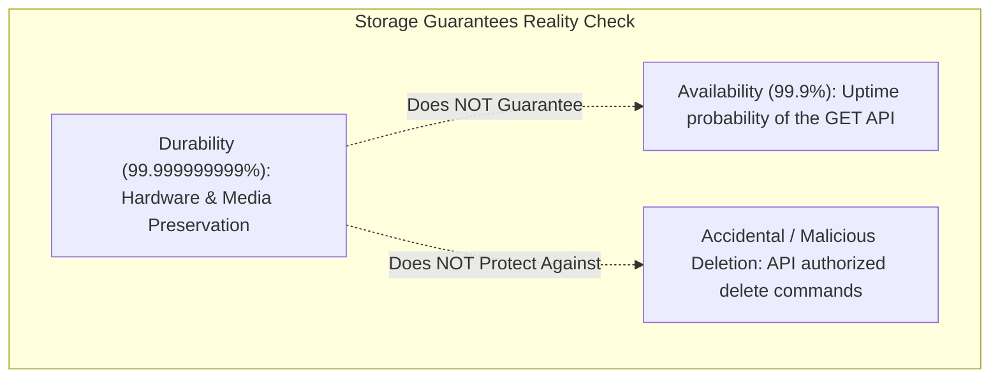
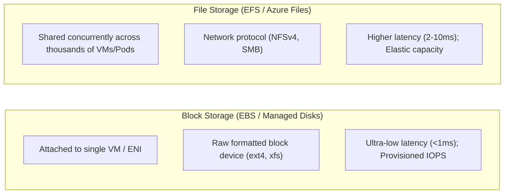
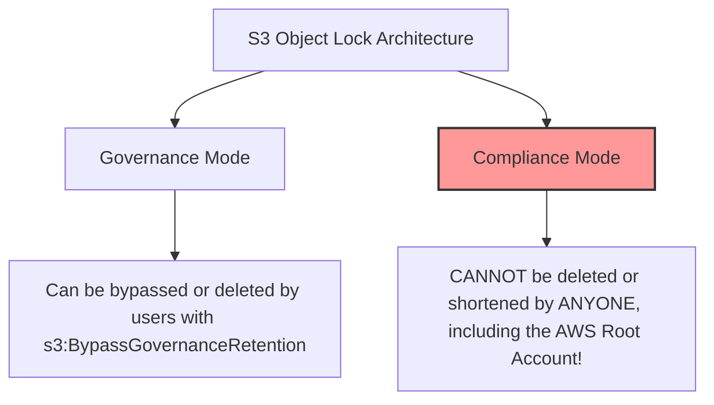
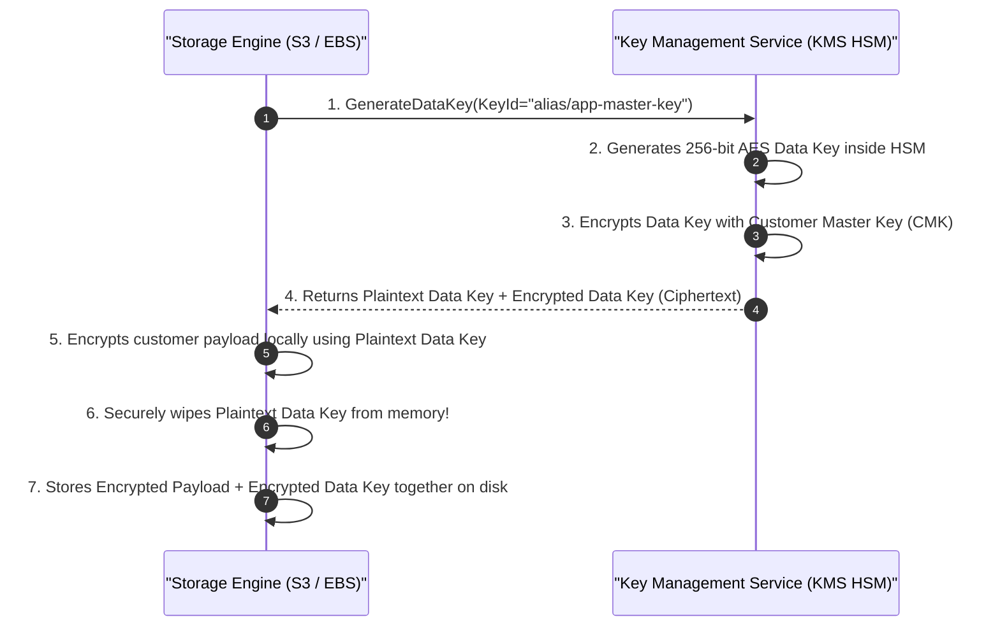

# Module 07: Storage Classes and Data Durability

Cloud storage is partitioned into three distinct physical paradigms: Object Storage, Block Storage, and File Storage. Architects must understand the statistical distinction between durability and availability, the economic mechanics of lifecycle tiering and minimum retention penalties, and the cryptographic implementation of envelope encryption.

## 1. Object Storage: Durability vs. Availability

Object storage (e.g., Amazon S3, Google Cloud Storage, Azure Blob Storage, Cloudflare R2) provides a horizontally scalable, HTTP-based key-value store designed for binary large objects (blobs).

### The Math of Eleven Nines ($11\times 9\text{s}$) Durability

Major cloud providers advertise $99.999999999\%$ ($11\times 9\text{s}$) annual durability for standard object storage tiers.

- **Formal Meaning**: The annual probability of losing an object due to unrecoverable physical disk or facility corruption is $1 - 0.99999999999 = 10^{-11}$. If an organization stores $10,000,000$ ($10^7$) objects in S3, on average they will lose one single object once every 10,000 years.
- **Physical Implementation**: To achieve this durability without triple-replication storage costs, cloud storage engines employ **Erasure Coding** (Reed-Solomon $M+K$ schemas) across multiple physically separated Availability Zones. If an object is split into $8$ data fragments and $4$ parity fragments across $3$ AZs, any $4$ fragments or an entire AZ can be destroyed simultaneously without loss of data.

### Durability $\ne$ Availability $\ne$ Protection from Deletion

1. **Durability vs. Availability**: A system can maintain $11\times 9\text{s}$ durability while suffering a temporary regional outage with $0\%$ availability (e.g., if the front-end HTTP API endpoints are unreachable). The bits remain physically intact on storage media, but cannot be read until the API recovers.
2. **Durability Protects Against Hardware Loss, Not Delete Commands**: When a compromised API credential or rogue script issues `s3:DeleteObject`, the storage engine executes the command faithfully. High durability does _not_ protect against deletion. Protection requires **S3 Object Lock (WORM)** and **Bucket Versioning**.

## 2. Storage Tiers and Minimum Retention Penalties

Cloud object storage offers tiered pricing based on access frequency:

| Storage Class Tier | Base Storage Cost | Retrieval Fee Per GB | Minimum Retention Duration | First-Byte Read Latency |
| :-- | :-- | :-- | :-- | :-- |
| **Standard / Hot** | $\approx \$0.023$ / GB-mo | $\$0.00$ | None (0 Days) | Milliseconds ($\approx 10 - 50\text{ ms}$) |
| **Infrequent Access (Cool)** | $\approx \$0.0125$ / GB-mo | $\approx \$0.01$ / GB | 30 Days | Milliseconds |
| **Glacier Instant Retrieval** | $\approx \$0.004$ / GB-mo | $\approx \$0.03$ / GB | 90 Days | Milliseconds |
| **Glacier Flexible (Cold)** | $\approx \$0.0036$ / GB-mo | $\approx \$0.01$ / GB | 90 Days | Minutes to Hours ($1 - 5\text{ hours}$) |
| **Deep Archive** | $\approx \$0.00099$ / GB-mo | $\approx \$0.02$ / GB | 180 Days | Hours ($12 - 48\text{ hours}$) |

### The Early Deletion Penalty Trap

If an object is uploaded to S3 Glacier Flexible Retrieval and deleted after 10 days, the cloud provider bills for the remaining 80 days as an **Early Deletion Fee**. Transitioning transient, short-lived objects (such as temporary build artifacts or short-lived logs) into cold tiers is a severe financial anti-pattern that multiplies storage bills.

## 3. Block Storage vs. File Storage

- **Block Storage (e.g., AWS EBS, Azure Managed Disks)**: Raw, unformatted virtual hard drives attached over the hypervisor bus to a single virtual machine. Used for primary database storage (PostgreSQL, MySQL, MongoDB) requiring low latency and provisioned IOPS (`gp3`, `io2 Block Express`).
- **File Storage (e.g., AWS EFS, Azure Files, Google Cloud Filestore)**: Managed network file systems mounted over standard network protocols (NFSv4, SMB) across thousands of compute nodes or Kubernetes pods concurrently. Used for shared media directories, legacy application migration, and shared CMS storage.

## 4. Object Lock: WORM Compliance Architecture

To comply with regulatory standards (such as SEC Rule 17a-4 and FINRA), object stores implement **Write Once, Read Many (WORM)** through Object Lock:

- **Governance Mode**: Protects objects from accidental deletion by standard users, while permitting users with special IAM permissions (`s3:BypassGovernanceRetention`) to alter the lock or delete the object during audit emergencies.
- **Compliance Mode**: Completely immutable. The retention period cannot be shortened, and locked object versions cannot be deleted by _any_ principal—including the AWS account root user or AWS support personnel—until the configured retention timestamp has passed.

## 5. Envelope Encryption and KMS Key Hierarchies

Encrypting terabytes of storage directly with a single Master Key stored in a hardware security module (HSM) is physically impossible due to HSM rate limits and cryptographic key wear-out. Cloud storage solves this using **Envelope Encryption** with the Advanced Encryption Standard (AES-256-GCM):

To read the data back, S3 sends the _Encrypted Data Key_ back to KMS via `kms:Decrypt`. KMS decrypts the data key inside the HSM and returns the plaintext key to memory, allowing S3 to decrypt the payload. The Customer Master Key (CMK) never leaves the physical HSM boundary.

## 6. Executable Proofs

The storage tiering early deletion penalties and WORM object lock durability properties are verified in our test suite:

| Assertion / Invariant | Implementation Mechanism | Test File Reference |
| :-- | :-- | :-- |
| **Early Deletion Fee Calculation** | Calculates exact early deletion penalty fee when deleting before minimum retention days | [`../examples/07-storage-lifecycle-and-durability.test.ts`](../examples/07-storage-lifecycle-and-durability.test.ts) |
| **Durability vs Deletion Protection** | Proves Object Lock Compliance Mode is mandatory to prevent malicious/accidental deletes | [`../examples/07-storage-lifecycle-and-durability.test.ts`](../examples/07-storage-lifecycle-and-durability.test.ts) |

## 7. Then vs. Now: Storage Paradigm Shift

- **Then**: Single-SAN physical block storage; tape archives shipped off-site; static customer-managed encryption keys stored in text config files.
- **Now**: Multi-AZ erasure-coded object storage with $11\times 9\text{s}$ durability; hardware-backed envelope encryption with KMS; immutable WORM compliance locks.

## 8. Provider Mapping Matrix

| Concept | AWS | Google Cloud | Microsoft Azure | Cloudflare |
| :-- | :-- | :-- | :-- | :-- |
| **Object Storage** | Amazon S3 | Cloud Storage (GCS) | Azure Blob Storage | Cloudflare R2 |
| **Cold Archive Tier** | S3 Glacier Deep Archive | Archive Storage | Azure Blob Archive | Not Applicable |
| **Block Storage** | Amazon EBS (gp3, io2) | Persistent Disk / Hyperdisk | Azure Managed Disks | Not Applicable |
| **Network File Share** | Amazon EFS (NFS) | Filestore (NFS) | Azure Files (SMB/NFS) | Not Applicable |
| **Immutability Lock** | S3 Object Lock (Compliance) | Bucket Lock (Retention) | Immutable Blob Storage | Not Applicable |
| **KMS Service** | AWS KMS | Cloud KMS | Azure Key Vault | Secrets Store |

---

## 9. Interview Drill: Questions & Model Answers

1. What does 11 nines (99.999999999%) durability mean in practical engineering terms, and why does it not protect against data deletion?

Eleven nines of annual durability means that if an enterprise stores 10 million objects in S3, on average they can expect to lose a single object due to physical hardware corruption or bit rot once every 10,000 years. It measures physical media resilience achieved via erasure coding across independent Availability Zones. However, durability does not evaluate the semantic intent of API commands: if an authenticated administrator or compromised access key issues `s3:DeleteObject`, the storage engine deletes the object. Protection against deletion requires Bucket Versioning combined with Object Lock in Compliance Mode.

2. Explain the early deletion fee penalty in cold storage tiers like Amazon S3 Glacier.

Cold storage tiers (such as S3 Glacier Flexible Retrieval with a 90-day minimum retention, or Deep Archive with 180 days) offer deeply discounted monthly storage rates in exchange for a commitment to hold data long-term. If an object is deleted, overwritten, or transitioned to another tier before the minimum retention duration has elapsed, the cloud provider bills a prorated "early deletion fee" for the remaining days. Deleting 1,000 GB on day 10 of a 90-day tier bills for the 10 days stored plus an early deletion charge for the remaining 80 days.

3. How does Envelope Encryption work, and why is it used instead of encrypting data directly with a master key?

Envelope encryption encrypts customer data with an ephemeral Data Key (AES-256), and then encrypts that Data Key with a root Customer Master Key (CMK) managed inside an HSM. It is used because: (1) Hardware Security Modules (HSMs) have physical throughput limits and cannot encrypt gigabytes of payload data directly without throttling; (2) Transferring large datasets over the network into an HSM creates massive latency; (3) Envelope encryption limits the blast radius of key wear-out, ensuring the root master key is used only to encrypt small 256-bit data keys.

4. What is the fundamental difference between Object Lock in Governance Mode versus Compliance Mode?

In Governance Mode, objects are protected from deletion by users without special permissions, but users with the explicit IAM permission `s3:BypassGovernanceRetention` can delete the object or disable the lock. In Compliance Mode, the lock is completely immutable: no user—including the AWS account root user, full administrators, or cloud provider support—can delete the locked object version or shorten the retention duration until the configured retention date has passed.

5. When should an architect choose Block Storage (EBS) over File Storage (EFS)?

Block Storage (EBS) should be selected for high-performance single-instance workloads, such as relational databases (PostgreSQL, MySQL, SQL Server) and distributed datastores, that require sub-millisecond I/O latency, raw block device filesystem formatting, and dedicated provisioned IOPS (`gp3`/`io2`). File Storage (EFS) should be selected when shared, concurrent multi-instance read/write access (POSIX filesystem) is required across hundreds of VMs or Kubernetes pods simultaneously over NFS.

