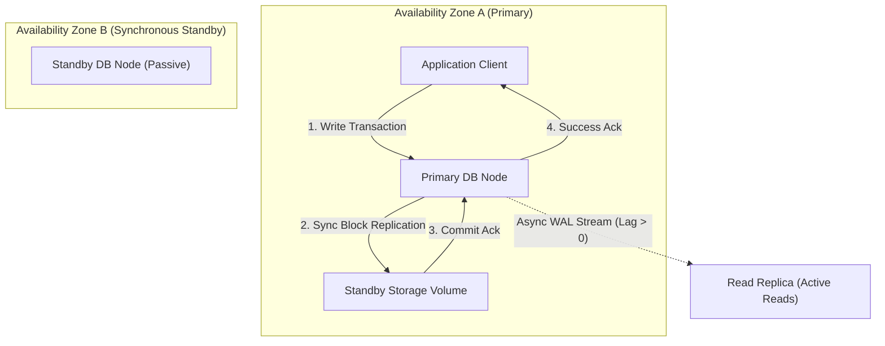
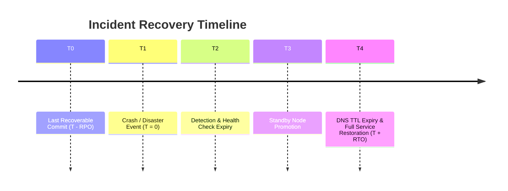
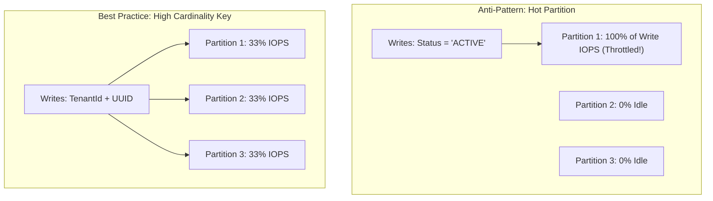
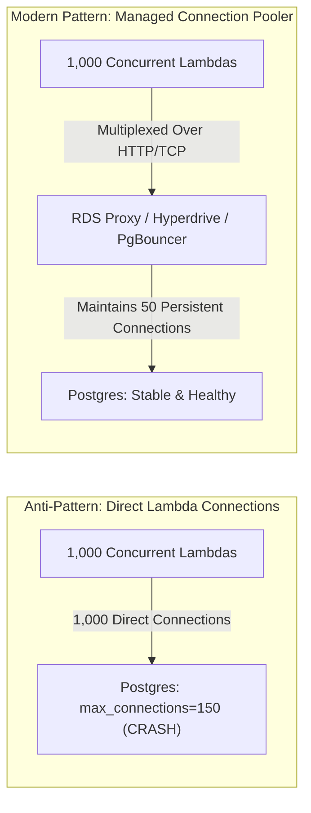

# Module 08: Managed Databases

Relational and non-relational database services are the stateful core of modern cloud architectures. Moving from self-managed databases on virtual machines to managed cloud databases (such as Amazon RDS, Aurora, Cloud Spanner, and DynamoDB) offloads replication, backups, and failovers to the provider. However, engineers must understand replication mechanics, RPO/RTO trade-offs, global distributed consistency, and serverless connection pooling to avoid production outages.

## 1. High Availability: Synchronous Standbys vs. Asynchronous Read Replicas

Cloud relational database services (e.g., Amazon RDS Multi-AZ, Azure Flexible Server HA, Cloud SQL HA) offer two distinct replication topologies:

| Dimension | Multi-AZ Synchronous Standby | Asynchronous Read Replica |
| :-- | :-- | :-- |
| **Commit Protocol** | Synchronous physical block replication: client write is not acknowledged until written to both primary and standby storage | Asynchronous logical/WAL streaming replication: primary acknowledges write immediately; changes stream to replica in background |
| **Data Loss on Failover (RPO)** | **RPO = 0**: Zero data loss guaranteed | **RPO > 0**: Data committed during the replication lag window ($\Delta t$) is lost |
| **Serving Read Traffic** | Passive standby; cannot serve read queries | Active replica; serves read-only queries to offload primary |
| **Failover Automation** | Fully automated failover via DNS flip and storage re-attach ($30 - 60\text{ s}$) | Manual or automated promotion; promoting replica breaks replication stream |

## 2. Recovery Metrics: RPO and RTO Mathematical Derivations

The resilience of a stateful system is quantified by two operational metrics:

1. **Recovery Point Objective (RPO)**: The maximum acceptable data loss measured backward in time from the moment of catastrophic hardware failure.
   - For Multi-AZ synchronous standby: $\text{RPO} = 0\text{ seconds}$.
   - For asynchronous read replica: $\text{RPO} = \text{ReplicationLag}(\Delta t)$.
   - For snapshot-based backups: $\text{RPO} = \text{TimeSinceLastSnapshot}$.
2. **Recovery Time Objective (RTO)**: The maximum acceptable duration of time to restore service functionality after an outage occurs.
   - Total Client Outage Time: $\text{RTO} = T_{\text{detection}} + T_{\text{promotion}} + T_{\text{DNS TTL}}$.

## 3. Globally Distributed SQL: Spanner, Aurora DSQL, and Cosmos DB

When relational workloads require global multi-region write scalability with strict serializable consistency, traditional single-primary replication breaks down due to the speed of light: a synchronous roundtrip between Virginia and Frankfurt takes $\approx 80 - 100\text{ ms}$.

### Google Cloud Spanner and TrueTime

Google Cloud Spanner solved global external consistency without distributed locking deadlocks by inventing **TrueTime**:

- TrueTime uses synchronized atomic clocks and GPS receivers in every Google datacenter to bound clock uncertainty to $\epsilon \approx 1 - 7\text{ ms}$.
- When Spanner assigns a commit timestamp $t$, it deliberately pauses execution for $2\epsilon$ ("commit wait") before releasing the write lock.
- **Guarantee**: If transaction $T_2$ begins after transaction $T_1$ commits anywhere on Earth, $T_2$ is guaranteed to receive a timestamp strictly greater than $T_1$ ($t_2 > t_1$), guaranteeing external consistency without a central global sequencer.

## 4. NoSQL Key Design and the Hot Partition Trap

Managed NoSQL document and key-value stores (e.g., Amazon DynamoDB, Google Cloud Firestore, Azure Cosmos DB) achieve horizontal scalability by partitioning data across storage nodes using a **Partition Key** (Hash Key).

### The Hot Partition Anti-Pattern

If a developer selects a low-cardinality attribute (e.g., `Status: 'ACTIVE'` or `Date: '2026-11-07'`) as the partition key, all write operations map to the exact same physical storage partition. While the table has 50,000 provisioned write capacity units across the fleet, the single physical partition is capped at 1,000 WCU, resulting in HTTP 400 `ProvisionedThroughputExceededException` errors while 98% of the database capacity sits idle.

- **Remedy**: Use high-cardinality partition keys (e.g., `userId`, `deviceId`, or synthetic composite keys like `deviceId_hashSuffix`).

## 5. Connection Pooling for Serverless Workloads

Traditional relational database engines (PostgreSQL and MySQL) allocate dedicated memory and process threads per client connection (often 5–10 MB of RAM per connection). A standard database instance typically caps `max_connections` at 100–200.

### The Serverless Connection Exhaustion Failure

When serverless FaaS functions (AWS Lambda, Cloud Run) scale out in response to a traffic burst, 1,000 concurrent function invocations simultaneously open 1,000 direct database connections, immediately crashing the database with connection exhaustion errors.

- **Solution**: Deploy a managed connection proxy (Amazon RDS Proxy, Cloudflare Hyperdrive, or PgBouncer). The proxy maintains a small pool of 50 persistent connections to the database and efficiently multiplexes thousands of ephemeral serverless queries over that shared pool.

## 6. Executable Proofs

The zero RPO vs. async lag data loss calculation, failover timeline equations, and connection pooler necessity invariants are verified in our test suite:

| Assertion / Invariant | Implementation Mechanism | Test File Reference |
| :-- | :-- | :-- |
| **Zero RPO Synchronous Standby** | Proves Multi-AZ synchronous standby eliminates data loss compared to async replicas | [`../examples/08-managed-databases-and-rpo-rto.test.ts`](../examples/08-managed-databases-and-rpo-rto.test.ts) |
| **Serverless Connection Barrier** | Proves direct FaaS concurrency exhausts database `max_connections` without a pooler | [`../examples/08-managed-databases-and-rpo-rto.test.ts`](../examples/08-managed-databases-and-rpo-rto.test.ts) |

## 7. Then vs. Now: Database Paradigm Shift

- **Then**: Self-managed PostgreSQL running on a single EC2 instance; manual replication scripts; nightly tape dumps; direct client database connections.
- **Now**: Multi-AZ Aurora/Spanner clusters with automated storage auto-repair; zero-RPO synchronous standby failover; managed serverless connection proxies (RDS Proxy).

## 8. Provider Mapping Matrix

| Concept | AWS | Google Cloud | Microsoft Azure | Cloudflare |
| :-- | :-- | :-- | :-- | :-- |
| **Managed Relational** | Amazon RDS, Aurora | Cloud SQL, AlloyDB | Azure SQL DB, PostgreSQL Flexible | D1 (SQLite) |
| **Globally Distributed SQL** | Amazon Aurora DSQL | Google Cloud Spanner | Azure Cosmos DB (PostgreSQL) | D1 with global read replicas |
| **Managed NoSQL** | Amazon DynamoDB | Cloud Firestore, Bigtable | Azure Cosmos DB (NoSQL API) | Cloudflare KV, Durable Objects |
| **Connection Pooler** | Amazon RDS Proxy | Built-in AlloyDB Pooler | Azure Database PgBouncer | Cloudflare Hyperdrive |
| **In-Memory Cache** | ElastiCache (Valkey/Redis) | Memorystore for Valkey | Azure Managed Redis | Cache API, KV |

---

## Interview Drill

1. Why does an Amazon RDS Multi-AZ synchronous standby deployment achieve an RPO of 0, while an asynchronous read replica does not?

In an RDS Multi-AZ synchronous standby deployment, write transactions use synchronous physical block-level replication: when the primary writes a page, the write is replicated across private low-latency links to the standby storage in AZ-b before the transaction is acknowledged as committed to the client. If AZ-a fails catastrophically, the standby storage contains 100% of committed transactions (RPO = 0). An asynchronous read replica relies on asynchronous WAL streaming: writes are acknowledged on the primary immediately, creating a replication lag window ($\Delta t$). If the primary crashes, transactions in transit are lost (RPO > 0).

2. How does Google Cloud Spanner achieve external serializable consistency across global regions without distributed deadlocks?

Spanner utilizes the TrueTime API, which leverages GPS receivers and atomic clocks in Google datacenters to bound clock uncertainty to $\epsilon \approx 1 - 7\text{ ms}$. When a transaction writes, Spanner assigns a commit timestamp $t$ and pauses execution for $2\epsilon$ ("commit wait") before releasing locks and acknowledging to the client. This guarantees that any subsequent transaction anywhere on Earth receives a timestamp strictly greater than $t$, ensuring monotonic global order without central coordinators.

3. What is a "hot partition" in DynamoDB, and what architectural pattern prevents it?

A hot partition occurs when write or read traffic is disproportionately concentrated on a single partition key value (e.g., partitioning by a static status string or current date). Because physical storage partitions are capped at 1,000 write capacity units (WCU) and 3,000 read capacity units (RCU), the single physical partition throttles with `ProvisionedThroughputExceededException`, even if the overall table has vast unused capacity. The pattern to prevent this is choosing high-cardinality keys (e.g., UUIDs) or applying synthetic "write sharding" (appending random suffix digits `_0` through `_9` to the key).

4. Why do serverless architectures (like AWS Lambda) require connection proxies when communicating with relational databases?

Relational databases allocate dedicated process/thread memory per connection ($\approx 5 - 10\text{ MB}$ per connection in PostgreSQL) and enforce a strict ceiling on `max_connections` (typically 100–200). When serverless Lambda functions scale outward to handle incoming bursts, 1,000 concurrent Lambda instances open 1,000 separate database connections, instantly exhausting database connection limits and crashing the server. Connection proxies (like RDS Proxy or Hyperdrive) maintain a stable pool of persistent connections and multiplex thousands of ephemeral serverless requests over that pool.

5. What components determine the Recovery Time Objective (RTO) during an automated database failover?

Total RTO is determined by: (1) Fault detection time—the duration required for health checks to confirm primary unresponsiveness (typically 15–30 seconds); (2) Promotion time—the duration required to promote the standby instance and mount storage (typically 20–30 seconds); (3) Client propagation latency—the time required for client DNS caches and connection pools to flush and resolve the database endpoint to the new primary IP (governed by DNS TTL).

