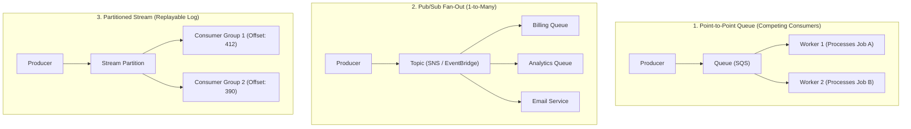
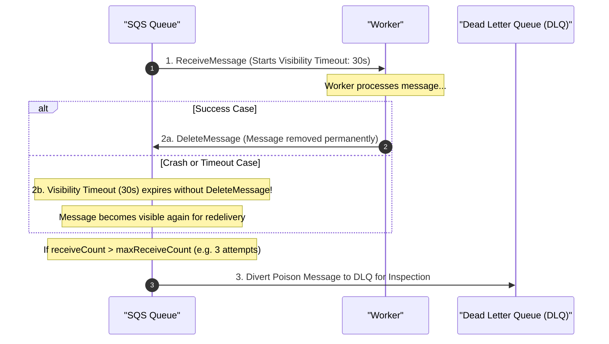
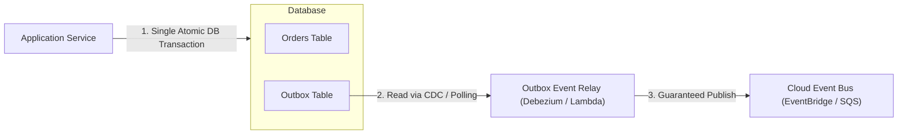

# Module 09: Messaging and Event-Driven Integration

Synchronous communication between distributed cloud services creates tight temporal coupling, cascading failures, and fragile architectures. Event-driven architectures replace synchronous RPC calls with asynchronous messaging, decoupling producers from consumers in time, space, and scale. Engineers must master message queues, pub/sub topics, streaming logs, visibility timeouts, and consumer idempotency.

## 1. Queues vs. Topics vs. Streams

Cloud messaging services provide three fundamentally different abstractions:

| Dimension | Message Queues (e.g. SQS, Azure Queues) | Pub/Sub Topics (e.g. SNS, EventBridge) | Event Streams (e.g. Kinesis, Kafka) |
| :-- | :-- | :-- | :-- |
| **Consumption Model** | Point-to-point: Competing consumers pull messages; one consumer processes each message | 1-to-many fan-out: Messages pushed to all subscribed queues/endpoints | Partitioned commit log: Multiple consumer groups read replayable offsets |
| **Message Deletion** | Destructive: Message is deleted after consumer confirms successful processing | Ephemeral: Message is discarded once delivered to active subscribers | Retained: Messages persist on disk until retention expiry (e.g. 7 days) |
| **Ordering** | FIFO queues preserve order per group ID; Standard queues do not | Not ordered across parallel subscribers | Strictly ordered per partition / shard key |
| **Backpressure** | Natural: Messages accumulate safely in the queue until workers catch up | Push: Consumers can be overwhelmed unless buffered by an intermediate queue | Offset tracking: Consumer reads at its own pace |



## 2. Delivery Semantics: The Myth of "Exactly-Once"

In distributed systems subject to network unreliability (the Two Generals' Problem), network acknowledgments can be dropped, delayed, or lost. Cloud messaging systems support three delivery models:

1. **At-Most-Once**: The message is delivered 0 or 1 time. If a failure occurs, the message is lost. Unacceptable for business transactions.
2. **At-Least-Once**: The message is guaranteed to be delivered, but in the event of dropped acknowledgments or worker crashes during visibility windows, duplicate messages will be delivered. This is the universal standard for scalable cloud queues (Standard SQS, Pub/Sub, Service Bus).
3. **The "Exactly-Once" Myth**: Distributed systems cannot guarantee end-to-end exactly-once delivery across uncoordinated third-party systems without distributed locks or transactional outboxes. High-level "exactly-once" claims in cloud systems (such as SQS FIFO) guarantee deduplication only within a narrow time window (typically 5 minutes) based on a `MessageDeduplicationId`.

## 3. Visibility Timeout, Poison Messages, and DLQs

When a worker receives a message from a queue, the message is not deleted; it enters a temporary invisible state governed by the **Visibility Timeout**.



- **Visibility Timeout Sizing**: Must be longer than the maximum anticipated processing time of a single transaction. If the timeout is set to 30 seconds but processing takes 45 seconds, a second worker will receive the exact same message while the first is still working, triggering duplicate processing.
- **Dead Letter Queue (DLQ)**: A malformed payload ("poison message") that causes consumer code to crash will repeatedly return to the queue upon timeout expiry. A DLQ isolates messages that exceed `maxReceiveCount` (e.g., 3 attempts), alerting operators without blocking the remaining queue traffic.

## 4. Consumer Idempotency and the Transactional Outbox Pattern

Because at-least-once delivery guarantees duplicate deliveries, **all message consumers must be engineered to be idempotent**.

### Implementing Consumer Idempotency

Every message must carry a unique, deterministic business identifier (e.g., `idempotencyKey = "order-create-4912"`). The consumer executes processing inside an atomic database transaction:

```
BEGIN TRANSACTION;
  -- 1. Attempt to insert the idempotency key with a UNIQUE constraint
  INSERT INTO processed_events (idempotency_key, processed_at)
  VALUES ('order-create-4912', NOW());

  -- 2. If insert succeeds (key is new), execute the business side-effect
  INSERT INTO orders (id, amount) VALUES (4912, 100.00);
COMMIT;
```

If a duplicate message arrives, the `INSERT INTO processed_events` fails with a unique constraint violation, and the consumer safely acknowledges the message without executing duplicate side effects.

### The Transactional Outbox Pattern

A classic distributed systems failure mode occurs when a service commits a local database transaction (e.g., creating an order) and then attempts to publish an event to SNS/SQS. If the network drops or the process crashes before publishing, the database has committed the state change, but the event is permanently lost.



The **Transactional Outbox Pattern** saves the outgoing event into an `outbox` table inside the exact same local database transaction as the business entity. A background relay process (e.g., Debezium CDC or an outbox worker) reads committed outbox entries and publishes them to the cloud message broker with guaranteed reliability.

## 5. Executable Proofs

The SQS visibility timeout expiration, poison message dead-letter queue routing, and consumer idempotency deduplication invariants are verified in our test suite:

| Assertion / Invariant | Implementation Mechanism | Test File Reference |
| :-- | :-- | :-- |
| **Poison Message DLQ Routing** | Diverts message to DLQ after exceeding configured `maxReceiveCount` | [`../examples/09-messaging-dlq-and-idempotency.test.ts`](../examples/09-messaging-dlq-and-idempotency.test.ts) |
| **Idempotency Deduplication** | Proves duplicate at-least-once deliveries are discarded without duplicate execution | [`../examples/09-messaging-dlq-and-idempotency.test.ts`](../examples/09-messaging-dlq-and-idempotency.test.ts) |

## 6. Then vs. Now: Messaging Paradigm Shift

- **Then**: Synchronous REST calls between monolithic microservices; point-to-point coupling; single message broker VMs running RabbitMQ without durable tiering.
- **Now**: Asynchronous event-driven architecture using managed serverless queues and event buses (EventBridge); CloudEvents JSON schemas; transactional outbox pattern with CDC.

## 7. Provider Mapping Matrix

| Concept | AWS | Google Cloud | Microsoft Azure | Cloudflare |
| :-- | :-- | :-- | :-- | :-- |
| **Message Queue** | Amazon SQS | Cloud Tasks / Pub/Sub | Azure Queue Storage / Service Bus | Cloudflare Queues |
| **Pub/Sub Topic** | Amazon SNS | Cloud Pub/Sub | Azure Service Bus Topics | Cloudflare Queues |
| **Event Bus** | Amazon EventBridge | Eventarc | Azure Event Grid | Cloudflare Workers |
| **Event Streaming** | Amazon Kinesis Data Streams | Cloud Pub/Sub (ordered) | Azure Event Hubs | Workers Analytics Engine |
| **Dead Letter Queue** | SQS DLQ | Pub/Sub Dead Letter Topic | Service Bus DLQ | Queues Dead Letter Target |

---

## Interview Drill

<details><summary>1. Why is an SQS Visibility Timeout shorter than the application processing time dangerous?</summary>

The visibility timeout hides a dequeued message from other competing workers while the current worker processes it. If a transaction takes 45 seconds to complete but the visibility timeout is set to 30 seconds, the message becomes visible again in the queue at the 30-second mark. A second worker dequeues the same message and begins processing it concurrently, resulting in duplicate processing, race conditions, and wasted compute resources.
</details>

<details><summary>2. Explain why true "exactly-once" delivery cannot exist in distributed cloud networks without consumer idempotency.</summary>

In distributed systems, the network is inherently unreliable. When a message broker delivers a message to a worker and the worker completes the task, it sends an acknowledgment back to the broker. If a network packet drop or timeout occurs before the acknowledgment reaches the broker, the broker must assume the worker failed and redelivers the message to ensure at-least-once delivery. Therefore, duplicate receipts are inevitable; "exactly-once" processing semantics can be achieved only if the consumer application enforces idempotency by recording transaction keys.
</details>

<details><summary>3. What problem does the Transactional Outbox Pattern solve in microservices?</summary>

It eliminates the "dual-write" failure mode. If a service writes to an application database and then publishes an event to SQS in two separate network calls, a process crash or network drop between the two operations leaves the system in an inconsistent state: the database state committed, but downstream services were never notified. The outbox pattern writes both the business entity and the outgoing event into the same local database transaction. A separate relay process reads the outbox table and guarantees publication to the message broker.
</details>

<details><summary>4. What is a "poison message" in a queue, and how does a Dead Letter Queue (DLQ) protect the system?</summary>

A poison message is a malformed or corrupted message that triggers an unhandled exception or crash in consumer code every time it is read. Without a DLQ, the message returns to the queue upon visibility timeout expiry and is repeatedly picked up by workers, thrashing CPU resources and blocking other legitimate messages. A DLQ tracks `receiveCount`; when attempts exceed a configured threshold, the message is automatically moved to the DLQ, unblocking the main queue and alerting engineers for inspection.
</details>

<details><summary>5. How does a Pub/Sub Topic differ from a Message Queue in terms of consumer topology?</summary>

A message queue implements a point-to-point competing consumer pattern: multiple workers listen to the same queue, but each individual message is processed by exactly one worker. A Pub/Sub topic implements a one-to-many fan-out pattern: when a message is published to a topic, a copy of the message is fanned out and pushed to all active subscribers (e.g., multiple independent queues belonging to billing, notifications, and analytics services).
</details>
