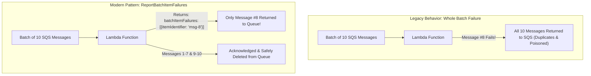
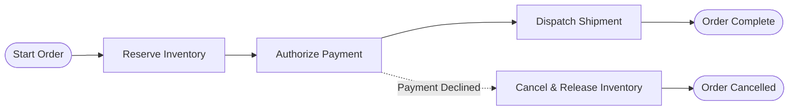
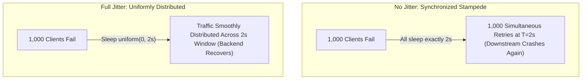

# Module 10: Serverless and Durable Workflows

As cloud applications transition from monolithic architectures to fine-grained microservices, managing complex, multi-step business transactions becomes challenging. Individual Lambda functions or microservices cannot hold state across hours or days. Serverless orchestrators and durable workflow engines provide deterministic state machines, automated retries, and distributed saga compensation patterns to coordinate multi-service business logic.

## 1. Event Source Mappings and Partial-Batch Failures

In serverless architectures, event source mappings (ESM) poll message queues or streams (such as Amazon SQS, Kinesis, or DynamoDB Streams) and invoke functions with a batch of records (e.g., 10 messages per invocation).

### The Entire-Batch Poisoning Trap

Historically, if a Lambda function processed a batch of 10 messages and the 8th message threw an unhandled exception, the entire Lambda invocation failed. The ESM assumed all 10 messages failed and returned all 10 back to the queue. Messages 1 through 7 (which had already executed side effects) were reprocessed, causing duplicate operations, while the 8th message continued to poison the batch.



### The Solution: `ReportBatchItemFailures`

Modern serverless architectures configure `ReportBatchItemFailures` in the ESM. When an individual record fails, the function returns a response object listing the specific message ID:

```json
{
  "batchItemFailures": [{ "itemIdentifier": "msg-8-uuid" }]
}
```

The ESM deletes the successfully processed messages from the queue and leaves only message #8 for redelivery, preventing duplicate executions and batch poisoning.

## 2. Durable State Machines vs. Point-to-Point Choreography

When coordinating a multi-step business process (such as user onboarding or loan approval), systems employ two patterns:

| Pattern | Mechanism | Strengths | Pitfalls |
| :-- | :-- | :-- | :-- |
| **Choreography** | Microservices emit events to a pub/sub topic; downstream services listen and react independently | Highly decoupled, decentralized ownership | "Pinball machine" architecture; no central visibility into workflow state; difficult to debug |
| **Orchestration** | A centralized state machine (AWS Step Functions, Google Cloud Workflows, Azure Durable Functions) directs each step explicitly | Visual state visibility, deterministic timeouts, centralized error handling and saga rollbacks | Orchestrator creates a central point of definition |



## 3. The Distributed Saga Pattern: Compensating Transactions

A distributed saga manages transactions across multiple microservices without distributed two-phase commit (2PC) locks. A saga executes a sequence of local transactions: each transaction updates the service's local database and publishes an event. If a local transaction fails, the saga orchestrator executes **compensating transactions** in reverse order to logically undo earlier changes.

### Saga Execution Mechanics

1. **Forward Transactions**:
   - Step 1: `ReserveInventory()` $\to$ Success (Inventory locked).
   - Step 2: `ChargeCard()` $\to$ Success (Customer card billed).
   - Step 3: `BookCourier()` $\to$ **FAILED!** (Courier API returns out of capacity).
2. **Reverse Compensating Transactions**:
   - The orchestrator catches the Step 3 failure.
   - Compensation 1: `RefundCard()` $\to$ Reverses Step 2.
   - Compensation 2: `ReleaseInventory()` $\to$ Reverses Step 1.
   - Workflow finishes in an `Aborted` state with data consistency maintained.

## 4. Retries, Timeouts, and Exponential Backoff with Jitter

When calling external dependencies or serverless APIs, transient network drops and database lock contentions occur. However, uncoordinated retries lead to catastrophic **retry storms**.

### Exponential Backoff Equation

$$\text{Sleep Interval} = \min\left(\text{MaxInterval}, \text{BaseInterval} \times 2^{\text{attempt}}\right)$$

### Full Jitter Randomization

If 1,000 clients fail simultaneously at $T = 0$, pure exponential backoff causes all 1,000 clients to retry in synchronized lockstep waves at $T = 1\text{s}$, $T = 2\text{s}$, $T = 4\text{s}$, knocking the recovering service offline repeatedly.



The mathematical remedy is **Full Jitter**:

$$\text{Sleep Interval} = \text{random}\left(0, \min\left(\text{MaxInterval}, \text{BaseInterval} \times 2^{\text{attempt}}\right)\right)$$

Full jitter uniformly distributes retries across the time window, flattening traffic spikes and allowing recovering services to heal.

## 5. Executable Proofs

The reverse compensating transaction execution order and exponential backoff jitter bounds are verified in our test suite:

| Assertion / Invariant | Implementation Mechanism | Test File Reference |
| :-- | :-- | :-- |
| **Saga Reverse Compensation** | Executes compensating transactions in strict reverse order of completed forward steps | [`../examples/10-saga-workflows-and-retry-storms.test.ts`](../examples/10-saga-workflows-and-retry-storms.test.ts) |
| **Exponential Backoff Jitter** | Proves randomized jitter flattens retry bursts within exponential bounds | [`../examples/10-saga-workflows-and-retry-storms.test.ts`](../examples/10-saga-workflows-and-retry-storms.test.ts) |

## 6. Then vs. Now: Workflow Paradigm Shift

- **Then**: Brittle two-phase commit (2PC) distributed locks across relational databases; custom polling scripts on cron VMs; whole-batch queue failure cascades.
- **Now**: Declarative state machines with visual orchestration (Step Functions / Workflows); partial-batch item failure reporting; distributed Sagas with automated reverse compensation.

## 7. Provider Mapping Matrix

| Concept | AWS | Google Cloud | Microsoft Azure | Cloudflare |
| :-- | :-- | :-- | :-- | :-- |
| **Orchestrator** | AWS Step Functions | Google Cloud Workflows | Azure Durable Functions, Logic Apps | Cloudflare Workflows |
| **Partial Batch Handling** | `ReportBatchItemFailures` (SQS ESM) | Pub/Sub single-ack API | Service Bus dead-lettering per message | Cloudflare Queues batch ack |
| **Long-Running Workflows** | Step Functions Standard Workflows (up to 1 year) | Cloud Workflows (up to 1 year) | Durable Functions (Indefinite) | Cloudflare Workflows (Durable) |
| **Event-Driven Compute** | AWS Lambda | Cloud Run functions | Azure Functions | Cloudflare Workers |

---

## Interview Drill

<details><summary>1. How does `ReportBatchItemFailures` prevent duplicate message processing when consuming SQS queues with Lambda?</summary>

Without `ReportBatchItemFailures`, throwing an exception during the processing of a single message causes the entire batch (e.g., 10 messages) to fail. The event source mapping marks all 10 messages as unacknowledged and returns them to the queue. When redelivered, the 9 previously successful messages are executed again, causing duplicate operations. With `ReportBatchItemFailures`, the function returns an array containing only the failed message ID. The event source mapping deletes the 9 successful messages from the queue and leaves only the single failed message for redelivery.
</details>

<details><summary>2. Explain the difference between Orchestration and Choreography in distributed sagas.</summary>

In Choreography, services communicate asynchronously via pub/sub events without a central coordinator: Service A completes an action and emits an event, which triggers Service B. This offers high decoupling, but makes tracking overall business state difficult. In Orchestration, a dedicated state machine (such as AWS Step Functions) explicitly commands each service to execute, waits for response payloads, handles branching logic, and directly triggers compensating transactions in reverse order if a step fails.
</details>

<details><summary>3. Why is "Full Jitter" superior to plain exponential backoff in mitigating retry storms?</summary>

Plain exponential backoff increases the delay exponentially ($1\text{s}, 2\text{s}, 4\text{s}, 8\text{s}$), but all failed clients that crashed at the same time will calculate the exact same delay. Consequently, clients retry in synchronized stampedes, repeatedly overwhelming the recovering dependency. Full Jitter randomizes the backoff interval uniformly between $0$ and the exponential ceiling ($\text{random}(0, \text{backoff})$). This flattens the retry curve into a smooth, continuous stream of requests, giving the recovering backend headroom to heal.
</details>

<details><summary>4. What is a Compensating Transaction in the Saga pattern, and why can it not simply rely on database ROLLBACK?</summary>

In a distributed microservice architecture, each service has its own independent database; there is no global distributed transaction coordinator or shared ACID boundary. Once Service A commits its local transaction to disk (e.g., reserving hotel inventory), that commit cannot be undone with a SQL `ROLLBACK` after the connection has closed. A compensating transaction is an explicit business operation (e.g., `cancelHotelReservation()`) that logically reverses the observable side effects of the earlier committed action.
</details>

<details><summary>5. When should Step Functions Standard Workflows be chosen over Express Workflows?</summary>

Standard Workflows should be chosen for long-running processes (up to 1 year), workflows requiring human-in-the-loop approvals, processes needing exactly-once task execution, or where a full visual audit history of every state transition is mandatory. Express Workflows should be chosen for high-volume, short-duration event-processing workloads (up to 5 minutes) that handle thousands of events per second at lower cost with at-least-once execution semantics.
</details>
