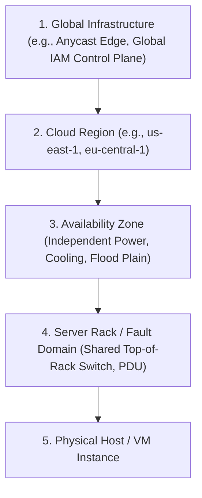
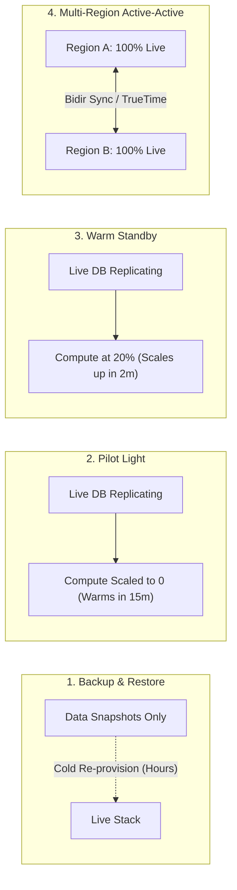
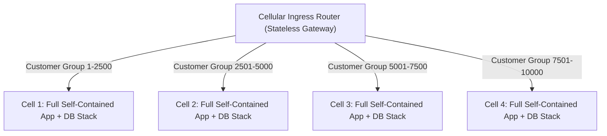
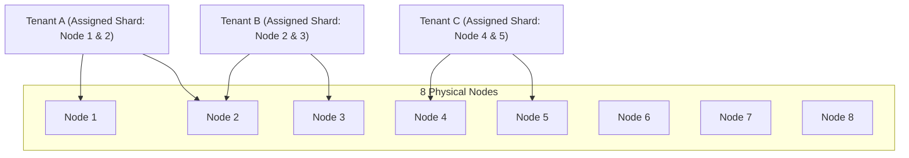

# Module 11: Resilience, Disaster Recovery and Multi-Region

Designing resilient distributed cloud applications requires assuming that every component will eventually fail. High availability is achieved not by preventing hardware malfunctions, but by engineering software architectures that compartmentalize failures, contain blast radiuses, and survive Availability Zone and regional catastrophes.

## 1. Hierarchy of Failure Domains

A **failure domain** is a set of physical or logical resources that share common failure modes (such as a shared power supply, physical network switch, hypervisor, or control-plane software release).

### The Single-Region Control Plane Trap

A critical disaster recovery mistake is assuming that a multi-region deployment is automatically immune to single-region outages.

- **Example**: In AWS, certain global services have their write-path control plane hosted in a specific region (e.g., IAM role and policy updates, Route 53 hosted zone modifications, and ACM certificate issuances have their primary write control plane in `us-east-1`).
- **Architectural Axiom**: If your secondary disaster recovery region requires making IAM policy calls or creating Route 53 records to complete a failover, a failure in `us-east-1` will paralyze your disaster recovery failover in `eu-west-1`. Statically stable architectures pre-replicate all IAM roles, KMS keys, and infrastructure to the secondary region in advance.

## 2. Disaster Recovery (DR) Strategies

Disaster recovery architectures trade cost against Recovery Point Objective (RPO) and Recovery Time Objective (RTO):

| Strategy | RTO (Time to Recover) | RPO (Data Loss Window) | Relative Cost | Operational Mechanics |
| :-- | :-- | :-- | :-- | :-- |
| **Backup & Restore** | Hours to Days | Hours (Last Snapshot) | $\$$ (Lowest) | Nightly or hourly snapshots replicated to cold storage in Region B; IaC re-provisions compute upon disaster declaration. |
| **Pilot Light** | 10 to 60 Minutes | Minutes (Replication Lag) | $\$ \$$ | Critical databases replicate continuously to Region B; minimal core infrastructure provisioned; compute fleet is scaled to zero. |
| **Warm Standby** | 2 to 10 Minutes | Seconds to Minutes | $\$ \$ \$$ | A scaled-down functional copy of the entire application stack runs 24/7 in Region B; autoscales to full capacity on failover. |
| **Multi-Region Active-Active** | Near Zero ($< 30\text{ s}$) | Near Zero / Zero | $\$ \$ \$ \$$ (Highest) | Full production capacity serves live traffic simultaneously across both regions; requests routed dynamically via Anycast or latency DNS. |

## 3. Cell-Based Architecture

As a distributed platform grows, a single monolithic cluster—even when spread across multiple AZs—suffers from an expanding blast radius: a single bad deployment, corrupted database transaction, or runaway query can bring down the entire global system.

A **Cell-Based Architecture** partitions the platform into multiple completely independent, self-contained units called **Cells**.

### Invariants of Cell Design

- **No Shared Stateful Resources**: Cells do not share relational databases, caches, or message queues. If Cell 2's database suffers deadlock corruption, Cells 1, 3, and 4 experience zero degradation.
- **Hard Maximum Cell Size**: Cells are never allowed to grow beyond a fixed threshold (e.g., 2,500 active tenants). When business demand expands, engineers deploy a new Cell 5 rather than enlarging existing cells.
- **Cellular Ingress Router**: A lightweight, statically stable routing layer inspects the tenant ID in the incoming request and routes it to the designated cell.

## 4. Shuffle Sharding: Mathematical Blast Radius Containment

**Shuffle Sharding** is an advanced virtual partitioning technique that assigns each customer a deterministic subset of physical nodes from a shared pool, exponentially multiplying fault isolation domains without adding physical hardware.

### The Combinatorial Math

Suppose an organization runs a shared cluster of $N = 8$ physical worker nodes. Instead of giving every tenant access to all 8 nodes, each tenant is assigned a unique shard of $K = 2$ nodes:

$$\text{Total Virtual Shards} = \binom{N}{K} = \frac{N!}{K!(N - K)!} = \frac{8!}{2!(6!)} = \frac{56}{2} = 28\text{ Unique Shards}$$

### The Poison Pill Scenario

If Tenant A submits a malicious "poison pill" request that crashes worker nodes:

1. Tenant A crashes Node 1 and Node 2.
2. Tenant C (assigned Nodes 4 and 5) experiences zero degradation.
3. Tenant B (assigned Nodes 2 and 3) loses Node 2, but Node 3 remains completely operational and processes Tenant B's requests.
4. **Impact Probability**: Only tenants that were assigned the _exact same pair_ (Node 1 and Node 2) are knocked offline. The probability of an innocent tenant sharing that exact pair is:

$$P(\text{Impact}) = \frac{1}{\binom{8}{2}} = \frac{1}{28} \approx 3.57\%$$

Increasing the cluster to $N = 100$ and $K = 5$ yields $\binom{100}{5} = 75,287,520$ virtual shards, reducing the overlap probability to near zero ($1.3 \times 10^{-8}$).

## 5. Chaos Engineering and Controlled Fault Injection

High availability cannot be proven on paper; it must be verified empirically under simulated production stress using **Chaos Engineering** (e.g., AWS Fault Injection Service, Azure Chaos Studio, Chaos Mesh).

- **AZ Severing**: Injecting network latency and dropping packets between Availability Zone A and Availability Zone B to verify database failover.
- **CPU and Memory Stress**: Artificially spiking instance CPU to 100% to test whether autoscaling and load shed policies trigger correctly.
- **Process Termination**: Abruptly terminating primary database nodes without warning to verify that applications reconnect without human intervention.

## 6. Executable Proofs

The shuffle sharding combinatorial calculations, deterministic customer node assignment, and cell isolation blast radius bounds are verified in our test suite:

| Assertion / Invariant | Implementation Mechanism | Test File Reference |
| :-- | :-- | :-- |
| **Shuffle Sharding Blast Radius** | Proves $\binom{8}{2} = 28$ shards limit poison pill impact to $3.57\%$ of tenants | [`../examples/11-cell-architecture-and-shuffle-sharding.test.ts`](../examples/11-cell-architecture-and-shuffle-sharding.test.ts) |
| **Cellular Isolation Boundary** | Proves complete failure of Cell A leaves Cell B 100% operational | [`../examples/11-cell-architecture-and-shuffle-sharding.test.ts`](../examples/11-cell-architecture-and-shuffle-sharding.test.ts) |

## 7. Then vs. Now: Resilience Paradigm Shift

- **Then**: Single monolithic datacenter with disaster recovery manuals; manual DNS failover flipping during outages; hoping systems recover under stress.
- **Now**: Multi-region cell-based architectures; mathematical blast radius reduction via shuffle sharding; automated chaos engineering (FIS) continuously proving failover resilience in CI/CD.

## 8. Provider Mapping Matrix

| Concept | AWS | Google Cloud | Microsoft Azure | Cloudflare |
| :-- | :-- | :-- | :-- | :-- |
| **Disaster Recovery Routing** | Route 53 ARC / Route 53 Failover | Cloud DNS Routing Policies | Azure Traffic Manager / Front Door | Cloudflare Load Balancing |
| **Chaos Engineering** | AWS Fault Injection Service (FIS) | Google Cloud Chaos Testing Tools | Azure Chaos Studio | Cloudflare Chaos Testing |
| **Cell Routing** | CloudFront + Lambda@Edge / ALB | Global External Application LB | Azure Front Door / App Gateway | Cloudflare Workers Router |
| **Multi-Region Database** | DynamoDB Global Tables, Aurora Global | Cloud Spanner, Bigtable Multi-Region | Azure Cosmos DB Multi-Region | Cloudflare D1 Global Replicas |

---

## Interview Drill

1. How does Shuffle Sharding reduce the blast radius of a "poison pill" tenant compared to standard round-robin load balancing?

In standard round-robin load balancing across 8 nodes, a poison pill tenant that crashes every node it touches will eventually be routed to all 8 nodes, knocking the entire cluster offline and impacting 100% of tenants. In shuffle sharding with a shard size of 2, the tenant is restricted to a deterministic combination of 2 nodes ($\binom{8}{2} = 28$ possible virtual shards). When the poison pill crashes its 2 assigned nodes, only customers assigned to that exact same combination are affected ($1/28 \approx 3.57\%$). The remaining 6 nodes continue serving the other 96.4% of tenants with zero disruption.

2. Why can relying on control-plane API calls during a disaster recovery failover cause secondary failover collapse?

During a major Availability Zone or regional incident, thousands of cloud customers experience failures simultaneously. If a disaster recovery plan requires calling control-plane APIs (e.g., creating 50 new EC2 instances, provisioning new EBS volumes, or modifying IAM policies), these APIs face massive rate-limiting (throttling) and backend capacity exhaustion. Statically stable architectures pre-provision standby compute and pre-configure IAM policies and DNS routing controls in advance, ensuring that failovers operate purely on the data plane without issuing a single control-plane API call.

3. Contrast the Pilot Light disaster recovery strategy with the Warm Standby strategy in terms of cost and RTO.

In a Pilot Light strategy, critical database state is continuously replicated to the secondary region, but the application compute fleet is scaled to zero (idle). It has low ongoing infrastructure costs, but has an RTO of 15–45 minutes because virtual machines or container clusters must be spun up and booted before traffic can be served. In a Warm Standby strategy, a scaled-down but fully functional version of the entire application fleet runs 24/7 in the secondary region. It costs more, but achieves an RTO of 2–5 minutes because the fleet is already warm and only needs to autoscale upward to handle the incoming load.

4. What is a Cell-Based Architecture, and why does it set a hard ceiling on maximum cell size?

A Cell-Based Architecture breaks a large distributed system into independent, self-contained, isolated mini-stacks (cells), each containing its own web, compute, and database resources without cross-cell state dependencies. It sets a hard maximum cell size (e.g., 2,500 tenants) to permanently cap the maximum possible blast radius of any bug, operational error, or database corruption. When the business expands, instead of scaling existing cells into complex, fragile monoliths, engineers provision additional independent cells.

5. What is Chaos Engineering, and why should it be executed in production environments?

Chaos Engineering is the discipline of experimenting on a system to build confidence in the system's capability to withstand turbulent conditions in production. It proactively injects controlled failures (such as killing database instances, severing network connections between AZs, or adding synthetic latency) into staging and production. It is executed in production because staging environments rarely replicate real-world production traffic volumes, network topologies, third-party latencies, and data distributions.

