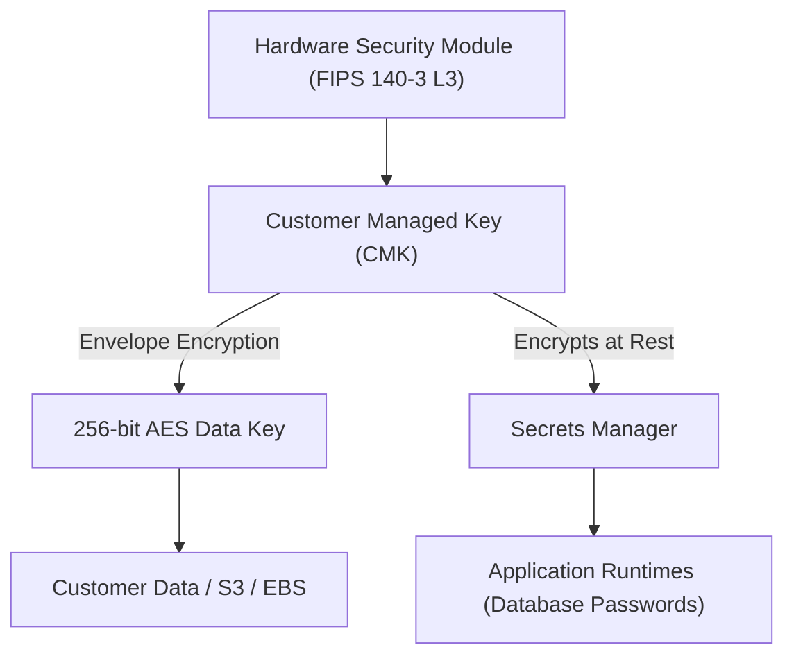
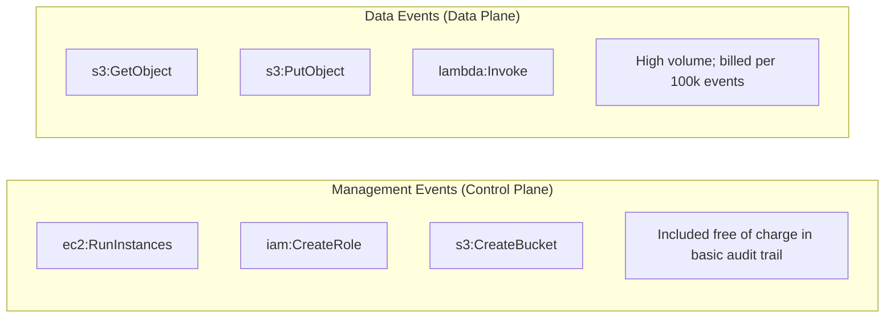
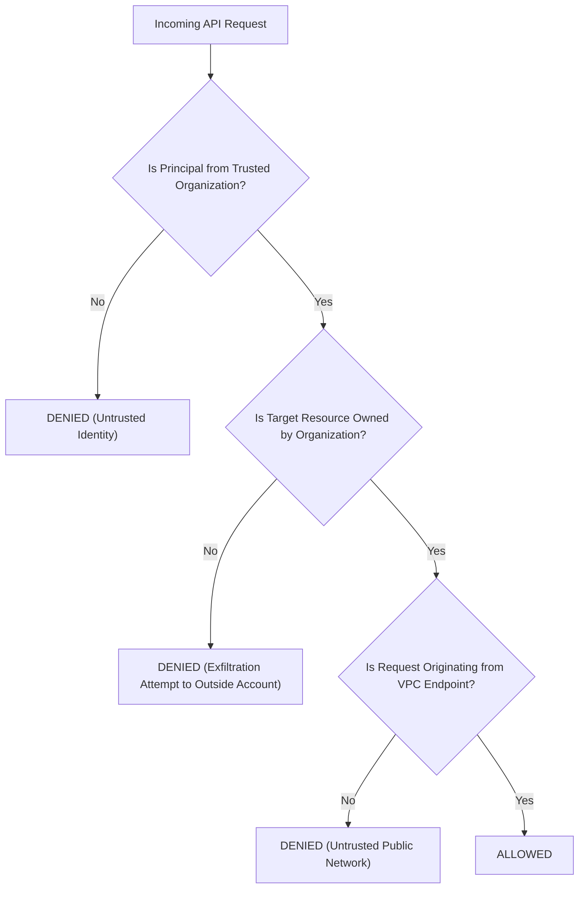
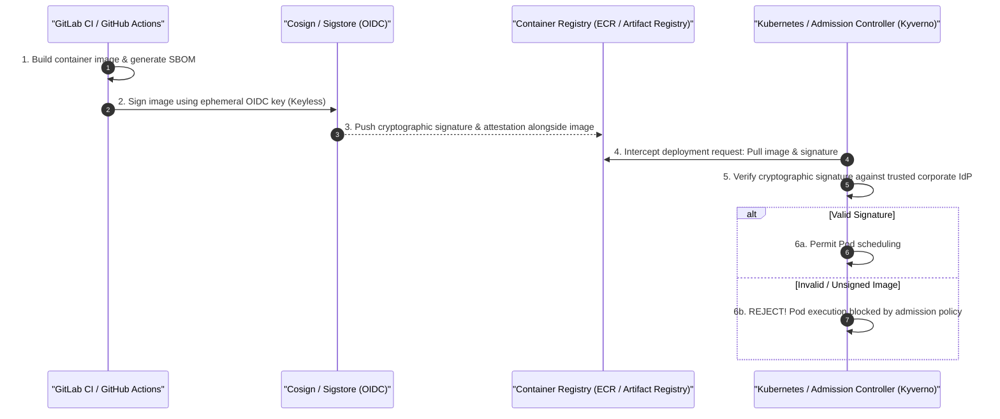

# Module 12: Security Posture and Compliance

Securing cloud environments requires a defense-in-depth model that integrates cryptographic key management, immutable audit logging, continuous posture scanning, policy-as-code guardrails, and cryptographic software supply-chain integrity.

## 1. KMS Key Hierarchies and Secrets Management

Modern cloud cryptography enforces a strict separation between Key Management Services (KMS) and Secrets Managers:

| Component | Primary Purpose | Cryptographic Mechanism | Data Stored |
| :-- | :-- | :-- | :-- |
| **Key Management Service (KMS)** | Generating, rotating, and managing cryptographic root keys | Hardware Security Modules (FIPS 140-2/3 Level 3 validated HSMs) | Cryptographic keys only; never stores arbitrary passwords or strings |
| **Secrets Manager** | Storing, retrieving, and automatically rotating arbitrary secrets | Encrypted with KMS at rest; integrated with RDS/databases for password rotation | Database passwords, third-party API tokens, OAuth client secrets, TLS certificates |



### Key Types and Rotation

- **AWS / Provider Managed Keys**: Default keys managed by the provider (e.g., `aws/s3`). Free of charge, but permissions cannot be customized, and they cannot be shared across cloud accounts.
- **Customer Managed Keys (CMKs)**: Created and controlled by the organization. Allows granular key policies, cross-account sharing, and automated annual rotation. When a CMK is rotated, KMS preserves the prior key material to decrypt historical ciphertext while using the new key version for all subsequent encrypt operations.

## 2. Audit Trails: Management Events vs. Data Events

Audit trails provide forensic proof of who executed what action, against which resource, from what IP address, and at what timestamp.



- **Management Events (Control Plane)**: Record administrative mutations (e.g., creating a VPC, attaching an IAM policy, launching an EC2 instance). These are captured by default across the entire account.
- **Data Events (Data Plane)**: Record high-frequency payload operations on resources (e.g., reading an individual object via `s3:GetObject` or invoking a Lambda function). Because data plane traffic can generate billions of operations per day, logging data events incurs significant ingestion and storage costs. Data events should be enabled selectively on compliance-sensitive buckets rather than globally.

## 3. Cloud Security Posture Management (CSPM) and Data Perimeters

A **Cloud Security Posture Management (CSPM)** engine (such as AWS Security Hub, Google Cloud Security Command Center, or Microsoft Defender for Cloud) continuously scans all provisioned infrastructure against established benchmarks (CIS Benchmarks, NIST 800-53, PCI-DSS).

### Data Perimeter Architecture

A **Data Perimeter** is an architectural boundary that guarantees:

1. **Trusted Identities**: Only identities belonging to the organization can access data.
2. **Trusted Resources**: Company identities can access only resources owned by the company (preventing data exfiltration to external personal accounts).
3. **Trusted Networks**: Resources can be accessed only from trusted corporate VPCs or corporate IP ranges.



## 4. Policy-as-Code: OPA/Rego and Terraform Policy

Relying on human code reviews to catch security mistakes in Terraform or Kubernetes manifests is prone to errors. **Policy-as-Code** evaluates Infrastructure-as-Code (IaC) plans deterministically inside CI/CD pipelines before resources are provisioned.

### Open Policy Agent (OPA) / Rego Example

The following declarative Rego rule blocks any S3 bucket configured with public read access:

```rego
package cloud.security

default allow = true

deny[msg] {
    resource := input.resource_changes[_]
    resource.type == "aws_s3_bucket"
    resource.change.after.acl == "public-read"
    msg := sprintf("Security Violation: Bucket '%v' must not have public-read ACL!", [resource.name])
}

allow = false {
    count(deny) > 0
}
```

If an engineer opens a pull request containing `acl = "public-read"`, `opa test` fails with a non-zero exit code, blocking the merge gate automatically.

## 5. Software Supply Chain Security: Image Signing and SLSA

Deploying untrusted third-party container images directly into production Kubernetes or ECS clusters exposes workloads to malware injection and supply-chain compromises.



- **Container Image Signing (Cosign / Sigstore)**: Cryptographically binds container digest hashes to corporate CI/CD identities using keyless OIDC signing.
- **Admission Controllers (Kyverno / OPA Gatekeeper)**: Enforces that cluster nodes reject any container image lacking a valid cryptographic signature from the trusted CI pipeline.

## 6. Executable Proofs

The policy-as-code guardrails blocking public S3 buckets and open SSH ingress on port 22 are verified in our test suite:

| Assertion / Invariant | Implementation Mechanism | Test File Reference |
| :-- | :-- | :-- |
| **Public Object Storage Prevention** | Policy rule engine rejects `public-read` bucket definitions | [`../examples/12-policy-as-code-and-guardrails.test.ts`](../examples/12-policy-as-code-and-guardrails.test.ts) |
| **Open Port 22 Ingress Denial** | Policy rule engine rejects security group rules allowing `0.0.0.0/0:22` | [`../examples/12-policy-as-code-and-guardrails.test.ts`](../examples/12-policy-as-code-and-guardrails.test.ts) |

## 7. Then vs. Now: Security Paradigm Shift

- **Then**: Manual perimeter firewalls; static credentials stored in text files; manual security audits once a year; deploying untrusted container images without provenance.
- **Now**: Data perimeter architecture; hardware-backed KMS envelope encryption; policy-as-code evaluation on every pull request; cryptographically signed container supply chains (Sigstore/SLSA).

## 8. Provider Mapping Matrix

| Concept | AWS | Google Cloud | Microsoft Azure | Cloudflare |
| :-- | :-- | :-- | :-- | :-- |
| **Audit Trails** | AWS CloudTrail | Google Cloud Audit Logs | Azure Activity Log / Monitor | Workers Logs / Audit Logs |
| **KMS Service** | AWS KMS | Cloud KMS | Azure Key Vault | Secrets Store |
| **CSPM Scanner** | AWS Security Hub | Security Command Center (SCC) | Microsoft Defender for Cloud | Cloudflare Security Center |
| **Data Perimeter** | Resource Control Policies (RCP) | VPC Service Controls | Service Endpoints / Private Link | Zero Trust Network Access |
| **Policy-as-Code** | Terraform Policy / OPA | Google Cloud Policy Controller | Azure Policy (Bicep/ARM) | Wrangler Config Validation |

---

## Interview Drill

<details><summary>1. What is the difference between a Key Management Service (KMS) and a Secrets Manager?</summary>

A Key Management Service (KMS) manages the lifecycle of cryptographic root keys (generation, rotation, and authorization) backed by FIPS-validated Hardware Security Modules (HSMs). KMS never stores arbitrary plaintext secrets; it executes cryptographic operations (encrypt, decrypt, sign, verify). A Secrets Manager stores and retrieves arbitrary sensitive strings (such as database passwords, API tokens, and TLS private keys), encrypting them at rest with a KMS key and providing automated rotation scripts.
</details>

<details><summary>2. Why are CloudTrail Data Events not enabled by default across all S3 buckets in an AWS account?</summary>

Management events record control plane actions (e.g., creating a bucket, updating IAM policies) and are included by default. Data events record data plane operations (e.g., `s3:GetObject`, `s3:PutObject`, `lambda:Invoke`). In high-throughput architectures, data plane operations can reach billions of requests per day. Logging every single object read and write generates massive ingestion and storage bills ($0.10 per 100,000 events in CloudTrail). Therefore, data events must be enabled selectively on compliance-critical buckets.
</details>

<details><summary>3. What is a "Data Perimeter" in cloud security architecture?</summary>

A Data Perimeter is a set of overarching guardrails (implemented via SCPs, Resource Control Policies, VPC endpoint policies, and network firewalls) that enforces three rules: (1) Only trusted identities (company employees and IAM roles) can access data; (2) Trusted identities can access only trusted resources (preventing employees from copying data to external personal AWS accounts); (3) Data can be accessed only from trusted network locations (corporate VPCs or VPNs).
</details>

<details><summary>4. How does Policy-as-Code (such as OPA/Rego) improve security compared to detective cloud scanners?</summary>

Detective cloud scanners (like AWS Config or Azure Policy Audit) evaluate resources _after_ deployment. If an engineer applies an insecure configuration (e.g., opening port 22 to `0.0.0.0/0`), the resource is live on the public internet for several minutes before the scanner detects it and alerts security. Policy-as-Code evaluates the declarative IaC plan (e.g., `terraform plan -out=plan.json`) inside the CI/CD pipeline _before_ deployment, rejecting non-compliant configurations with a failed build so the vulnerable resource is never provisioned.
</details>

<details><summary>5. Explain how keyless container image signing (Cosign / Sigstore) protects Kubernetes production clusters.</summary>

Keyless signing uses OpenID Connect (OIDC) to authenticate the CI/CD runner. When the pipeline builds an image, it requests an ephemeral cryptographic certificate tied to the repository and branch name from a public/private Sigstore CA (Fulcio), signs the image digest, and publishes the signature to an immutable transparency log (Rekor). When Kubernetes schedules the pod, an admission controller (e.g., Kyverno) intercepts the request and verifies that the image carries a cryptographic signature from the verified CI/CD identity. Unsigned or modified images are immediately rejected.
</details>
