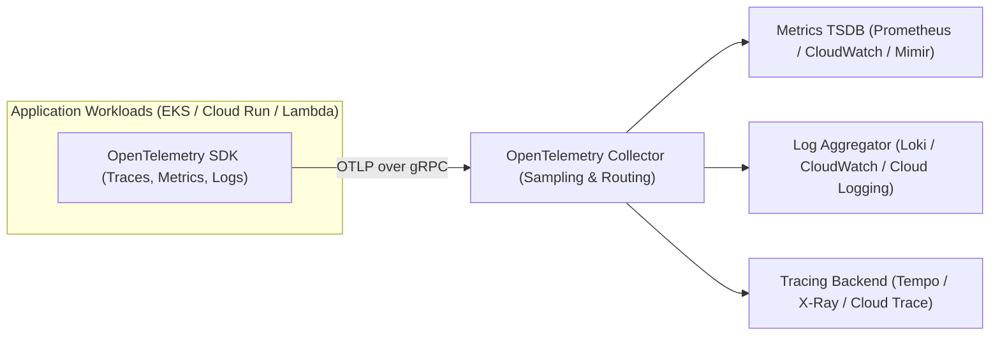
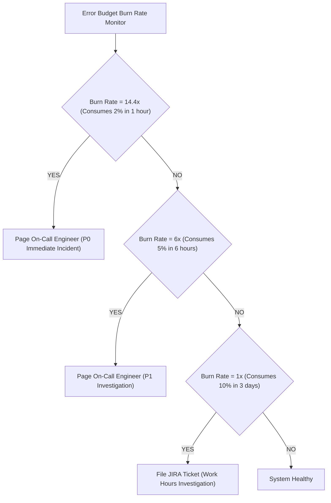
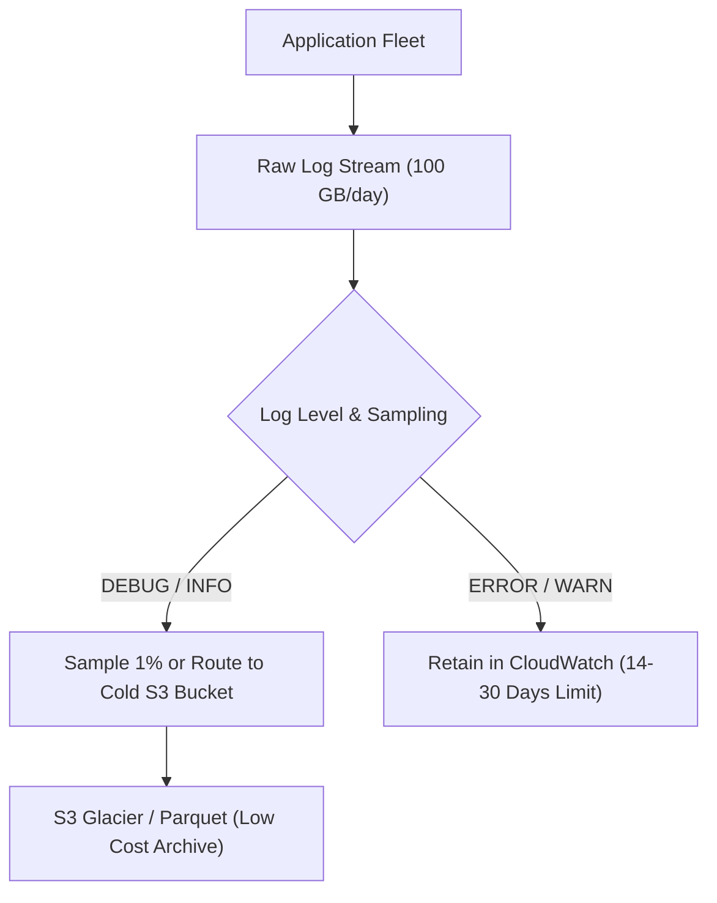

# Module 13: Observability and Operations

Operating enterprise cloud applications requires comprehensive visibility into internal system state based on external telemetry signals. Engineers must design telemetry pipelines that collect metrics, structured logs, and distributed traces without incurring runaway ingestion costs. Site Reliability Engineering (SRE) principles—specifically Service Level Objectives (SLOs), error budgets, and multi-burn-rate alerting—provide the operational discipline required to balance deployment velocity against system reliability.

## 1. The Three Telemetry Signals in Multi-Cloud

Cloud telemetry relies on three complementary signals:

| Telemetry Signal | Data Structure | Ingestion Volume | Primary Operational Use Case |
| :-- | :-- | :-- | :-- |
| **Metrics** | Numeric time series: `(timestamp, value, label_set)` | Low to Moderate (predictable cost) | Real-time alerting, dashboards, autoscaling triggers, SLI calculation |
| **Logs** | Structured JSON events: `(timestamp, level, message, metadata)` | High (linear with user traffic) | Forensic debugging, audit compliance, root-cause error analysis |
| **Distributed Traces** | Directed acyclic graphs of Spans: `(trace_id, span_id, duration, baggage)` | High (requires sampling) | Latency breakdown across microservices, identifying bottleneck RPC calls |

## 2. Service Level Objectives (SLOs) and Error Budgets

SRE governance defines operational reliability mathematically:

1. **Service Level Indicator (SLI)**: A quantifiable metric representing user satisfaction (e.g., the proportion of successful HTTP requests).

$$\text{SLI} = \frac{\text{Good Requests (HTTP Status } < 500 \text{ and Latency } \le 200\text{ms})}{\text{Total Valid Requests}}$$

2. **Service Level Objective (SLO)**: The target reliability percentage committed over an evaluation window (e.g., $99.9\%$ over a 30-day rolling window).
3. **Error Budget**: The allowable room for unreliability:

$$\text{Error Budget} = 1.0 - \text{SLO} = 1.0 - 0.999 = 0.001\text{ (or } 0.1\%\text{)}$$

If an application handles $10,000,000$ requests over 30 days, an SLO of $99.9\%$ permits up to $10,000$ failed requests. The error budget is a shared currency between product and engineering: while the budget is positive, teams ship new features rapidly. When the error budget is exhausted, feature deployments are paused to focus exclusively on stability engineering.

## 3. Multi-Window Multi-Burn-Rate Alerting

Traditional threshold alerting (e.g., alert if CPU > 80% or error rate > 1% for 5 minutes) creates alert fatigue and fails to distinguish between catastrophic outages and minor transient spikes.

The Google SRE framework mandates **Multi-Window Multi-Burn-Rate Alerting**:

- **Burn Rate 1**: Consumes 100% of the error budget over exactly the 30-day window (steady-state).
- **Burn Rate 14.4**: Consumes 2% of the total monthly error budget in only 1 hour. This indicates a major production disruption requiring immediate engineer paging.
- **Burn Rate 6**: Consumes 5% of the budget in 6 hours, requiring daytime engineer investigation.
- **Dual Window Requirement**: An alert fires only if _both_ a short window (e.g., 5 minutes) and a long window (e.g., 1 hour) agree that the burn rate exceeds the threshold, eliminating false alarms from brief 30-second spikes.

## 4. Log Cost Control and Retention Traps

Logging is frequently the most expensive single line item on enterprise cloud observability invoices. Ingesting and storing uncompressed debug logs generates massive bills.

### The Default Retention Trap

By default, Amazon CloudWatch log groups are configured with a retention setting of **Never Expire**. An application ingesting 50 GB of logs daily accumulates 1.5 TB in month 1, 3.0 TB in month 2, and over 18 TB in year 1, resulting in continuously compounding monthly storage bills for historical debug data that is never read.

### Log Cost Optimization Strategy

1. **Enforce Finite Retention in IaC**: Set explicit retention (14 or 30 days) on all log groups in Terraform: `retention_in_days = 30`.
2. **Log Level Dynamic Filtering**: Run production workloads at `INFO` or `WARN` levels; enable `DEBUG` logging only dynamically via trace context headers for specific test requests.
3. **Log Routing & S3 Tiering**: Route high-volume access logs (ALB access logs, VPC Flow Logs) directly to an S3 bucket with lifecycle transition to Parquet / Athena, bypassing expensive interactive log ingestion platforms.

## 5. Executable Proofs

The SLO error budget consumption calculations and compounding log retention cost savings are verified in our test suite:

| Assertion / Invariant | Implementation Mechanism | Test File Reference |
| :-- | :-- | :-- |
| **SLO Error Budget Burn Math** | Calculates allowed errors and percentage of budget consumed | [`../examples/13-observability-slo-and-log-retention.test.ts`](../examples/13-observability-slo-and-log-retention.test.ts) |
| **Log Retention Compounding Cost** | Proves 30-day capped retention saves over 95% vs infinite default retention | [`../examples/13-observability-slo-and-log-retention.test.ts`](../examples/13-observability-slo-and-log-retention.test.ts) |

## 6. Then vs. Now: Operations Paradigm Shift

- **Then**: SSH into individual VMs to tail log files; raw CPU threshold alerts firing indiscriminately at 3 AM; infinite log retention on expensive SSDs.
- **Now**: Unified OpenTelemetry collector pipelines; SRE SLO-driven multi-burn-rate alerting; automated runbooks triggered via EventBridge; cost-optimized log lifecycle tiering.

## 7. Provider Mapping Matrix

| Concept | AWS | Google Cloud | Microsoft Azure | Cloudflare |
| :-- | :-- | :-- | :-- | :-- |
| **Metrics Backend** | Amazon CloudWatch Metrics | Cloud Monitoring | Azure Monitor Metrics | Workers Analytics Engine |
| **Log Management** | Amazon CloudWatch Logs | Cloud Logging | Azure Log Analytics | Cloudflare Logpush |
| **Distributed Tracing** | AWS X-Ray | Cloud Trace | Application Insights | Tail Workers |
| **SLO Management** | CloudWatch Application Signals | Cloud Monitoring SLOs | Azure Monitor Workbooks | Zero Trust Telemetry |
| **Automated Runbooks** | AWS Systems Manager Automation | Cloud Run Jobs / Workflows | Azure Automation Runbooks | Cloudflare Workflows |

---

## Interview Drill

1. Explain the difference between an SLI, an SLO, and an SLA.

An SLI (Service Level Indicator) is a quantifiable metric measuring real-time performance (e.g., successful request percentage: $99.92\%$). An SLO (Service Level Objective) is the internal target reliability goal agreed upon by engineering and product teams over a specific window (e.g., $99.9\%$ over 30 days). An SLA (Service Level Agreement) is the formal legal/contractual commitment made to paying customers, which includes financial penalties or credits if unfulfilled (e.g., $99.5\%$ with a 10% credit payout). To preserve a safety buffer, the SLO is always set higher than the SLA.

2. Why does Multi-Window Multi-Burn-Rate alerting prevent alert fatigue compared to simple error rate thresholds?

Simple error rate thresholds (e.g., error rate > 1% for 5 minutes) suffer from two failure modes: they fire alerts on brief, transient spikes that resolve on their own before an engineer wakes up, and they fail to detect low-level, slow burns (e.g., 0.5% errors over 3 days) that steadily wipe out the monthly error budget. Multi-window multi-burn-rate alerting measures the rate of budget consumption and requires both a short-term window (verifying the failure is currently happening) and a long-term window (verifying significant budget impact) to agree before paging on-call personnel.

3. Why is leaving the default retention setting on Amazon CloudWatch log groups dangerous?

The default retention policy in CloudWatch is "Never Expire". In a high-traffic production application, logs continuously accumulate indefinitely on high-performance storage ($0.03/GB-month). Over 2–3 years, an organization accumulates tens of terabytes of obsolete debug logs, resulting in thousands of dollars in monthly storage charges for data that is never queried. Best practice mandates setting explicit retention policies (14 or 30 days) in IaC modules.

4. What is the role of the OpenTelemetry (OTel) Collector in a multi-cloud enterprise architecture?

The OpenTelemetry Collector serves as a vendor-neutral proxy that receives, processes, and exports telemetry data (metrics, traces, logs). It decouples application code from vendor-specific backends: application libraries emit telemetry using standardized OTLP protocols to the local collector. The collector performs tail-sampling, sensitive PII redaction, label enrichment, and then fans out telemetry to multiple destinations (e.g., CloudWatch, Prometheus, Datadog, and cold S3 archives) without requiring changes to application code.

5. What is the "Error Budget Policy", and what action is mandated when the budget is exhausted?

An Error Budget Policy is a formal organizational contract between product management and engineering. It establishes that the allowable room for unreliability ($100\% - \text{SLO}$) is an operational currency. When the error budget is exhausted before the end of the rolling 30-day window, the policy mandates that all new feature deployments and non-essential releases are frozen. Engineering capacity is redirected exclusively toward bug fixes, automated testing, infrastructure hardening, and reliability improvements until the budget recovers.

