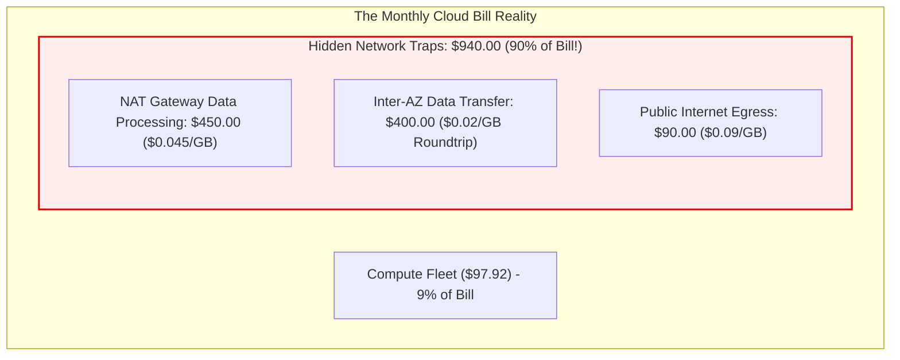
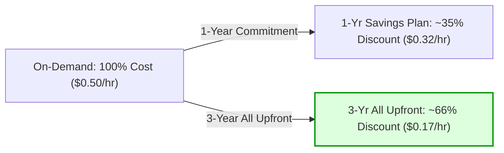

# Module 14: Cost and FinOps

Cloud computing fundamentally shifts corporate technology spending from upfront capital expenditures (CapEx) to dynamic, variable operational expenditures (OpEx). Without disciplined architectural governance and continuous financial accountability, cloud costs grow uncontrollably. **FinOps** is the operational framework and cultural practice that brings financial discipline, engineering accountability, and unit-economic visibility to cloud infrastructure.

## 1. Cloud Pricing Dimensions: The Hidden Network Traps

Cloud resource costs are calculated across multiple distinct dimensions: compute-hours, storage capacity, API request volume, and network data transfer.

### The Three Hidden Network Traps

1. **NAT Gateway Data Processing Fee**: While NAT Gateways have a base hourly charge, the primary trap is the **data processing fee**: cloud providers charge ≈ $0.045 per GB processed. If a batch compute cluster running in private subnets downloads 50 TB of public container images, package dependencies, or public datasets, the company pays over $2,250 in pure NAT processing overhead alone!
2. **Inter-Availability Zone (Cross-AZ) Traffic**: In standard cloud regional deployments, network packets crossing Availability Zone boundaries are billed at ≈ $0.01 per GB in each direction (≈ $0.02/GB roundtrip). Chatty microservices communicating across AZs over uncompressed JSON can easily exceed the cost of the virtual machines hosting them.
3. **Public Egress Asymmetry**: Cloud providers charge $0.00 for data transferred _into_ their network (ingress), but charge ≈ $0.08–$0.09 per GB for data transferred _out_ to the public internet (egress). Bandwidth-heavy distribution platforms face compounding monthly egress penalties.

## 2. Commitment Discounts: Savings Plans and Reserved Instances

For predictable baseline workloads running 24/7, paying standard on-demand hourly rates is financially wasteful. Cloud providers offer commitment discounts in exchange for 1-year or 3-year usage commitments:

| Commitment Instrument | Term Commitment | Typical Discount | Flexibility / Portability | Best Suited For |
| :-- | :-- | :-- | :-- | :-- |
| **Compute Savings Plans** | 1 or 3 Years ($X/hour spend) | Up to $66\%$ | Highest: Automatically applies across instance families, regions, OS, and Fargate/Lambda | Dynamic organizations with evolving instance architectures |
| **EC2 Instance Savings Plans** | 1 or 3 Years ($X/hour on instance family) | Up to $72\%$ | Medium: Locked to a specific instance family (e.g. `c6g`) in a specific region | Stable workloads committed to a specific processor tier |
| **Standard Reserved Instances (RIs)** | 1 or 3 Years (Fixed instances) | Up to $72\%$ | Low: Locked to instance type and region (can be sold on AWS RI Marketplace) | Legacy infrastructure with completely predictable sizing |
| **Committed Use Discounts (GCP CUDs)** | 1 or 3 Years | Up to $70\%$ | High: Available as Resource-based or Spend-based across Google Cloud services | Steady-state Compute Engine and GKE clusters |

## 3. Unit Economics: Beyond Absolute Cloud Spend

Tracking absolute monthly cloud expenditure (e.g., "our AWS bill was $150,000 this month") is an incomplete and misleading metric. If the business grew revenue by 300% over the same period, an increase in cloud spend is expected and healthy.

**Unit Economics** normalizes cloud infrastructure spend against fundamental business output metrics:

$$\text{Unit Cost} = \frac{\text{Total Cloud Spend}}{\text{Business Value Metric}}$$

### Canonical Unit Metric Examples

- **E-Commerce**: Infrastructure cost per completed checkout transaction (e.g., target: ≤ $0.04 per order).
- **Fintech**: Infrastructure cost per processed payment API call.
- **SaaS Enterprise**: Infrastructure cost per monthly active tenant (e.g., target: ≤ $12.50 per customer).
- **Streaming Media**: Infrastructure cost per streamed video hour.

If total cloud spend increases by 20% while business transactions increase by 100%, unit cost drops by 40%—demonstrating superior architectural efficiency and operational scaling.

## 4. Tagging Governance: Showback vs. Chargeback

Effective cost allocation requires an automated, organization-wide tagging strategy.

### The Four Mandatory Cost Allocation Tags

1. `Environment`: `prod`, `staging`, `dev`, `sandbox`.
2. `Owner`: Email or team handle of the responsible engineering owner.
3. `CostCenter`: Corporate accounting general ledger code for department billing.
4. `Service`: Specific microservice name (e.g., `checkout-api`, `auth-service`).

### The Immutability of Cost Allocation Tags

> [!WARNING]
> Cost allocation tags are **never retroactive**. If an engineering team spins up 100 TB of un-tagged storage or 20 un-tagged GPU instances, the cloud billing engine places those expenses into an "Unallocated / Untagged" bucket. Tagging the instances two weeks later does not backfill historical invoices. Enforce tagging guardrails in CI/CD using policy-as-code (OPA/Terraform Policy) to block provisioning of any un-tagged resources.

### Showback vs. Chargeback

- **Showback**: Generates granular cost visibility dashboards and sends monthly reports to engineering leadership for awareness, benchmarking, and cultural accountability. No money actually changes accounts.
- **Chargeback**: Directly debits monthly cloud infrastructure costs against individual department profit-and-loss (P&L) budgets, incentivizing engineering managers to decommission idle resources and optimize architectures.

## 5. The Well-Architected Cost Optimization Pillar

The cost optimization pillar focuses on five core engineering principles:

1. **Practice Cloud Financial Management**: Treat cost as a primary architectural constraint alongside performance and security.
2. **Adopt a Consumption Model**: Scale down compute to zero when idle; stop non-production development environments over weekends and nights.
3. **Measure Overall Efficiency**: Track unit economics continuously on corporate executive dashboards.
4. **Stop Spending Money on Undifferentiated Heavy Lifting**: Replace self-managed Kafka, Elasticsearch, or PostgreSQL clusters on EC2 with fully managed serverless offerings where operational overhead exceeds managed markup.
5. **Analyze and Attribute Expenditure**: Establish 100% cost transparency across teams and microservices.

## 6. Executable Proofs

The hidden network charge calculations (NAT gateway processing, cross-AZ traffic, egress) and commitment discount savings models are verified in our test suite:

| Assertion / Invariant | Implementation Mechanism | Test File Reference |
| :-- | :-- | :-- |
| **Hidden Network Cost Impact** | Proves network data transfer and NAT processing fees can exceed compute costs by $>85\%$ | [`../examples/14-finops-unit-economics-and-cost.test.ts`](../examples/14-finops-unit-economics-and-cost.test.ts) |
| **Commitment Discount Economics** | Validates $66\%$ annual savings using 3-year commitment plans vs on-demand rates | [`../examples/14-finops-unit-economics-and-cost.test.ts`](../examples/14-finops-unit-economics-and-cost.test.ts) |

## 7. Then vs. Now: FinOps Paradigm Shift

- **Then**: Engineering deployed servers without financial visibility; finance received a massive surprise invoice at month-end; annual static budgeting.
- **Now**: Continuous automated FinOps; real-time cost anomaly alerts in Slack; unit economics tracked per transaction; policy-as-code enforcing cost allocation tags at pull-request time.

## 8. Provider Mapping Matrix

| Concept | AWS | Google Cloud | Microsoft Azure | Cloudflare |
| :-- | :-- | :-- | :-- | :-- |
| **Cost Dashboard** | AWS Cost Explorer | Cloud Billing Console | Microsoft Cost Management | Cloudflare Dashboard Analytics |
| **Detailed Billing Export** | Cost and Usage Report (CUR 2.0) | Billing Export to BigQuery | Cost Management Export to Storage | Billing API |
| **Commitment Vehicle** | AWS Savings Plans / RIs | Committed Use Discounts (CUDs) | Azure Reservations / Savings Plan | Annual Usage Contracts |
| **Anomaly Detection** | AWS Cost Anomaly Detection | Billing Anomaly Alerts | Cost Management Alerts | Usage Alerts |
| **Zero-Egress Object Storage** | S3 (Standard egress billed) | Cloud Storage (egress billed) | Blob Storage (egress billed) | Cloudflare R2 (zero egress fees) |

---

## Version History & Architectural Evolution

| Version / Milestone | Year | Architectural Shifts & Key Capabilities | Deprecations & Breaking Hazards |
| --- | :-: | --- | --- |
| **Generation 1: Flat IaaS & EC2-Classic** | 2006–2012 | Unpartitioned flat Layer 2/3 networks; public IPv4 addresses assigned directly to virtual instances; manual VM provisioning; static unallocated monthly invoices. | EC2-Classic completely retired; absence of private subnets and security groups exposed instances directly to the public internet. |
| **Generation 2: Virtual Private Clouds (VPC) & Reserved Instances** | 2009–2015 | Software-Defined Networking (SDN); RFC 1918 private subnets; stateful Security Groups and stateless NACLs; 1-year and 3-year standard Reserved Instances (RIs) offering up to 72% discounts. | Static RIs locked teams to specific instance families and availability zones; NAT instances became CPU bottlenecks before managed NAT Gateways. |
| **Generation 3: Managed Kubernetes & Compute Savings Plans** | 2014–2020 | Container orchestration (EKS, GKE, AKS); CNI overlay networks; flexible Compute Savings Plans and Flexible CUDs decoupling commitments from instance types; FinOps Foundation established. | Unmanaged cluster resource overprovisioning (CPU/RAM requests vs. limits); multi-tenant shared cluster costs invisible without dedicated allocation tools (Kubecost). |
| **Generation 4: Serverless Containers & Automated Bin-Packing** | 2018–2023 | Scale-to-zero serverless runtimes (AWS Fargate, Cloud Run, Lambda); Karpenter just-in-time Kubernetes node autoscaling; automated spot instance interruption handling. | Cold start latencies; ephemeral compute connection exhaustion against relational databases requiring serverless proxies; egress markup fees on API gateways. |
| **Generation 5: Edge Wasm, Sustainable FinOps & FOCUS 1.0** | 2024–2026 | Sub-millisecond WebAssembly isolates at the edge (Cloudflare Workers, Fastly Compute); FinOps Open Cost and Usage Specification (FOCUS v1.0/v1.1) standardizing multi-cloud billing schemas; unit economics tied to business KPIs and carbon emissions. | Complex multi-cloud billing reconciliation without unified FOCUS pipelines; egress vendor lock-in penalized by modern zero-egress alternatives (Cloudflare R2). |

---

## Interview Drill

1. How can a chatty microservice architecture generate a network bill that vastly exceeds its virtual machine compute costs?

In cloud hyperscalers, data transferred across Availability Zone boundaries in the same region is billed at ≈ $0.01/GB in each direction (≈ $0.02/GB roundtrip), and outbound internet traffic routed through a NAT Gateway incurs a $0.045/GB processing fee. If a microservice cluster transfers 50 TB of uncompressed inter-service RPC payloads across AZs and downloads 20 TB of dependencies through a NAT Gateway, the network transfer fees total $1,000 + $900 = $1,900, while the underlying c6g.xlarge instances hosting the services may cost only $98/month.

2. Why are cost allocation tags not retroactive in cloud billing engines?

Cloud billing engines generate meter records and usage logs in near real time, attaching metadata tags present on the resource at the exact moment of usage. When the billing ledger processes records, it attributes spend according to those stamped tags. Applying tags to an existing resource two weeks later applies only to future meter records. Historical billing records remain forever assigned to the "Untagged / Unallocated" category.

3. Differentiate between Compute Savings Plans and EC2 Instance Savings Plans in AWS.

Compute Savings Plans provide the greatest flexibility: they commit to an hourly spend (e.g., $10/hour) and automatically apply across all instance families (C, M, R, T), operating systems, AWS regions, and even container/serverless compute (AWS Fargate and AWS Lambda), yielding up to 66% discounts. EC2 Instance Savings Plans provide deeper discounts (up to 72%), but require committing to a specific instance family (e.g., `c6g`) within a specific region (e.g., `us-east-1`), forfeiting cross-family and cross-region portability.

4. What is the fundamental difference between Showback and Chargeback in organizational FinOps?

Showback provides financial visibility by reporting granular cloud costs directly to engineering teams and department leaders, raising cost consciousness and enabling benchmarking without financial debiting. Chargeback goes a step further by directly deducting actual cloud expenditure from each business unit's internal financial budget, turning cloud spend into a direct P&L line item that impacts department bonuses and operational budgets.

5. Explain the concept of Unit Economics in cloud engineering and why it is superior to tracking total monthly spend.

Tracking total cloud spend is misleading because total spend naturally increases when a business experiences rapid customer growth. Unit economics normalizes cloud spend by dividing total expenditure by a core business value metric (e.g., cloud spend per processed transaction, per active subscriber, or per ride booked). If total cloud spend grows by 20% while total customer transactions grow by 100%, the unit cost per transaction has decreased by 40%, proving that the underlying architecture has achieved greater operational efficiency and economies of scale.

