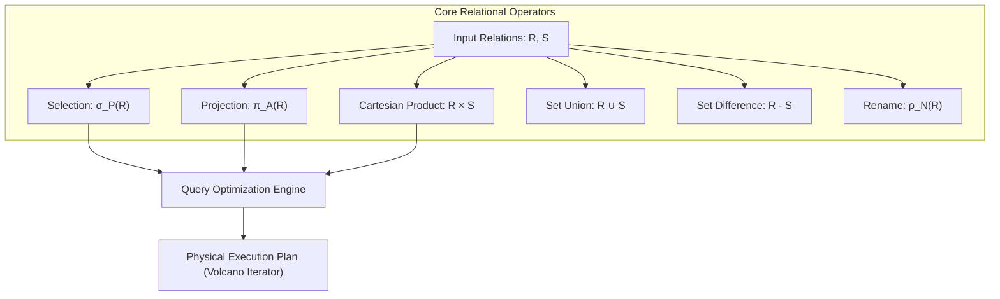
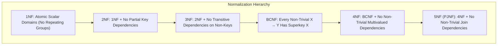
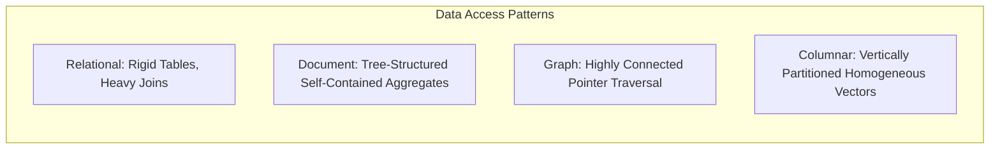
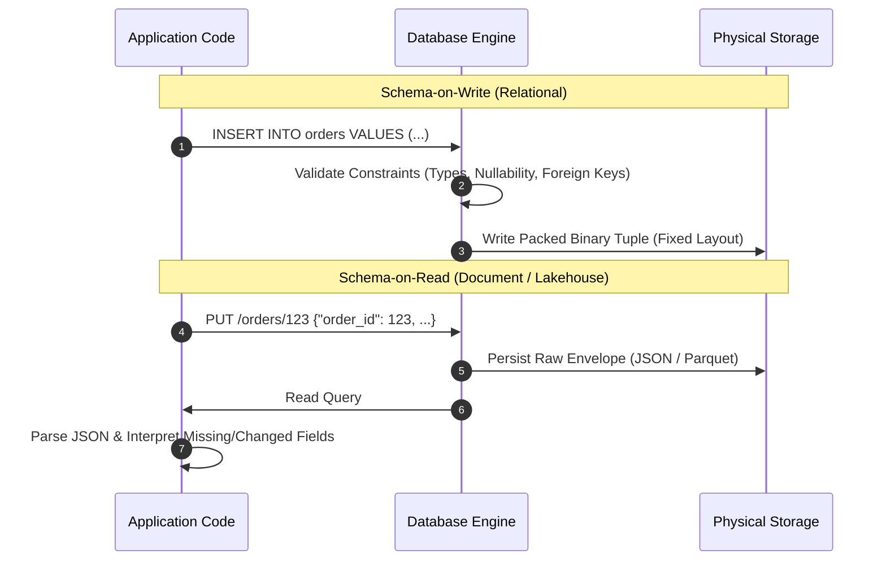

# Module 01: Data Models and Query Languages

Data models represent the fundamental abstraction through which software engineers structure, conceptualize, and query information. Every operational system is built upon layers of data modeling: hardware registers model byte sequences, operating systems model files and virtual memory, storage engines model disk pages and log records, and database management systems model relations, documents, or graphs. The choice of data model dictates the mathematical properties of queries, the hardware access patterns during execution, and the cognitive overhead of evolving application schemas over time.

---

## 1. Formal Foundations: Relational Algebra and Relational Calculus

The relational data model, introduced by Edgar F. Codd in 1970, grounds data representation in first-order predicate logic and set theory. A relation $R$ is mathematically defined as a subset of the Cartesian product of $n$ attribute domains:

$$R \subseteq D_1 \times D_2 \times \dots \times D_n$$

An element of $R$ is an $n$-tuple $(v_1, v_2, \dots, v_n)$ where each value $v_i$ belongs to domain $D_i$. In relational theory, relations are unordered sets of unique tuples, though practical SQL implementations adopt bag (multiset) semantics permitting duplicate rows unless constrained by unique indexes.

### The Six Primitive Operators of Codd's Relational Algebra

Relational algebra is a procedural query language consisting of six primitive operators that accept one or two relations as input and produce a new relation as output:

1. **Selection ($\sigma_\varphi(R)$)**: Extracts tuples from relation $R$ that satisfy propositional logic predicate $\varphi$. In first-order logic:

$$\sigma_\varphi(R) = \{ t \in R \mid \varphi(t) \}$$

2. **Projection ($\pi_{A_1, \dots, A_k}(R)$)**: Produces a relation containing only the specified attribute subset $\{A_1, \dots, A_k\}$, removing duplicate tuples under set semantics:

$$\pi_{A_1, \dots, A_k}(R) = \{ (t.A_1, \dots, t.A_k) \mid t \in R \}$$

3. **Cartesian Product ($R \times S$)**: Yields the cross product pairing every tuple in relation $R$ with every tuple in relation $S$:

$$R \times S = \{ t \circ s \mid t \in R \land s \in S \}$$

4. **Set Union ($R \cup S$)**: Merges two union-compatible relations having identical attribute arity and matching domains:

$$R \cup S = \{ t \mid t \in R \lor t \in S \}$$

5. **Set Difference ($R - S$)**: Computes the set of tuples present in $R$ but absent in $S$:

$$R - S = \{ t \mid t \in R \land t \notin S \}$$

6. **Rename ($\rho_{S(B_1, \dots, B_n)}(R)$)**: Alters the relational identifier and attribute names without modifying the underlying data tuples.

Derived operators such as Natural Join ($R \bowtie S$), Theta Join ($R \bowtie_\theta S$), and Relational Division ($R \div S$) are compositions of these six primitives. A database query language is formally termed **relationally complete** if it expresses at least the full expressive power of Codd's relational algebra.

### Relational Calculus and Codd's Equivalence Theorem

While relational algebra provides procedural expressions describing *how* to evaluate a result, Relational Calculus provides declarative expressions describing *what* properties the result must satisfy. Relational calculus exists in two formulations:
- **Tuple Relational Calculus (TRC)**: Evaluates expressions of the form $\{ t \mid P(t) \}$, where $t$ is a tuple variable and $P(t)$ is a first-order predicate formula containing existential ($\exists$) or universal ($\forall$) quantifiers.
- **Domain Relational Calculus (DRC)**: Evaluates expressions of the form $\{ \langle x_1, x_2, \dots, x_n \rangle \mid P(x_1, x_2, \dots, x_n) \}$, where variables range over attribute domains.

Codd's Equivalence Theorem establishes that safe expressions in Tuple Relational Calculus, Domain Relational Calculus, and Relational Algebra possess identical expressive power. This theoretical equivalence allows declarative SQL queries to be translated into relational algebra expression trees, which cost-based query optimizers rewrite via algebraic equivalence rules:

$$\sigma_{\varphi_1 \land \varphi_2}(R) \equiv \sigma_{\varphi_1}(\sigma_{\varphi_2}(R))$$

$$\sigma_{\varphi}(R \bowtie S) \equiv (\sigma_{\varphi}(R)) \bowtie S \quad \text{if } \varphi \text{ references only attributes of } R$$

---

## 2. Normalization Theory: Functional Dependencies to BCNF

Normalization is the mathematical decomposition of relations to eliminate data redundancy, prevent update anomalies (insert, delete, and update anomalies), and preserve data integrity through functional dependency constraints.

### Functional Dependencies and Armstrong's Axioms

Given relation schema $R$, a functional dependency $X \to Y$ (where $X, Y \subseteq R$) asserts that whenever two tuples $t_1, t_2 \in R$ agree on attribute set $X$, they must identically agree on attribute set $Y$:

$$\forall t_1, t_2 \in R, \quad (t_1[X] = t_2[X]) \implies (t_1[Y] = t_2[Y])$$

The closure of a set of functional dependencies $F$, denoted $F^+$, is derived using **Armstrong's Axioms**:
- **Reflexivity**: If $Y \subseteq X$, then $X \to Y$.
- **Augmentation**: If $X \to Y$, then $XZ \to YZ$ for any attribute set $Z$.
- **Transitivity**: If $X \to Y$ and $Y \to Z$, then $X \to Z$.

Secondary inference rules derived directly from Armstrong's Axioms include Union ($X \to Y \land X \to Z \implies X \to YZ$), Decomposition ($X \to YZ \implies X \to Y \land X \to Z$), and Pseudotransitivity ($X \to Y \land WY \to Z \implies WX \to Z$).

In terms of the set of compliant relations satisfying each constraint level:
$$\text{5NF} \subset \text{4NF} \subset \text{BCNF} \subset \text{3NF} \subset \text{2NF} \subset \text{1NF}$$

### The Normal Form Spectrum

| Normal Form | Formal Definition / Violation Condition | Mechanical Significance |
| :--- | :--- | :--- |
| **First Normal Form (1NF)** | All attribute domains contain only atomic, indivisible scalar values; relation contains no repeating groups or nested array attributes. | Eliminates variable-length pointer navigation inside tuples; guarantees fixed-width or standard offset record encoding on disk. |
| **Second Normal Form (2NF)** | Relation is in 1NF, and no non-prime attribute is functionally dependent on a proper subset of any candidate key (no partial key dependencies). | Prevents data duplication when tables utilize composite candidate keys. |
| **Third Normal Form (3NF)** | Relation is in 2NF, and for every non-trivial functional dependency $X \to Y$, either $X$ is a superkey or $Y$ is a prime attribute (part of a candidate key). | Eliminates transitive functional dependencies ($X \to Z$ mediated through non-key $Y$). |
| **Boyce-Codd Normal Form (BCNF)** | For every non-trivial functional dependency $X \to Y$ in $F^+$, $X$ must be a strict superkey of $R$. | Completely eliminates redundancy attributable to functional dependencies. Unlike 3NF, BCNF decomposition may not always preserve all functional dependencies. |
| **Fourth Normal Form (4NF)** | For every non-trivial multivalued dependency (MVD) $X \twoheadrightarrow Y$ on $R$, $X$ must be a superkey of $R$. | Eliminates independent multi-valued facts from multiplying Cartesian products inside tuples. |
| **Fifth Normal Form (5NF / PJNF)** | Every non-trivial join dependency $\Join[R_1, \dots, R_n]$ on $R$ is implied by the candidate keys of $R$. | Guarantees lossless reconstruction without cyclic join anomalies across $n$-way decompositions. |

### Lossless-Join Decomposition and Dependency Preservation

Decomposing relation $R$ into subrelations $R_1, R_2$ with attribute sets $A(R_1), A(R_2)$ is a **lossless-join decomposition** if and only if:

$$A(R_1) \cap A(R_2) \to A(R_1) \quad \text{or} \quad A(R_1) \cap A(R_2) \to A(R_2)$$

That is, the common attributes must form a superkey for at least one of the decomposed relations. If this condition fails, joining $R_1$ and $R_2$ produces spurious false tuples not present in the original relation $R$.

### Higher Normal Forms: 4NF, 5NF, and Denormalization Trade-offs

#### Multivalued Dependencies and Fourth Normal Form (4NF)
A functional dependency $X \to Y$ restricts each $X$-value to exactly one $Y$-value. A **Multivalued Dependency** (MVD), denoted $X \twoheadrightarrow Y$, models independent multi-valued facts. Given relation schema $R$ and attribute sets $X, Y \subseteq R$, let $Z = R \setminus (X \cup Y)$. The MVD $X \twoheadrightarrow Y$ holds on $R$ if and only if for all tuples $t_1, t_2 \in R$ such that $t_1[X] = t_2[X]$, there exists a tuple $t_3 \in R$ such that:
$$t_3[X] = t_1[X], \quad t_3[Y] = t_1[Y], \quad t_3[Z] = t_2[Z]$$
Symmetrically, there must also exist $t_4 \in R$ with $t_4[X] = t_1[X], t_4[Y] = t_2[Y], t_4[Z] = t_1[Z]$. Intuitively, $Y$ and $Z$ are conditionally independent given $X$.

**4NF Definition (Fagin 1977):** Relation $R$ is in 4NF with respect to a set of functional and multivalued dependencies if for every non-trivial MVD $X \twoheadrightarrow Y$ (where $Y \nsubseteq X$ and $X \cup Y \neq R$), $X$ is a superkey for $R$.
- **Anomaly Solved:** Storing an author who speaks multiple languages and teaches multiple courses in a single table `(Author, Language, Course)` generates a Cartesian product of tuples for every independent language and course. 4NF decomposes $R$ into `(Author, Language)` and `(Author, Course)`.

#### Join Dependencies and Fifth Normal Form (5NF / PJNF)
A **Join Dependency** (JD), denoted $\Join[R_1, R_2, \dots, R_n]$ where $\bigcup_{i=1}^n R_i = R$, asserts that $R$ can be losslessly reconstructed by joining its projections on $R_1, \dots, R_n$:
$$R = \pi_{R_1}(R) \bowtie \pi_{R_2}(R) \bowtie \dots \bowtie \pi_{R_n}(R)$$
An MVD is merely a 2-way join dependency: $X \twoheadrightarrow Y \iff \Join[X \cup Y, X \cup (R \setminus Y)]$.

**5NF (Project-Join Normal Form, Fagin 1979):** Relation $R$ is in 5NF if and only if every non-trivial join dependency on $R$ is implied by the candidate keys of $R$.
- **Symmetric Cyclic Constraints:** 5NF handles 3-way symmetric relationships (e.g. `(Supplier, Part, Project)` where a supplier supplies a part, a project uses a part, and a supplier works on a project, but only certain 3-way combinations are valid). Decomposing into 3 binary tables is lossless only if the 5NF join dependency holds.

### Recursive Query Evaluation: Datalog and Fixed-Point Semantics

While standard relational algebra (and non-recursive SQL) cannot express transitive closure (such as traversing an arbitrary-depth graph or bill-of-materials), **Datalog** provides formal declarative recursion grounded in Horn-clause first-order logic.

A Datalog rule has the form:
$$\text{Head}(X) \leftarrow \text{Body}_1(X, Y_1), \dots, \text{Body}_k(Y_{k-1}, Z)$$
- **EDB (Extensional Database):** Base relations stored directly in physical storage.
- **IDB (Intensional Database):** Virtual relations defined declaratively by Datalog rules.

#### Fixed-Point Semantics (Knaster-Tarski)
The semantics of a positive Datalog program $P$ is defined via the **Immediate Consequence Operator** $T_P$. Given a database instance $I$, $T_P(I)$ returns the set of all facts that can be inferred by applying one step of the rules in $P$ to facts in $I$.
1. Because positive Datalog rules contain only conjunctions and existential variables (no negation), $T_P$ is **monotonic**: $I \subseteq J \implies T_P(I) \subseteq T_P(J)$.
2. By the Knaster-Tarski Theorem on the complete lattice of relation subsets, $T_P$ has a unique **Least Fixed Point (LFP)**, denoted $T_P^\infty(\emptyset)$:
$$I_0 = \emptyset, \quad I_{k+1} = T_P(I_k), \quad T_P^\infty(\emptyset) = \bigcup_{k \ge 0} I_k$$
On finite databases, the fixed point is reached in a finite number of steps ($I_{k+1} = I_k$).

#### Seminaive Evaluation
Naive evaluation evaluates all rules repeatedly over $I_k$, re-deriving already known facts and resulting in $O(k^2)$ redundant tuple evaluations. **Seminaive Evaluation** computes the fixed point incrementally by maintaining differential deltas $\Delta R^{(k)} = R^{(k)} \setminus R^{(k-1)}$:
- At step $k$, each recursive rule must use at least one delta predicate $\Delta R^{(k)}$ from the immediately preceding iteration in its body.
- This ensures no tuple combination is evaluated more than once across iterations, forming the theoretical execution foundation for modern SQL recursive CTEs (`WITH RECURSIVE`).

#### Stratified Negation
When Datalog programs include negation ($\text{not } P(X)$), monotonicity is broken, potentially creating ill-defined or non-deterministic fixed points (e.g. $p \leftarrow \text{not } q$ and $q \leftarrow \text{not } p$).
- **Stratification:** The rule dependency graph (with directed edges $P \to Q$, and negative edges for $\text{not } Q$) must contain **no negative cycles**.
- The rules are partitioned into strata $S_0, S_1, \dots, S_m$ where any negated predicate in stratum $S_i$ is fully computed and finalized in a strictly lower stratum $S_j$ ($j < i$). Each stratum is evaluated to its unique least fixed point sequentially, preserving declarative determinism.

---

## 3. Data Model Paradigms: Relational, Document, Graph, and Columnar

Modern data engineering spans multiple foundational paradigms, each optimizing for specific graph topologies, access patterns, and storage layouts.

### 1. Relational Paradigm
- **Structure**: Tables of tuples, foreign key references, normalized schemas.
- **Query Mechanism**: Declarative relational algebra (SQL). Joins evaluated via nested loops, hash joins, or merge joins.
- **Strengths**: Eliminates data anomalies; enforces referential integrity at the database layer; allows dynamic multi-way ad-hoc joins without predefined navigational paths.
- **Weaknesses**: Join overhead scales with query complexity; object-relational impedance mismatch requires ORMs or mapping layers.

### 2. Document Paradigm (Hierarchical Aggregates)
- **Structure**: Self-contained hierarchical trees (JSON, BSON, Protocol Buffers). Tuples nest child arrays and embedded sub-documents.
- **Locality**: One-to-many relationships are embedded within the same physical disk record. Loading an order and its ten line-items requires a single contiguous disk read rather than multiple indexed relational lookups.
- **Weaknesses**: Many-to-many relationships degenerate. Denormalized data duplicated across documents requires multi-document distributed updates, risking inconsistency under write failures.

### 3. Graph Paradigm (Connected Networks)
- **Structure**: Nodes (entities), Edges (directed relationships), and Properties (key-value attributes).
- **Physical Representation**: Index-free adjacency, where each node maintains direct memory or disk pointers to its incoming and outgoing edges, achieving $O(1)$ traversal per hop regardless of total graph size.
- **Strengths**: Deep recursive traversals (e.g. social graphs, fraud rings, dependency trees, knowledge graphs) execute orders of magnitude faster than multi-table recursive relational joins.

### 4. Columnar / Vectorized Paradigm
- **Structure**: Relations partitioned vertically into columns rather than horizontally into row tuples.
- **Disk Encoding**: Column values are stored contiguously in homogeneous blocks, enabling SIMD execution and high-ratio compression (Run-Length Encoding, Dictionary Encoding, Frame-of-Reference).
- **Strengths**: Ideal for OLAP analytics scanning billions of records across a handful of columns.

---

## 4. Schema-on-Read versus Schema-on-Write

The debate between relational and document models is fundamentally an architectural choice between **schema-on-write** and **schema-on-read**.

### Comparative Mechanics

1. **Schema-on-Write (Traditional Relational)**:
   - The database engine validates all incoming data against a catalog schema before persisting bytes to disk.
   - Tuples are packed into dense, fixed-offset binary layouts without storing attribute names per row.
   - Column additions and type alterations require catalog locks and potentially whole-table rewrites or background catalog backfills.

2. **Schema-on-Read (Document Stores & Data Lakes)**:
   - The database treats payloads as untyped byte strings or semi-structured key-value dictionaries, persisting field identifiers alongside values within each record.
   - Application code assumes responsibility for handling missing fields, polymorphic types, and legacy schemas at runtime.
   - Accelerates early prototyping but transfers integrity validation to application code, causing silent data corruption when applications fail to implement comprehensive validation layers.

---

## 5. Then vs Now: Evolution of Data Models

| Architectural Dimension | Classical Approach (1970–1990s) | Intermediate Wave (2000–2010s) | Modern Converged Architecture (2020s–Present) |
| :--- | :--- | :--- | :--- |
| **Dominant Model** | Rigid Relational Tables (Codd 3NF) | Segregated NoSQL (MongoDB, Cassandra, Neo4j) | Converged Multi-Model Relational (PostgreSQL, SQLite, Spanner) |
| **Semi-Structured Data** | Stored as opaque unindexed `TEXT` or `BLOB` strings | Dedicated Document Stores without ACID transactions | Native `JSONB` with binary indexing (GIN, jsonpath) and hybrid SQL queries |
| **Graph Traversal** | Expensive recursive SQL CTEs (`WITH RECURSIVE`) | Dedicated graph engines with custom query languages | Property graph extensions within relational engines (SQL:2023 Property Graph Queries - PGQ) |
| **Vector Embeddings** | Standalone vector databases (Milvus, Pinecone) | External nearest-neighbor libraries (FAISS) | Integrated vector extensions (`pgvector`, native HNSW) collocated with transactional data |
| **Schema Evolution** | Blocking table-level DDL exclusive locks | Unchecked schema-on-read drift | Instant DDL via catalog metadata manipulation (`ADD COLUMN DEFAULT` without rewrite) |

---

## 6. Production Failure Modes and Anti-Patterns

### 1. Unbounded Array Bloat in Document Models
- **Symptom**: Query latency degrades exponentially over time; single-document updates trigger massive disk write amplification and memory eviction.
- **Root Cause**: Embedding one-to-many relationships (e.g. user activity logs or order events) inside an array within a parent document. When the document exceeds the page boundary (e.g. 16MB in MongoDB, or TOAST threshold in PostgreSQL), the storage engine must reallocate, copy, and re-index the entire document across disk pages.
- **Mitigation**: Apply the bucket pattern or split unbounded collections into separate parent-child relations referenced via foreign keys.

### 2. The Relational N+1 Query Cascade
- **Symptom**: Database connection pools exhaust; backend service latency spikes under modest read throughput.
- **Root Cause**: Application ORMs loading a list of $N$ parent records in one query, then executing $N$ separate relational queries to fetch related child entities instead of a single SQL join or multi-key `WHERE parent_id IN (...)` batch.
- **Mitigation**: Utilize eager loading joins, declarative lateral joins, or subquery batching at the ORM layer.

### 3. Graph Traversal Explosion (Supernode Problem)
- **Symptom**: Graph query memory consumption explodes; traversals hang indefinitely.
- **Root Cause**: A path-finding query encounters a "supernode"—a vertex possessing millions of incident edges (e.g. a celebrity account in a social network). Naive breadth-first search attempts to traverse all incident paths.
- **Mitigation**: Implement edge-degree limits, directional pruning, or split supernodes into hierarchical sub-clusters.

---

## 7. Interview Drill

<strong>Q1: Why is BCNF strictly stronger than 3NF, and what trade-off occurs when decomposing into BCNF?</strong>

**Answer:** 
BCNF requires that for *every* non-trivial functional dependency $X \to Y$, $X$ must be a superkey. 3NF relaxes this requirement by permitting $X$ to not be a superkey *provided* that every attribute in $Y$ is a prime attribute (part of some candidate key).

The critical trade-off is **dependency preservation**. While any relational schema can be decomposed into 3NF such that the decomposition is both lossless-join and dependency-preserving, decomposing into BCNF is guaranteed to be lossless-join but **may fail to preserve functional dependencies**. When dependencies are lost in BCNF, enforcing integrity across updates requires inter-table joins, negating the performance benefits of normalization.

<strong>Q2: Explain Codd's Equivalence Theorem and its practical implication in relational query optimizers.</strong>

**Answer:** 
Codd's Equivalence Theorem proves that safe expressions written in declarative Tuple Relational Calculus, Domain Relational Calculus, and procedural Relational Algebra possess identical expressive power.

In practical database engines, users write declarative SQL queries (grounded in relational calculus). The engine parses this SQL into an abstract syntax tree and lowers it into an initial Relational Algebra plan tree. Because relational algebra possesses algebraic identities (commutativity and associativity of joins, pushdown of selections and projections), the query optimizer can systematically rewrite and cost alternative algebraic plan trees to discover the optimal physical execution plan without altering the declarative semantics specified by the user.

<strong>Q3: When should an architect choose an embedded document model over a normalized relational model?</strong>

**Answer:** 
An embedded document model is optimal when:
1. **Access pattern alignment**: The parent entity and its nested children are almost always retrieved and updated together (strong 1-to-few aggregate boundary).
2. **Physical disk locality**: Contiguous disk storage of the aggregate eliminates multiple random I/O index lookups and join processing.
3. **Bounded cardinality**: The child collection has a strictly bounded size (e.g. an address with 2 lines, or an order with a dozen items).

Conversely, normalized relational models are strictly required when child entities have unbounded cardinality, when child entities are queried independently of parents, or when many-to-many relationships exist that would require denormalized duplicate writes across multiple documents.

<strong>Q4: What causes spurious tuples during relational table decomposition, and how is it mathematically prevented?</strong>

**Answer:** 
Spurious tuples occur when a table is decomposed into two subrelations along attribute sets that do not share a common candidate key. When the two tables are subsequently joined back together, the absence of a unique constraint causes rows to match with unintended rows, generating phantom records that were never present in the original dataset.

Lossless-join decomposition is mathematically guaranteed if and only if the intersection of the attribute sets of the decomposed relations functionally determines at least one of the full attribute sets:

$$A(R_1) \cap A(R_2) \to A(R_1) \quad \text{or} \quad A(R_1) \cap A(R_2) \to A(R_2)$$

<strong>Q5: What is index-free adjacency in graph databases, and how does it compare to relational foreign keys?</strong>

**Answer:** 
In traditional relational databases, traversing a relationship requires consulting an index (e.g. a B-tree lookup on a child foreign key column), which incurs $O(\log N)$ computational cost per hop where $N$ is the total number of rows in the target table.

In a graph engine with **index-free adjacency**, nodes maintain direct memory pointers or physical disk record IDs to their adjacent edges and neighbor nodes. Traversing an edge requires dereferencing an already known pointer in $O(1)$ constant time, completely independent of the total graph size. For multi-hop traversals of depth $k$, graph engines scale as $O(d^k)$ (where $d$ is the average degree of visited nodes), whereas relational joins scale as $O(k \cdot \log N)$.

<strong>Q6: How do modern multi-model database engines render dedicated document stores obsolete for general web workloads?</strong>

**Answer:** 
Modern relational engines (e.g. PostgreSQL, SQLite, Spanner) incorporate binary JSON types (`JSONB`) with decomposed binary storage, specialized index operator classes (GIN path indexing), and standard SQL/JSON path syntax (`jsonb_path_query`). 

This architecture provides the document model's schema flexibility and hierarchical aggregate locality within specific columns, while preserving strict relational schema guarantees, foreign key referential integrity, multi-table joins, and full ACID multi-statement transaction guarantees across the rest of the database schema. Dedicated document stores often trade away cross-collection referential integrity and multi-document consistency without delivering superior throughput.

