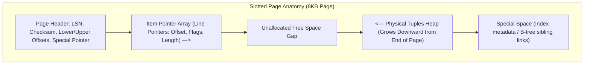
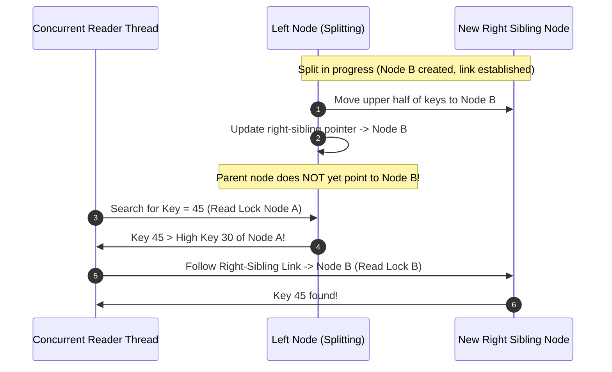
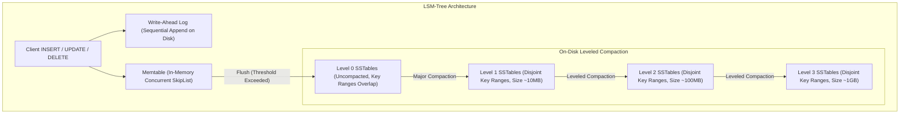
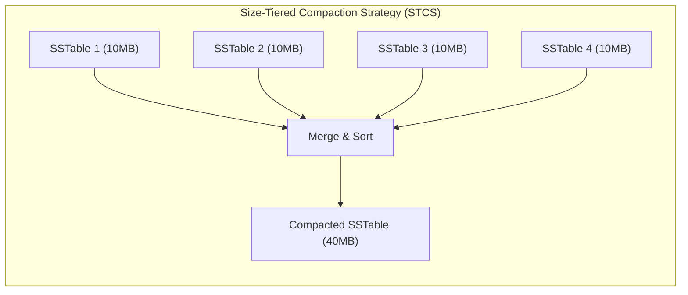
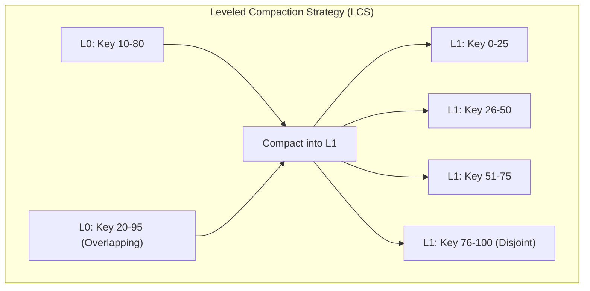
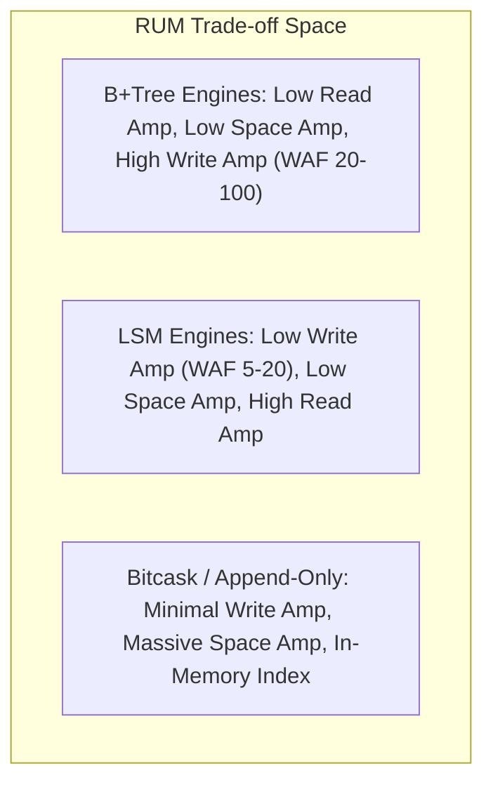
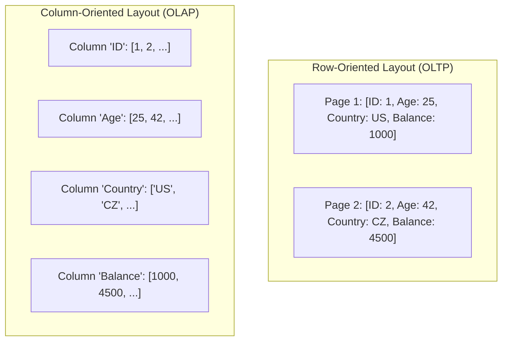

# Module 02: Storage Engines: Slotted Pages, B-Trees, and LSM-Trees

At the lowest architectural tier of a database system sits the **storage engine**—the component responsible for persisting, indexing, and retrieving records from physical non-volatile storage media (HDDs, NVMe SSDs, and persistent memory). Storage engine design is fundamentally shaped by hardware trade-offs: sequential disk I/O provides orders-of-magnitude higher bandwidth than random I/O, flash memory requires coarse-grained block erasures before rewriting, and memory hierarchies exhibit sharp latency cliffs from L1 cache (1 ns) to DRAM (100 ns) to NVMe flash (10–100 μs).

---

## 1. Physical Page Organization: The Slotted-Page Architecture

Modern page-based storage engines divide disk files into fixed-size blocks called **pages** (typically 4KB in operating systems, 8KB in PostgreSQL, or 16KB in MySQL InnoDB). Because relational and document records contain variable-length attributes (e.g. `VARCHAR`, `TEXT`, `JSONB`), pages cannot simply store fixed-size array slots. Instead, database engines utilize the canonical **slotted-page architecture**.

### Mechanical Layout of a Slotted Page

1. **Page Header**: Located at byte offset 0. Stores metadata including:
   - `page_lsn`: 64-bit Log Sequence Number tracking the last Write-Ahead Log record modifying this page.
   - `checksum`: Integrity validation preventing silent storage corruption.
   - `lower_offset`: Byte offset pointing to the end of the item pointer array (grows *downward* toward page end).
   - `upper_offset`: Byte offset pointing to the start of the most recently written tuple (grows *upward* toward page beginning).
   - `special_offset`: Offset identifying index-specific auxiliary space (e.g., B-tree sibling links).
2. **Item Pointer Array (Line Pointers)**: An array of compact 32-bit pointers:
   - Each entry contains a byte offset into the page, status flags (unused, used, redirect, dead), and byte length of the tuple.
   - The array index forms the tuple's internal identifier (Tuple ID or `ctid = (block_number, item_offset)`).
   - **Indirection invariant**: Secondary indexes store pointers to the item slot index, *never* the raw byte offset of the physical tuple. This allows the storage engine to defragment, shift, and compact physical tuples within the page without breaking external index pointers.
3. **Physical Tuple Heap**: Tuples are appended from the byte end of the page upward. Each tuple contains a tuple header (`t_xmin`, `t_xmax`, null bitmap) followed by packed attribute data.
4. **Defragmentation and Compaction**: When a tuple is deleted, its item pointer is marked unused or dead, but physical bytes remain until `VACUUM` or an in-page compaction routine shifts active tuples toward the upper page boundary, resetting the contiguous `lower` and `upper` free space gap.

---

## 2. In-Place Update Engines: B-Trees, B+Trees, and B-Link Trees

The B-Tree family (invented by Bayer and McCreight in 1970) represents the dominant indexing structure for general-purpose relational database management systems. 

```mermaid
graph TD
    subgraph BTreeHierarchy["Balanced B+Tree Hierarchy (Fanout B = 4)"]
        Root["Root Node: [Key 20, Key 50]"]
        Internal1["Internal: [Key 10]"]
        Internal2["Internal: [Key 30, Key 40]"]
        Internal3["Internal: [Key 60, Key 80]"]
        
        Leaf1["Leaf Node 1: [Keys 5, 8]"]
        Leaf2["Leaf Node 2: [Keys 10, 15]"]
        Leaf3["Leaf Node 3: [Keys 20, 25]"]
        Leaf4["Leaf Node 4: [Keys 30, 35]"]
        Leaf5["Leaf Node 5: [Keys 40, 45]"]
        Leaf6["Leaf Node 6: [Keys 50, 55]"]
        Leaf7["Leaf Node 7: [Keys 60, 70]"]
        Leaf8["Leaf Node 8: [Keys 80, 95]"]
        
        Root -->|"< 20"| Internal1
        Root -->|"20 <= K < 50"| Internal2
        Root -->|">= 50"| Internal3
        
        Internal1 --> Leaf1
        Internal1 --> Leaf2
        Internal2 --> Leaf3
        Internal2 --> Leaf4
        Internal2 --> Leaf5
        Internal3 --> Leaf6
        Internal3 --> Leaf7
        Internal3 --> Leaf8
        
        Leaf1 -.->|"Right Sibling Link"| Leaf2
        Leaf2 -.-> Leaf3
        Leaf3 -.-> Leaf4
        Leaf4 -.-> Leaf5
        Leaf5 -.-> Leaf6
        Leaf6 -.-> Leaf7
        Leaf7 -.-> Leaf8
    end
```

### B-Tree versus B+Tree Architectural Differences

In a standard B-Tree, both internal nodes and leaf nodes store search keys alongside associated data records or row pointers. In contrast, modern database storage engines universally adopt the **B+Tree** variant:
- **Internal Nodes**: Act strictly as a routing directory. They store search keys and child page pointers, storing zero tuple data. This maximizes node **fanout** ($B$), allowing an 8KB internal page to store hundreds of keys and reducing total tree height $h \approx \lceil \log_B(N) \rceil$.
- **Leaf Nodes**: Contain all actual data records or heap tuple pointers.
- **Doubly-Linked Leaf Chains**: Leaf pages contain forward (and often backward) sibling pointers, enabling sequential range scans ($O(K)$ disk reads for $K$ rows) without traversing back up through parent nodes.

### Concurrency and the Lehman-Yao B-Link Tree Algorithm

Standard B+Tree implementations face severe concurrency bottlenecks during node splits: when an inserting thread splits a full node, it must acquire exclusive locks up the tree hierarchy to install the new divider key in parent nodes, blocking concurrent readers and writers across large tree subtrees.

The **Lehman-Yao B-Link Tree** (1981) resolves this via two structural additions:
1. **High-Key Invariant**: Every node contains a "high key" attribute representing the maximum key value permitted in its subtree.
2. **Right-Sibling Link Pointer**: Every internal node (not just leaf nodes) contains an explicit right-sibling pointer to the next node at the same horizontal level.

Under Lehman-Yao semantics:
- Page splits are decomposed into two atomic steps: first, the new right-sibling node is written and linked horizontally from the splitting node; second, the parent pointer is installed.
- If a concurrent reader traverses a node before the parent link is established, it compares its search key against the node's high key. If the search key exceeds the high key, the reader simply navigates across the horizontal right-sibling pointer to find the key in the new sibling.
- **Result**: Readers execute with zero read-locks or minimal optimistic page latches, never stalling behind long parent node splits.

---

## 3. Append-Only Storage Engines: Log-Structured Merge-Trees (LSM)

While B+Trees excel at low-latency point lookups and range scans, they perform **in-place updates**: modifying a single row requires reading an 8KB page from disk, modifying bytes in memory, and writing the entire 8KB page back to disk. On modern solid-state media, this causes severe random write amplification and poor ingest throughput.

The **Log-Structured Merge-Tree (LSM-Tree)**, introduced by O'Neil, Cheng, Gawlick, and O'Neil in 1996, transforms random disk writes into high-throughput sequential appends.

### Core Components of an LSM-Tree

1. **Write-Ahead Log (WAL)**: Every write operation is sequentially appended to an on-disk WAL before memory state is modified, providing crash-recovery durability.
2. **Memtable**: An in-memory, sorted data structure (typically a lock-free SkipList or Red-Black Tree) buffering recent writes. Writes in the memtable execute in $O(\log N)$ time with zero disk seek overhead.
3. **Immutable Memtable & Flushing**: When the active memtable reaches its byte limit (e.g., 64MB), it is converted into a read-only immutable memtable, and a fresh active memtable is allocated. A background worker flushes the immutable memtable to disk as a sorted, immutable **Sorted String Table (SSTable)**.
4. **SSTable File Layout**:
   - **Data Blocks**: Chunks of sorted key-value pairs compressed with Snappy, LZ4, or Zstandard.
   - **Index Block**: Stored at the end of the SSTable file, mapping the last key of each data block to its file byte offset.
   - **Bloom Filter Block**: A probabilistic bit array allowing point lookups to determine with $100\%$ accuracy if a key is *absent* from the SSTable, skipping expensive disk block reads.

### Compaction Strategies: Leveled versus Size-Tiered

Because SSTables are immutable, updating or deleting a key appends a new version or a deletion tombstone to the active memtable. Over time, multiple SSTables accumulate duplicate keys and dead tombstones. Storage engines employ background **compaction** to merge SSTables, discard obsolete versions, and reclaim disk space:

- **Size-Tiered Compaction (STCS)**:
  - Groups SSTables into size tiers. When $N$ SSTables of similar size accumulate, they are merged into a single larger SSTable.
  - *Trade-off*: Lowest write amplification; high space amplification (can require $50\%$ free disk headroom for major compactions).
- **Leveled Compaction (LCS)**:
  - Organizes disk files into numbered levels ($L_0, L_1, L_2, \dots$) where level $L_{i+1}$ has $10\times$ the capacity of $L_i$.
  - In levels $L_1$ and higher, SSTables have strictly **disjoint, non-overlapping key ranges**.
  - A point lookup queries at most one SSTable per level.
  - *Trade-off*: Excellent read latency and minimal space amplification ($\sim 10\%$ overhead); higher write amplification factor.

---

## 4. The Fundamental Amplification Trilemma (RUM Conjecture)

Every database storage engine navigates the **RUM Conjecture** (Read, Update, Memory/Space), which states that optimizing two of these three amplification dimensions inevitably degrades the third:

$$\text{Write Amplification Factor (WAF)} = \frac{\text{Bytes Written to Physical Storage}}{\text{Bytes Written by User Application}}$$

$$\text{Space Amplification Factor (SAF)} = \frac{\text{Physical Disk Space Consumed}}{\text{Size of Useful Uncompressed Live Data}}$$

$$\text{Read Amplification Factor (RAF)} = \frac{\text{Bytes Read from Physical Storage}}{\text{Bytes Returned to User Query}}$$

### Empirical Storage Engine Trade-off Matrix

| Storage Engine Architecture | Read Amplification | Write Amplification | Space Amplification | Representative Engines | Primary Workload Fit |
| :--- | :--- | :--- | :--- | :--- | :--- |
| **B+Tree / Slotted Page** | Low ($O(\log_B N)$ page reads) | Very High (modifying 50-byte record rewrites full 8KB/16KB page: WAF 30–100+) | Moderate ($1.33\times$ due to $67\%$ average B-tree page fillfactor) | PostgreSQL heap, MySQL InnoDB, SQLite | Balanced OLTP, low-latency point reads, range scans. |
| **LSM-Tree (Leveled Compaction)** | Moderate-High (must consult Bloom filters and SSTables across levels) | Moderate (WAF 10–30 during iterative level compactions) | Low ($1.1\times$ to $1.2\times$ disk space overhead) | RocksDB, Cassandra, ScyllaDB, CockroachDB | Heavy write ingest, time-series, append-dominated event logging. |
| **LSM-Tree (Size-Tiered Compaction)**| High (reads check multiple SSTables per tier) | Low (WAF 4–10) | High ($1.5\times$ to $2.0\times$ disk space headroom required) | Cassandra default, RocksDB Universal | Massive bulk data ingestion with deferred read requirements. |
| **Log-Structured Hash (Bitcask)** | Low ($1$ disk seek per lookup) | Minimal (sequential write append) | Very High (uncompacted tombstones and duplicate keys until full merge) | Bitcask (Riak), early Redis append-only files | High-throughput key-value lookups where entire key set fits in RAM. |

---

## 5. Column-Oriented Storage Engines: Vectorized Execution and Compression

While row-oriented engines store all attributes of tuple $i$ contiguously, column-oriented engines (e.g. Parquet, ClickHouse, Amazon Redshift) partition relations vertically, storing all values of attribute $A$ contiguously across pages.

### Columnar Encoding and Compression Algorithms

Because adjacent values in a single column belong to the identical domain, they exhibit high correlation, enabling extreme lossless compression:
1. **Run-Length Encoding (RLE)**: Compresses consecutive duplicate values into `(value, count)` pairs. A sorted table with 1,000,000 rows where `country = 'US'` compresses to a single 8-byte entry: `('US', 1000000)`.
2. **Dictionary Encoding**: Replaces variable-length strings with compact 1-byte or 2-byte integer IDs, storing a small per-block dictionary.
3. **Bit-Packing and Frame of Reference (FoR)**: Stores integer offsets relative to a minimum baseline value rather than full 64-bit integers.
4. **Vectorized SIMD Processing**: Modern CPUs evaluate vectorized predicates (e.g. `age > 30`) using AVX-512 vector instructions over contiguous column arrays, processing 16 integer records per single CPU clock cycle.

---

## 6. Then vs Now: Structural Storage Evolution

| Dimension | Classical Paradigm (1980–2000s) | Transitional Period (2010s) | Modern State-of-the-Art (2020s–Present) |
| :--- | :--- | :--- | :--- |
| **Media Assumption** | Rotating magnetic spinning platters (HDDs with 10ms seek times) | SATA/NVMe SSDs treated like fast magnetic disks | ZNS (Zoned Namespaces) and direct NVMe kernel bypass (`io_uring`) |
| **Write Optimization** | Complex double-write buffers and in-place B-tree updates | Basic LSM-Trees with heavy write-stall spikes | Adaptive LSM compactions, partitioned memory buffers, and tiered hybrid engines |
| **Concurrency Control** | Coarse page-level read/write latches up the tree | Fine-grained latch crabbing / Lehman-Yao B-link | Lock-free Bw-Trees, epoch-based reclamation, and optimistic reader protocols |
| **Analytical Formats** | Proprietary database column store formats | Hadoop ORC / Parquet files in data lakes | Unified open columnar table formats with ACID metadata (Apache Iceberg, Delta Lake) |

---

## 7. Production Failure Modes and Anti-Patterns

### 1. LSM Compaction Stalls (Write Stalls)
- **Symptom**: Client write throughput suddenly drops to near zero; p99 latency spikes by three orders of magnitude.
- **Root Cause**: The client write rate exceeds the background I/O bandwidth available for SSTable compaction. When uncompacted $L_0$ SSTables exceed high-water thresholds (e.g. 20 files in RocksDB), the engine throttles or completely pauses client ingestion to prevent read amplification from degrading to catastrophic levels.
- **Mitigation**: Provision dedicated I/O bandwidth for background compactions; tune thread limits (`max_background_compactions`); switch from Leveled to Dynamic or Universal Compaction during ingest bursts.

### 2. High Random B-Tree Page Splits Under Monotonic Keys
- **Symptom**: B+Tree index storage size balloons by $50\%$; cache hit rates degrade rapidly.
- **Root Cause**: While sequential ascending keys (e.g. auto-increment IDs) split leaf pages cleanly at the rightmost edge with $100\%$ fillfactor, random key inserts (e.g. standard random `uuidv4`) cause page splits in the middle of existing leaves, leaving both split pages only $50\%$ full.
- **Mitigation**: Adopt time-ordered monotonic identifiers like `uuidv7` or configure custom fillfactors (`WITH (fillfactor = 70)`).

### 3. Space Amplification Exhaustion During Major Compaction
- **Symptom**: Database disks run out of space during low-traffic maintenance windows, causing server crashes.
- **Root Cause**: In Size-Tiered LSM compaction, merging several large SSTables into a single file requires keeping the old SSTables on disk simultaneously until the new compacted file is fully written and fsynced, consuming up to $100\%$ extra temporary disk space.
- **Mitigation**: Maintain at least $50\%$ free disk headroom or transition to Leveled Compaction where compactions operate incrementally on small 64MB SSTable chunks.

---

## 8. Interview Drill

<strong>Q1: Explain how the slotted-page architecture enables physical record updates without invalidating secondary index entries.</strong>

**Answer:** 
Secondary indexes in a slotted-page engine do not store the physical byte offset of a record on disk; instead, they store a logical Tuple ID (`ctid`) consisting of `(page_number, item_slot_index)`. 

Inside the page, the item pointer array at the top of the block maps `item_slot_index` to the physical byte offset of the tuple at the bottom of the block. If an update lengthens or shortens the tuple, or if the page is defragmented to reclaim dead space, the engine can move the tuple anywhere within that 8KB page and simply update the 32-bit item pointer entry. Because the `item_slot_index` remains unchanged, every external secondary index continues to point to the correct tuple without requiring index updates.

<strong>Q2: How does the Lehman-Yao B-link tree achieve high-concurrency read operations during concurrent node splits?</strong>

**Answer:** 
In standard B+trees, splitting a node requires locking the parent and holding locks up the path to install the new divider key. 

The Lehman-Yao B-link tree solves this by adding a **high-key** and a **right-sibling pointer** to every node in the tree. When a node splits, its upper half of keys is moved to a new sibling node, and the original node's right-sibling pointer is linked to the new node. A reader traversing the tree compares its target search key against the node's high-key. If the search key is greater than the high key, the reader immediately navigates across the horizontal right-sibling pointer to the new node. This allows page splits to occur bottom-up in two independent half-actions without holding parent locks, permitting readers to execute completely unblocked.

<strong>Q3: Why do LSM-trees offer significantly higher write throughput than B+trees on solid-state drives?</strong>

**Answer:** 
B+trees use an in-place update model: updating a 50-byte record requires reading an entire 8KB or 16KB page, modifying it in cache, and later writing the full 8KB block back to disk (causing a Write Amplification Factor of 50 to 100+). Furthermore, writes occur at random physical offsets across disk files.

LSM-trees convert all write operations into sequential appends. Writes are immediately appended to an in-memory memtable and an on-disk sequential log. Disk writes occur in large, sequential batches when immutable memtables are flushed as contiguous Sorted String Tables (SSTables). Sequential writes maximize NVMe flash controller parallelism, avoid flash memory erase-cycle thrashing, and achieve much lower initial write amplification.

<strong>Q4: What is the purpose of Bloom filters in an LSM storage engine, and what query types benefit from them?</strong>

**Answer:** 
Because LSM-trees store data across multiple SSTable files, reading a key might require checking every SSTable on disk to locate the latest version. A Bloom filter is an in-memory probabilistic bit array associated with each SSTable file that tests set membership.

Bloom filters have zero false negatives: if the filter reports a key is absent, it is guaranteed not to exist in that SSTable, allowing the engine to skip reading the SSTable from disk entirely. Point lookups (`GET key`) benefit dramatically from Bloom filters. However, **range scans (`SCAN key1 TO key2`) cannot use Bloom filters**, because Bloom filters hash exact discrete keys and cannot test whether keys within an arbitrary continuous interval exist in the file.

<strong>Q5: Formulate the Write Amplification Factor (WAF) and explain why it matters for SSD hardware longevity.</strong>

**Answer:** 
The Write Amplification Factor is defined as:

$$\text{WAF} = \frac{\text{Bytes Written to Physical Storage Media}}{\text{Bytes Issued by User Application}}$$

On SSDs, flash memory cannot be overwritten in place; it must be erased in large blocks (typically 2MB–8MB) before individual 4KB pages can be programmed. High database WAF (caused by repeated page rewrites in B+trees or aggressive compactions in LSM-trees) exhausts the finite Program/Erase (P/E) endurance cycles of NAND flash cells (typically 1,000–3,000 cycles for TLC/QLC flash), causing premature physical drive failure and hardware write throttling.

<strong>Q6: Why are column-oriented storage engines vastly superior to row-oriented engines for analytical aggregation queries?</strong>

**Answer:** 
Analytical aggregation queries (e.g. `SELECT country, SUM(revenue) FROM sales GROUP BY country`) access a small subset of columns across billions of rows. 

In a row-oriented database, the engine must read every entire tuple from disk into memory, loading unused columns (customer names, descriptions, addresses) and saturating disk and memory bandwidth. In a column-oriented engine, only the contiguous blocks for `country` and `revenue` are read from disk, reducing I/O volume by $90\%+$. Furthermore, contiguous column arrays compress exceptionally well (RLE, dictionary encoding) and allow CPUs to process multiple rows per cycle via SIMD vector execution.

