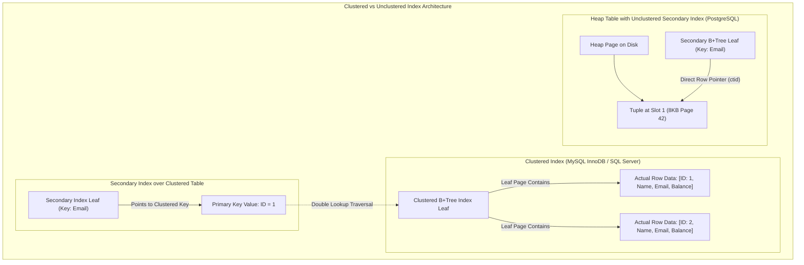
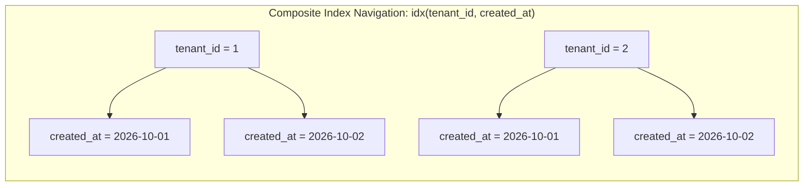
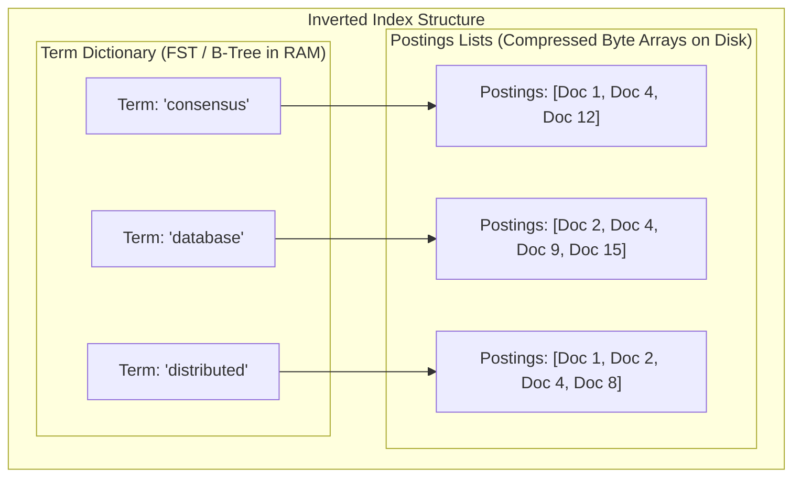
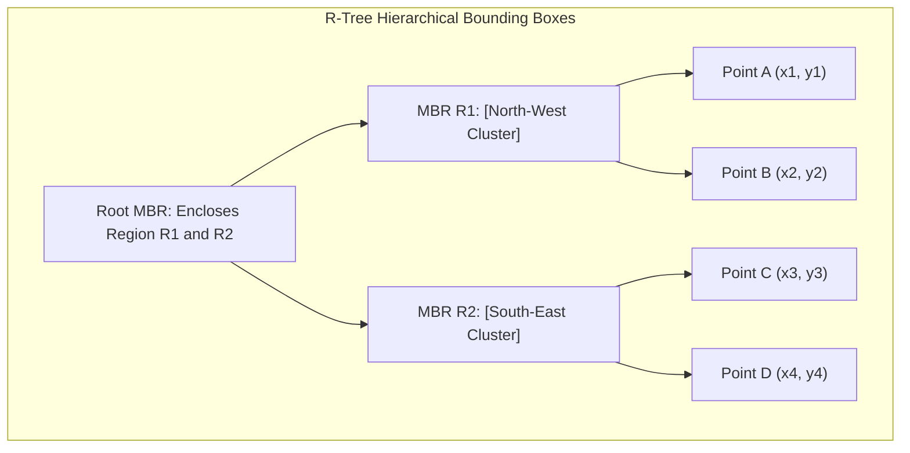
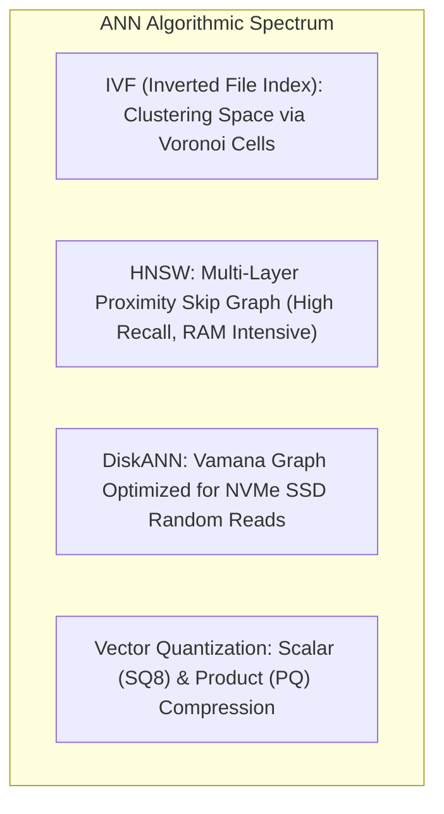
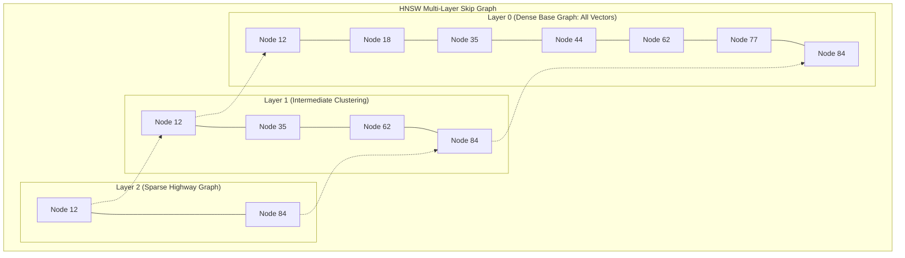

# Module 03: Indexing Theory, Inverted Indexes, and Vector Search

Indexes are auxiliary data structures maintained by a database engine to accelerate record retrieval without scanning the entire underlying relation. Every index represents a physical trade-off: it consumes non-volatile disk and volatile RAM storage, and imposes write amplification overhead on every `INSERT`, `UPDATE`, and `DELETE` operation in exchange for reducing query read complexity from linear $O(N)$ sequential table scans to logarithmic $O(\log N)$ or sub-millisecond approximate nearest-neighbor traversals.

---

## 1. Classical Index Architecture: Clustered, Unclustered, and Composite



### Architectural Classification of Indexes

1. **Clustered Index (Index-Organized Table)**:
   - The physical rows of the table are stored directly within the leaf pages of the B+Tree, sorted strictly by the primary key.
   - *Advantage*: Primary key point lookups and range scans retrieve full row attributes with zero secondary disk lookups.
   - *Disadvantage*: Secondary indexes cannot store direct physical disk byte addresses (because page splits would invalidate millions of external pointers). Instead, secondary indexes store the primary key value, requiring a two-phase traversal (secondary index lookup $\to$ clustered B+tree root lookup).
2. **Unclustered Index (Heap-Organized Table)**:
   - Data rows reside in an unordered heap file.
   - Every index (including primary key indexes) is a secondary index whose leaf nodes store direct logical tuple identifiers (e.g., PostgreSQL `ctid = (block_number, item_offset)`).
   - *Advantage*: Secondary index lookups directly dereference heap pages without a second tree traversal; table updates do not reorder physical table pages.
   - *Disadvantage*: Clustered range scans on large tables trigger random I/O across scattered heap pages.
3. **Covering Indexes (`INCLUDE` Clause)**:
   - Extends an index leaf page to include non-key payload attributes.
   - Facilitates **Index-Only Scans**, allowing the engine to satisfy query projection and filter criteria entirely within the index leaf, bypassing heap page access.

### Composite Index Column Ordering and Skip Scans

For a composite index on attributes $(A, B, C)$, records are sorted lexicographically first by $A$, then by $B$, and finally by $C$:

$$\forall t_1, t_2, \quad (t_1.A < t_2.A) \lor (t_1.A = t_2.A \land t_1.B < t_2.B) \lor (t_1.A = t_2.A \land t_1.B = t_2.B \land t_1.C \le t_2.C)$$



- **Prefix Rule**: Queries filtering on $(A)$ or $(A, B)$ or $(A, B, C)$ leverage the index via direct binary search. Queries filtering *only* on $(B)$ or $(C)$ cannot utilize standard B-tree range traversal because values of $B$ are scattered across distinct subtrees of $A$.
- **B-Tree Skip Scan**: When leading column $A$ has low distinct cardinality (e.g. 5 tenant IDs across 10,000,000 rows), a modern engine skips across the distinct values of $A$, executing sub-index scans for $B$ within each distinct $A$ prefix partition.

---

## 2. Inverted Indexes and Text Retrieval: TF-IDF and BM25

Relational B-Trees cannot efficiently evaluate unstructured text substring or multi-term queries (`WHERE body LIKE '%database%'`). Information retrieval systems utilize **Inverted Indexes**.



### Components of an Inverted Index

1. **Term Dictionary**: A sorted list of all unique stemmed lexemes across all indexed documents, typically stored as a Finite State Transducer (FST) or B-Tree in memory.
2. **Postings Lists**: For each term, an ordered array of document IDs containing the term, accompanied by term frequency ($tf$), positional offsets, and payload data.
3. **Compression Algorithms**:
   - Because postings lists are ordered integers ($d_1 < d_2 < d_3$), engines store **delta gaps** ($\Delta_i = d_i - d_{i-1}$) rather than full 64-bit document IDs.
   - Delta integers are compressed via **Variable-Byte Encoding** (VByte), **Frame-of-Reference** (FoR), or **Roaring Bitmaps**, reducing storage to $1–2$ bytes per posting.

### The Okapi BM25 Ranking Formulation

Given query $Q$ with terms $q_1, \dots, q_n$ and document $D$, **Okapi BM25** computes relevance score $S(D, Q)$:

$$S(D, Q) = \sum_{i=1}^{n} \text{IDF}(q_i) \cdot \frac{f(q_i, D) \cdot (k_1 + 1)}{f(q_i, D) + k_1 \cdot \left(1 - b + b \cdot \frac{|D|}{\text{avgdl}}\right)}$$

Where:
- $f(q_i, D)$ is the term frequency of $q_i$ in document $D$.
- $|D|$ is the length of document $D$ in words, and $\text{avgdl}$ is the average document length across the collection.
- $k_1$ (typically $1.2$) controls **term frequency saturation**: as term frequency increases, its marginal contribution asymptotically saturates toward $k_1 + 1$.
- $b$ (typically $0.75$) controls **document length normalization**: penalizes long verbose documents that mention terms incidentally.
- $\text{IDF}(q_i)$ is Inverse Document Frequency:

$$\text{IDF}(q_i) = \ln \left( \frac{N - n(q_i) + 0.5}{n(q_i) + 0.5} + 1 \right)$$

---

## 3. Multidimensional and Spatial Indexing: R-Trees and BKD-Trees

Relational B+Trees impose a total order on 1D scalars; they cannot natively index multi-dimensional data (e.g. 2D geospatial coordinates $(x, y)$, or multi-attribute numeric ranges).



1. **R-Trees (Minimum Bounding Boxes - MBR)**:
   - Groups spatial objects into hierarchical, overlapping $n$-dimensional bounding boxes.
   - Evaluates range and containment queries by testing box intersection.
   - *Limitation*: Heavy spatial updates cause MBR expansion and overlapping box fragmentation, degrading search performance unless periodically rebuilt via $R^*$-Tree packing algorithms.
2. **BKD-Trees (Block K-D Trees)**:
   - Balanced binary spatial trees partitioning space along alternating dimensions at each tree level.
   - Adopted in Apache Lucene and Elasticsearch for indexing all numeric, date, and spatial values.
   - Features exceptionally fast range scans and low memory footprint.

---

## 4. Vector Search and Approximate Nearest Neighbors (ANN)

In artificial intelligence and machine learning architectures, unstructured entities (documents, images, audio) are mapped into high-dimensional dense floating-point vector spaces ($\mathbb{R}^d$, where $d \in [384, 1536]$). Exact nearest neighbor search requires computing the distance from the query vector to every vector in the dataset:

$$x^* = \arg\min_{x \in X} \text{dist}(q, x)$$

For $N = 10,000,000$ vectors of dimension $d = 1536$, a single exact query requires evaluating $15.36 \times 10^9$ floating-point operations. Spatial partitioning trees (KD-Trees) collapse under the **Curse of Dimensionality** (at $d > 20$, all points become roughly equidistant). Modern database systems therefore deploy **Approximate Nearest Neighbor (ANN)** indexing.



### Distance Metrics

| Metric | Mathematical Formula | Usage Context |
| :--- | :--- | :--- |
| **Euclidean Distance ($L_2$)** | $d(u, v) = \sqrt{\sum_{i=1}^{d} (u_i - v_i)^2}$ | Continuous physical spatial features, geometric clustering. |
| **Cosine Distance** | $d(u, v) = 1 - \frac{u \cdot v}{\|u\|_2 \|v\|_2} = 1 - \frac{\sum u_i v_i}{\sqrt{\sum u_i^2} \sqrt{\sum v_i^2}}$ | Text and language embeddings where vector magnitude carries no semantic weight. |
| **Dot Product (Inner Product)** | $d(u, v) = - (u \cdot v) = - \sum_{i=1}^{d} u_i v_i$ | Normalized vectors ($\|u\| = 1$), maximizing SIMD throughput (equivalent to Cosine). |

### 1. Inverted File Index (IVF)
- **Algorithm**: Partitions vector space into $K$ Voronoi cells using $k$-means clustering during an initial training phase.
- **Index Structure**: Maintains an inverted list for each centroid. Vectors are assigned to their nearest centroid.
- **Query Phase**: The query vector is compared against all $K$ centroids. The engine selects the `nprobe` closest centroids and scans only the vectors in those inverted lists.
- **Trade-off**: Fast index construction; lower recall when queries lie near Voronoi boundaries unless `nprobe` is tuned aggressively.

### 2. Hierarchical Navigable Small World (HNSW)
HNSW (Malkov & Yashunin, 2018) is the state-of-the-art graph-based ANN algorithm. It models multi-layer proximity graphs inspired by probabilistic SkipLists.



- **Structural Mechanics**:
  - Vectors are assigned an entry layer probabilistically: the probability of a node existing at layer $l$ decays exponentially: $P(l) \propto e^{-l / m_L}$.
  - **Layer 0** contains all vectors in the dataset with high node connectivity.
  - Upper layers contain sparse subsets forming "express highways" over long vector distances.
- **Query Traversal**:
  - Search begins at a global entry point at the topmost layer.
  - The algorithm executes greedy routing: hopping to the neighbor closest to the query vector until reaching a local minimum at that layer.
  - The search drops down to the corresponding node in the next lower layer and repeats greedy routing.
  - At **Layer 0**, it explores candidate neighbors tracked in a priority queue of size `ef_search`, returning the top $K$ nearest vectors.
- **Key Parameters**:
  - $M$: Maximum number of outgoing edges per node (typically $16–64$). Higher $M$ increases recall and graph memory footprint.
  - $ef\_construction$: Size of the dynamic candidate list during graph construction (typically $64–200$).
  - $ef\_search$: Size of the candidate list during query execution. Higher values linearly increase search latency while asymptotically improving recall.

### 3. Vector Quantization Techniques (Compression)
Uncompressed high-dimensional vectors require massive memory: $1,000,000$ OpenAI embeddings ($1536 \times 4$ bytes) consume $6.14\text{ GB}$ of RAM *excluding* HNSW graph edge overhead.
- **Scalar Quantization (SQ8)**: Maps each 32-bit float linearly into an 8-bit signed integer ($[-128, 127]$), reducing vector memory footprint by $75\%$ ($4\times$) with minimal loss of search recall.
- **Product Quantization (PQ)**: Decomposes a $d$-dimensional vector into $m$ orthogonal sub-vectors, runs $k$-means on each sub-space, and represents each sub-vector as an 8-bit centroid ID. Reduces memory footprint by $16\times$ to $32\times$ and accelerates distance calculations via precomputed lookup tables (Asymmetric Distance Computation - ADC).
- **Better Binary Quantization (BBQ / 1-bit)**: Quantizes each dimension strictly to a single bit ($0$ or $1$) based on its sign. Computes vector distances using hardware `POPCNT` (population count) over `XOR` bitwise operations, running at blazing CPU clock speed.

---

## 5. Then vs Now: Evolution of Query Retrieval

| Retrieval Dimension | Classical Databases (1980–2000s) | Modern Search Engines (2010s) | AI-Era Hybrid Engines (2020s–Present) |
| :--- | :--- | :--- | :--- |
| **Primary Index Primitives** | B+Tree (Equality and 1D Range) | Inverted Index (Postings lists + BM25) | Unified Multi-Vector & Inverted Indexes |
| **Query Matching** | Exact boolean matching (`WHERE status = 'active'`) | Tokenized keyword relevance | Semantic similarity via embeddings + Hybrid Lexical |
| **Search Scoring** | Binary predicate filter (True/False) | Okapi BM25 frequency saturation | Reciprocal Rank Fusion (RRF) combining BM25 and HNSW |
| **Index Hardware Model** | Disk pages buffered into DRAM pool | Inverted postings lists memory-mapped | Multi-tiered: Quantized graphs in RAM, raw vectors on NVMe |

---

## 6. Production Failure Modes and Anti-Patterns

### 1. Vector Search Recall Collapse Under Selective Relational Filters
- **Symptom**: A hybrid query (`WHERE tenant_id = 42 ORDER BY embedding <=> query LIMIT 10`) returns only 2 low-relevance results or takes seconds to execute.
- **Root Cause**: **Post-filtering anomaly**. The engine executes HNSW vector search first, retrieves top 100 nearest global vectors, and then applies `tenant_id = 42`. If tenant 42 owns only $0.1\%$ of the database, almost all vector candidates are discarded. Conversely, **pre-filtering** using a B-tree on `tenant_id` isolates a tiny candidate set, but HNSW cannot easily restrict graph hops strictly inside arbitrary disjoint ID sets without falling back to slow brute-force scans.
- **Mitigation**: Utilize engines supporting **Iterative Single-Stage Graph Filtering** (e.g. pgvector, Lucene 10) or create partitioned vector indexes isolated per tenant.

### 2. Inverted Index Mapping Explosion
- **Symptom**: Full-text cluster runs out of memory; cluster state serialization causes cluster-wide heartbeat disconnects.
- **Root Cause**: Indexing dynamic user-generated JSON where arbitrary object keys are interpreted as new index fields, creating millions of distinct dictionary terms and metadata postings.
- **Mitigation**: Enforce strict schema mappings (`dynamic: false` or `dynamic: runtime`) and route unstructured key-value dictionaries into `flattened` field types.

### 3. Secondary Index Write Amplification Thrashing
- **Symptom**: Ingestion throughput plummets by $80\%$ as more indexes are added to a table.
- **Root Cause**: Every row insert requires writing to the heap and updating every individual secondary B-tree index. Because secondary indexes have distinct key orders, each write causes random page updates across completely disjoint disk blocks in the buffer pool.
- **Mitigation**: Audit and prune redundant indexes; utilize covering indexes to satisfy multiple queries; apply Heap-Only Tuples (HOT) optimizations.

---

## 7. Interview Drill

<details>
<summary><strong>Q1: What is the fundamental difference between a clustered and an unclustered index, and how does it affect secondary index lookup latency?</strong></summary>

**Answer:** 
In a **clustered index** (e.g. MySQL InnoDB), the leaf pages of the index contain the physical row data itself. In an **unclustered index** (e.g. PostgreSQL), the table data is stored in an independent heap file, and indexes contain pointers (Tuple IDs / `ctid`) to pages in that heap file.

This fundamentally impacts secondary indexes:
- In a clustered architecture, secondary indexes store the table's primary key as the row pointer (to avoid updating secondary indexes when clustered leaf pages split). Consequently, a secondary index lookup requires a **two-phase traversal**: first traversing the secondary B+Tree to find the primary key, and then traversing the clustered B+Tree from root to leaf to retrieve the actual row.
- In an unclustered architecture, secondary indexes store direct heap page pointers (`ctid`), allowing the engine to fetch the row from the heap in a single I/O operation without a second B+Tree traversal.
</details>

<details>
<summary><strong>Q2: Explain the purpose and mathematics of term frequency saturation in Okapi BM25 compared to classical TF-IDF.</strong></summary>

**Answer:** 
In classical TF-IDF, term frequency weight scales linearly or logarithmically with the count of term occurrences ($tf$). Under pure linear scaling, a document containing a keyword 100 times is scored 10 times higher than a document containing it 10 times, even if the repetition is spam or redundant.

Okapi BM25 replaces linear scaling with a **hyperbolic saturation curve**:

$$\frac{f(q, D) \cdot (k_1 + 1)}{f(q, D) + k_1 \cdot \left(1 - b + b \cdot \frac{|D|}{\text{avgdl}}\right)}$$

As term frequency $f(q, D) \to \infty$, this term approaches an asymptote of $k_1 + 1$ (typically $2.2$ when $k_1 = 1.2$). This ensures that once a document mentions a search term several times, subsequent mentions yield diminishing marginal relevance gains.
</details>

<details>
<summary><strong>Q3: Why do spatial tree structures like KD-trees and R-trees fail when searching high-dimensional vector spaces ($d > 100$)?</strong></summary>

**Answer:** 
This failure is caused by the **Curse of Dimensionality**:
1. **Exponential Volume Expansion**: In high-dimensional spaces, the volume of the space grows exponentially ($V \propto r^d$). The data points become exponentially sparse.
2. **Equidistance Phenomenon**: As dimension $d$ increases, the distance between any query point and its nearest neighbor approaches the distance to its furthest neighbor ($\lim_{d \to \infty} \frac{D_{\max} - D_{\min}}{D_{\min}} = 0$).
3. **Partition Ineffectiveness**: Spatial partitioning trees work by hyper-plane bounding (bisecting dimensions or enclosing in bounding boxes). In high dimensions, any query sphere intersects virtually every bounding box in the tree, forcing spatial search algorithms to backtrack and explore nearly all tree nodes, degenerating into an $O(N)$ brute-force linear scan with high tree traversal overhead.
</details>

<details>
<summary><strong>Q4: Describe how the Hierarchical Navigable Small World (HNSW) graph achieves logarithmic search complexity.</strong></summary>

**Answer:** 
HNSW achieves $O(\log N)$ search complexity by combining the concept of **Navigable Small World graphs** (graphs with high local clustering and short average path lengths) with the hierarchical multi-layer skip-list principle:

1. Vectors are assigned to hierarchical layers probabilistically. The top layers contain very few vectors connected by long-distance edges ("highways"), while the bottom layer (Layer 0) contains all vectors with fine-grained local connectivity.
2. Search begins at the topmost layer. It executes greedy routing: evaluating candidate neighbors and hopping to the neighbor closest to the query vector until no closer neighbor exists (a local minimum at that layer).
3. The search drops to the corresponding node in the next lower layer and resumes greedy routing over shorter-range edges.
4. This hierarchical progression prevents the search from getting trapped in local minima in high-dimensional space and converges exponentially toward the true nearest neighbors at Layer 0.
</details>

<details>
<summary><strong>Q5: How does Product Quantization (PQ) compress dense vector embeddings, and how does Asymmetric Distance Computation (ADC) work?</strong></summary>

**Answer:** 
Product Quantization compresses vectors by decomposing the vector space into a Cartesian product of low-dimensional subspaces:
1. A $d$-dimensional vector (e.g. $d = 1024$) is split into $m$ sub-vectors of dimension $d/m$ (e.g. $m = 64$ sub-vectors of dimension 16).
2. For each subspace, $k$-means clustering identifies $k = 256$ centroids. Each centroid is assigned an 8-bit ID ($0–255$).
3. Any vector is represented by $m$ 1-byte centroid IDs, reducing a 4096-byte vector ($1024 \times 4$) to just 64 bytes ($64\times$ compression).

**Asymmetric Distance Computation (ADC)** evaluates distance without decompressing the database vectors: the uncompressed query vector $q$ is projected into each of the $m$ subspaces, and its Euclidean distance to all 256 centroids is computed once and stored in an in-memory lookup table ($m \times 256$). The distance between query $q$ and any quantized database vector is computed simply by summing $m$ precalculated lookups from the table, requiring zero floating-point multiplications.
</details>

<details>
<summary><strong>Q6: Explain the "Covering Index" optimization and why it produces drastic performance gains in OLTP databases.</strong></summary>

**Answer:** 
A covering index is a secondary index that contains all columns required by a specific query (both filter columns and projected columns), typically implemented via the `INCLUDE` clause:

```sql
CREATE INDEX idx_orders_covering ON orders (user_id) INCLUDE (total_amount, status);
```

In standard secondary index lookups, the engine scans the index to find matching keys and must subsequently perform random I/O reads on underlying table heap pages to retrieve the non-indexed columns (`total_amount, status`). 

With a covering index, all required values are stored directly within the index leaf node. The query optimizer executes an **Index-Only Scan**, satisfying the query entirely from the cached index structure. This eliminates random heap disk reads, improves memory buffer locality, and avoids table page locks.
</details>
