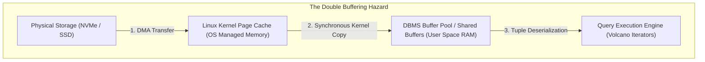
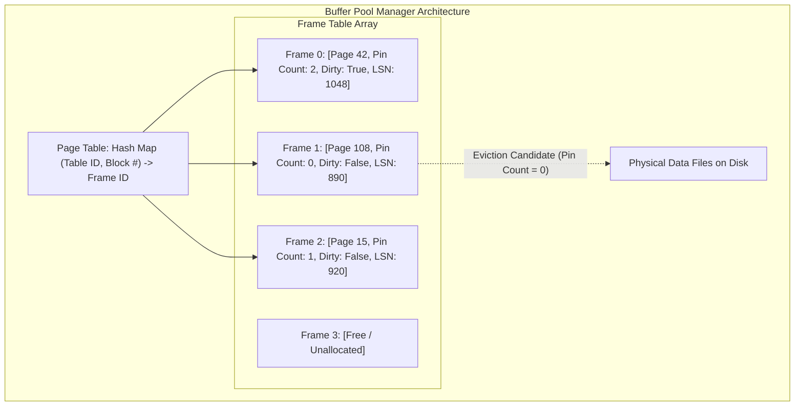
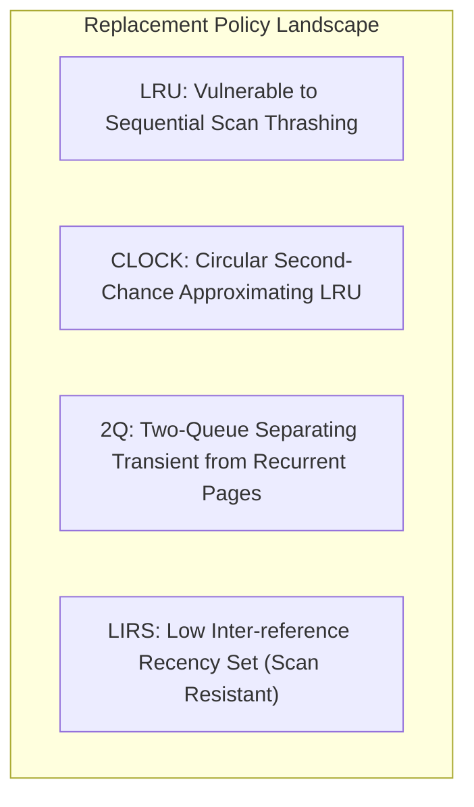
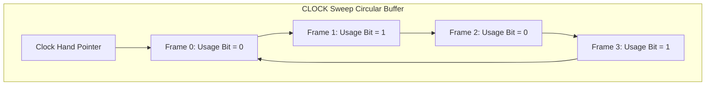
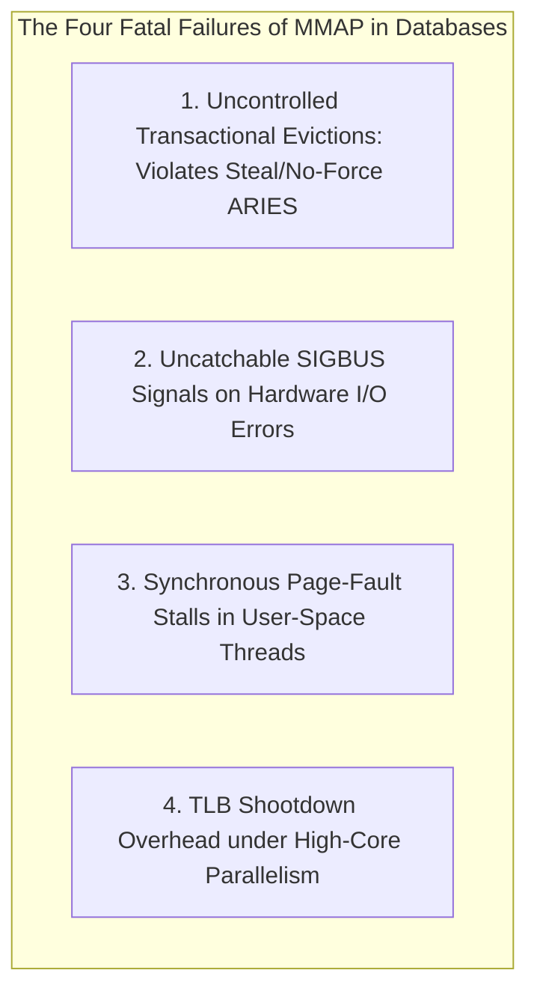
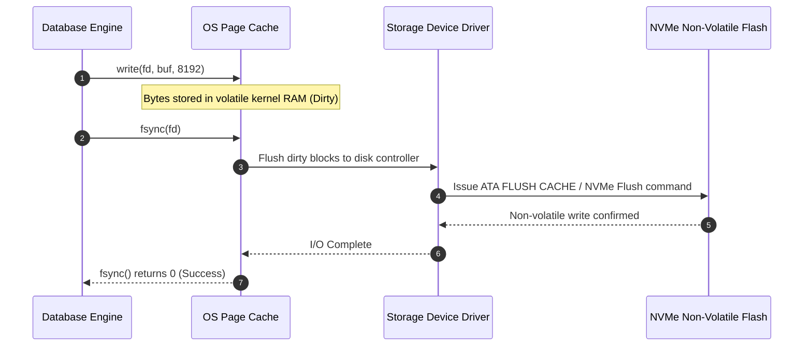
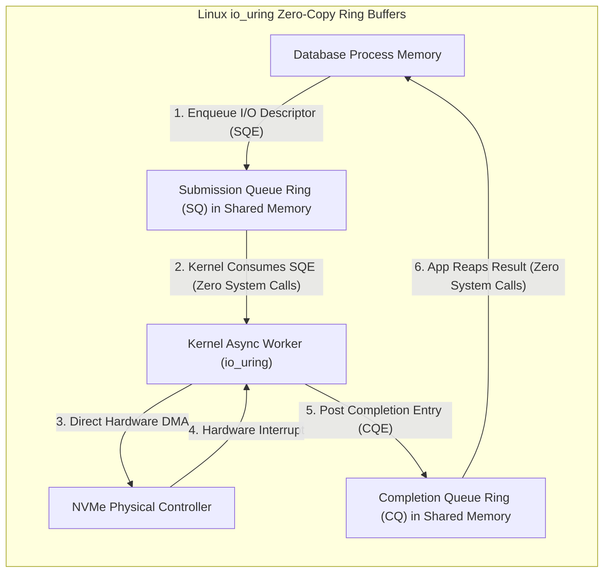

# Module 04: Buffer Management, Memory Hierarchies, and Operating System I/O

Database performance is primarily governed by how effectively the engine minimizes physical disk I/O. A memory reference to DRAM executes in approximately $50–100\text{ ns}$, whereas an NVMe flash random read takes $10–50\ \mu\text{s}$ ($500\times$ slower) and a mechanical spinning platter seek takes $5–10\text{ ms}$ ($100,000\times$ slower). Consequently, modern database engines implement sophisticated **Buffer Pool Managers** that mediate all reads and writes between physical storage files and query execution execution engines.

---

## 1. Operating System Page Cache versus DBMS Buffer Pool: The Double Buffering Dilemma

When an application uses standard operating system system calls (`read()` and `write()`), the OS kernel copies data from the storage device into kernel-managed RAM known as the **OS Page Cache**, and subsequently copies those bytes into the application's user-space memory buffer.

### Why Database Engines Require Dedicated Buffer Management

Relying on the operating system kernel to manage database caching introduces four severe architectural liabilities:

1. **The Double Buffering Penalty**: The exact same 8KB database page is duplicated in both the kernel page cache and the DBMS buffer pool. This halves the effective RAM capacity available to cache the working set, triggering premature disk evictions.
2. **Lack of Semantic Awareness**: The operating system kernel treats all disk blocks as opaque byte chunks. It cannot distinguish between a transient sequential table scan of a 1TB log table and the root node of a critical B+Tree that routes 100,000 queries per second. A single sequential scan can flush the entire database working set out of the OS cache.
3. **Loss of Write-Ahead Log (WAL) Invariant Control**: In transactional database systems, a dirty data page must *never* be flushed to disk before its corresponding WAL record has been flushed and fsynced to disk (the Steal/Write-Ahead rule). Operating system kernels asynchronously flush dirty pages in arbitrary order based on memory pressure, risking catastrophic unrecoverable database corruption during crashes.
4. **Direct I/O (`O_DIRECT`) as the Architectural Solution**: Enterprise databases (PostgreSQL, MySQL InnoDB, Oracle) open database files using the `O_DIRECT` flag (or `F_NOCACHE` on macOS), instructing the operating system kernel to bypass the page cache entirely. Direct memory access (DMA) transfers data directly between the physical storage controller and user-space DBMS buffer frames.

---

## 2. Buffer Pool Architecture: Frames, Hash Tables, and Page Latches

A Buffer Pool Manager organizes an allocated pool of contiguous virtual memory into an array of fixed-size slots called **Buffer Frames**.

### Metadata Maintained per Buffer Frame

- **Page Identifier (`PageID`)**: The physical mapping `(file_descriptor / table_oid, block_number)`.
- **Pin Count (Reference Count)**: Tracks how many concurrent worker threads are currently executing queries against this physical page in memory. A page with $\text{Pin Count} > 0$ is pinned and **cannot be evicted**. A frame becomes an eviction candidate only when its pin count reaches exactly zero.
- **Dirty Bit (`is_dirty`)**: A boolean flag indicating whether a thread has modified the page contents in memory. If `is_dirty = true`, the page must be written and fsynced to storage before the frame can be overwritten with a new page.
- **Page LSN**: The Log Sequence Number of the last WAL record that modified this page, used to enforce WAL flush ordering.
- **Page Latches (Read/Write Locks)**: Short-term memory synchronization primitives (rwlocks or atomic futexes) protecting the physical memory bytes of the frame from concurrent corruption while a worker thread reads or mutates tuples. (Distinct from transactional *database locks*, which protect logical rows across transaction lifetimes).

---

## 3. Buffer Replacement Policies: LRU, 2Q, CLOCK, and LIRS

When a query requests a page absent from memory and all buffer frames are occupied, the Buffer Pool Manager must select a victim frame to evict.

### 1. Least Recently Used (LRU) and Sequential Scan Pollution
Classical LRU maintains a doubly-linked list of frames ordered by their last access timestamp. When eviction is required, the frame at the tail is selected.
- **The Scan Pollution Vulnerability**: Suppose the buffer pool holds 100,000 pages. A background analytics query executes a sequential scan across a 150,000-page table. Every page of the scan is referenced exactly once. In a naive LRU engine, this single scan pushes all 100,000 hot index and metadata pages out of memory, leaving the buffer pool populated entirely with cold pages that will never be accessed again.

### 2. The CLOCK Algorithm (Second-Chance FIFO)
Because maintaining a strict LRU doubly-linked list requires acquiring a global mutex on every single page read to shift nodes to the list head, high-concurrency engines adopt the **CLOCK algorithm**:

- Frames are arranged in a logical circular ring. Each frame possesses an atomic 1-bit or counter `usage_bit`.
- When a page is accessed by a query, its `usage_bit` is set to $1$ via an atomic CAS instruction without acquiring global list locks.
- When an eviction is needed, the **clock hand** sweeps sequentially through the ring:
  - If a frame has $\text{usage\_bit} = 1$, the clock hand flips it to $0$ and advances.
  - If a frame has $\text{usage\_bit} = 0$ and $\text{pin\_count} = 0$, this frame is selected as the **eviction victim**.

### 3. Advanced Scan-Resistant Policies: 2Q and LIRS
- **2Q (Two Queue)**: Divides memory into two distinct queues: an $A1_{\text{in}}$ FIFO queue for newly loaded pages, and an $Am$ LRU queue for recurrent pages. When a page is first read, it enters $A1_{\text{in}}$. Only if it is referenced *again* while in the queue is it promoted to the main LRU queue $Am$. Single-pass sequential scans sweep through $A1_{\text{in}}$ without evicting hot pages in $Am$.
- **LIRS (Low Inter-Reference Recency Set)**: Categorizes pages based on their *inter-reference distance* (the time elapsed between two consecutive references). Pages with low inter-reference distance are classified as High Priority (LIR) and protected from eviction, while single-pass pages remain Low Priority (HIR) and are rapidly discarded.

---

## 4. The `mmap` Anti-Pattern for Database Engines

A recurring engineering temptation is to eliminate the Buffer Pool Manager entirely by using memory-mapped files (`mmap()`), letting the operating system kernel handle page caching and virtual memory translation.

In 2022, Crotty et al. (Carnegie Mellon University) published the definitive empirical critique: *"Are You Sure You Want to Use MMAP in Your Database Management System?"* (CIDR 2022). The paper demonstrates why `mmap` is fundamentally unsuited for robust transactional database architectures:

1. **Transactional Incoherence (Steal/No-Force Violation)**: When an application modifies bytes in an `mmap`-backed pointer, the page becomes dirty in the OS page cache. The kernel's background flusher (`kswapd`) can flush those dirty bytes to physical storage at any arbitrary time—even before the modifying transaction commits, and *before* the WAL record is written. Preventing dirty page flushes under `mmap` requires complex, slow copy-on-write shadow paging.
2. **Synchronous Page-Fault Stalls**: When a thread dereferences a memory address whose page is not in RAM, the CPU triggers a hardware **major page fault**, pausing user-space execution and trapping into the kernel. The thread blocks completely in kernel space while disk I/O completes. In an asynchronous or coroutine-based database (e.g. ScyllaDB, Seastar), this stalls the entire user-space event loop, preventing other concurrent tasks from executing.
3. **Fatal `SIGBUS` Signals**: If a disk controller encounters an uncorrectable read error, or if storage fills up while writing a dirty page, the operating system kernel delivers a `SIGBUS` signal to the process. Unlike standard system calls that return an inspectable `EIO` or `ENOSPC` error code, handling asynchronous `SIGBUS` signals in multi-threaded C++/Rust runtimes without crashing or corrupting state is extraordinarily difficult.
4. **Virtual Memory and TLB Shootdown Overhead**: Updating virtual page tables across hundreds of CPU cores requires inter-processor interrupts (IPIs) to invalidate Translation Lookaside Buffers (TLBs), creating massive multi-core scalability bottlenecks.

---

## 5. Linux Storage Mechanics: The "fsyncgate" Flaw, O_DIRECT, and `io_uring`

Ensuring physical persistence requires understanding the semantics of POSIX synchronization system calls and kernel block layer internals.

### The PostgreSQL "fsyncgate" Anomaly (2018)

In 2018, the database engineering community discovered a critical flaw in how the Linux kernel handled I/O errors during background writeback:
1. A database process issues `write()` calls, dirtying pages in the OS page cache.
2. The kernel's background flusher attempts to write the dirty pages to disk, but the storage drive encounters an I/O error (e.g. network disconnect on SAN/EBS).
3. The kernel marks the page buffer as clean (discarding the dirty state) and records the error code in the inode.
4. Later, the database process issues `fsync()`. The Linux kernel returned `EIO` on the *first* `fsync()` call, but **cleared the error bit** from the inode.
5. If the database retried `fsync()`, the subsequent call returned **0 (Success)**! The database engine assumed the data was safely on disk, whereas the kernel had silently discarded the modified data blocks from RAM without writing them to disk.
- **Resolution**: Database engines must treat any `fsync()` failure as a fatal cluster panic, immediately terminating the server process to force crash recovery from the Write-Ahead Log.

### The Modern I/O Frontier: Linux `io_uring`

Historically, asynchronous I/O on Linux via POSIX AIO (`io_submit`) was crippled: it only worked with `O_DIRECT`, blocked synchronously on filesystem metadata locks, and incurred heavy context-switch costs.

Introduced by Jens Axboe in Linux 5.1 (2019), **`io_uring`** completely transforms database storage I/O:

- **Ring Buffer Design**: Operates via two lockless ring buffers shared directly between user space and kernel space: the **Submission Queue (SQ)** and the **Completion Queue (CQ)**.
- **Zero System-Call Overhead**: An application writes thousands of read/write requests into the Submission Queue and submits them with a single `io_uring_enter()` call—or in polled mode (`IORING_SETUP_SQPOLL`), with **zero system calls**, as a dedicated kernel worker thread continuously polls the queue.
- **High-Throughput Vectorization**: Enables modern database engines (such as PostgreSQL 18+, ScyllaDB, and DuckDB) to achieve millions of IOPS with minimal CPU utilization.

---

## 6. Then vs Now: Buffer and I/O Evolution

| Dimension | Classical Era (1980–2000s) | Modern Pre-2020 Era | Modern State-of-the-Art (2020s–Present) |
| :--- | :--- | :--- | :--- |
| **I/O Interface** | Blocking POSIX `read()` / `write()` with synchronous threads | Thread pools executing synchronous `pread()` / `pwrite()` | True asynchronous kernel bypass via `io_uring` and SPDK |
| **Storage Layer** | Relied partially on OS page cache (`mmap` or buffered I/O) | Strict `O_DIRECT` with custom user-space buffer pools | Asynchronous I/O (`io_uring`) combined with `O_DIRECT` and direct NVMe DMA |
| **Eviction Policy** | Naive LRU or simple circular CLOCK | 2Q / LRU-K / ARC (Adaptive Replacement Cache) | Scan-resistant LIRS and concurrent lock-free CLOCK-Pro |
| **Concurrency Primitives**| Coarse-grained buffer pool mutexes | Striped buffer pool partitions and lock-free page tables | Thread-per-core shared-nothing architectures (Seastar) |

---

## 7. Production Failure Modes and Anti-Patterns

### 1. Silent Data Loss via the `fsync()` Retry Anti-Pattern
- **Symptom**: After a brief storage disconnect or network glitch, the database crashes and recovers, but previously acknowledged committed transactions are permanently missing or corrupted.
- **Root Cause**: The application code caught an error on `fsync()`, slept, and retried `fsync()`. Because Linux cleared the error state after the first call, the retry returned success, masking the fact that the operating system kernel silently discarded the dirty page blocks without writing them to disk.
- **Mitigation**: Never retry a failed `fsync()`. Crash the database process immediately (`PANIC`) and execute recovery from the Write-Ahead Log.

### 2. Sequential Scan Buffer Pool Eviction Cascades
- **Symptom**: Database queries that typically take $1\text{ ms}$ suddenly spike to $500\text{ ms}$; CPU utilization drops while disk read IOPS hit hardware limits.
- **Root Cause**: A rogue ad-hoc query (e.g. `SELECT * FROM audit_logs WHERE payload LIKE '%error%'`) executed a sequential scan over a table larger than the entire buffer pool, flushing hot operational indexes and tables out of memory.
- **Mitigation**: Implement a Ring Buffer scan limit for sequential scans (e.g. PostgreSQL restricts sequential scans to a tiny 256KB ring buffer), or configure scan-resistant eviction algorithms (2Q / LIRS).

### 3. Asynchronous Page Fault Latency Injections in MMAP Engines
- **Symptom**: P99.9 latency spikes by three orders of magnitude in an engine utilizing `mmap` (e.g. LMDB, early MongoDB).
- **Root Cause**: An application worker thread dereferences an unmapped memory address. The OS halts the thread in kernel space to handle a major page fault, blocking the thread for $20\text{ ms}$ while retrieving the page from disk, stalling all downstream transactions multiplexed on that thread.
- **Mitigation**: Migrate from `mmap` to explicit user-space Buffer Pool Managers using `io_uring` or asynchronous prefetching (`madvise(MADV_WILLNEED)`).

---

## 8. Interview Drill

<strong>Q1: What is the "Double Buffering" problem, and why do high-performance database engines bypass the OS page cache using O_DIRECT?</strong>

**Answer:** 
The double buffering problem occurs when a database engine runs on top of standard buffered operating system I/O. The operating system kernel caches 8KB disk blocks in the kernel **Page Cache**, while the database engine simultaneously caches those exact same blocks in its user-space **Buffer Pool**.

This duplicates cached data in RAM, effectively cutting the usable memory capacity in half and forcing premature page evictions. Furthermore, the database engine cannot control when the operating system writes dirty page cache blocks to disk, which risks violating the Write-Ahead Logging (WAL) invariant. Using the `O_DIRECT` flag instructs the OS kernel to bypass the page cache completely, transferring data directly between storage controllers and user-space buffer pool frames via DMA.

<strong>Q2: Explain the purpose of the "Pin Count" (or reference count) in a buffer frame, and what happens if a page with Pin Count > 0 is selected for eviction.</strong>

**Answer:** 
The Pin Count tracks the number of concurrent query execution threads currently reading or modifying tuples inside that specific memory frame. 

A page with $\text{Pin Count} > 0$ **must never be evicted**. If a buffer replacement algorithm (e.g. CLOCK or LRU) examines a frame whose pin count is greater than zero, it skips that frame and continues searching for a victim whose pin count is exactly zero. Evicting a pinned page would corrupt active execution memory, as worker threads would read or write data belonging to the newly loaded page that overwrote the frame.

<strong>Q3: How does the 2Q replacement policy prevent sequential scan buffer pool thrashing compared to naive LRU?</strong>

**Answer:** 
Naive LRU places every newly accessed page at the head of a single LRU list. A sequential scan over a table larger than the buffer pool will push every page into the list, evicting the entire existing hot working set even though the scanned pages will only be read once.

The **2Q policy** resolves this by splitting memory into two queues:
1. An $A1_{\text{in}}$ FIFO queue for newly referenced pages.
2. An $Am$ LRU queue for recurrently referenced pages.

When a page is first read, it enters $A1_{\text{in}}$. If it is never accessed again (typical of sequential scans), it simply slides out of $A1_{\text{in}}$ and is evicted without ever touching $Am$. Only if a page receives a *second* reference while in the queue is it promoted to $Am$. This insulates hot working-set pages in $Am$ from single-pass scan thrashing.

<strong>Q4: Why was the Linux "fsyncgate" vulnerability so catastrophic for database durability, and what is the proper engineering remedy?</strong>

**Answer:** 
During the "fsyncgate" vulnerability, if background kernel writeback failed due to an I/O error, the Linux kernel discarded the dirty state of the page in the page cache and recorded the error code in the file inode. 

When the database engine subsequently called `fsync()`, the first call returned `EIO` and **cleared the error bit**. If the database retried `fsync()`, the subsequent call returned **0 (Success)**! The database engine assumed the write had succeeded, when in reality the kernel had dropped the dirty block from memory without persisting it to disk.

The proper engineering remedy is: **a failed `fsync()` must never be retried**. The database engine must immediately trigger a fatal process panic (`PANIC`), terminating the server to force recovery from the sequential Write-Ahead Log upon restart.

<strong>Q5: Summarize why the CMU CIDR 2022 paper argued against using MMAP in database management systems.</strong>

**Answer:** 
Crotty et al. demonstrated that `mmap` creates four fundamental architectural liabilities:
1. **Transactional Safety**: The OS kernel can flush dirty pages to disk at any time under memory pressure, violating the ARIES Steal/Write-Ahead rule and risking disk corruption before WAL records are flushed.
2. **I/O Stalls**: Page faults trap into the kernel synchronously, blocking the calling thread. In event-driven or coroutine architectures, this halts the entire thread and freezes unrelated concurrent tasks.
3. **Error Handling**: Storage failures or full-disk conditions during page eviction deliver asynchronous `SIGBUS` signals rather than return codes (`EIO`/`ENOSPC`), causing unrecoverable process crashes.
4. **Scalability**: Page table modifications across high-core systems trigger expensive inter-processor interrupts for TLB shootdowns, creating severe multi-core latency bottlenecks.

<strong>Q6: How does Linux `io_uring` achieve orders-of-magnitude higher I/O throughput compared to traditional POSIX AIO and synchronous read/write calls?</strong>

**Answer:** 
Traditional POSIX I/O requires a context switch into the kernel for every single `read()` or `write()` system call. Even POSIX AIO (`io_submit`) incurs system-call overhead per batch and frequently blocks synchronously on filesystem inode locks.

`io_uring` replaces system calls with two **lock-free ring buffers** in shared memory:
1. The **Submission Queue (SQ)** where user space enqueues I/O request descriptors.
2. The **Completion Queue (CQ)** where the kernel posts completed I/O events.

In polled mode (`IORING_SETUP_SQPOLL`), a dedicated kernel worker polls the Submission Queue directly, enabling the database to submit and reap millions of I/O operations with **zero system calls** and zero context switches. Furthermore, `io_uring` fully supports non-blocking asynchronous direct I/O (`O_DIRECT`), enabling true hardware-level NVMe parallelism.

