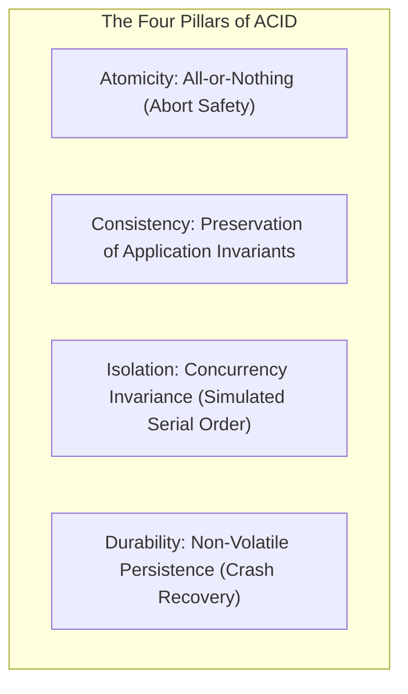
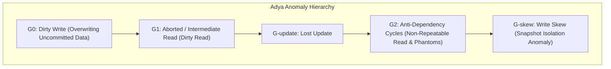
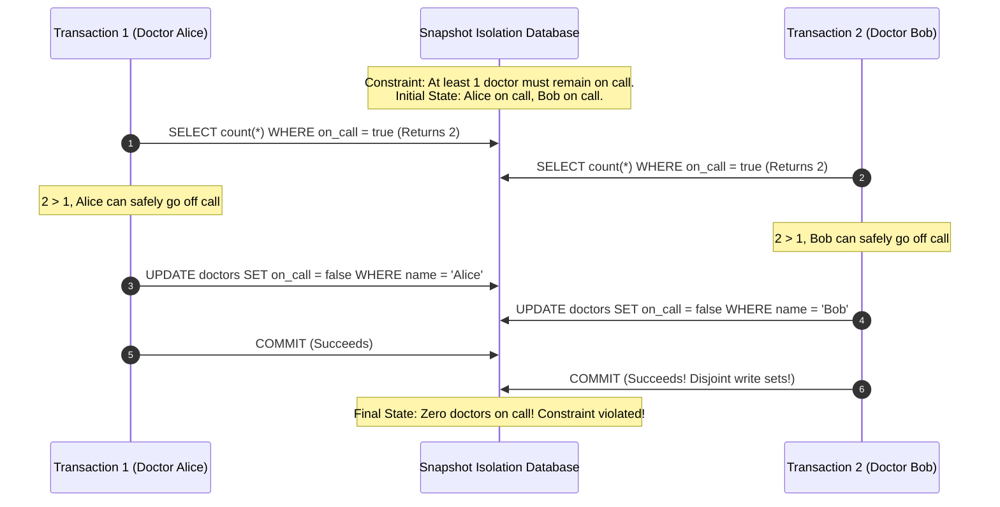
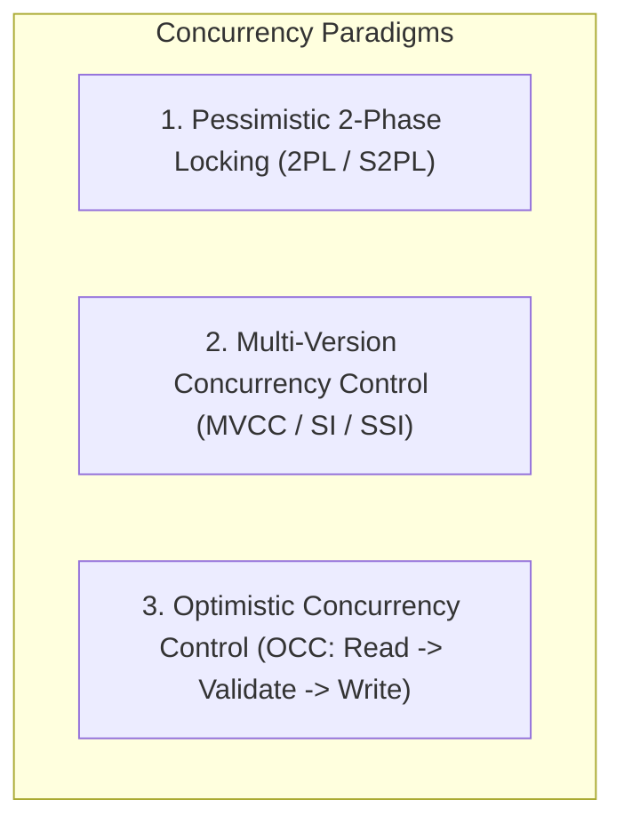
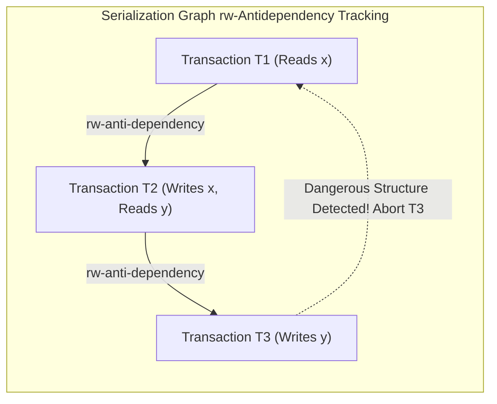

# Module 05: Transactions, Formal ACID, and the Concurrency Anomaly Spectrum

The transaction is the central abstraction of reliable data systems. Introduced by Jim Gray and colleagues in the late 1970s, transactions provide safety guarantees that insulate application business logic from the catastrophic realities of system crashes, hardware failures, concurrent interleaved executions, and partial network partitions. However, despite decades of widespread industry adoption, the precise definitions of transactional isolation and the mechanical anomalies permitted by commercial database engines remain widely misunderstood.

---

## 1. Formal ACID Deconstruction

ACID is frequently treated as a uniform acronym, but its four constituents address fundamentally distinct theoretical concerns:

1. **Atomicity (Abortability)**:
   - A transaction represents an indivisible unit of work. If a transaction encounters a software error, constraint violation, system crash, or explicit application `ROLLBACK`, every mutation executed up to that point must be completely undone.
   - Atomicity is *not* about concurrency; it is about **fault recovery**. The database engine ensures the system state never reflects a partial execution of a failed transaction.
2. **Consistency (Invariant Preservation)**:
   - The state of the database satisfies all defined application and relational constraints before and after transaction execution.
   - Unlike Atomicity, Isolation, and Durability (which are purely mechanical guarantees enforced by the database engine), Consistency is fundamentally an **application property**: the application code must define correct operations that preserve business truths (e.g. conservation of money in double-entry bookkeeping). The database aids consistency through declarative schema constraints (`UNIQUE`, `CHECK`, `FOREIGN KEY`).
3. **Isolation (Concurrent Non-Interference)**:
   - Concurrently executing transactions must not observe or interfere with each other's intermediate, uncommitted states. Under the strictest isolation level (Serializability), the concurrent execution of transactions yields a final database state mathematically equivalent to some serial, sequential execution of those transactions one after another.
4. **Durability (Survivability)**:
   - Once a transaction receives a successful commit confirmation, all its modifications are guaranteed to survive any subsequent system crash, power outage, or OS panic. Durability is enforced by persisting records to non-volatile storage (via the Write-Ahead Log) before acknowledging the client.

---

## 2. The Concurrency Anomaly Hierarchy: Berenson and Adya Frameworks

In 1992, the ANSI SQL standard attempted to define transaction isolation levels using three informal operational phenomena ($P1$ Dirty Read, $P2$ Non-Repeatable Read, $P3$ Phantom). In 1995, Berenson et al. published the seminal paper *"A Critique of ANSI SQL Isolation Levels"*, proving that the ANSI definitions were ambiguous, incomplete, and failed to account for modern multi-version engines. In 1999, Atul Adya formalized generalized anomaly definitions using dependency serialization graphs ($DSG$).

### Formal Specification of Concurrency Anomalies

Let $w_i[x]$ denote a write to item $x$ by transaction $T_i$, $r_i[x]$ denote a read of item $x$ by transaction $T_i$, and $c_i$ / $a_i$ denote commit / abort.

#### 1. Dirty Write ($G_0$)
Occurs when transaction $T_1$ writes to item $x$, and transaction $T_2$ overwrites $x$ *before* $T_1$ commits or aborts:

$$w_1[x] \dots w_2[x] \dots (c_1 \lor a_1)$$

If $T_1$ subsequently aborts, the engine's attempt to restore the prior image of $x$ would erase $T_2$'s modification, or vice versa, corrupting database consistency. **Every modern isolation level (including Read Uncommitted) strictly prohibits $G_0$.**

#### 2. Dirty Read ($G_1$ / Adya $A1$)
Occurs when transaction $T_2$ reads a value of $x$ modified by transaction $T_1$, where $T_1$ subsequently aborts:

$$w_1[x] \dots r_2[x] \dots a_1 \dots c_2$$

$T_2$ has observed a transient, phantom state that never formally existed in the committed history of the database.

#### 3. Non-Repeatable Read / Read Skew ($G_2$-item / $A2$)
Occurs when transaction $T_1$ reads item $x$, transaction $T_2$ updates $x$ and commits, and $T_1$ re-reads $x$, observing the changed value:

$$r_1[x] \dots w_2[x] \dots c_2 \dots r_1[x]$$

Under **Read Skew**, $T_1$ reads item $x$, $T_2$ updates both $x$ and $y$ maintaining an invariant ($x + y = 100$), and $T_1$ subsequently reads $y$, observing an inconsistent cross-item snapshot violating the invariant ($x_{\text{old}} + y_{\text{new}} \ne 100$).

#### 4. Lost Update ($P4$ / $G_{\text{update}}$)
Occurs when transactions $T_1$ and $T_2$ read item $x$, and both compute a new value and write it back:

$$r_1[x] \dots r_2[x] \dots w_1[x] \dots c_1 \dots w_2[x] \dots c_2$$

$T_2$'s write completely overwrites $T_1$'s modification without incorporating it. (Classic example: two concurrent increment operations `$balance = $balance + 10` resulting in a net addition of only 10 instead of 20).

#### 5. Write Skew ($G_{\text{skew}}$)
The defining anomaly of **Snapshot Isolation**. Occurs when concurrent transactions read overlapping datasets, verify a joint integrity constraint, and perform disjoint writes that collectively violate the constraint.

$$\text{History: } r_1[x, y] \dots r_2[x, y] \dots w_1[x] \dots w_2[y] \dots c_1 \dots c_2$$

Because $T_1$ writes only to $x$ and $T_2$ writes only to $y$, their write sets do not conflict, allowing both to commit under standard Snapshot Isolation.

#### 6. Phantom Read ($A3$)
Occurs when a transaction reads a collection of rows satisfying a search predicate $\varphi$, a concurrent transaction inserts or deletes a row matching $\varphi$ and commits, and the first transaction repeats the predicate search, observing a modified row count.

---

## 3. The Isolation Level Spectrum: ANSI versus Reality

| Isolation Level | Dirty Write ($G_0$) | Dirty Read ($G_1$) | Read Skew / Non-Repeatable | Lost Update | Write Skew | Phantom ($A3$) |
| :--- | :---: | :---: | :---: | :---: | :---: | :---: |
| **Read Uncommitted** | Prevented | Allowed | Allowed | Allowed | Allowed | Allowed |
| **Read Committed** | Prevented | Prevented | Allowed | Allowed | Allowed | Allowed |
| **Repeatable Read (ANSI)** | Prevented | Prevented | Prevented | Prevented | Allowed | Allowed |
| **Snapshot Isolation (SI)** | Prevented | Prevented | Prevented | Prevented | **Allowed** | Prevented (on points) |
| **Serializable** | Prevented | Prevented | Prevented | Prevented | Prevented | Prevented |

> [!IMPORTANT]
> The ANSI SQL:1992 standard does not define **Snapshot Isolation**. In several major database engines (including PostgreSQL and Oracle), configuring `TRANSACTION ISOLATION LEVEL REPEATABLE READ` internally executes under **Snapshot Isolation**, which prevents phantom reads on existing rows but permits **Write Skew**.

---

## 4. Concurrency Control Mechanisms

Database engines deploy three major algorithmic paradigms to enforce isolation:

### 1. Two-Phase Locking (2PL) and Deadlock Management
In Two-Phase Locking (Eswaran et al., 1976), transactions must acquire shared (S) locks to read, and exclusive (X) locks to write.
- **The Two Phases**:
  1. **Growing Phase**: Locks are acquired; no locks can be released.
  2. **Shrinking Phase**: Locks are released; no locks can be acquired.
- **Strict 2PL (S2PL)**: Holds all exclusive locks until transaction commit/abort, preventing cascading aborts.
- **Rigorous 2PL (SS2PL)**: Holds *all* locks (both S and X) until commit, guaranteeing strict serial order.
- **Deadlock Resolution**:
  - **Wait-For Graph Cycle Detection**: Background worker checks for directed cycles in lock wait queues ($T_1 \to T_2 \to T_1$), aborting the youngest transaction.
  - **Timestamp Prevention**:
    - **Wait-Die (Non-preemptive)**: If old transaction requests lock held by young transaction, old waits; if young requests lock held by old, young dies (aborts).
    - **Wound-Wait (Preemptive)**: If old requests lock held by young, old wounds (aborts) young and steals lock; if young requests lock held by old, young waits.

### 2. Multi-Version Concurrency Control (MVCC) and Snapshot Isolation
MVCC decouples reads from writes: **readers never block writers, and writers never block readers**.
- Each write creates a new physical tuple version stamped with transaction metadata ($t_{\text{xmin}}, t_{\text{xmax}}$).
- When transaction $T$ begins, it acquires a read snapshot recording the list of currently active uncommitted transactions. $T$ evaluates tuple visibility: it reads the version created by the most recent transaction that committed *prior* to $T$'s snapshot.
- **First-Committer-Wins (Write Conflict Rule)**: If $T_1$ and $T_2$ attempt to update or delete the same row concurrently, the first transaction to commit succeeds; the second transaction aborts with a serialization failure.

### 3. Serializable Snapshot Isolation (SSI)
Invented by Cahill, Rohm, and Fekete (2008), SSI provides **true serializability with zero read locks**, combining the performance of MVCC with mathematical serial correctness.

- **Algorithm Mechanics**:
  - SSI tracks **$rw$-antidependency edges** during execution. An edge $T_1 \xrightarrow{rw} T_2$ exists if $T_1$ reads a version of an item, and $T_2$ subsequent writes a newer version of that item (meaning $T_1$ must logically precede $T_2$ in serial order).
  - A cycle of $rw$-antidependencies indicates a potential serializability violation (such as Write Skew).
  - The engine monitors for a **dangerous structure**: two consecutive $rw$-edges ($T_1 \xrightarrow{rw} T_2 \xrightarrow{rw} T_3$). When detected, the engine aborts one of the transactions before a cycle can commit.

### 4. Optimistic Concurrency Control (OCC)
In OCC (Kung & Robinson, 1981), transactions execute without acquiring locks:
1. **Read Phase**: Reads data from storage, executing writes only in a private local transaction workspace.
2. **Validation Phase**: At commit time, the engine checks whether the transaction's read set overlaps with the write set of any concurrent transaction that committed during its execution.
3. **Write Phase**: If validation passes, changes are written to the database; if validation fails, the transaction aborts and retries. (Adopted in Turso/SQLite `BEGIN CONCURRENT` and Redis `WATCH/MULTI/EXEC`).

---

## 5. Then vs Now: Concurrency Control Evolution

| Dimension | Classical Era (1980–1990s) | Modern Pre-Cloud (2000–2010s) | Modern Distributed State-of-the-Art (2020s–Present) |
| :--- | :--- | :--- | :--- |
| **Default Paradigm** | Pessimistic Strict 2PL (readers block writers via S/X locks) | Snapshot Isolation via MVCC (readers never block writers) | Serializable Snapshot Isolation (SSI) and Deterministic Execution |
| **ANSI Standards** | Informal lock-based anomaly definitions ($P1, P2, P3$) | Adya Generalized Dependency Graphs ($G_0, G_1, G_2$) | Formal TLA+ validated operational execution specifications |
| **Deadlock Strategy** | Heavy lock-table contention and timeout aborts | Fine-grained row locks and lock wait graphs | Lock-free optimistic validation or deterministic transaction ordering (Calvin) |
| **Distributed Scaling** | Heavy Two-Phase Commit (2PC) over 2PL locks | Paxos-backed primary with async read replicas | Globally synchronized TrueTime/HLC multi-version concurrency (Spanner, CockroachDB) |

---

## 6. Production Failure Modes and Anti-Patterns

### 1. Write Skew Financial Invariant Violation
- **Symptom**: Aggregate balances violate constraints (e.g. combined credit balance drops below zero) despite isolation configured as `REPEATABLE READ`.
- **Root Cause**: The application relies on `REPEATABLE READ` in an MVCC engine (e.g. PostgreSQL or MySQL InnoDB), which runs under Snapshot Isolation. Because each transaction modifies a distinct row, the engine's first-committer-wins rule detects no conflict, allowing both to commit.
- **Mitigation**: Upgrade isolation to `SERIALIZABLE` (activating SSI), or use explicit locking: `SELECT ... FOR UPDATE` to serialize access on the shared constraint rows.

### 2. Lock Queue Head-of-Line Starvation
- **Symptom**: A routine schema alteration (`ALTER TABLE add_column`) hangs; within seconds, all application database connections exhaust and the site experiences an outage.
- **Root Cause**: The DDL requires an `AccessExclusiveLock`. A single long-running read query blocks the DDL. Because PostgreSQL's lock manager grants locks FIFO, the pending `AccessExclusiveLock` requests blocks *all subsequent incoming shared read queries*, starving the connection pool.
- **Mitigation**: Always wrap DDL in short lock timeouts: `SET lock_timeout = '2s'; ALTER TABLE ...`.

### 3. SSI False-Positive Abort Spikes Under High Contention
- **Symptom**: Application experiences high rates of `40001: serialization_failure` errors during peak traffic.
- **Root Cause**: SSI uses conservative heuristic tracking of $rw$-antidependency chains. In tables with hot rows (e.g. counter updates, status transitions), false-positive dangerous structures are frequently flagged, causing transactions to abort even when the execution was mathematically serializable.
- **Mitigation**: Move hot counter updates to atomic increments, separate read-heavy workflows from write-heavy workflows, or implement jittered exponential backoff retry loops at the application layer.

---

## 7. Interview Drill

<strong>Q1: Formulate the Write Skew anomaly and explain why standard Snapshot Isolation fails to prevent it.</strong>

**Answer:** 
Write Skew occurs when two concurrent transactions read an overlapping dataset, evaluate a shared integrity constraint, and subsequently perform disjoint writes that collectively violate the constraint.

Mathematically, the history is:

$$r_1[x, y] \dots r_2[x, y] \dots w_1[x] \dots w_2[y] \dots c_1 \dots c_2$$

Snapshot Isolation prevents write-write conflicts using the **first-committer-wins rule**: if two concurrent transactions attempt to write to the *same* physical item, the second transaction is blocked or aborted. 

However, in Write Skew, Transaction 1 writes strictly to item $x$, and Transaction 2 writes strictly to item $y$. Because their write sets are completely disjoint ($\text{WriteSet}(T_1) \cap \text{WriteSet}(T_2) = \emptyset$), the first-committer-wins check detects no collision, allowing both transactions to commit and leaving the database in an invalid state.

<strong>Q2: Why did Berenson et al. conclude that the ANSI SQL:1992 isolation definitions were fundamentally flawed?</strong>

**Answer:** 
Berenson et al. demonstrated that ANSI SQL:1992 suffered from two fundamental flaws:
1. **Pessimistic Locking Bias**: The ANSI standard framed its three phenomena ($P1$ Dirty Read, $P2$ Non-Repeatable Read, $P3$ Phantom) assuming a lock-based (2PL) database architecture, defining them strictly in terms of lock acquisition timings.
2. **Failure to Cover Multi-Version Engines**: The ANSI definitions completely omitted **Snapshot Isolation** (SI). Under the ANSI definitions, SI appeared to qualify as "Serializable" because it prevents $P1, P2,$ and $P3$ on existing rows. However, SI permits **Write Skew**, which is not serializable. 

Consequently, databases claiming "Repeatable Read" or "Serializable" under ANSI standards routinely permit severe non-serial anomalies.

<strong>Q3: How does Serializable Snapshot Isolation (SSI) prevent Write Skew without acquiring shared read locks?</strong>

**Answer:** 
SSI avoids read locks by tracking **$rw$-antidependency edges** in a dynamic dependency graph in memory. An $rw$-antidependency $T_1 \xrightarrow{rw} T_2$ occurs when transaction $T_1$ reads a version of an item, and concurrent transaction $T_2$ writes a newer version of that item (meaning $T_1$ must precede $T_2$ in serial order).

Theoretical analysis shows that any non-serializable cycle in Snapshot Isolation must contain a **dangerous structure**: two consecutive $rw$-antidependency edges:

$$T_1 \xrightarrow{rw} T_2 \xrightarrow{rw} T_3$$

During execution, when the SSI manager detects a transaction participating as the pivot ($T_2$) in two consecutive $rw$-edges, it aborts one of the transactions with a `serialization_failure`. This guarantees serializability while allowing readers to execute purely out of MVCC snapshots without taking S-locks.

<strong>Q4: Explain the difference between Strict Two-Phase Locking (S2PL) and Rigorous Two-Phase Locking (SS2PL).</strong>

**Answer:** 
In standard 2PL, a transaction cannot acquire new locks once it begins releasing locks (Growing Phase $\to$ Shrinking Phase).
- **Strict 2PL (S2PL)** requires that all **exclusive (X) write locks** must be held until the transaction fully commits or aborts. Shared (S) read locks can be released during the shrinking phase. Holding X-locks prevents **cascading aborts** (where uncommitted writes read by other transactions force subsequent aborts).
- **Rigorous 2PL (SS2PL / Strong Strict 2PL)** requires that **all locks (both shared S-locks and exclusive X-locks)** must be held until the transaction completes. No locks are released during execution. 

Rigorous 2PL guarantees that the serializability order of transactions is identical to their commit order, but causes higher lock contention and lock wait times.

<strong>Q5: What are the three phases of Optimistic Concurrency Control (OCC), and under what workload conditions does OCC outperform 2PL?</strong>

**Answer:** 
OCC divides transaction execution into three phases:
1. **Read Phase**: The transaction reads data without acquiring locks and writes changes to a private workspace in memory.
2. **Validation Phase**: At commit time, the engine checks whether the transaction's read set overlaps with the write sets of concurrent transactions that committed since this transaction started.
3. **Write Phase**: If validation succeeds, changes are copied from the private buffer to persistent database storage; if validation fails, the transaction aborts and restarts.

OCC outperforms 2PL in **low-contention, read-dominated workloads** where transactions rarely access the same keys concurrently. In these environments, OCC incurs zero lock-manager mutex overhead and avoids deadlocks completely. However, under high write contention, OCC causes severe abort-and-retry storms.

<strong>Q6: How do Wait-Die and Wound-Wait deadlock prevention algorithms differ in how they prioritize transactions based on age?</strong>

**Answer:** 
Both algorithms assign monotonically increasing timestamps to transactions when they begin ($T_{\text{old}} < T_{\text{young}}$):
- **Wait-Die (Non-preemptive)**:
  - If $T_{\text{old}}$ requests a lock held by $T_{\text{young}}$: $T_{\text{old}}$ is permitted to **wait**.
  - If $T_{\text{young}}$ requests a lock held by $T_{\text{old}}$: $T_{\text{young}}$ is killed (**dies**) and restarts with its original timestamp. (Younger transactions die).
- **Wound-Wait (Preemptive)**:
  - If $T_{\text{old}}$ requests a lock held by $T_{\text{young}}$: $T_{\text{old}}$ preempts and aborts $T_{\text{young}}$ (**wounds** it) and seizes the lock.
  - If $T_{\text{young}}$ requests a lock held by $T_{\text{old}}$: $T_{\text{young}}$ is permitted to **wait**.

Wound-Wait tends to minimize transaction aborts because an older transaction immediately aborts a younger one without waiting, whereas Wait-Die forces younger transactions to abort repeatedly whenever they conflict with older long-running transactions.

