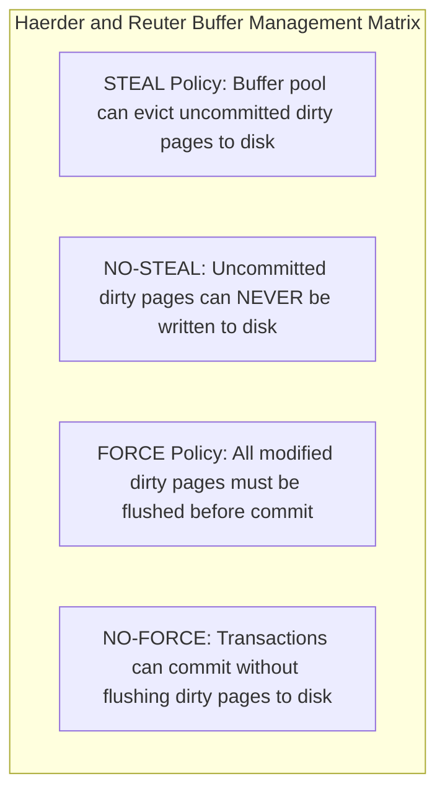
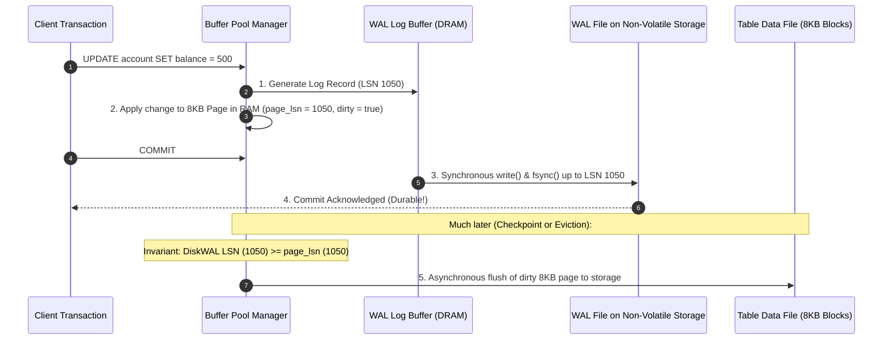
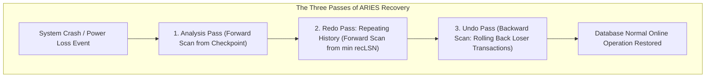
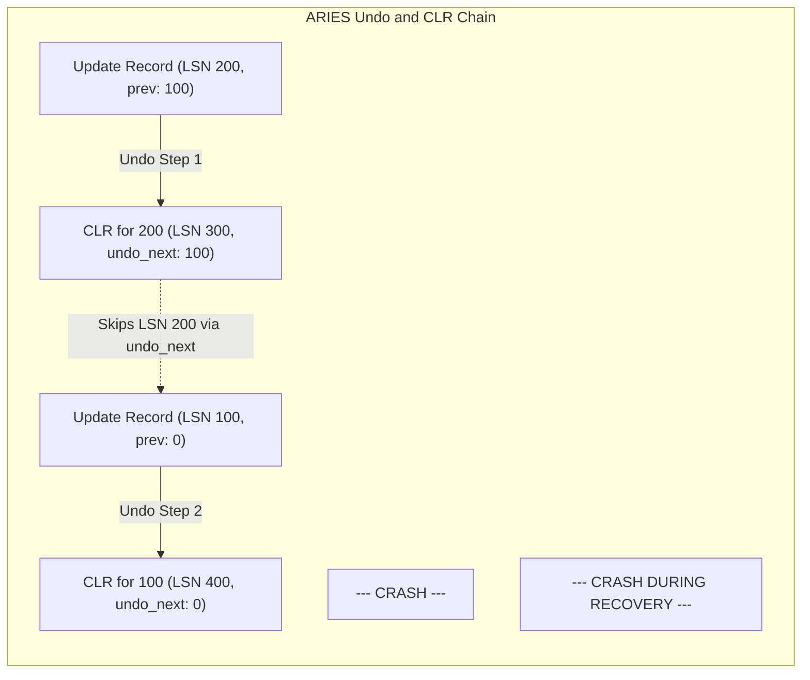
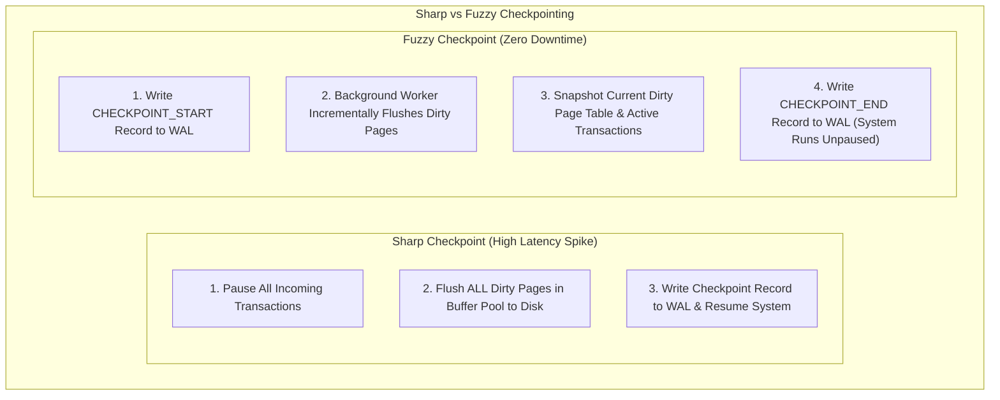
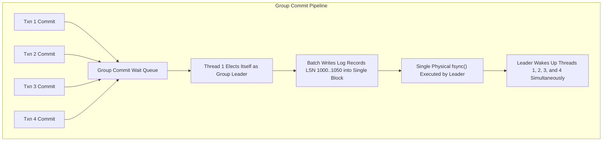

# Module 06: Durability, Write-Ahead Logging, and the ARIES Recovery Algorithm

Transactional durability requires that once a database engine acknowledges a transaction commit, its modifications must survive any subsequent operating system crash, power outage, or hardware failure. However, forcing every modified database page to physical non-volatile storage at commit time would collapse transactional throughput into an unviable cascade of random disk I/O. Modern database durability is founded upon the mathematical separation of logical change logging from physical page flushing, encapsulated in the **Write-Ahead Logging (WAL)** protocol and the canonical **ARIES recovery algorithm**.

---

## 1. Buffer Management Policies: Steal, No-Steal, Force, and No-Force

The architectural interplay between a database's Buffer Pool Manager and its Crash Recovery subsystem is governed by two orthogonal binary dimensions formulated by Haerder and Reuter (1983):

### The Four Policy Combinations

| Policy Combination | Buffer Pool Flexibility | Commit Latency & Throughput | Recovery Requirements |
| :--- | :--- | :--- | :--- |
| **No-Steal / Force** | Extremely poor (transactions limited to available buffer memory). | Terrible (every commit synchronously flushes hundreds of random 8KB pages). | **Trivial**: No Undo logging required (no uncommitted writes on disk); No Redo logging required (all committed writes already on disk). |
| **No-Steal / No-Force** | Poor (buffer frames holding uncommitted transactions cannot be evicted). | High (commits flush only sequential log records). | **Redo-Only Logging**: Committed transactions not yet on disk must be replayed upon restart. |
| **Steal / Force** | High (buffer pool can evict any unpinned frame). | Terrible (commits synchronously flush dirty pages to disk). | **Undo-Only Logging**: Active uncommitted writes flushed to disk before a crash must be rolled back. |
| **Steal / No-Force** | **Optimal**: Complete freedom to manage memory frames. | **Optimal**: Highest throughput; commits flush only compact sequential log records. | **Undo and Redo Logging (Universal Standard)**: Requires full ARIES recovery protocol. |

Every high-performance enterprise database engine (PostgreSQL, MySQL InnoDB, Oracle, Microsoft SQL Server) operates under the **Steal / No-Force** paradigm.

---

## 2. The Write-Ahead Logging (WAL) Protocol

Write-Ahead Logging ensures that modifications to database pages are recorded in a continuous, append-only sequential log file *before* those modifications are written to persistent table files.

### The Fundamental WAL Invariant

A database engine must enforce the **WAL Invariant** at all times:

$$\text{flushed\_to\_disk\_lsn} \ge \text{page\_lsn}$$

Before any dirty page in the buffer pool can be written to physical storage (whether during buffer eviction or routine background writing), the engine must verify that all WAL log records up to that page's `page_lsn` have already been written and **fsynced to persistent storage**. If this rule were violated and a crash occurred, the table file on disk would contain changes from uncommitted transactions with no corresponding log records to undo them.

### Anatomy of a WAL Record

Each WAL log record contains:
- `lsn`: 64-bit monotonically increasing Log Sequence Number.
- `prev_lsn`: Byte offset of the previous log record written by this transaction (forming a reverse singly-linked list of all actions in the transaction).
- `txn_id`: Unique transaction identifier.
- `type`: Operation identifier (`BEGIN`, `UPDATE`, `INSERT`, `DELETE`, `ABORT`, `COMMIT`, `CLR`).
- `page_id`: Physical mapping `(table_space, rel_id, block_number)`.
- `redo_data` / `undo_data`: Physiological logging payloads:
  - **Physical Logging**: Exact byte-level before-image and after-image of modified page bytes. (Guarantees idempotency but creates massive log volume).
  - **Logical Logging**: High-level procedural statements (e.g., `UPDATE accounts SET balance = balance + 10`). (Compact log size, but non-deterministic under concurrent execution).
  - **Physiological Logging (ARIES Standard)**: Physical addressing down to a specific page block, but logical operations inside the page (e.g. "insert tuple into slot 3 of page 42").

---

## 3. The ARIES Recovery Algorithm

Designed by C. Mohan at IBM Research in 1992, **ARIES** (Algorithms for Recovery and Isolation Exploiting Semantics) is the foundational crash-recovery algorithm adopted by virtually all relational database management systems.

ARIES executes crash recovery in **Three Successive Passes**:

### 1. The Analysis Pass (Reconstructing System State)
The Analysis pass scans forward through the WAL starting from the most recent **Checkpoint** record up to the end of the log (the crash boundary).
- **Objectives**:
  1. Reconstruct the **Transaction Table**: identifies all transactions that were active (uncommitted) at the moment of the crash. These transactions are classified as **Losers**.
  2. Reconstruct the **Dirty Page Table (DPT)**: tracks every page that was modified in memory but not yet flushed to disk. For each dirty page, the DPT records its `rec_lsn` (the earliest LSN that dirtied the page).
  3. Determine the minimum `rec_lsn` across all pages in the DPT ($\min(\text{rec\_lsn})$), which marks the exact starting point for the subsequent Redo pass.

### 2. The Redo Pass ("Repeating History")
The Redo pass scans forward through the WAL from $\min(\text{rec\_lsn})$ all the way to the end of the log.
- **The "Repeating History" Principle**: ARIES re-executes the actions of **all transactions**—including transactions that later aborted, and transactions that were active losers when the crash occurred! This restores the exact physical byte state of the database to the precise millisecond preceding the crash.
- **Idempotency Check**: To avoid re-applying changes already present in pages flushed before the crash, the engine compares the log record's `lsn` with the page's on-disk `page_lsn`:
  - If $\text{page\_lsn} \ge \text{record\_lsn}$, the modification is already present on disk; **the log record is skipped**.
  - If $\text{page\_lsn} < \text{record\_lsn}$, the engine reapplies the redo action and sets $\text{page\_lsn} = \text{record\_lsn}$.

### 3. The Undo Pass (Rolling Back Loser Transactions)
The Undo pass scans backward through the WAL, reversing the mutations of all active loser transactions identified during the Analysis pass.
- **Compensation Log Records (CLRs)**:
  - When the engine undoes an action, it writes a special **Compensation Log Record (CLR)** to the WAL and fsyncs it.
  - The CLR records the undo action and stores an `undo_next_lsn` pointer copying the `prev_lsn` of the undone record.
  - **The Invariant of CLRs**: **CLRs are NEVER undone**. If the server crashes *during* recovery, the subsequent recovery cycle will read the CLR, follow `undo_next_lsn`, and bypass already-undone actions. This mathematically guarantees that recovery will never enter an infinite loop of crashing and re-undoing.

---

## 4. Checkpointing Mechanisms: Sharp versus Fuzzy Checkpoints

If recovery had to scan the WAL from the beginning of cluster creation, crash recovery would require hours or days. Checkpointing limits the volume of WAL replayed during recovery.

### 1. Sharp Checkpoints
- The engine pauses all incoming client queries, flushes every dirty buffer frame to physical storage, and writes a checkpoint marker.
- *Problem*: In a 512GB buffer pool with 40GB of dirty pages, flushing everything creates a catastrophic 30-second I/O freeze.

### 2. Fuzzy Checkpoints (Modern Standard)
- The engine initiates a checkpoint without halting client transactions.
- A background worker (`checkpointer`) flushes dirty pages gradually over minutes, paced to smooth out disk write bandwidth.
- The checkpoint record written to the WAL stores the current snapshot of the Dirty Page Table and active Transaction Table. Recovery starts from the LSN of the checkpoint start, scanning only a bounded window of log segments.

---

## 5. Group Commit and Torn Page Protection

### Group Commit Optimization
Under high-concurrency OLTP, if 500 concurrent threads each call `fsync()` on their individual transaction commit, the disk controller is overwhelmed with 500 independent write-barrier stalls.

- When thread $T_1$ arrives to commit, it registers as the **Group Leader**.
- Threads $T_2, T_3, T_4$ arriving milliseconds later queue as followers.
- The leader thread issues a single batched `write()` and a single `fsync()` covering the log records of all queued transactions, and subsequently wakes up all follower threads. This transforms thousands of random sync stalls into high-throughput pipelined sequential writes.

### Torn Page Protection
Operating systems and storage hardware write data in physical sectors (typically 512 bytes or 4KB). A database page is typically 8KB or 16KB.
- If power fails in the middle of writing an 8KB block (e.g. after the first 2KB are written), the page on disk contains a mixture of old and new bytes—a **torn page**. Because the page is physically corrupt, standard block checksums fail, and ARIES physiological redo logging cannot be applied (since redo expects a structurally valid page).
- **PostgreSQL Full Page Images (FPI)**: Upon the first modification of any page after a checkpoint, PostgreSQL writes the **entire 8KB page snapshot** into the WAL stream. If a torn page occurs, recovery restores the full page image from the WAL before replaying subsequent delta records.
- **MySQL Doublewrite Buffer**: InnoDB writes dirty pages to a contiguous sequential disk area (the doublewrite buffer) and flushes it *before* writing pages to their actual data files.

---

## 6. Then vs Now: Crash Recovery Paradigms

| Dimension | Classical Paradigm (1970–1980s) | Enterprise Modern (1990–2010s) | Cloud-Native Decoupled (2020s–Present) |
| :--- | :--- | :--- | :--- |
| **Recovery Strategy** | Shadow paging (System R) or simple rollback journals | Steal/No-Force with ARIES (Analysis, Redo, Undo) | "The Log is the Database" (AWS Aurora, Neon, PolarDB) |
| **Logging Scope** | Physical before/after image of entire tables | Physiological page-level WAL logging | Log-structured distributed storage; compute nodes generate WAL, storage re-applies asynchronously |
| **Checkpointing** | Sharp checkpoints causing visible application pauses | Fuzzy checkpointing with background pacing | Continuous LSN checkpointing in distributed storage layers |
| **Torn Page Safety** | Hardware battery-backed RAID controller caches | Full Page Images (WAL) or Doublewrite Buffers | Erasure-coded distributed log streams with page reconstruction |

---

## 7. Production Failure Modes and Anti-Patterns

### 1. WAL Disk Saturation Cascade
- **Symptom**: Database engine suddenly halts all write transactions, logging fatal `PANIC: could not write to log file: No space left on device`.
- **Root Cause**: WAL segments accumulate without being recycled. Common culprits include: an abandoned replication slot retaining WAL indefinitely, failed WAL archiving (`archive_command` failing due to remote S3 bucket permissions), or massive uncheckpointed bulk imports.
- **Mitigation**: Configure safety thresholds like `max_slot_wal_keep_size`; monitor disk free space alerts; implement fallback archiving queues.

### 2. Checkpoint Spikes and I/O Latency Cliffs
- **Symptom**: P99 transaction write latency spikes from $2\text{ ms}$ to $500\text{ ms}$ precisely every 5 minutes.
- **Root Cause**: Checkpoints configured with aggressive or bursty write policies (`checkpoint_completion_target` set too low, e.g. 0.1). The checkpointer flushes all dirty pages in a massive burst at the start of the checkpoint interval, saturating SSD write queues.
- **Mitigation**: Spread checkpoint writing evenly across the entire duration by setting `checkpoint_completion_target = 0.9`.

### 3. Disabling Full Page Writes for "Performance"
- **Symptom**: Database crashes after an unexpected power outage and fails to restart, reporting `FATAL: invalid page header in block 4128 of relation base/16384/2659`.
- **Root Cause**: An administrator disabled `full_page_writes` in configuration to reduce WAL generation volume. When power was lost, the drive suffered a torn page write. Because no Full Page Image exists in the WAL, crash recovery cannot reconstruct the page.
- **Mitigation**: Never disable `full_page_writes` in production unless operating on battery-backed RAID controllers with guaranteed atomic sector write hardware.

---

## 8. Interview Drill

<strong>Q1: Define the Steal and No-Force buffer pool management policies and explain why modern DBMS architectures universally adopt them.</strong>

**Answer:** 
- **Steal Policy**: Allows the buffer manager to evict dirty, unpinned pages belonging to uncommitted active transactions to non-volatile disk storage in order to free memory frames for other transactions.
- **No-Force Policy**: Permits a transaction to commit without requiring all of its modified dirty data pages to be flushed to disk at commit time; only its sequential log records must be flushed.

Modern databases adopt **Steal / No-Force** because it maximizes both memory efficiency and write throughput:
1. *Steal* ensures that long-running transactions with large working sets are not artificially limited by the physical size of RAM.
2. *No-Force* eliminates the catastrophic latency penalty of synchronously writing hundreds of scattered, random 8KB pages across storage for every commit. The trade-off is recovery complexity: Steal requires **Undo logging** (to roll back uncommitted changes written to disk), and No-Force requires **Redo logging** (to re-apply committed changes that were still in memory during a crash).

<strong>Q2: Walk through the three passes of the ARIES recovery algorithm and state the specific purpose of each pass.</strong>

**Answer:** 
The three passes of ARIES are:
1. **Analysis Pass**: Scans forward from the last checkpoint to the end of the log. It reconstructs the **Transaction Table** (identifying active loser transactions at crash) and the **Dirty Page Table** (identifying dirty pages and calculating $\min(\text{rec\_lsn})$ where Redo must start).
2. **Redo Pass ("Repeating History")**: Scans forward from $\min(\text{rec\_lsn})$ to the end of the log. It reapplies the modifications of *all* transactions (both committed and uncommitted) to restore the exact physical database state preceding the crash. It uses page LSNs to make redo operations strictly idempotent.
3. **Undo Pass**: Scans backward from the end of the log, reversing the updates of all loser transactions identified in Analysis. For every undone action, it writes a Compensation Log Record (CLR) to ensure that undo actions are never repeated if the system crashes again during recovery.

<strong>Q3: What is a Compensation Log Record (CLR) in ARIES, and what critical guarantee does it provide during recursive crashes?</strong>

**Answer:** 
A Compensation Log Record (CLR) is a WAL record written during the Undo pass when an operation performed by an aborted or loser transaction is rolled back. 

A CLR contains a critical field called **`undo_next_lsn`**, which points to the `prev_lsn` of the log record that was just undone. The fundamental rule of CLRs is: **CLRs are never undone**. 

If the database crashes *during the recovery process itself*, the subsequent restart recovery re-executes Analysis and Redo, but during the Undo pass, when it encounters a CLR, it immediately jumps to the record specified by `undo_next_lsn`, completely skipping already-undone work. This guarantees that recovery progress is strictly monotonic and **never enters an infinite recovery crash loop**.

<strong>Q4: Explain how Group Commit resolves the throughput bottleneck of physical `fsync()` calls on transactional storage.</strong>

**Answer:** 
Under high-concurrency workloads, if every committing transaction thread independently issues `fsync()` on the WAL file, the storage controller is overwhelmed by write-barrier stalls, capping commit throughput at the physical drive's IOPS limit (e.g. 500–1000 syncs/sec).

**Group Commit** resolves this via leader-follower coordination:
1. The first thread attempting to commit becomes the **Group Leader**.
2. Concurrent threads attempting to commit during the flush window are registered as **Followers** and wait on a condition variable.
3. The leader thread issues a single batched `write()` and a single `fsync()` covering the combined WAL records of the leader and all followers.
4. Once `fsync()` completes, the leader signals all followers, and all transactions return commit success simultaneously. This amortizes disk synchronization latency over dozens of concurrent transactions.

<strong>Q5: What is a "Torn Page", why does it break physiological WAL recovery, and how does PostgreSQL prevent it?</strong>

**Answer:** 
A torn page occurs when power fails or an OS crashes while the storage system is writing a database page (e.g. 8KB) composed of multiple smaller physical disk sectors (e.g. 512B or 4KB). The resulting block on disk contains a corrupt mixture of old and new data bytes.

Torn pages break physiological WAL logging because physiological logging assumes the page is structurally valid (that page headers, slot offsets, and line pointers are intact) so that logical updates can be applied inside the block. 

PostgreSQL prevents torn-page corruption via **Full Page Images (FPI)**: upon the first modification of any page after a checkpoint, PostgreSQL writes a complete 8KB snapshot of the page into the WAL stream. During crash recovery, if an 8KB block is torn, the recovery engine restores the complete pristine 8KB image from the WAL before replaying subsequent delta log records.

<strong>Q6: How does a Fuzzy Checkpoint differ from a Sharp Checkpoint, and how does it avoid freezing transactional query processing?</strong>

**Answer:** 
A **Sharp Checkpoint** halts all active transactions, flushes every dirty buffer frame in memory to disk, writes a checkpoint marker, and resumes transactions. This causes severe, multi-second application latency spikes on systems with large buffer pools.

A **Fuzzy Checkpoint** does not flush all dirty pages synchronously:
1. It writes a `CHECKPOINT_START` record to the WAL, noting the current LSN.
2. A background checkpointer process flushes dirty pages gradually over a long, tuned interval, smoothing out disk I/O bandwidth without pausing client transactions.
3. Once all pages that were dirty at `CHECKPOINT_START` have reached disk, the engine snapshots the current Dirty Page Table and active Transaction Table and writes a `CHECKPOINT_END` record.

Recovery begins at the `CHECKPOINT_START` LSN, ensuring durability while eliminating transaction latency pauses.

