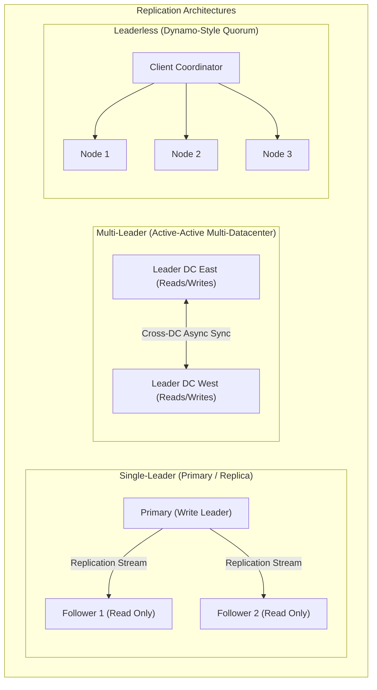
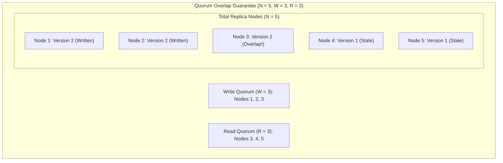
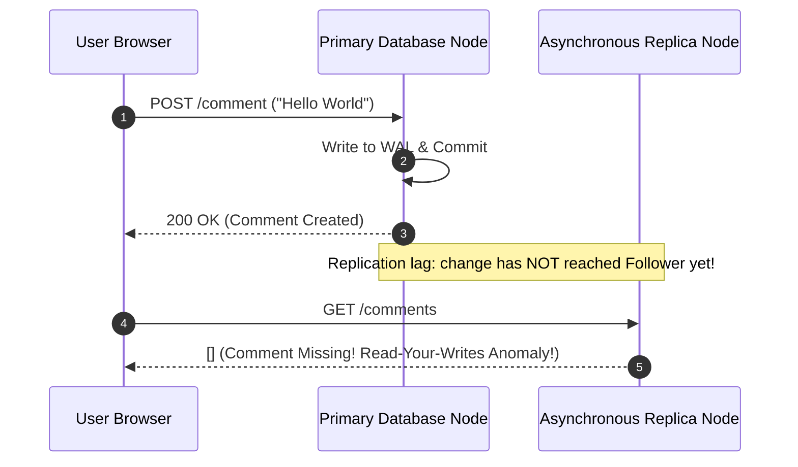
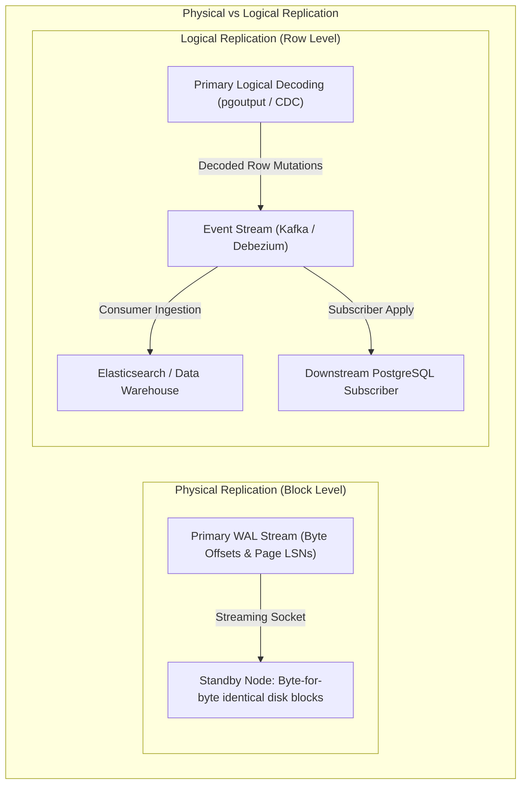
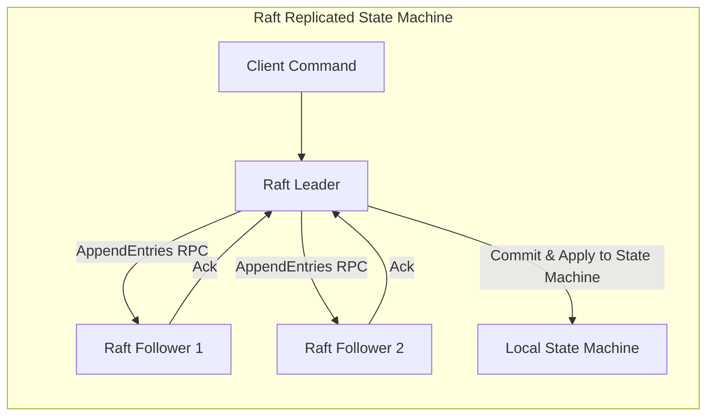
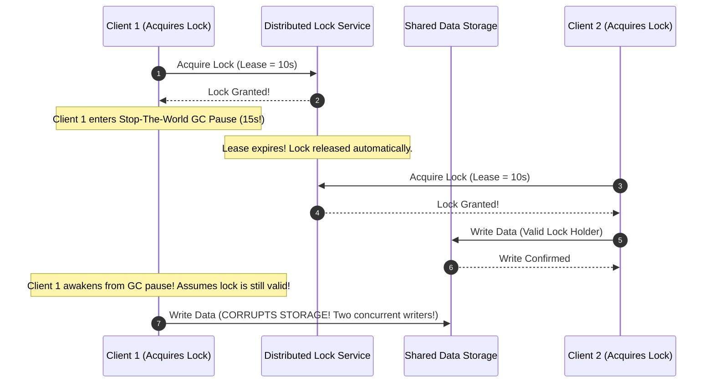

# Module 07: Replication Topologies, Quorum Mechanics, and Distributed Consensus

Replication is the practice of maintaining copies of the same data across multiple distinct physical nodes connected via a network. Data systems replicate information for three primary architectural reasons: **high availability** (ensuring the system continues serving queries if one or more hardware machines fail), **latency reduction** (placing data geographically proximate to end users), and **read scale-out** (distributing query load across multiple replica nodes). However, because network links are fundamentally asynchronous and subject to variable delays, packet loss, and partitions, replication introduces profound consistency trade-offs.

---

## 1. Replication Architectures: Single-Leader, Multi-Leader, and Leaderless

### 1. Single-Leader Replication (Leader / Follower)
- **Role Separation**: All write mutations (`INSERT`, `UPDATE`, `DELETE`) are directed exclusively to a single designated node: the **Primary (Leader)**. The leader writes changes to its local storage and streams change records to **Followers (Replicas)**.
- **Read Distribution**: Read queries can be executed against any replica, providing horizontal read scalability.
- **Limitation**: The single leader is an architectural bottleneck for write throughput. If the leader fails, the cluster must execute a leader election before writes can resume.

### 2. Multi-Leader Replication (Active-Active)
- **Mechanics**: Multiple nodes concurrently accept client write operations, typically distributed across distinct geographical data centers to ensure sub-millisecond local write latencies.
- **The Conflict Resolution Dilemma**: If user Alice updates a profile on Leader US-East while user Bob updates the same profile on Leader EU-West concurrently, both writes succeed locally. When changes replicate asynchronously across the Atlantic, the cluster encounters a **write-write conflict**.
  - **Last-Write-Wins (LWW)**: Orders writes using physical wall-clock timestamps (NTP). High risk of silent data loss due to clock skew.
  - **Conflict-Free Replicated Data Types (CRDTs)**: Mathematically structured data types (e.g. PN-Counters, Observed-Removed Sets) whose merge operators are commutative, associative, and idempotent ($A \cup B = B \cup A$).

### 3. Leaderless Replication (Dynamo-Style Quorums)
- **Pioneered by Amazon Dynamo (2007)** (Apache Cassandra, ScyllaDB, Amazon DynamoDB).
- Clients write directly to multiple replica nodes in parallel without any centralized coordinator node acting as a single leader.

---

## 2. Quorum Consensus Mathematics: $W + R > N$

In a leaderless system configured with replication factor $N$ (the total number of replica nodes storing a given key), client operations specify write and read quorums:

### The Strict Quorum Condition

To guarantee that every read operation observes the most recent committed write:

$$W + R > N$$

Where:
- $N$ is the replication factor.
- $W$ is the write quorum (the number of positive acknowledgments required for a write to be considered committed).
- $R$ is the read quorum (the number of replica nodes queried in parallel during a read).

By the **Pigeonhole Principle**, any subset of size $W$ and any subset of size $R$ must intersect in at least one node:

$$\text{Overlap} = (W + R) - N \ge 1$$

At least one node in the read set is guaranteed to possess the most up-to-date version of the record. The client compares timestamps or version vectors across the $R$ responses and selects the highest version.

### Read Repair and Anti-Entropy

Leaderless engines maintain replica consistency through two background mechanisms:
1. **Read Repair**: When a client issues a quorum read ($R = 3$) and observes that Node 1 and Node 2 return version 5 while Node 3 returns stale version 4, the client (or coordinator) serves version 5 to the application and asynchronously sends an update to Node 3 to write version 5.
2. **Sloppy Quorums and Hinted Handoff**: If a network partition isolates several primary replica nodes, the system accepts writes by storing temporary "hints" on reachable non-designated neighbor nodes. Once the network partition heals, the neighbor forwards the hinted writes back to the primary replicas.

---

## 3. Replication Lag Anomalies

Under asynchronous or semi-synchronous replication, replicas trail behind the primary. Applications reading from replicas encounter three canonical consistency anomalies:

### 1. Read-Your-Writes Consistency (Monotonic Write Consistency)
- **Anomaly**: A user updates their profile, reloads the page, and observes their old profile data because the read request was routed to a replica that has not yet replayed the replication stream.
- **Mitigation Techniques**:
  - Route read requests for recently updated entities to the **Primary** for a fixed window (e.g. 10 seconds).
  - Track the primary's commit Log Sequence Number ($LSN_{\text{commit}}$) in a client session cookie. Replicas evaluate `WAIT FOR LSN $LSN_{\text{commit}}$` before executing the query.

### 2. Monotonic Reads
- **Anomaly**: A user reads comments, seeing comment 5 from Replica A. The user refreshes the page; the load balancer routes the request to Replica B, which has greater replication lag. Comment 5 disappears! The user experiences time traveling backward.
- **Mitigation**: Bind each user session to a single replica using consistent hashing on user ID.

### 3. Consistent Prefix Reads
- **Anomaly**: In a sharded or distributed database, causal relationships between writes are broken. If Alice asks a question on Shard 1 and Bob answers on Shard 2, an observer reading from async replicas might observe Bob's answer *before* Alice's question.
- **Mitigation**: Enforce global Lamport/HLC causal ordering timestamps or co-locate causally related entities within the same replication partition.

---

## 4. Physical versus Logical Replication and Change Data Capture (CDC)

### Comparative Analysis

1. **Physical Streaming Replication**:
   - Replicates exact physical disk page mutations and byte-level WAL records.
   - *Advantages*: Extremely low CPU overhead; absolute binary consistency; zero schema translation.
   - *Disadvantages*: The standby must run the identical major database version, architecture, and operating system; standby nodes are strictly read-only; cannot replicate a single table or filter columns.
2. **Logical Replication & Change Data Capture (CDC)**:
   - Evaluates WAL records through a logical decoding plugin, converting internal physical storage structures into clean row modification events (`INSERT {id: 1, name: 'Alice'}`).
   - *Advantages*: Replicates across heterogeneous major versions; permits selective per-table subscriptions; drives real-time event streaming architectures (Debezium $\to$ Kafka).
   - *The Transactional Outbox Pattern*: Eliminates dual-write vulnerabilities between a database and message queues by writing events to an `outbox` database table within the local ACID transaction, relying on CDC to tail the WAL and publish to brokers.

---

## 5. Distributed Consensus: Paxos, Raft, and Distributed Lock Warnings

To manage leader election, automated failover, and membership changes in distributed databases without risking catastrophic split-brain state, systems rely on **Distributed Consensus Protocols**.

### Consensus Guarantees and Mechanics (Paxos / Raft)
- **The Quorum Invariant**: In an $N$-node cluster, progress requires a majority quorum of:

$$\text{Quorum} = \left\lfloor \frac{N}{2} \right\rfloor + 1$$

A 3-node cluster tolerates 1 node failure; a 5-node cluster tolerates 2 node failures.
- **Split-Brain Prevention**: Because two majorities in any cluster of size $N$ must share at least one node ($\lfloor N/2 \rfloor + 1 + \lfloor N/2 \rfloor + 1 > N$), a partitioned cluster can elect a leader in at most *one* network component. The minority component cannot establish quorum and halts writes.

### Martin Kleppmann's Critique of Distributed Locks (The Redlock Flaw)
Many architectures attempt to coordinate distributed systems using simple locks in shared key-value stores (e.g. Redis Redlock). In 2016, Martin Kleppmann demonstrated why distributed locks without **fencing tokens** are mathematically unsafe:

### The Solution: Monotonic Fencing Tokens
To ensure correctness, the lock service must return a strictly monotonically increasing **fencing token** (a counter incremented with each grant: e.g. Token 42, Token 43). The underlying storage system rejects any write presenting a fencing token lower than the highest token it has already processed. When Client 1 awakens from its GC pause and submits Token 42, the storage layer rejects the write because it has already accepted Token 43 from Client 2.

---

## 6. Then vs Now: Replication Evolution

| Dimension | Classical Paradigm (1980–1990s) | Modern Pre-Cloud (2000–2010s) | Modern Distributed State-of-the-Art (2020s–Present) |
| :--- | :--- | :--- | :--- |
| **Failover Control** | Manual operator intervention using VIPs | Heartbeat scripts (Keepalived, Corosync) prone to split-brain | Consensus-driven automated orchestrators (Patroni + etcd, Raft) |
| **Replication Stream** | Batch log shipping (copying 16MB WAL files) | Continuous network streaming of physical blocks | Native multi-Paxos/Raft log consensus baked directly into storage engines |
| **Multi-Master** | Fragile two-phase commit over synchronous 2PL | Unchecked async multi-master with high conflict rates | Spanner TrueTime synchronized commit timestamps and CRDTs |
| **Data Pipelines** | Heavy periodic ETL batch database dumps | Custom polling queries (`WHERE updated_at > ...`) | Zero-impact Change Data Capture (CDC via Debezium/Kafka) |

---

## 7. Production Failure Modes and Anti-Patterns

### 1. Split-Brain Write Corruption
- **Symptom**: Network between two data centers flaps; both instances assume they are Primary, accept distinct writes from local clients, and diverge permanently.
- **Root Cause**: Implementing automated failover without a strict distributed consensus quorum (e.g. running 2 nodes without an external tie-breaking witness/DCS).
- **Mitigation**: Deploy a minimum of 3 nodes across distinct failure domains governed by an odd-numbered consensus store (etcd/Consul via Patroni).

### 2. Cascading Failover Replication Lag Meltdown
- **Symptom**: Primary database crashes; automated failover promotes a replica. Within 60 seconds, the new primary crashes, followed by the remaining replica.
- **Root Cause**: The promoted replica was trailing behind the primary by 10 minutes of replication lag. Applications immediately saturated the new primary with missing-data error cascades and re-executed write storms, driving CPU and disk queues to exhaustion.
- **Mitigation**: Configure failover orchestrators to reject promoting replicas whose replication lag exceeds strict thresholds (`maximum_lag_on_failover`).

### 3. Unbounded WAL Disk Bloat via Inactive Replication Slots
- **Symptom**: Primary database disk usage reaches $100\%$, triggering an immediate crash.
- **Root Cause**: A logical replication slot or standby slot was created for a replica or CDC pipeline that subsequently disconnected or was decommissioned. PostgreSQL retains all WAL segments on the primary to prevent the slot from falling behind.
- **Mitigation**: Configure safety ceiling limits: `max_slot_wal_keep_size = 50GB`.

---

## 8. Interview Drill

<strong>Q1: Prove mathematically why a leaderless quorum system with $W + R > N$ guarantees that a read operation observes the latest committed write.</strong>

**Answer:** 
Let $S_{\text{write}}$ be the set of nodes that acknowledge a successful write operation ($|S_{\text{write}}| = W$). Let $S_{\text{read}}$ be the set of nodes queried during a read operation ($|S_{\text{read}}| = R$). Both sets are subsets of the total replica set $S$ of size $N$.

According to the Pigeonhole Principle, if the sum of the cardinalities of two subsets of a universal set exceeds the cardinality of the universal set:

$$|S_{\text{write}}| + |S_{\text{read}}| > |S| \implies W + R > N$$

Then their intersection must contain at least one node:

$$S_{\text{write}} \cap S_{\text{read}} \ne \emptyset$$

Therefore, at least one node in the read set is guaranteed to belong to the write set that acknowledged the latest write. Because every write is tagged with a monotonically increasing version number or timestamp, the client evaluates all responses and selects the highest version, guaranteeing strong read-your-writes consistency.

<strong>Q2: Explain the Read-Your-Writes consistency anomaly and outline two production mitigations in a single-leader read-replica architecture.</strong>

**Answer:** 
The **Read-Your-Writes anomaly** occurs when a client writes data to the primary database, receives a commit acknowledgment, immediately issues a read query, and fails to observe its own write. This occurs because the read query was routed to an asynchronous read replica that is trailing behind the primary due to replication lag.

Two production mitigations:
1. **Time-Based Primary Routing**: When a client performs a write, the application session records the timestamp. For a bounded window (e.g. 5–10 seconds), all subsequent read queries from that specific user session are routed to the **Primary** database instead of read replicas.
2. **LSN-Based Replica Synchronization**: The primary returns its current Log Sequence Number ($LSN_{\text{commit}}$) to the client upon commit. When the client issues a read query to a replica, it passes this LSN. The client driver or database engine pauses execution until the replica has replayed the WAL up to that target LSN (e.g. PostgreSQL 19 `WAIT FOR LSN`).

<strong>Q3: Why are distributed locks implemented via Redis Redlock unsafe without fencing tokens, as demonstrated by Martin Kleppmann?</strong>

**Answer:** 
Redlock assumes that locks have physical expiration timeouts (leases, e.g. 10 seconds). In real-world computing environments, processes experience **asynchronous pauses** beyond application control: long garbage collection Stop-The-World pauses, page faults, CPU throttling, or network delays.

If Client 1 acquires a lock, pauses during a 15-second GC pause, its lock lease expires in Redis. Client 2 then acquires the exact same lock and begins writing to shared storage. When Client 1 awakens from its pause, it falsely assumes its lock is still valid and issues its write, corrupting data because two clients write concurrently without mutual exclusion.

A **fencing token** resolves this: the lock service returns a strictly monotonically increasing counter with every lock grant. Storage rejects any write carrying a token lower than the highest token it has already processed, safely blocking Client 1's stale write.

<strong>Q4: Contrast physical streaming replication with logical replication in terms of operational flexibility and performance.</strong>

**Answer:** 
- **Physical Streaming Replication**: Streams byte-for-byte binary WAL records to standbys, ensuring the replica's disk layout is an exact clone of the primary.
  - *Pros*: Extremely low CPU overhead; absolute fidelity; fast apply rates.
  - *Cons*: Standby must run the identical major version and OS architecture; standby is strictly read-only; cannot replicate a subset of tables.
- **Logical Replication**: Decodes WAL records into logical row mutations (`INSERT`, `UPDATE`, `DELETE`) and streams events via publish/subscribe.
  - *Pros*: Replicates across major versions (enabling zero-downtime upgrades); supports selective table replication; allows subscribers to maintain independent local indexes and write to local tables.
  - *Cons*: Higher CPU overhead for encoding/decoding; conflict management overhead; cannot replicate schema DDL changes natively.

<strong>Q5: What is the Transactional Outbox pattern, and why is it essential when microservices publish database changes to Kafka?</strong>

**Answer:** 
The Transactional Outbox pattern solves the **dual-write problem**: if an application attempts to write to a relational database and publish an event to a Kafka broker in two separate network calls, a crash between the two operations leaves the system in an inconsistent state (either the database committed but the event was lost, or the event was published but the database rolled back).

In the Outbox pattern:
1. The application writes both the business entity update AND an event message into an `outbox` table in the database **within the same atomic ACID transaction**.
2. A Change Data Capture (CDC) engine (such as Debezium) tails the database's Write-Ahead Log, reads the committed outbox events, and publishes them reliably to the message broker.

This guarantees that messages are published if and only if the database transaction commits, achieving at-least-once message delivery without distributed 2PC transactions.

<strong>Q6: How does Raft consensus prevent split-brain state during a network partition?</strong>

**Answer:** 
Raft prevents split-brain by requiring that any valid leader election and any log commitment must receive positive votes from a **strict majority quorum** of the total configured cluster nodes:

$$\text{Quorum} = \left\lfloor \frac{N}{2} \right\rfloor + 1$$

If a 5-node cluster is partitioned into a 3-node partition and a 2-node partition:
- In the 3-node partition, candidates can achieve a majority ($3 \ge 3$) and elect a single leader.
- In the 2-node partition, candidates can achieve at most 2 votes ($2 < 3$), failing to achieve quorum. No leader can be elected.

Because two majorities must always overlap by at least one node, it is mathematically impossible for two independent leaders to be elected simultaneously, preventing split-brain write divergence.

